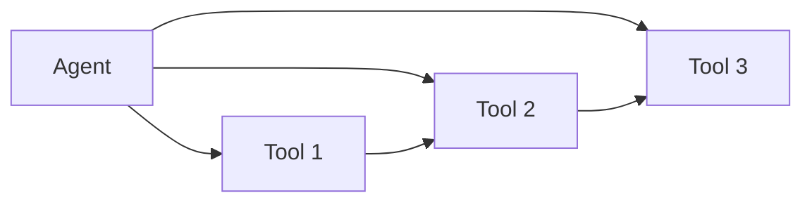
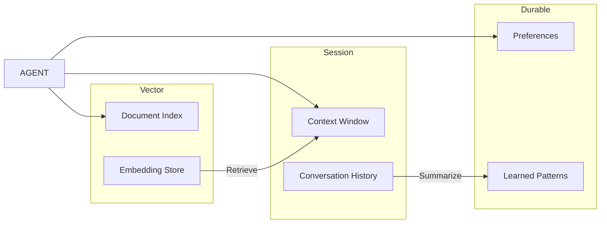
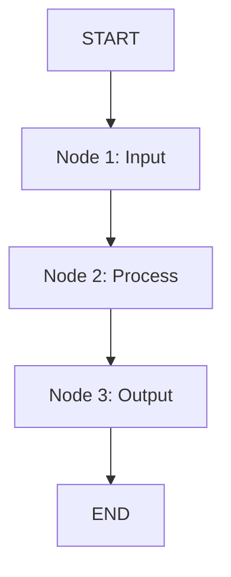
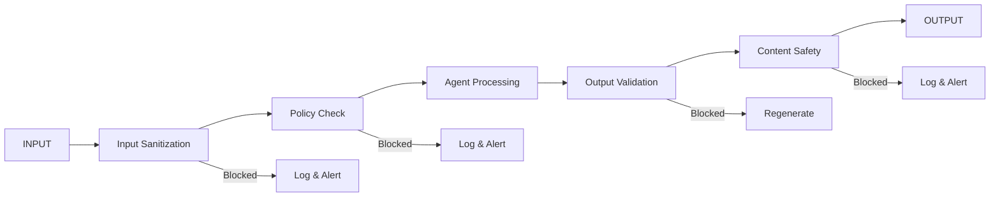
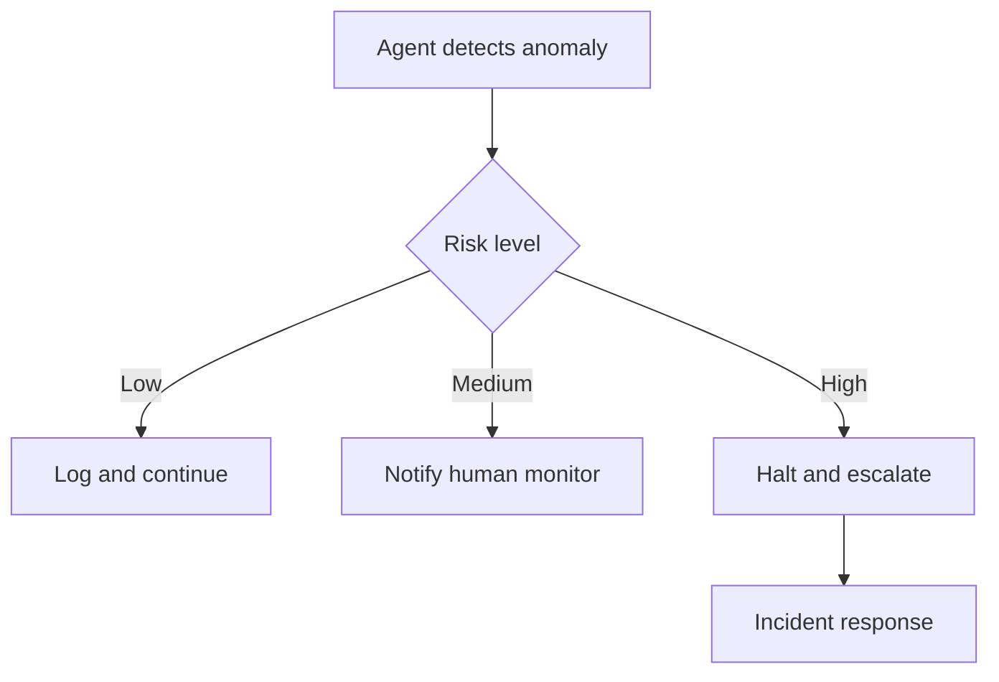
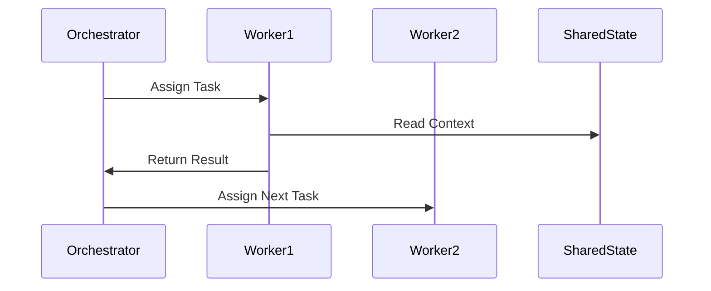
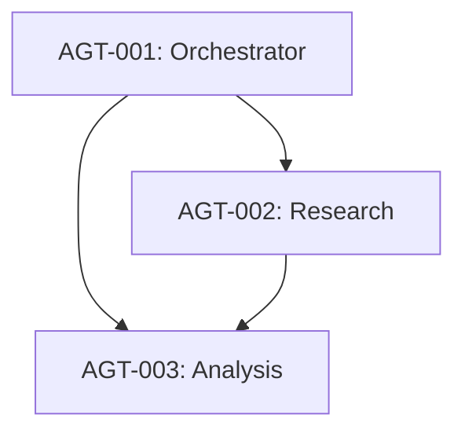
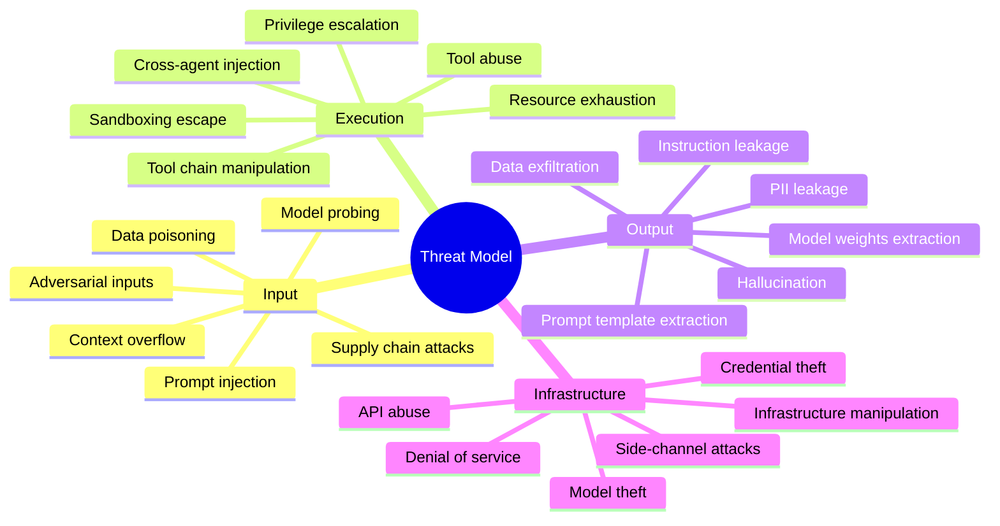
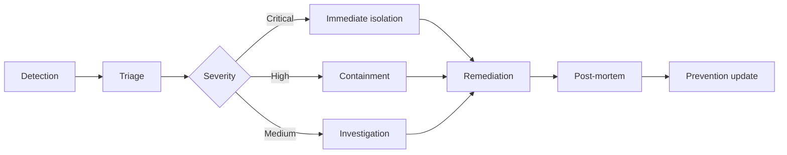

<!-- arckit-overlay-template: agent-design-template.md -->

---
title: "Agent Architecture Specification"
docType: AAGR
templateVersion: "1.0"
---

# Agent Architecture Specification

## Document Control

<!-- DOC-CONTROL-HEADER -->
<!-- Resolved at command-execution time per _partials/RENDERING.md. -->

## Revision History

| Version   | Date   | Author    | Changes                                              | Approved By | Approval Date |
| --------- | ------ | --------- | ---------------------------------------------------- | ----------- | ------------- |
| [VERSION] | [DATE] | ArcKit AI | Initial creation from `/arckit:agent-design` command | [PENDING]   | [PENDING]     |

---

## 1. Agent Architecture Overview

### 1.1 Architecture Pattern

| Pattern      | Description            | When to Use                        |
| ------------ | ---------------------- | ---------------------------------- |
| Single Agent | [Description]          | [Simple tasks, single domain]      |
| Chain        | [Sequential pipeline]  | [Multi-step reasoning]             |
| Multi-Agent  | [Parallel workers]     | [Complex domains, parallelization] |
| Hierarchical | [Supervisor + workers] | [Coordinated multi-agent]          |

**Selected Pattern**: [Pattern name]

**Justification**: [Why this pattern was chosen over alternatives, with
reference to requirements and domain complexity]

### 1.2 Component Diagram

```mermaid
C4Component
    title Agent Architecture — Component Diagram
    Person(user, "User", "End user")
    System_Boundary(agent, "[Agent Name]")
        Component(llm, "LLM Core", "[Model]")
        Component(tools, "Tool Layer", "[MCP servers]")
        Component(memory, "Memory", "[Session/Durable/Vector]")
        Component(guardrails, "Guardrails", "[Safety layer]")
    Rel(user, llm, "Sends prompts")
    Rel(llm, tools, "Calls tools")
    Rel(llm, memory, "Reads/writes")
    Rel(llm, guardrails, "Subject to")
```

### 1.3 Agent Capabilities

| Capability | Description   | Priority            |
| ---------- | ------------- | ------------------- |
| [C-001]    | [Description] | [Must/Should/Could] |
| [C-002]    | [Description] | [Must/Should/Could] |
| [C-003]    | [Description] | [Must/Should/Could] |

### 1.4 LLM Configuration

| Setting            | Value                    | Rationale                             |
| ------------------ | ------------------------ | ------------------------------------- |
| **Model**          | [Model name and version] | [Why this model]                      |
| **Temperature**    | [0.0 – 1.0]              | [Balancing creativity vs determinism] |
| **Max Tokens**     | [Number]                 | [Output length constraint]            |
| **Context Window** | [Tokens]                 | [Memory capacity requirement]         |

---

## 2. Tool Contracts

| Tool ID | Name   | Type                | Permissions          | Input Schema | Output Schema |
| ------- | ------ | ------------------- | -------------------- | ------------ | ------------- |
| T-001   | [Name] | [MCP/REST/Function] | [Read/Write/Execute] | [Schema]     | [Schema]      |

### 2.1 Tool Details

#### T-001: [Tool Name]

**Type**: [MCP / REST / Function Call / Database]

**Permissions**: [Read / Write / Execute / Admin]

**Description**: [What this tool does and why the agent needs it]

**Input Schema**:

```json
{
  "type": "object",
  "properties": {
    "[parameter]": {
      "type": "[string/number/object]",
      "description": "[Description]",
      "required": [true/false]
    }
  }
}
```

**Output Schema**:

```json
{
  "type": "object",
  "properties": {
    "[result]": {
      "type": "[string/number/object]",
      "description": "[Description]"
    }
  }
}
```

**Error Handling**: [How the agent handles tool failures, retries, timeouts]

**Rate Limits**: [Request limits, burst limits, quotas]

### 2.2 Tool Dependency Graph



---

## 3. Memory Architecture

| Layer   | Type       | Storage     | Retention      | Access     |
| ------- | ---------- | ----------- | -------------- | ---------- |
| Session | Ephemeral  | In-memory   | Session only   | Read/Write |
| Durable | Persistent | [DB]        | [Indefinite]   | Read/Write |
| Vector  | Semantic   | [Vector DB] | [Configurable] | Search     |

### 3.1 Session Memory

**Purpose**: Short-term context within a single conversation

**Storage**: In-memory context window

**Capacity**: [Max tokens/messages in context window]

**Scope**: Single session, cleared on disconnect

**Access Pattern**: LRU eviction when context limit reached

### 3.2 Durable Memory

**Purpose**: Cross-session persistence of preferences, decisions, and learned
behaviors

**Storage**: [Database technology — e.g., SQLite, PostgreSQL, Redis]

**Schema**:

| Field        | Type      | Description                  |
| ------------ | --------- | ---------------------------- |
| `id`         | UUID      | Unique memory entry          |
| `agent_id`   | String    | Agent this memory belongs to |
| `key`        | String    | Memory key/label             |
| `value`      | JSON      | Memory content               |
| `created_at` | Timestamp | When stored                  |
| `updated_at` | Timestamp | Last modified                |
| `expires_at` | Timestamp | TTL or null for permanent    |

**Retention Policy**: [e.g., 90 days, indefinite, user-controlled]

### 3.3 Vector Memory

**Purpose**: Semantic search and retrieval of relevant information

**Storage**: [Vector database — e.g., Chroma, Pinecone, Weaviate]

**Embedding Model**: [Model name and dimensions]

**Index Type**: [HNSW / IVF / Flat]

**Retrieval Strategy**: [Top-K, similarity threshold, MMR]

**Retrieval Schema**:

| Parameter              | Value     | Description                          |
| ---------------------- | --------- | ------------------------------------ |
| `top_k`                | [Number]  | Results returned per query           |
| `similarity_threshold` | [0.0–1.0] | Minimum relevance score              |
| `namespace`            | [Scope]   | Query scope (session/project/global) |

### 3.4 Memory Flow Diagram



---

## 4. Orchestration Design

| Component | Framework              | Role   | Handoff     |
| --------- | ---------------------- | ------ | ----------- |
| [Node 1]  | [LangGraph/CrewAI/etc] | [Role] | [To Node 2] |

### 4.1 Orchestration Flow



### 4.2 Node Definitions

#### Node 1: [Name]

**Role**: [Input validation, prompt construction, task routing]

**Inputs**: [User query, context, tool results]

**Outputs**: [Validated request, structured task]

**Guardrails**: [Input checks applied here]

#### Node 2: [Name]

**Role**: [Tool invocation, reasoning, knowledge retrieval]

**Inputs**: [Task from Node 1, memory context]

**Outputs**: [Results, intermediate findings]

**Guardrails**: [Tool output validation]

#### Node 3: [Name]

**Role**: [Response formatting, quality check, output delivery]

**Inputs**: [Results from Node 2]

**Outputs**: [Final response to user]

**Guardrails**: [Output validation, safety check]

### 4.3 State Management

| State Variable | Type   | Persistence | Description                   |
| -------------- | ------ | ----------- | ----------------------------- |
| `task_id`      | String | Session     | Current task identifier       |
| `context`      | Object | Session     | Current context window        |
| `tool_history` | Array  | Session     | Recent tool calls and results |
| `preferences`  | Object | Durable     | User preferences              |
| `metrics`      | Object | Durable     | Performance tracking          |

### 4.4 Error Handling and Retries

| Error Type      | Strategy                       | Max Retries | Backoff         |
| --------------- | ------------------------------ | ----------- | --------------- |
| Tool failure    | Retry with exponential backoff | [3]         | [1s, 2s, 4s]    |
| Rate limit      | Wait and retry                 | [5]         | [5s, 15s, 30s]  |
| LLM timeout     | Retry with reduced context     | [2]         | [Immediate, 1s] |
| Guardrail block | Fallback response              | [0]         | [None]          |

---

## 5. Guardrail Configuration

| Guardrail         | Type                  | Threshold   | Action               |
| ----------------- | --------------------- | ----------- | -------------------- |
| Output validation | [Regex/LLM/Heuristic] | [Threshold] | [Block/Flag/Reroute] |

### 5.1 Input Guardrails

| Guardrail        | Check             | Pattern        | Action             |
| ---------------- | ----------------- | -------------- | ------------------ |
| Prompt injection | Semantic + regex  | [Patterns]     | Block and log      |
| Input length     | Heuristic         | [Max tokens]   | Truncate or reject |
| Sensitive data   | Regex             | [PII patterns] | Redact and proceed |
| Malformed input  | Schema validation | [JSON schema]  | Request correction |

### 5.2 Output Guardrails

| Guardrail           | Check              | Pattern           | Action                  |
| ------------------- | ------------------ | ----------------- | ----------------------- |
| Content safety      | LLM classifier     | [Policy]          | Block and report        |
| Format compliance   | Schema validation  | [Expected schema] | Reroute to regeneration |
| Hallucination check | Confidence scoring | [Threshold]       | Flag and request source |
| PII leakage         | Regex detection    | [PII patterns]    | Redact output           |

### 5.3 Safety Pipeline



---

## 6. Testing Strategy

| Test Type   | Coverage         | Tool        |
| ----------- | ---------------- | ----------- |
| Unit        | Tool contracts   | pytest      |
| Integration | Agent flow       | [Framework] |
| Security    | Prompt injection | [Tool]      |

### 6.1 Unit Tests

| Test ID | Target        | Input            | Expected Output    |
| ------- | ------------- | ---------------- | ------------------ |
| UT-001  | T-001 tool    | [Valid input]    | [Expected schema]  |
| UT-002  | T-001 tool    | [Invalid input]  | [Error handling]   |
| UT-003  | Memory write  | [Key-value pair] | [Persisted]        |
| UT-004  | Memory search | [Query]          | [Relevant results] |

### 6.2 Integration Tests

| Test ID | Scenario                | Steps                                  | Expected Result              |
| ------- | ----------------------- | -------------------------------------- | ---------------------------- |
| IT-001  | Full agent flow         | [User query → Agent → Tool → Response] | [Correct answer with source] |
| IT-002  | Multi-turn conversation | [Query → Follow-up → Resolution]       | [Context maintained]         |
| IT-003  | Tool failure recovery   | [Valid → Failed → Retry → Success]     | [Graceful handling]          |

### 6.3 Security Tests

| Test ID | Attack Vector      | Method                  | Expected Result |
| ------- | ------------------ | ----------------------- | --------------- |
| ST-001  | Prompt injection   | [Direct injection]      | [Blocked]       |
| ST-002  | Indirect injection | [Data poisoning]        | [Detected]      |
| ST-003  | Tool abuse         | [Permission escalation] | [Blocked]       |
| ST-004  | Data exfiltration  | [Query engineering]     | [Redacted]      |

### 6.4 Performance Tests

| Test ID | Metric              | Target        | Measurement  |
| ------- | ------------------- | ------------- | ------------ |
| PT-001  | Response latency    | < [X]s p95    | [Tool]       |
| PT-002  | Throughput          | > [Y] req/min | [Tool]       |
| PT-003  | Context utilization | < [Z]% window | [Monitoring] |

---

## 7. Traceability

| Source Artifact                | Reference               | How It Informs This Design                                          |
| ------------------------------ | ----------------------- | ------------------------------------------------------------------- |
| AAGI (Agent Inventory)         | ARC-{P}-AAGI-v{VERSION} | [Existing agents, capabilities, and operational context referenced] |
| REQ (Requirements)             | ARC-{P}-REQ-v{VERSION}  | [FR-xxx, NFR-xxx mapped to capabilities]                            |
| RISK (Risk Register)           | ARC-{P}-RISK-v{VERSION} | [R-xxx risks addressed by guardrails]                               |
| PRIN (Architecture Principles) | ARC-000-PRIN-v{VERSION} | [Principles influencing design choices]                             |
| STKE (Stakeholder Analysis)    | ARC-{P}-STKE-v{VERSION} | [Stakeholder needs driving agent design]                            |

---

> **Generated by**: ArcKit `/arckit:agent-design` command **Generated on**:
> [DATE] [TIME] GMT **ArcKit Version**: [VERSION] **Project**: [PROJECT_NAME]
> (Project [PROJECT_ID]) **AI Model**: [MODEL_NAME] **Generation Context**:
> [SOURCE_DOCUMENTS]

<!-- arckit-overlay-template: agent-governance-template.md -->

---
title: "Agent Governance Framework"
docType: AAOV
templateVersion: "1.0"
---

# Agent Governance Framework

## Document Control

<!-- DOC-CONTROL-HEADER -->
<!-- Resolved at command-execution time per _partials/RENDERING.md. -->

## 1. Oversight Model

### 1.1 Oversight Tiers

| Tier   | Model                 | When Applied                             | Human Role                               |
| ------ | --------------------- | ---------------------------------------- | ---------------------------------------- |
| Tier 1 | Human-in-the-loop     | High-risk decisions, output to end users | Approves each action                     |
| Tier 2 | Human-on-the-loop     | Routine operations with monitoring       | Reviews dashboards, intervenes if needed |
| Tier 3 | Human-out-of-the-loop | Automated, auditable tasks               | Post-facto audit                         |

### 1.2 Oversight Assignment

| Agent ID | Risk Level | Oversight Tier | Justification   |
| -------- | ---------- | -------------- | --------------- |
| AGT-001  | [Critical] | [Tier 1]       | [Justification] |

## 2. Approval Matrix

| Risk Tier | Decision Type   | Approver               | SLA              | Escalation    |
| --------- | --------------- | ---------------------- | ---------------- | ------------- |
| Critical  | All             | [Named person + Board] | [1 business day] | [Board Chair] |
| High      | Operational     | [Team lead]            | [4 hours]        | [Director]    |
| Medium    | Automated       | [System]               | [Immediate]      | [Team lead]   |
| Low       | Fully automated | [Agent]                | [Immediate]      | [Monitor]     |

## 3. Audit Requirements

| Audit Type     | Frequency | Scope                     | Retention |
| -------------- | --------- | ------------------------- | --------- |
| Full audit     | Quarterly | All agent actions         | [2 years] |
| Spot check     | Weekly    | Sample of outputs         | [1 year]  |
| Security audit | Monthly   | Security-relevant actions | [3 years] |

## 4. Monitoring KPIs

| KPI                | Target | Current | Status |
| ------------------ | ------ | ------- | ------ |
| Approval rate      | [>95%] | [98%]   | ✅     |
| Escalation rate    | [<5%]  | [3%]    | ✅     |
| Mean time to audit | [<24h] | [12h]   | ✅     |

## 5. Escalation Procedures



## 6. Incident Response Plan

| Phase       | Action                     | Owner            | Timeline    |
| ----------- | -------------------------- | ---------------- | ----------- |
| Detection   | [Auto-monitoring triggers] | [System]         | [Immediate] |
| Containment | [Isolate agent]            | [SRE]            | [<15 min]   |
| Assessment  | [Determine scope]          | [Lead architect] | [<1h]       |
| Resolution  | [Apply fix]                | [Team]           | [<4h]       |
| Post-mortem | [Root cause, prevention]   | [Team]           | [<1 week]   |

## 7. Compliance Mapping

| Framework      | Requirement | Status              | Evidence   |
| -------------- | ----------- | ------------------- | ---------- |
| UK AI Playbook | [Req ID]    | [Compliant/Partial] | [Evidence] |
| EU AI Act      | [Annex]     | [Compliant/Partial] | [Evidence] |
| NIST AI RMF    | [Function]  | [Compliant/Partial] | [Evidence] |

## 8. Traceability

[AAGI → AAGR → AAOV links]

---

[Generation footer]

<!-- arckit-overlay-template: agent-integration-template.md -->

---
title: "Agent Integration Architecture"
docType: AAIN
templateVersion: "1.0"
---

# Agent Integration Architecture

## Document Control

<!-- DOC-CONTROL-HEADER -->
<!-- Resolved at command-execution time per _partials/RENDERING.md. -->

## 1. Integration Architecture

### 1.1 Overview

[Overview of multi-agent system — purpose, scope, and agents involved]

### 1.2 Integration Pattern

| Pattern          | Description                   | When to Use               |
| ---------------- | ----------------------------- | ------------------------- |
| Event-Driven     | Agents communicate via events | Async, decoupled          |
| Request-Response | Direct synchronous calls      | Tight coupling, real-time |
| Message Queue    | Asynchronous message passing  | Buffered processing       |
| Shared State     | Common state repository       | Coordinated state         |

> **Selected patterns**: [List selected patterns with justification]

---

## 2. Inter-Agent Contracts

| Contract ID | Source Agent | Target Agent | Interface   | Protocol          | SLA   |
| ----------- | ------------ | ------------ | ----------- | ----------------- | ----- |
| CNT-001     | [Agent A]    | [Agent B]    | [Interface] | [gRPC/HTTP/Queue] | [<1s] |
| CNT-002     | [Agent A]    | [Agent C]    | [Interface] | [gRPC/HTTP/Queue] | [<1s] |
| CNT-003     | [Agent B]    | [Agent C]    | [Interface] | [gRPC/HTTP/Queue] | [<1s] |

> **Minimum**: At least 3 agent contracts must be documented.

### Contract Specification

```json
{
  "contractId": "CNT-001",
  "version": "1.0.0",
  "input": {
    "type": "object",
    "properties": {
      "taskId": { "type": "string" },
      "payload": { "type": "object" }
    }
  },
  "output": {
    "type": "object",
    "properties": {
      "result": { "type": "object" },
      "status": { "type": "string", "enum": ["success", "error"] }
    }
  }
}
```

> **Repeat** contract specifications for each contract (CNT-002, CNT-003, etc.)

---

## 3. Message Protocol



> **Note**: Update participant names and message flows to match actual agents
> and protocols.

---

## 4. Shared State Design

| Store        | Type       | Purpose         | Access Pattern |
| ------------ | ---------- | --------------- | -------------- |
| [Redis]      | KV store   | Session state   | Read/Write     |
| [PostgreSQL] | Relational | Durable state   | Read/Write     |
| [Qdrant]     | Vector     | Semantic search | Search         |

> **Note**: Update stores to match actual infrastructure. Document consistency
> model (eventual/strong) per store.

---

## 5. Failure Isolation

| Boundary         | Isolation Level     | Failure Mode     | Recovery          |
| ---------------- | ------------------- | ---------------- | ----------------- |
| Agent process    | [Container/Process] | [Crash, timeout] | [Restart, retry]  |
| Tool execution   | [Sandbox/Timeout]   | [API failure]    | [Fallback, retry] |
| Message delivery | [At-least-once]     | [Duplicate]      | [Dedup]           |

---

## 6. Observability

| Component     | Metric              | Alert          |
| ------------- | ------------------- | -------------- |
| Agent health  | [Uptime, latency]   | [>99.9% SLA]   |
| Message queue | [Depth, throughput] | [Depth > 1000] |
| Error rate    | [Failed/Total]      | [>1%]          |

---

## 7. Traceability

| Source | Reference                          | Link                  |
| ------ | ---------------------------------- | --------------------- |
| AAGR   | [Agent Architecture Specification] | `ARC-{P}-AAGR-v{VER}` |
| AAGI   | [Agent Inventory]                  | `ARC-{P}-AAGI-v{VER}` |
| AAOV   | [Agent Governance Framework]       | `ARC-{P}-AAOV-v{VER}` |
| AASE   | [Agent Security Architecture]      | `ARC-{P}-AASE-v{VER}` |

---

## Revision History

| Version | Date   | Author    | Changes                                                   | Approved By | Approval Date |
| ------- | ------ | --------- | --------------------------------------------------------- | ----------- | ------------- |
| 1.0     | {DATE} | ArcKit AI | Initial creation from `/arckit:agent-integration` command | —           | —             |

---

**Generated by**: ArcKit `/arckit:agent-integration` command **Generated on**:
{DATE} **ArcKit Version**: {ARCKIT_VERSION} **Project**: {PROJECT_NAME} (Project
{PROJECT_ID}) **AI Model**: [Model Name]

<!-- arckit-overlay-template: agent-inventory-template.md -->

---
title: "AI Agent Inventory"
docType: AAGI
templateVersion: "1.0"
---

# AI Agent Inventory

## Document Control

<!-- DOC-CONTROL-HEADER -->
<!-- Resolved at command-execution time per _partials/RENDERING.md. -->

## 1. Agent Register

| Agent ID | Name         | Purpose                     | Model              | Deployment                 | Owner             | Risk Level              | Oversight                                       |
| -------- | ------------ | --------------------------- | ------------------ | -------------------------- | ----------------- | ----------------------- | ----------------------------------------------- |
| AGT-001  | [Agent Name] | [Brief purpose description] | [GPT-4/Claude/etc] | [Prod/Staging/Dev/Planned] | [Owner Name/Role] | [Critical/High/Med/Low] | [Human-in-the-loop/on-the-loop/out-of-the-loop] |
| AGT-002  | [Agent Name] | [Brief purpose description] | [Model]            | [Env]                      | [Owner]           | [Risk]                  | [Oversight]                                     |
| AGT-003  | [Agent Name] | [Brief purpose description] | [Model]            | [Env]                      | [Owner]           | [Risk]                  | [Oversight]                                     |

> **Minimum**: At least 3 agents must be documented. If fewer exist, ask user to
> confirm scope.

## 2. Capability Matrix

| Agent ID | Tools                      | Skills           | Memory                            | Output Types           |
| -------- | -------------------------- | ---------------- | --------------------------------- | ---------------------- |
| AGT-001  | [tool1, tool2, MCP client] | [skill1, skill2] | [Session/Durable/Vector/Episodic] | [Text/API/File/Action] |
| AGT-002  | [tool1, tool2]             | [skill1]         | [Session/Vector]                  | [Text/API]             |
| AGT-003  | [tool1, tool2, tool3]      | [skill1, skill2] | [Durable/Vector]                  | [Text/File]            |

## 3. Agent Dependencies



> **Note**: Update agent IDs and labels to match actual agents. Show all
> agent-to-agent communication paths, including data flows and orchestration
> chains.

## 4. Security Classification

| Agent ID | Data Sensitivity | Access Level     | Isolation                    | Audit Required |
| -------- | ---------------- | ---------------- | ---------------------------- | -------------- |
| AGT-001  | [High/Med/Low]   | [Full/Read/None] | [Sandboxed/Container/Native] | [Yes/No]       |
| AGT-002  | [High/Med/Low]   | [Full/Read/None] | [Sandboxed/Container/Native] | [Yes/No]       |
| AGT-003  | [High/Med/Low]   | [Full/Read/None] | [Sandboxed/Container/Native] | [Yes/No]       |

## 5. Agent Lifecycle

| Agent ID | Status                                      | Created      | Last Updated | Version |
| -------- | ------------------------------------------- | ------------ | ------------ | ------- |
| AGT-001  | [Active/In Development/Deprecating/Retired] | [YYYY-MM-DD] | [YYYY-MM-DD] | [vX.Y]  |
| AGT-002  | [Active/In Development/Deprecating/Retired] | [YYYY-MM-DD] | [YYYY-MM-DD] | [vX.Y]  |
| AGT-003  | [Active/In Development/Deprecating/Retired] | [YYYY-MM-DD] | [YYYY-MM-DD] | [vX.Y]  |

## 6. Oversight Model

| Agent ID | Oversight Level                                 | Approval Gates      | Monitoring              | Escalation |
| -------- | ----------------------------------------------- | ------------------- | ----------------------- | ---------- |
| AGT-001  | [Human-in-the-loop/on-the-loop/out-of-the-loop] | [Gate descriptions] | [Dashboard/Alert/Audit] | [Criteria] |
| AGT-002  | [Human-in-the-loop/on-the-loop/out-of-the-loop] | [Gate descriptions] | [Dashboard/Alert/Audit] | [Criteria] |
| AGT-003  | [Human-in-the-loop/on-the-loop/out-of-the-loop] | [Gate descriptions] | [Dashboard/Alert/Audit] | [Criteria] |

## 7. Traceability

| Source | Reference                               | Link                  |
| ------ | --------------------------------------- | --------------------- |
| ADMP   | [ADM Preliminary / Architecture Vision] | `ARC-{P}-ADMP-v{VER}` |
| APP    | [Application Inventory]                 | `ARC-{P}-APP-v{VER}`  |
| PRIN   | [Principles]                            | `ARC-000-PRIN-v{VER}` |
| AAGR   | [Agent Architecture Specification]      | `ARC-{P}-AAGR-v{VER}` |
| AAOV   | [Agent Governance Framework]            | `ARC-{P}-AAOV-v{VER}` |
| AASE   | [Agent Security Architecture]           | `ARC-{P}-AASE-v{VER}` |

---

## Revision History

| Version | Date   | Author    | Changes                                                 | Approved By | Approval Date |
| ------- | ------ | --------- | ------------------------------------------------------- | ----------- | ------------- |
| 1.0     | {DATE} | ArcKit AI | Initial creation from `/arckit:agent-inventory` command | —           | —             |

---

**Generated by**: ArcKit `/arckit:agent-inventory` command **Generated on**:
{DATE} **ArcKit Version**: {ARCKIT_VERSION} **Project**: {PROJECT_NAME} (Project
{PROJECT_ID}) **AI Model**: [Model Name]

<!-- arckit-overlay-template: agent-maturity-template.md -->

---
title: "Agent Program Maturity Model"
docType: AAMT
templateVersion: "1.0"
---

# Agent Program Maturity Model

## Document Control

<!-- DOC-CONTROL-HEADER -->
<!-- Resolved at command-execution time per _partials/RENDERING.md. -->

## Revision History

| Version   | Date   | Author    | Changes                                                | Approved By | Approval Date |
| --------- | ------ | --------- | ------------------------------------------------------ | ----------- | ------------- |
| [VERSION] | [DATE] | ArcKit AI | Initial creation from `/arckit:agent-maturity` command | [PENDING]   | [PENDING]     |

---

## 1. Maturity Model Framework

### 1.1 Framework Overview

This maturity model assesses the AI agent program across five dimensions at five
levels of maturity. Each level represents a progressive stage of capability
development.

| Level | Name      | Description                                                            |
| ----- | --------- | ---------------------------------------------------------------------- |
| L1    | Ad-hoc    | No formal processes, reactive, undocumented, person-dependent          |
| L2    | Reactive  | Processes defined post-incident, some documentation, inconsistent      |
| L3    | Defined   | Standard processes documented, proactive management, measured outcomes |
| L4    | Managed   | Metrics-driven, data-led decisions, continuous improvement             |
| L5    | Optimized | Continuous improvement, predictive, industry-leading, automated        |

### 1.2 Level Definitions by Dimension

#### Design

| Level | Characteristics                                                                     |
| ----- | ----------------------------------------------------------------------------------- |
| L1    | Designs created ad-hoc, no reuse, decisions undocumented                            |
| L2    | Basic designs documented after issues arise, some patterns identified               |
| L3    | Standard design patterns documented, reviews required, reusable templates           |
| L4    | Design quality measured, automated validation, architecture decision records        |
| L5    | AI-assisted design optimisation, predictive pattern matching, industry contribution |

#### Governance

| Level | Characteristics                                                                  |
| ----- | -------------------------------------------------------------------------------- |
| L1    | No formal governance, decisions made by individuals                              |
| L2    | Basic oversight after incidents, ad-hoc reviews                                  |
| L3    | Governance framework established, regular reviews, documented authority          |
| L4    | Automated compliance monitoring, governance metrics, audit trails                |
| L5    | Self-governing framework, predictive compliance, industry standards contribution |

#### Security

| Level | Characteristics                                                                    |
| ----- | ---------------------------------------------------------------------------------- |
| L1    | No formal security design, reactive to breaches                                    |
| L2    | Basic security controls added after incidents                                      |
| L3    | Security by design, threat modelling, regular security testing                     |
| L4    | Automated security monitoring, continuous vulnerability scanning, security metrics |
| L5    | Predictive threat detection, zero-trust architecture, security automation          |

#### Integration

| Level | Characteristics                                                            |
| ----- | -------------------------------------------------------------------------- |
| L1    | Point-to-point integrations, no standards, manual connections              |
| L2    | Basic integration patterns, some API documentation                         |
| L3    | Standardised integration patterns, API specifications, integration testing |
| L4    | API management platform, automated integration testing, observability      |
| L5    | Self-healing integrations, automated discovery, integration orchestration  |

#### Operations

| Level | Characteristics                                                |
| ----- | -------------------------------------------------------------- |
| L1    | Manual operations, no monitoring, reactive to failures         |
| L2    | Basic monitoring, runbooks created after incidents             |
| L3    | Standard operating procedures, alerting, SLA tracking          |
| L4    | Automated operations, predictive monitoring, MTTR targets      |
| L5    | Self-healing operations, predictive scaling, chaos engineering |

---

## 2. Current State Assessment

### 2.1 Assessment Matrix

| Dimension   | Level                     | Evidence                                                                                               | Gaps                                                                                 |
| ----------- | ------------------------- | ------------------------------------------------------------------------------------------------------ | ------------------------------------------------------------------------------------ |
| Design      | [Current level, e.g., L2] | [Concrete evidence — e.g., "Architecture decisions documented in 2 of 5 agents, no reusable patterns"] | [Gaps — e.g., "No design review process, limited pattern reuse across agents"]       |
| Governance  | [Current level, e.g., L1] | [Concrete evidence — e.g., "No formal governance board for AI agents, ad-hoc oversight"]               | [Gaps — e.g., "No audit trail, no compliance monitoring, no authority matrix"]       |
| Security    | [Current level, e.g., L2] | [Concrete evidence — e.g., "Guardrails defined in 3 agents, basic prompt injection checks"]            | [Gaps — e.g., "No threat model, no automated security testing, no security metrics"] |
| Integration | [Current level, e.g., L1] | [Concrete evidence — e.g., "Point-to-point API connections, no integration standards"]                 | [Gaps — e.g., "No API management, no integration testing, no observability"]         |
| Operations  | [Current level, e.g., L2] | [Concrete evidence — e.g., "Basic monitoring via cloud provider, ad-hoc runbooks"]                     | [Gaps — e.g., "No SLA tracking, no alerting thresholds, no incident response plan"]  |

### 2.2 Maturity Heatmap

```mermaid
quadrantChart
    title Agent Program Maturity — Current State
    x-axis__Low --> High
    y-axis__High Priority --> Low Priority
    quadrant-1 Quick Wins
    quadrant-2 Monitor
    quadrant-3 Strategic Investments
    quadrant-4 Develop
    "Design", [0.3, 0.4]
    "Governance", [0.1, 0.3]
    "Security", [0.2, 0.5]
    "Integration", [0.2, 0.2]
    "Operations", [0.3, 0.6]
```

### 2.3 Dimension Analysis

#### Design — [Current Level]

**Strengths**:

- [Strength 1]
- [Strength 2]

**Areas for improvement**:

- [Gap 1 — what needs to change]
- [Gap 2 — specific artefact or process missing]

**Evidence summary**:

- [Artefact reference 1]
- [Artefact reference 2]

#### Governance — [Current Level]

**Strengths**:

- [Strength 1]
- [Strength 2]

**Areas for improvement**:

- [Gap 1]
- [Gap 2]

**Evidence summary**:

- [Artefact reference 1]
- [Artefact reference 2]

#### Security — [Current Level]

**Strengths**:

- [Strength 1]
- [Strength 2]

**Areas for improvement**:

- [Gap 1]
- [Gap 2]

**Evidence summary**:

- [Artefact reference 1]
- [Artefact reference 2]

#### Integration — [Current Level]

**Strengths**:

- [Strength 1]
- [Strength 2]

**Areas for improvement**:

- [Gap 1]
- [Gap 2]

**Evidence summary**:

- [Artefact reference 1]
- [Artefact reference 2]

#### Operations — [Current Level]

**Strengths**:

- [Strength 1]
- [Strength 2]

**Areas for improvement**:

- [Gap 1]
- [Gap 2]

**Evidence summary**:

- [Artefact reference 1]
- [Artefact reference 2]

---

## 3. Target State

### 3.1 Target Levels

| Dimension   | Current | Target | Gap  | Rationale                                                                                           |
| ----------- | ------- | ------ | ---- | --------------------------------------------------------------------------------------------------- |
| Design      | [L2]    | [L4]   | [+2] | [e.g., "Support multi-agent programmes with standardised patterns and automated design validation"] |
| Governance  | [L1]    | [L3]   | [+2] | [e.g., "Regulatory compliance requires documented governance framework within 6 months"]            |
| Security    | [L2]    | [L4]   | [+2] | [e.g., "Security incidents require proactive threat modelling and automated security testing"]      |
| Integration | [L1]    | [L3]   | [+2] | [e.g., "Enterprise integration requires standardised APIs and integration testing"]                 |
| Operations  | [L2]    | [L4]   | [+2] | [e.g., "Production operations require SLA tracking, alerting, and automated response"]              |

### 3.2 Priority Ranking

| Rank | Dimension   | Priority | Justification                      |
| ---- | ----------- | -------- | ---------------------------------- |
| 1    | [Dimension] | Critical | [Why this is the highest priority] |
| 2    | [Dimension] | High     | [Why this ranks second]            |
| 3    | [Dimension] | Medium   | [Why this ranks third]             |
| 4    | [Dimension] | Medium   | [Why this ranks fourth]            |
| 5    | [Dimension] | Low      | [Why this ranks last]              |

---

## 4. Improvement Roadmap

### 4.1 Improvement Initiatives

| Initiative                                           | Dimension     | From | To   | Timeline | Investment  | Owner  |
| ---------------------------------------------------- | ------------- | ---- | ---- | -------- | ----------- | ------ |
| [Initiative 1 — e.g., "Design Pattern Library"]      | [Design]      | [L2] | [L3] | [Q1–Q2]  | [£X / FTEs] | [Team] |
| [Initiative 2 — e.g., "Governance Board Setup"]      | [Governance]  | [L1] | [L2] | [Q1]     | [£X / FTEs] | [Team] |
| [Initiative 3 — e.g., "Security Testing Automation"] | [Security]    | [L2] | [L3] | [Q2–Q3]  | [£X / FTEs] | [Team] |
| [Initiative 4 — e.g., "API Gateway Implementation"]  | [Integration] | [L1] | [L2] | [Q2]     | [£X / FTEs] | [Team] |
| [Initiative 5 — e.g., "Operations Dashboard"]        | [Operations]  | [L2] | [L3] | [Q3–Q4]  | [£X / FTEs] | [Team] |

### 4.2 Initiative Details

#### [Initiative 1]: [Name]

**Dimension**: [Design] **Scope**: [What this initiative will deliver]
**Activities**:

- [Activity 1]
- [Activity 2]
- [Activity 3]

**Success Criteria**:

- [Criterion 1 — measurable outcome]
- [Criterion 2 — measurable outcome]

**Dependencies**: [Depends on / Enables] **Risks**: [Key risks and mitigations]

#### [Initiative 2]: [Name]

**Dimension**: [Governance] **Scope**: [What this initiative will deliver]
**Activities**:

- [Activity 1]
- [Activity 2]
- [Activity 3]

**Success Criteria**:

- [Criterion 1 — measurable outcome]
- [Criterion 2 — measurable outcome]

**Dependencies**: [Depends on / Enables] **Risks**: [Key risks and mitigations]

#### [Initiative 3]: [Name]

**Dimension**: [Security] **Scope**: [What this initiative will deliver]
**Activities**:

- [Activity 1]
- [Activity 2]
- [Activity 3]

**Success Criteria**:

- [Criterion 1 — measurable outcome]
- [Criterion 2 — measurable outcome]

**Dependencies**: [Depends on / Enables] **Risks**: [Key risks and mitigations]

### 4.3 Timeline

```mermaid
gantt
    title Agent Maturity Improvement Roadmap
    dateFormat  YYYY-MM
    section Phase 1 — Foundation
    Governance Board Setup       :active, gov1, 2026-Q1, 3M
    Design Pattern Library        :active, des1, 2026-Q1, 6M
    section Phase 2 — Capability
    Security Testing Automation   :active, sec1, 2026-Q2, 6M
    API Gateway Implementation    :active, int1, 2026-Q2, 4M
    section Phase 3 — Optimisation
    Operations Dashboard          :active, ops1, 2026-Q3, 6M
```

### 4.4 Dependencies and Sequencing

| Initiative     | Depends On            | Blocks         |
| -------------- | --------------------- | -------------- |
| [Initiative 1] | [None / Initiative X] | [Initiative Y] |
| [Initiative 2] | [None]                | [Initiative 3] |
| [Initiative 3] | [Initiative 2]        | [None]         |

---

## 5. Benchmarks

### 5.1 Industry Benchmarking

| Benchmark            | Standard         | Industry Average | Our Position | Gap  |
| -------------------- | ---------------- | ---------------- | ------------ | ---- |
| Design maturity      | CMMI Software    | L3               | [L2]         | [-1] |
| Governance maturity  | NIST AI RMF      | L3               | [L1]         | [-2] |
| Security maturity    | OWASP LLM Top 10 | L3               | [L2]         | [-1] |
| Integration maturity | TOGAF            | L3               | [L1]         | [-2] |
| Operations maturity  | ITIL 4           | L4               | [L2]         | [-2] |

### 5.2 Peer Comparison

| Peer Organisation | Overall Maturity | Strongest Dimension | Weakest Dimension |
| ----------------- | ---------------- | ------------------- | ----------------- |
| [Organisation A]  | [Level / Score]  | [Dimension]         | [Dimension]       |
| [Organisation B]  | [Level / Score]  | [Dimension]         | [Dimension]       |
| **Our Programme** | [Level / Score]  | [Dimension]         | [Dimension]       |

### 5.3 Regulatory Alignment

| Regulation     | Requirement   | Our Status                        | Evidence   |
| -------------- | ------------- | --------------------------------- | ---------- |
| [Regulation 1] | [Requirement] | [Compliant/Partial/Non-compliant] | [Evidence] |
| [Regulation 2] | [Requirement] | [Compliant/Partial/Non-compliant] | [Evidence] |

---

## 6. Traceability

### 6.1 Source Artefacts

| Source                           | Document ID             | Contribution                                  |
| -------------------------------- | ----------------------- | --------------------------------------------- |
| Agent Inventory                  | ARC-{P}-AAGI-v{VERSION} | [Agent inventory and capability baseline]     |
| Agent Architecture Specification | ARC-{P}-AAGR-v{VERSION} | [Design patterns, tool contracts, guardrails] |
| Agent Governance Framework       | ARC-{P}-AAOV-v{VERSION} | [Governance maturity evidence]                |
| Agent Security Architecture      | ARC-{P}-AASE-v{VERSION} | [Security maturity evidence]                  |
| Agent Integration Architecture   | ARC-{P}-AAIN-v{VERSION} | [Integration maturity evidence]               |
| Architecture Principles          | ARC-000-PRIN-v{VERSION} | [Principles alignment for maturity targets]   |

### 6.2 Cross-References

| Target                    | Document ID             | Usage                             |
| ------------------------- | ----------------------- | --------------------------------- |
| Agent Design improvements | ARC-{P}-AAGR-v{NEXT}    | [Design initiative outputs]       |
| Governance updates        | ARC-{P}-AAOV-v{NEXT}    | [Governance initiative outputs]   |
| Roadmap                   | ARC-{P}-ROAD-v{VERSION} | [Improvement roadmap integration] |

## 7. External References

> This section provides traceability from generated content back to source
> documents. Follow citation instructions in the project's citation reference
> guide.

### Document Register

| Doc ID          | Filename | Type | Source Location | Description |
| --------------- | -------- | ---- | --------------- | ----------- |
| _None provided_ | —        | —    | —               | —           |

### Citations

| Citation ID | Doc ID | Page/Section | Category | Quoted Passage |
| ----------- | ------ | ------------ | -------- | -------------- |
| —           | —      | —            | —        | —              |

### Unreferenced Documents

| Filename | Source Location | Reason |
| -------- | --------------- | ------ |
| —        | —               | —      |

---

> **Generated by**: ArcKit `/arckit:agent-maturity` command **Generated on**:
> [DATE] [TIME] GMT **ArcKit Version**: [VERSION] **Project**: [PROJECT_NAME]
> (Project [PROJECT_ID]) **AI Model**: [MODEL_NAME] **Generation Context**:
> [SOURCE_DOCUMENTS]

<!-- arckit-overlay-template: agent-security-template.md -->

---
title: "Agent Security Architecture"
docType: AASE
templateVersion: "1.0"
---

# Agent Security Architecture

## Document Control

<!-- DOC-CONTROL-HEADER -->
<!-- Resolved at command-execution time per _partials/RENDERING.md. -->

## Revision History

| Version   | Date   | Author    | Changes                                                | Approved By | Approval Date |
| --------- | ------ | --------- | ------------------------------------------------------ | ----------- | ------------- |
| [VERSION] | [DATE] | ArcKit AI | Initial creation from `/arckit:agent-security` command | [PENDING]   | [PENDING]     |

---

## 1. Threat Model

### 1.1 Attack Surface



### 1.2 Threat Summary

| Threat Category | Dimension   | Severity                | Frequency    | Mitigation |
| --------------- | ----------- | ----------------------- | ------------ | ---------- |
| [Category 1]    | [Dimension] | [Critical/High/Med/Low] | [Likelihood] | [Control]  |
| [Category 2]    | [Dimension] | [Critical/High/Med/Low] | [Likelihood] | [Control]  |

---

## 2. Sandboxing Architecture

| Component      | Isolation           | Enforcement               |
| -------------- | ------------------- | ------------------------- |
| Agent process  | [Container/Sandbox] | [OS-level]                |
| Tool execution | [Separate process]  | [Permission boundary]     |
| Memory access  | [Scoped]            | [RBAC]                    |
| Network access | [API boundary]      | [Egress control]          |
| Data I/O       | [Context sandbox]   | [Input/output separation] |

### 2.1 Isolation Layers

| Layer        | Technology                | Scope            | Escape Risk    |
| ------------ | ------------------------- | ---------------- | -------------- |
| [OS Level]   | [Container/Sandbox]       | [Agent process]  | [Low/Med/High] |
| [App Level]  | [Wasm/Virtualisation]     | [Tool execution] | [Low/Med/High] |
| [Data Level] | [Encryption/Tokenisation] | [Memory/Data]    | [Low/Med/High] |

---

## 3. Tool Permission Matrix

| Tool     | Permission           | Agent Access        | Risk           | Mitigation |
| -------- | -------------------- | ------------------- | -------------- | ---------- |
| [Tool 1] | [Read/Write/Execute] | [Full/Limited/None] | [Low/Med/High] | [Control]  |
| [Tool 2] | [Read/Write/Execute] | [Full/Limited/None] | [Low/Med/High] | [Control]  |
| [Tool 3] | [Read/Write/Execute] | [Full/Limited/None] | [Low/Med/High] | [Control]  |
| [Tool 4] | [Read/Write/Execute] | [Full/Limited/None] | [Low/Med/High] | [Control]  |
| [Tool 5] | [Read/Write/Execute] | [Full/Limited/None] | [Low/Med/High] | [Control]  |

---

## 4. Data Handling Policy

| Data Type     | Handling                           | Agent Access      | Retention    |
| ------------- | ---------------------------------- | ----------------- | ------------ |
| PII           | [Encrypt at rest, mask in prompts] | [Allowed/Blocked] | [X days]     |
| Sensitive     | [Encrypted, scoped access]         | [Allowed/Blocked] | [X days]     |
| Public        | [Standard handling]                | [Unrestricted]    | [X days]     |
| Model weights | [Integrity verified, restricted]   | [Read-only]       | [Indefinite] |

---

## 5. Prompt Injection Defences

| Defence              | Method                             | Coverage             |
| -------------------- | ---------------------------------- | -------------------- |
| Input sanitization   | [Regex, LLM guard]                 | [Direct prompts]     |
| Context boundary     | [System prompt separation]         | [Indirect injection] |
| Output validation    | [Schema check, content filter]     | [Response]           |
| Tool call validation | [Permission check, arg validation] | [Tool abuse]         |
| [Defence 5]          | [Method]                           | [Coverage]           |
| [Defence 6]          | [Method]                           | [Coverage]           |

---

## 6. Output Validation Pipeline

```mermaid
flowchart LR
    A[Agent Output] --> B[Schema Validation]
    B --> C[Content Filter]
    C --> D[PII Scanner]
    D --> E[Human Review (if flagged)]
    E --> F[Release]
```

### 6.1 Pipeline Details

| Stage             | Check                        | Action on Failure    | Owner      |
| ----------------- | ---------------------------- | -------------------- | ---------- |
| Schema Validation | [Format, structure, type]    | [Reject / Flag]      | [System]   |
| Content Filter    | [Policy, safety, compliance] | [Block / Review]     | [System]   |
| PII Scanner       | [Personal data detection]    | [Redact / Review]    | [System]   |
| Human Review      | [Manual assessment]          | [Approve / Reject]   | [Reviewer] |
| Release           | [Final gate]                 | [Deliver / Escalate] | [System]   |

---

## 7. Secret Management

| Secret Type          | Storage           | Access   | Rotation  |
| -------------------- | ----------------- | -------- | --------- |
| API keys             | [Hashicorp Vault] | [Scoped] | [90 days] |
| Model credentials    | [Secrets manager] | [Scoped] | [90 days] |
| Database credentials | [Vault]           | [Scoped] | [30 days] |
| Encryption keys      | [HSM / KMS]       | [Scoped] | [30 days] |

### 7.1 Secret Lifecycle

| Phase      | Action                 | Automation            | Audit         |
| ---------- | ---------------------- | --------------------- | ------------- |
| Creation   | [Generated / Provided] | [Automated]           | [Logged]      |
| Storage    | [Encrypted at rest]    | [Vault-managed]       | [Access log]  |
| Usage      | [Scoped, time-limited] | [Injected at runtime] | [Usage log]   |
| Rotation   | [Automated cycle]      | [Scheduled]           | [Audit trail] |
| Revocation | [Immediate disable]    | [On-demand]           | [Event log]   |

---

## 8. Incident Response

| Severity | Response Time | Owner      | Actions                       |
| -------- | ------------- | ---------- | ----------------------------- |
| Critical | [<15 min]     | [SRE]      | [Isolate, investigate, patch] |
| High     | [<1h]         | [Security] | [Contain, assess, remediate]  |
| Medium   | [<24h]        | [Team]     | [Patch, monitor]              |
| Low      | [<72h]        | [Team]     | [Log, review, improve]        |

### 8.1 Incident Lifecycle



---

## 9. Traceability

| Source          | Reference             | Link                               |
| --------------- | --------------------- | ---------------------------------- |
| AAGI            | [Agent Inventory ID]  | [Agent list, risk classifications] |
| AAGR            | [Agent Design ID]     | [Tool contracts, architecture]     |
| SECD / SECD-MOD | [Secure by Design ID] | [Security controls, threat models] |
| AAOV            | [Governance ID]       | [Oversight tiers, compliance]      |

---

## Generation Metadata

**Generated by**: ArcKit `/arckit:agent-security` command **Generated on**:
[DATE] [TIME] GMT **ArcKit Version**: [ARCKIT_VERSION] **Project**:
[PROJECT_NAME] (Project [PROJECT_ID]) **AI Model**: [Model name] **Generation
Context**: [Brief note about source documents used]
