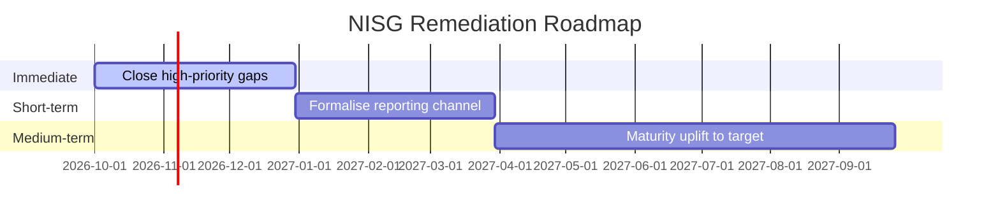

<!-- arckit-overlay-template: at-barrierefreiheit-template.md -->

# Austrian Accessibility Assessment (BaFG / WZG)

> **Template Origin**: Community | **ArcKit Version**: [VERSION] | **Command**:
> `/arckit:at-barrierefreiheit`
>
> ⚠️ **Community-contributed** — not yet validated against current BaFG / WZG
> text. Verify all citations against RIS before relying on output. Paragraph
> references marked `[NEEDS VERIFICATION]` are drawn from secondary sources and
> require confirmation by an Austrian accessibility practitioner.

## Document Control

<!-- DOC-CONTROL-HEADER -->
<!-- Resolved at command-execution time per _partials/RENDERING.md. -->

## Revision History

| Version   | Date         | Author    | Changes                                             | Approved By | Approval Date |
| --------- | ------------ | --------- | --------------------------------------------------- | ----------- | ------------- |
| [VERSION] | [YYYY-MM-DD] | ArcKit AI | Initial creation from `/arckit:at-barrierefreiheit` | [PENDING]   | [PENDING]     |

## Executive Summary

| # | Area                                    | Status                                    | Key Findings |
| - | --------------------------------------- | ----------------------------------------- | ------------ |
| 1 | Applicability (BaFG / WZG)              | [BaFG / WZG / Both / Neither / Exempt]    | [Summary]    |
| 2 | EN 301 549 Conformance                  | [Vollständig / Teilweise / Nicht konform] | [Summary]    |
| 3 | Barrierefreiheitserklärung (WZG)        | [Published / Outdated / Missing / N/A]    | [Summary]    |
| 4 | Product and Service Requirements (BaFG) | [Compliant / Partial / Gap / N/A]         | [Summary]    |
| 5 | Market Surveillance and Monitoring      | [Low / Medium / High exposure]            | [Summary]    |
| 6 | Remediation Roadmap                     | [Agreed / Draft / Absent]                 | [Summary]    |

---

## 1. Applicability Determination

### 1.1 Entity and Surface Inventory

| Surface | Type                                                            | Public-facing | Users                          |
| ------- | --------------------------------------------------------------- | ------------- | ------------------------------ |
|         | [Website / Mobile app / Terminal / Product / Document / E-book] | [Yes / No]    | [Consumers / Citizens / Staff] |

### 1.2 WZG (Public Sector) — Directive (EU) 2016/2102

| Test                                                                                           | Answer         | Basis                                                    |
| ---------------------------------------------------------------------------------------------- | -------------- | -------------------------------------------------------- |
| Federal public body, body governed by public law, or predominantly publicly funded?            | [Yes / No]     |                                                          |
| Surface is a website or mobile application?                                                    | [Yes / No]     |                                                          |
| **Land-level or municipal body?** (federal WZG does not apply — assess under the Landesgesetz) | [Yes / No]     | `[NEEDS VERIFICATION: name the applicable Landesgesetz]` |
| **WZG applies**                                                                                | **[Yes / No]** |                                                          |

### 1.3 BaFG (Products and Services) — Directive (EU) 2019/882

| Test                                                                                                                                        | Answer                  | Basis |
| ------------------------------------------------------------------------------------------------------------------------------------------- | ----------------------- | ----- |
| Economic actor: manufacturer / importer / distributor / service provider?                                                                   | [Yes / No — which role] |       |
| Product in Annex scope? (computer hardware and OS, self-service terminals, consumer terminal equipment, AV media terminals, e-readers)      | [Yes / No / N/A]        |       |
| Service in Annex scope? (electronic communications, AV media services, passenger transport elements, consumer banking, e-books, e-commerce) | [Yes / No / N/A]        |       |
| **BaFG applies**                                                                                                                            | **[Yes / No]**          |       |

### 1.4 Microenterprise Exemption — services only

> The exemption at § 6 BaFG covers Kleinstunternehmen **offering or providing
> services** `[NEEDS VERIFICATION: § 6]`. It does **not** exempt products. A
> nine-person importer of self-service terminals is fully in scope.

| Criterion (§ 3 Z 19 `[NEEDS VERIFICATION]`)                              | Value | Met            |
| ------------------------------------------------------------------------ | ----- | -------------- |
| Fewer than 10 persons employed                                           | [N]   | [Yes / No]     |
| Annual turnover at most EUR 2M **OR** balance-sheet total at most EUR 2M | [EUR] | [Yes / No]     |
| **Exemption available** (services only)                                  |       | **[Yes / No]** |

**Evidence retained**: [Source and date of the headcount and financial figures]

> The Sozialministeriumservice can require an entity claiming this exemption to
> produce the supporting evidence on request. An exemption asserted without
> evidence on file is a gap, not a pass.

---

## 2. Standard and Conformance Mapping

> **Binding version.** Both tracks route through EN 301 549 as the harmonised
> standard giving a presumption of conformity, and the version that binds is the
> one cited in the _Official Journal_: **v3.2.1**, which normatively references
> **WCAG 2.1 Level AA**. Draft v4.1.0 went to public review in November 2025;
> final v4.1.1, expected to carry WCAG 2.2 AA, is anticipated to be OJ-cited
> around October 2026 `[NEEDS VERIFICATION]`. Assess against 2.1 AA. Record any
> use of 2.2 AA as a deliberate forward-looking decision, not the legal floor.

**Assessed against**: EN 301 549 [v3.2.1] → WCAG [2.1] Level AA
**Forward-looking target adopted**: [None / WCAG 2.2 AA — rationale]

### 2.1 Test Method

| Method                                  | Used       | Scope | Date | Performed by |
| --------------------------------------- | ---------- | ----- | ---- | ------------ |
| Automated tooling                       | [Yes / No] |       |      |              |
| Manual expert review                    | [Yes / No] |       |      |              |
| Assistive-technology testing with users | [Yes / No] |       |      |              |

> Automated scanning alone is not conformance evidence. A statement resting on a
> tool report is a finding.

### 2.2 WCAG 2.1 AA Criterion Status

| Criterion                           | Level | Status                                          | Surface | Evidence | Date |
| ----------------------------------- | ----- | ----------------------------------------------- | ------- | -------- | ---- |
| 1.1.1 Non-text Content              | A     | [Supports / Partially / Does Not Support / N/A] |         |          |      |
| 1.3.1 Info and Relationships        | A     |                                                 |         |          |      |
| 1.4.3 Contrast (Minimum)            | AA    |                                                 |         |          |      |
| 2.1.1 Keyboard                      | A     |                                                 |         |          |      |
| 2.4.7 Focus Visible                 | AA    |                                                 |         |          |      |
| 4.1.2 Name, Role, Value             | A     |                                                 |         |          |      |
| [Add remaining applicable criteria] |       |                                                 |         |          |      |

### 2.3 Non-Web Clauses (where hardware, terminals, documents or e-books are in scope)

| EN 301 549 Clause               | Applies    | Status | Notes |
| ------------------------------- | ---------- | ------ | ----- |
| Clause 5 — Generic requirements | [Yes / No] |        |       |
| Clause 8 — Hardware             | [Yes / No] |        |       |
| Clause 10 — Non-web documents   | [Yes / No] |        |       |
| Clause 11 — Software            | [Yes / No] |        |       |

---

## 3. Barrierefreiheitserklärung (WZG track)

_Complete only where the WZG applies. Otherwise mark N/A and state why._

**Applies**: [Yes / No — reason]

| Required element                                                                     | Present          | Assessment |
| ------------------------------------------------------------------------------------ | ---------------- | ---------- |
| Conformance status in statutory wording (vollständig / teilweise / nicht konform)    | [Yes / No]       |            |
| Non-accessible content — **incompatible** with the requirements                      | [Yes / No]       |            |
| Non-accessible content — **disproportionate burden**, with the justifying assessment | [Yes / No / N/A] |            |
| Non-accessible content — **outside the scope** of the legislation                    | [Yes / No / N/A] |            |
| Preparation method (self-assessment / third-party) and date                          | [Yes / No]       |            |
| Feedback mechanism with a working contact and response commitment                    | [Yes / No]       |            |
| Enforcement pointer to the FFG                                                       | [Yes / No]       |            |

**Statement URL**: [URL or "not published"] **Last reviewed**: [YYYY-MM-DD]

> The most common failure is a statement that recites conformance without
> listing known non-conformances. It is visible to any auditor who runs a scan
> against it.

---

## 4. Product and Service Requirements (BaFG track)

_Complete only where the BaFG applies. Otherwise mark N/A and state why._

**Applies**: [Yes / No — reason]

### 4.1 Requirements Mapping

| In-scope product / service | Applicable requirements | Status                      | Gap |
| -------------------------- | ----------------------- | --------------------------- | --- |
|                            |                         | [Compliant / Partial / Gap] |     |

### 4.2 Information Obligations

| Obligation                                                                    | Met              | Notes |
| ----------------------------------------------------------------------------- | ---------------- | ----- |
| Accessible instructions and product information                               | [Yes / No / N/A] |       |
| Published description of how the service meets the accessibility requirements | [Yes / No / N/A] |       |
| Supporting documentation retained                                             | [Yes / No]       |       |

### 4.3 Conformity Assessment Route

> **Products** take an EU declaration of conformity and **CE marking**; the
> internal production-control route applies where the harmonised standard is
> used. **Services** take no CE marking — the obligation is the published
> description plus retained documentation. Do not apply CE marking to a service.

| Item | Type                | Route | Declaration drawn up | CE marking            |
| ---- | ------------------- | ----- | -------------------- | --------------------- |
|      | [Product / Service] |       | [Yes / No]           | [Yes / N/A — service] |

### 4.4 Statutory Defences

| Defence                                                | Claimed    | Documented assessment on file | Last re-assessed |
| ------------------------------------------------------ | ---------- | ----------------------------- | ---------------- |
| Disproportionate burden (unverhältnismäßige Belastung) | [Yes / No] | [Yes / No]                    | [YYYY-MM-DD]     |
| Fundamental alteration                                 | [Yes / No] | [Yes / No]                    | [YYYY-MM-DD]     |

> An undocumented claim is not a defence. Both require a retained assessment,
> re-done when the product or service changes and periodically thereafter.

### 4.5 Out of Scope Here

- **Emergency communications (Notrufe)** are transposed through the **TKG
  2021**, not the BaFG. Assess separately; do not evaluate them under this act.

---

## 5. Market Surveillance, Monitoring and Exposure

| Track | Authority                                                   | Powers                                                                                                         | Financial exposure                                                                                                                                        |
| ----- | ----------------------------------------------------------- | -------------------------------------------------------------------------------------------------------------- | --------------------------------------------------------------------------------------------------------------------------------------------------------- |
| BaFG  | Sozialministeriumservice (SMS) `[NEEDS VERIFICATION: § 21]` | Proactive monitoring, remediation orders, withdrawal of a product or prohibition of a service in serious cases | Administrative penalties up to **EUR 80,000** `[NEEDS VERIFICATION: § 36 and tier structure]`, tiered by severity and lower for SMEs and microenterprises |
| WZG   | FFG (Österreichische Forschungsförderungsgesellschaft)      | Monitoring and complaints handling; triennial reporting to the European Commission                             | **No administrative fine regime** — finding, complaint and publication                                                                                    |

**Assessed exposure**: [Range against the specific conduct, per applicable
track]

> Where both tracks apply, keep the exposures separate. Different authorities,
> different powers, different surfaces. Never carry the BaFG ceiling into a
> public-sector WZG assessment.

---

## 6. Gap Analysis and Remediation Roadmap

| # | Surface | Criterion / requirement | Track        | Severity     | User impact | Owner | Target date | NFR-UX ref |
| - | ------- | ----------------------- | ------------ | ------------ | ----------- | ----- | ----------- | ---------- |
| 1 |         |                         | [BaFG / WZG] | 🔴 / 🟠 / 🟡 |             |       |             | NFR-UX-xxx |

**Prioritisation basis**: user impact first, enforcement exposure second. A
blocked login path outranks a decorative contrast failure regardless of track.

**Procurement handoff**: [Items whose remediation will be tendered — carry the
conformance target into `/arckit:at-bvergg`]

---

## External References

### Document Register

| DOC_ID | Source | Description |
| ------ | ------ | ----------- |
|        |        |             |

### Citations

| Citation | Used In | Source |
| -------- | ------- | ------ |
|          |         |        |

### Unreferenced Documents

| Filename | Source Location | Reason |
| -------- | --------------- | ------ |
| —        | —               | —      |

---

**Generated by**: ArcKit `/arckit:at-barrierefreiheit` command **Generated on**:
[DATE] **ArcKit Version**: [VERSION] **Project**: [PROJECT_NAME] **Model**:
[AI_MODEL]

<!-- arckit-overlay-template: at-bvergg-template.md -->

# Austrian Public Procurement Documentation (BVergG 2018)

> **Template Origin**: Community | **ArcKit Version**: [VERSION] | **Command**:
> `/arckit:at-bvergg`
>
> ⚠️ **Community-contributed** — not yet validated against the current
> Bundesvergabegesetz 2018 (as amended by the **Vergaberechtsgesetz 2026**,
> BGBl. I Nr. 8/2026, in force 1 March 2026; eForms from 1 October 2026) or the
> applicable EU threshold regulation. Verify all citations before relying on
> output. Items marked `[NEEDS VERIFICATION]` must be confirmed against the
> current EU thresholds and §12 BVergG 2018.

## Document Control

<!-- DOC-CONTROL-HEADER -->
<!-- Resolved at command-execution time per _partials/RENDERING.md. -->

## Revision History

| Version   | Date         | Author    | Changes                                   | Approved By | Approval Date |
| --------- | ------------ | --------- | ----------------------------------------- | ----------- | ------------- |
| [VERSION] | [YYYY-MM-DD] | ArcKit AI | Initial creation from `/arckit:at-bvergg` | [PENDING]   | [PENDING]     |

## Executive Summary

| Item                     | Value                  |
| ------------------------ | ---------------------- |
| Contracting Authority    | [Name]                 |
| Object                   | [One-line description] |
| Auftragswert (excl. VAT) | € [value]              |
| Threshold Tier           | [Tier]                 |
| Procedure                | [Procedure]            |
| Publication              | [ANKÖ / ANKÖ + TED]    |
| Planned Publication Date | [YYYY-MM-DD]           |
| Award Target Date        | [YYYY-MM-DD]           |

---

## 1. Contracting Authority and Procedure

### 1.1 Auftraggeber

| Item                                           | Value     |
| ---------------------------------------------- | --------- |
| Legal name                                     | [Name]    |
| Legal basis (public law / §4 subsidy / Sektor) | [Ground]  |
| UID / Register number                          | [ID]      |
| Contact (Vergabestelle)                        | [Contact] |

### 1.2 Procedure Selection

| Item                                     | Value                                                     |
| ---------------------------------------- | --------------------------------------------------------- |
| Procedure                                | [e.g. Offenes Verfahren]                                  |
| Legal basis (BVergG 2018 §)              | [§ reference]                                             |
| Justification                            | [Brief justification, especially for non-open procedures] |
| Framework agreement (Rahmenvereinbarung) | [Yes / No]                                                |
| Lots (Teillose)                          | [Yes / No]                                                |

### 1.3 Threshold Determination

_Confirm against current EU thresholds from 1.1.2026 (classical central
govt/Bund €140K, classical sub-central €216K and Bau €5,404K per VO (EU)
2025/2152; Sektoren €432K per VO (EU) 2025/2150; concessions per VO (EU)
2025/2151; §12 BVergG 2018) and the domestic Direktvergabe limits set by the
Vergaberechtsgesetz 2026 (§46: supplies/services €143K — Bund effectively capped
at the €140K EU Oberschwelle; works €200K; from €50K document ≥3
Vergleichsangebote/Preisauskünfte)._

| Item                                                        | Value              |
| ----------------------------------------------------------- | ------------------ |
| Value aggregation applied (§13 BVergG)                      | [Yes / No]         |
| Exception applied (§9 BVergG, in-house, interinstitutional) | [Yes / No — which] |
| Current applicable threshold                                | € [value]          |
| Tier result                                                 | [Tier]             |

---

## 2. Leistungsbeschreibung (Requirements Statement)

### 2.1 Functional Scope

| ID       | Requirement | Source REQ | Mandatory / Desired |
| -------- | ----------- | ---------- | ------------------- |
| LB-F-001 |             | FR-xxx     |                     |

### 2.2 Non-Functional Scope

| Category                                                      | Requirement | Source NFR  | Acceptance |
| ------------------------------------------------------------- | ----------- | ----------- | ---------- |
| Performance                                                   |             | NFR-P-xxx   |            |
| Availability                                                  |             | NFR-AV-xxx  |            |
| Security                                                      |             | NFR-SEC-xxx |            |
| Accessibility (§107 BVergG / EN 301 549 v3.2.1 → WCAG 2.1 AA) |             | NFR-UX-xxx  |            |

> **Accessibility baseline.** EN 301 549 **v3.2.1** is the version cited in the
> Official Journal, so it is the one §107 BVergG invokes and the one carrying a
> presumption of conformity; it normatively references **WCAG 2.1 AA**. The
> revision carrying WCAG 2.2 AA (v4.1.1) is expected to be OJ-cited around
> October 2026 `[NEEDS VERIFICATION: confirm the OJ citation date and version]`
> — specify 2.2 AA only where the contract runs past that date, and say so
> explicitly rather than silently raising the bar.

### 2.3 Integration and Data

| Item                        | Requirement                                         |
| --------------------------- | --------------------------------------------------- |
| Integrations                | INT-xxx → [External system]                         |
| Data categories             | [Personal / Special category / Health / Classified] |
| Data location / sovereignty | [AT / EU / EEA / Other]                             |
| Open standards              | [e.g. OGC, OAS, W3C]                                |

---

## 3. Eignung (Suitability Criteria)

### 3.1 Ausschlussgründe (§78 BVergG)

| Ground                                          | Verification method          |
| ----------------------------------------------- | ---------------------------- |
| Clean criminal record — company and key persons | Eigenerklärung + extract     |
| Tax and social security compliance              | Finanzamt / ÖGK confirmation |
| No insolvency proceedings                       | Ediktsdatei                  |

### 3.2 Wirtschaftliche / Finanzielle Leistungsfähigkeit

| Criterion                        | Threshold   | Evidence  |
| -------------------------------- | ----------- | --------- |
| Annual turnover                  | ≥ € [value] | Abschluss |
| Professional liability insurance | ≥ € [value] | Policy    |

### 3.3 Technische Leistungsfähigkeit

| Criterion                                       | Minimum                    | Evidence      |
| ----------------------------------------------- | -------------------------- | ------------- |
| Comparable references (last 3 years)            | [N]                        | Referenzliste |
| Certifications (ISO 27001, ISO 9001, ISO 22301) | [Which — if proportionate] | Certificate   |
| Key personnel qualifications                    | [Roles + CV]               | CV            |

---

## 4. Zuschlagskriterien (Award Criteria)

**Principle**: Bestbieterprinzip (best price-performance ratio) unless
lowest-price is explicitly justified.

| Criterion             | Weight (%) | Scoring method   |
| --------------------- | ---------- | ---------------- |
| Price                 |            | Linear / formula |
| Quality               |            | Scored by panel  |
| Sustainability        |            |                  |
| Innovation            |            |                  |
| Vendor-lock-in / exit |            |                  |
| **Total**             | **100**    |                  |

---

## 5. Vertragliche Regelungen

### 5.1 Service Level Agreement

| SLA Item      | Target   | Measurement | Remedy                    |
| ------------- | -------- | ----------- | ------------------------- |
| Availability  | [%]      | [Method]    | [Vertragsstrafe / credit] |
| Response time | [ms / s] | [Method]    | [Remedy]                  |
| Incident MTTR | [hrs]    | [Method]    | [Remedy]                  |

### 5.2 Data Protection (Auftragsverarbeitung)

| Clause                            | Required         | Status |
| --------------------------------- | ---------------- | ------ |
| Art. 28 GDPR processor contract   | [Yes / No / N/A] |        |
| DSG-specific addendum             | [Yes / No / N/A] |        |
| Sub-processor approval mechanism  | [Yes / No / N/A] |        |
| International transfer safeguards | [Yes / No / N/A] |        |

### 5.3 NISG Supply-Chain Clauses

_Complete only if contracting authority is Essential / Important under NISG._

| Clause                                 | Required | Status |
| -------------------------------------- | -------- | ------ |
| Right to audit supplier security       |          |        |
| Incident notification timeline (to CA) |          |        |
| SBOM / patching obligations            |          |        |
| Vulnerability disclosure               |          |        |
| Exit / data return obligations         |          |        |

### 5.4 IP, Open Source, and Exit

| Item                           | Position                        |
| ------------------------------ | ------------------------------- |
| IP ownership                   | [Customer / Supplier / Joint]   |
| Open-source licences permitted | [Policy reference]              |
| Exit and transition            | [Obligations]                   |
| Data return format             | [e.g. standard JSON + SQL dump] |

### 5.5 Governing Law

Austrian law. Jurisdiction: [Gerichtsstand].

---

## 6. Publication and Timeline

| Milestone                          | Date               | Notes                                           |
| ---------------------------------- | ------------------ | ----------------------------------------------- |
| ANKÖ publication                   | [YYYY-MM-DD]       |                                                 |
| TED publication (if Oberschwellen) | [YYYY-MM-DD]       |                                                 |
| Bidder questions window close      | [YYYY-MM-DD]       |                                                 |
| Q&A published                      | [YYYY-MM-DD]       |                                                 |
| Angebotsfrist end                  | [YYYY-MM-DD]       | Min. per §§71–76 BVergG (OSB) / §§126–129 (USB) |
| Angebotsöffnung                    | [YYYY-MM-DD HH:MM] |                                                 |
| Evaluation complete                | [YYYY-MM-DD]       |                                                 |
| Zuschlagsentscheidung notified     | [YYYY-MM-DD]       |                                                 |
| Stillhaltefrist end                | [YYYY-MM-DD]       | Min. 10/15 days per BVergG                      |
| Zuschlagserteilung                 | [YYYY-MM-DD]       |                                                 |

---

## 7. Review and Remedies (BVergG Book 4)

| Item                                                | Value                                              |
| --------------------------------------------------- | -------------------------------------------------- |
| Review venue                                        | [BVwG (federal) / LVwG (Land)]                     |
| Application fees (Pauschalgebühren)                 | [reference BVergG § + current Verordnung]          |
| Interim measures (einstweilige Verfügung) available | Yes                                                |
| Documentation requirements for defence              | [As per §49 BVergG Dokumentation und Aufbewahrung] |

---

## 8. Vergabeakt

| Item                            | Content                    |
| ------------------------------- | -------------------------- |
| Entscheidungsgrundlagen         | Decisions + justifications |
| Eignungsprüfung protocols       |                            |
| Angebotsauswertung scores       |                            |
| Zuschlagsentscheidung reasoning |                            |
| Korrespondenz mit Bewerbern     |                            |
| Retention period                | [per §49 BVergG]           |

### Annexes

- A. Eigenerklärung / ESPD templates
- B. Technical specifications
- C. Draft contract
- D. Price schedule (Preisblatt)
- E. Evaluation sheet

---

## External References

### Document Register

| DOC_ID | Source | Description |
| ------ | ------ | ----------- |
|        |        |             |

### Citations

| Citation | Used In | Source |
| -------- | ------- | ------ |
|          |         |        |

---

**Generated by**: ArcKit `/arckit:at-bvergg` command **Generated on**: [DATE]
**ArcKit Version**: [VERSION] **Project**: [PROJECT_NAME] **Model**: [AI_MODEL]

<!-- arckit-overlay-template: at-dsgvo-template.md -->

# Austrian Data Protection Assessment (DSG / DSGVO)

> **Template Origin**: Community | **ArcKit Version**: [VERSION] | **Command**:
> `/arckit:at-dsgvo`
>
> ⚠️ **Community-contributed** — not yet validated against current
> Datenschutzbehörde (DSB) / EU regulatory text. Verify all citations before
> relying on output. Items marked `[NEEDS VERIFICATION]` require confirmation by
> an Austrian data protection practitioner.

## Document Control

<!-- DOC-CONTROL-HEADER -->
<!-- Resolved at command-execution time per _partials/RENDERING.md. -->

## Revision History

| Version   | Date         | Author    | Changes                                  | Approved By | Approval Date |
| --------- | ------------ | --------- | ---------------------------------------- | ----------- | ------------- |
| [VERSION] | [YYYY-MM-DD] | ArcKit AI | Initial creation from `/arckit:at-dsgvo` | [PENDING]   | [PENDING]     |

## Executive Summary

| #  | Area                                                                      | Status                                      | Key Findings |
| -- | ------------------------------------------------------------------------- | ------------------------------------------- | ------------ |
| 1  | AT DSG Regulatory Framework                                               | [Mapped / Partial / Gap]                    | [Summary]    |
| 2  | Lawful Basis (Art. 6 / Art. 9)                                            | [Identified / Unclear / Gap]                | [Summary]    |
| 3  | Consent Management                                                        | [Compliant / Partial / N/A]                 | [Summary]    |
| 4  | DPIA Screening (Art. 35 + DSB Blacklist)                                  | [Required / Not required]                   | [Summary]    |
| 5  | Image/Video Processing (GDPR; §12 DSG not applied — VwGH Ra 2023/04/0075) | [Compliant / Non-compliant / Partial / N/A] | [Summary]    |
| 6  | Health Data / ELGA                                                        | [Compliant / Partial / N/A]                 | [Summary]    |
| 7  | Employee Data / §96/§96a ArbVG                                            | [Compliant / Gap / N/A]                     | [Summary]    |
| 8  | Scientific Research (§§7–8 DSG)                                           | [Compliant / Partial / N/A]                 | [Summary]    |
| 9  | Data Subject Rights                                                       | [Ready / Gap]                               | [Summary]    |
| 10 | DPO Registration and ROPA                                                 | [Registered / Pending / N/A]                | [Summary]    |
| 11 | Breach Notification Readiness                                             | [Ready / Gap]                               | [Summary]    |
| 12 | TOMs (Art. 32)                                                            | [Adequate / Partial / Gap]                  | [Summary]    |
| 13 | Data Processing Agreements (Art. 28)                                      | [Complete / Partial / Gap]                  | [Summary]    |
| 14 | International Transfers                                                   | [Compliant / Gap / N/A]                     | [Summary]    |
| 15 | Cookies / Tracking (§165 TKG 2021)                                        | [Compliant / Partial / N/A]                 | [Summary]    |
| 16 | DSB Enforcement Self-Assessment                                           | [Low risk / Medium / High]                  | [Summary]    |
| 17 | Sanctions Exposure                                                        | [Low / Medium / High / Critical]            | [Summary]    |

---

## 1. AT DSG Regulatory Framework

### 1.1 Applicable Texts

| Text                                                                    | Reference                   | Applicability                                             |
| ----------------------------------------------------------------------- | --------------------------- | --------------------------------------------------------- |
| GDPR                                                                    | Regulation (EU) 2016/679    | Yes                                                       |
| Austrian Data Protection Act (DSG)                                      | BGBl. I Nr. 165/1999 (idgF) | Yes                                                       |
| DSG 3. Hauptstück §§36–61 (law enforcement / justice, RL (EU) 2016/680) | BGBl. I Nr. 165/1999 (idgF) | [Yes / No — law-enforcement or justice processing?]       |
| ELGA-Gesetz                                                             | BGBl. I Nr. 111/2012        | [Yes / No — health data?]                                 |
| Gesundheitstelematikgesetz (GTelG 2012)                                 | BGBl. I Nr. 111/2012        | [Yes / No]                                                |
| ArbVG §96 Abs 1 Z 3 / §96a (Betriebsvereinbarung)                       | BGBl. Nr. 22/1974 idgF      | [Yes / No — employee monitoring / personnel data system?] |
| Telekommunikationsgesetz (TKG 2021)                                     | BGBl. I Nr. 190/2021        | [Yes / No — electronic communications?]                   |
| Age of Digital Consent — 14 years                                       | §4(4) DSG                   | [Yes / No — minors in scope?]                             |

### 1.2 Authority and Remedies

| Item                        | Value                                |
| --------------------------- | ------------------------------------ |
| Supervisory Authority       | Datenschutzbehörde (DSB) — dsb.gv.at |
| Primary Remedy Path         | Complaint to DSB                     |
| Appellate Remedy            | Bundesverwaltungsgericht (BVwG)      |
| Constitutional/Admin Review | VwGH / VfGH                          |

---

## 2. Lawful Basis Assessment (Art. 6 / Art. 9 GDPR)

### Rechtsgrundlage nach Art. 6 Abs 1 DSGVO

| Basis                                                         | Lit. | Selected | Justification                                                  |
| ------------------------------------------------------------- | ---- | -------- | -------------------------------------------------------------- |
| Consent (Einwilligung)                                        | (a)  | ☐        |                                                                |
| Contract performance (Vertragserfüllung)                      | (b)  | ☐        |                                                                |
| Legal obligation (Rechtliche Verpflichtung)                   | (c)  | ☐        | Cite specific AT law:                                          |
| Vital interests (Lebenswichtige Interessen)                   | (d)  | ☐        |                                                                |
| Public interest / official authority (Öffentliches Interesse) | (e)  | ☐        | Cite specific AT law:                                          |
| Legitimate interests (Berechtigte Interessen)                 | (f)  | ☐        | Not available for public authorities (Art. 6(1) last sentence) |

### Special Category Data (Art. 9 Abs 2 DSGVO)

_Complete only if special category data (Art. 9(1)) is processed._

| Condition                         | Lit. | Selected | Notes                     |
| --------------------------------- | ---- | -------- | ------------------------- |
| Explicit consent                  | (a)  | ☐        |                           |
| Employment / social security law  | (b)  | ☐        | ArbVG / ASVG reference:   |
| Vital interests (incapacity)      | (c)  | ☐        |                           |
| Foundation / non-profit           | (d)  | ☐        |                           |
| Manifestly public                 | (e)  | ☐        |                           |
| Legal claims                      | (f)  | ☐        |                           |
| Substantial public interest       | (g)  | ☐        | §7 DSG / specific AT law: |
| Health / social care              | (h)  | ☐        | ELGA-G / GTelG reference: |
| Public health                     | (i)  | ☐        |                           |
| Archiving / research / statistics | (j)  | ☐        | §7 Abs 2–3 DSG:           |

---

## 3. Consent Management (where Art. 6(1)(a) or Art. 9(2)(a) applies)

_Complete only if consent is the lawful basis for any processing activity._

| Control                                                      | Status           | Notes |
| ------------------------------------------------------------ | ---------------- | ----- |
| Consent is freely given (no bundling, no imbalance of power) | [Yes / No / N/A] |       |
| Consent is specific (per purpose, not blanket)               | [Yes / No / N/A] |       |
| Consent is informed (plain language, purpose disclosed)      | [Yes / No / N/A] |       |
| Consent is unambiguous (clear affirmative action)            | [Yes / No / N/A] |       |
| Withdrawal mechanism equally easy as giving consent          | [Yes / No / N/A] |       |
| Consent records stored with timestamp and version            | [Yes / No / N/A] |       |
| Re-consent triggered on purpose change                       | [Yes / No / N/A] |       |
| Employee consent: power imbalance addressed (Art. 7 + WP259) | [Yes / No / N/A] |       |

---

## 4. DPIA Screening (Art. 35 GDPR + DSB Blacklist)

_Tick all criteria that apply. If ≥2 are ticked, a full DPIA is required (EDPB
WP248 rev.01)._

| # | Criterion (EDPB / DSB)                                      | Applies |
| - | ----------------------------------------------------------- | ------- |
| 1 | Evaluation or scoring (including profiling)                 | ☐       |
| 2 | Automated decision-making with legal/similar effect         | ☐       |
| 3 | Systematic monitoring                                       | ☐       |
| 4 | Sensitive data or data of highly personal nature            | ☐       |
| 5 | Data processed on large scale                               | ☐       |
| 6 | Matching or combining datasets                              | ☐       |
| 7 | Data concerning vulnerable data subjects                    | ☐       |
| 8 | Innovative use or applying new technology                   | ☐       |
| 9 | Processing preventing data subjects from exercising a right | ☐       |

| DSB Blacklist match (DSFA-V BGBl. II Nr. 278/2018) | [Yes / No] | Specify: |

**Result:** [DPIA required / DPIA not required / Borderline — consult DPO]

---

## 5. Image and Video Processing (GDPR; §§12–13 DSG)

_Complete only if CCTV, bodycams, doorbell cameras, visitor imagery, AI-enabled
video analytics, or any other Bildverarbeitung is in scope. Otherwise mark N/A._

> ⚠️ **Assess on the GDPR**: the VwGH has held that where private video
> surveillance is assessed under Art. 6(1)(f) GDPR, §12 Abs. 2 Z 4 iVm Abs. 3
> DSG stays unapplied for want of a GDPR opening clause, and the processing is
> measured solely against Art. 6(1)(f) GDPR, case by case (VwGH 22.10.2025, Ra
> 2023/04/0075, confirming BVwG W256 2214855-1, 20.11.2019 and W211 2210458-1,
> 25.11.2019). The OGH applied §12 DSG in civil proceedings (6 Ob 150/19f). Do
> not cite §§12–13 DSG as the legal basis or as stricter than the GDPR; the §13
> DSG points below are benchmarks only.

| Control                                                                                                                                    | Status           | Evidence / Gap |
| ------------------------------------------------------------------------------------------------------------------------------------------ | ---------------- | -------------- |
| GDPR Art. 6 lawful ground for the imaging established                                                                                      | [Yes / No / N/A] |                |
| Art. 6(1)(f) balancing of interests documented on the facts — not pre-empted by §12 Abs. 3 DSG (VwGH Ra 2023/04/0075)                      | [Yes / No / N/A] |                |
| Labelling (Kennzeichnung) — visible notice naming the controller (Art. 12–14 GDPR; cf. §13 Abs. 5 DSG)                                     | [Yes / No / N/A] |                |
| Retention limited to the purpose (Art. 5(1)(e) GDPR); anything over 72 hours justified and logged (§13 Abs. 3 DSG benchmark)               | [Yes / No / N/A] |                |
| No filming of the höchstpersönlicher Lebensbereich and no employee monitoring (weighed in the Art. 6(1)(f) balancing; ArbVG §96 for staff) | [Yes / No / N/A] |                |
| No covert imaging unless narrow statutory ground applies                                                                                   | [Yes / No / N/A] |                |
| DSB-Praxis und EDPB-Leitlinien 3/2019 zur Bildverarbeitung berücksichtigt                                                                  | [Yes / No / N/A] |                |
| Access control to recordings (who, when, audited)                                                                                          | [Yes / No / N/A] |                |

---

## 6. Health Data and ELGA

_Complete only if Gesundheitsdaten (Art. 9 GDPR special category health data)
are processed._

| Item                                     | Status                    | Notes |
| ---------------------------------------- | ------------------------- | ----- |
| Art. 9(2) lawfulness ground selected     | [Ground + reference]      |       |
| §§7–8 DSG research ground considered     | [Yes / No / N/A]          |       |
| ELGA-G interop requirements met          | [Yes / No / N/A]          |       |
| GTelG 2012 telematics compliance         | [Yes / No / N/A]          |       |
| Opt-out handling implemented             | [Yes / No / N/A]          |       |
| DPIA triggered (Art. 35 + DSB Blacklist) | [Required / Not required] |       |

---

## 7. Employee Data (Arbeitnehmerdatenschutz)

_Complete only if employees' personal data are processed in systems capable of
monitoring, evaluating, or profiling employees._

| Control                                                  | Status           | Evidence / Gap |
| -------------------------------------------------------- | ---------------- | -------------- |
| ArbVG §96 Abs 1 Z 3 / §96a Betriebsvereinbarung in place | [Yes / No / N/A] |                |
| Works council (Betriebsrat) informed / consulted         | [Yes / No / N/A] |                |
| Transparency notice to employees                         | [Yes / No / N/A] |                |
| Necessity and proportionality documented                 | [Yes / No / N/A] |                |
| Prohibition on use for discipline beyond scope of BV     | [Yes / No / N/A] |                |

---

## 8. Scientific Research (§§7–8 DSG)

_Complete only if processing is for scientific or statistical research purposes
under Art. 89 GDPR._

| Item                                                                                     | Status           | Notes |
| ---------------------------------------------------------------------------------------- | ---------------- | ----- |
| Research purpose documented                                                              | [Yes / No / N/A] |       |
| Pseudonymisation in place                                                                | [Yes / No / N/A] |       |
| §7 Abs 3 DSG Genehmigung der DSB beantragt (where consent impossible / disproportionate) | [Yes / No / N/A] |       |
| §2d FOG (Forschungsorganisationsgesetz) Art. 89(1) rights exemption assessed             | [Yes / No / N/A] |       |
| Re-identification risk assessed                                                          | [Yes / No / N/A] |       |
| Publication plan compliant with Art. 89 GDPR                                             | [Yes / No / N/A] |       |

---

## 9. Data Subject Rights (Austrian enforcement)

| Right                                             | Art. | Response Timeline         | Status        | Notes |
| ------------------------------------------------- | ---- | ------------------------- | ------------- | ----- |
| Access                                            | 15   | 1 month (extendable to 3) | [Ready / Gap] |       |
| Rectification                                     | 16   | 1 month                   | [Ready / Gap] |       |
| Erasure                                           | 17   | 1 month                   | [Ready / Gap] |       |
| Restriction                                       | 18   | 1 month                   | [Ready / Gap] |       |
| Portability                                       | 20   | 1 month                   | [Ready / Gap] |       |
| Object                                            | 21   | 1 month                   | [Ready / Gap] |       |
| No solely-automated decision                      | 22   | —                         | [Ready / Gap] |       |
| DSB complaint pathway disclosed in privacy notice | —    | —                         | [Yes / No]    |       |

---

## 10. DPO Registration and ROPA

**DPO Mandatory Assessment (Art. 37(1) GDPR):**

| Criterion                                                                                | Applies    | Justification |
| ---------------------------------------------------------------------------------------- | ---------- | ------------- |
| (a) Processing by public authority/body                                                  | [Yes / No] |               |
| (b) Core activities require regular, systematic monitoring at large scale                | [Yes / No] |               |
| (c) Core activities involve large-scale processing of special categories / criminal data | [Yes / No] |               |

→ If any = Yes → DPO is mandatory

| Item                                                                    | Status                                 | Notes   |
| ----------------------------------------------------------------------- | -------------------------------------- | ------- |
| DPO mandatory determination                                             | [Mandatory / Voluntary / Not required] | Reason: |
| DPO contact notified to DSB (dsb.gv.at portal)                          | [Yes / No / N/A]                       |         |
| Verarbeitungsverzeichnis (Art. 30) — depth aligned with DSB expectation | [Yes / Partial / Gap]                  |         |

---

## 11. Breach Notification to DSB

| Item                                            | Status        | Evidence / Gap |
| ----------------------------------------------- | ------------- | -------------- |
| Process for 72-hour DSB notification            | [Ready / Gap] |                |
| Individual notification for high-risk breach    | [Ready / Gap] |                |
| Breach register maintained                      | [Yes / No]    |                |
| Tabletop exercise carried out in last 12 months | [Yes / No]    |                |

---

## 12. Technical and Organisational Measures (Art. 32 GDPR)

| Measure Category                                                                            | Art. 32 Ref | Status | Evidence |
| ------------------------------------------------------------------------------------------- | ----------- | ------ | -------- |
| Pseudonymisation and encryption                                                             | Abs 1 lit a | ☐      |          |
| Confidentiality of processing systems                                                       | Abs 1 lit b | ☐      |          |
| Integrity of processing systems                                                             | Abs 1 lit b | ☐      |          |
| Availability and resilience                                                                 | Abs 1 lit b | ☐      |          |
| Ability to restore availability after incident                                              | Abs 1 lit c | ☐      |          |
| Regular testing / assessment of effectiveness                                               | Abs 1 lit d | ☐      |          |
| Persons acting under the controller's or processor's authority process only on instructions | Abs 4       | ☐      |          |

---

## 13. Data Processing Agreements (Art. 28 GDPR)

| Processor | Purpose | Location | AVV in place | Sub-processors disclosed | Last audit |
| --------- | ------- | -------- | ------------ | ------------------------ | ---------- |
|           |         |          | [Yes / No]   | [Yes / No]               |            |

**Key checks:**

- Art. 28(3) mandatory clauses included
- Processor's TOMs documented (Art. 32)
- Sub-processor chain approved (Art. 28(2)/(4))
- Termination / data return clause present

---

## 14. International Transfers (Post-Schrems II)

| Item                                                          | Status           | Notes |
| ------------------------------------------------------------- | ---------------- | ----- |
| Transfer mapping complete (countries, recipients, categories) | [Yes / No]       |       |
| TIA conducted per EDPB Recommendations 01/2020                | [Yes / No]       |       |
| SCCs + supplementary measures documented                      | [Yes / No / N/A] |       |
| EU-US Data Privacy Framework reliance assessed                | [Yes / No / N/A] |       |

---

## 15. Cookies and Tracking (§165 TKG 2021)

_Complete only if the system uses cookies, fingerprinting, pixels, or similar
tracking technologies._

| Control                                                          | Status           | Notes |
| ---------------------------------------------------------------- | ---------------- | ----- |
| §165 TKG 2021 consent required for non-essential cookies         | [Yes / No / N/A] |       |
| Consent freely given, specific, informed (no dark patterns)      | [Yes / No / N/A] |       |
| Opt-out equally easy as opt-in                                   | [Yes / No / N/A] |       |
| Cookie banner blocks tracking until consent                      | [Yes / No / N/A] |       |
| Cookie categories documented (essential / analytics / marketing) | [Yes / No / N/A] |       |
| Retention periods per cookie documented                          | [Yes / No / N/A] |       |
| Third-party tracking disclosed in privacy notice                 | [Yes / No / N/A] |       |

---

## 16. DSB Enforcement Priority Self-Assessment

_Map the processing against recent DSB enforcement themes. Reference the most
recent DSB Datenschutzbericht (Tätigkeitsbericht) and published DSB decisions
(available via RIS)._

| Theme                              | Applicable | Residual Risk         |
| ---------------------------------- | ---------- | --------------------- |
| Cookie consent / web tracking      | [Yes / No] | [Low / Medium / High] |
| CCTV retention overshoot           | [Yes / No] | [Low / Medium / High] |
| Employee monitoring without BV     | [Yes / No] | [Low / Medium / High] |
| SAR response timeliness            | [Yes / No] | [Low / Medium / High] |
| Lawful ground for HR data          | [Yes / No] | [Low / Medium / High] |
| International transfers (esp. USA) | [Yes / No] | [Low / Medium / High] |

---

## 17. Sanctions Exposure (Art. 83 GDPR + §62 DSG)

| Violation Category                                            | Legal Basis                            | Maximum Penalty    |
| ------------------------------------------------------------- | -------------------------------------- | ------------------ |
| GDPR Art. 83(4) — controller/processor obligations            | Art. 83(4)                             | €10M / 2% turnover |
| GDPR Art. 83(5) — principles, rights, transfers               | Art. 83(5)                             | €20M / 4% turnover |
| §62 DSG — Austrian-specific violations                        | §62 DSG                                | €50,000            |
| §188 TKG 2021 — cookie non-information (breach of §165 Abs 3) | §188 Abs 5 TKG 2021 (Fernmeldebehörde) | up to €75,000      |

> ⚠️ **Public-authority fine exemption (§30 Abs 5 DSG)**: Austria used the Art.
> 83(7) GDPR opening clause to exempt **Behörden, öffentliche Stellen and
> Körperschaften öffentlichen Rechts** from GDPR fines — the DSB **cannot impose
> Geldbußen** on them (but can still order corrective measures). If the
> controller is a public authority, the Art. 83 fine exposure above is generally
> **not** applicable. Note the boundary: ausgegliederte / competitively-active
> legal entities may fall **outside** the exemption — assess per entity.
> `[NEEDS VERIFICATION: confirm the controller qualifies as a covered public body]`

**Current residual risk rating:** [Low / Medium / High / Critical]

---

## 18. Gap Analysis and Action Plan

| # | Gap | Priority     | Owner | Target Date | Related Article |
| - | --- | ------------ | ----- | ----------- | --------------- |
| 1 |     | 🔴 / 🟠 / 🟡 |       |             |                 |

---

## External References

### Document Register

| DOC_ID | Source | Description |
| ------ | ------ | ----------- |
|        |        |             |

### Citations

| Citation | Used In | Source |
| -------- | ------- | ------ |
|          |         |        |

---

**Generated by**: ArcKit `/arckit:at-dsgvo` command **Generated on**: [DATE]
**ArcKit Version**: [VERSION] **Project**: [PROJECT_NAME] **Model**: [AI_MODEL]

<!-- arckit-overlay-template: at-nisg-template.md -->

# Austrian NISG 2026 (NIS2 Transposition) Assessment

> **Template Origin**: Community | **ArcKit Version**: [VERSION] | **Command**:
> `/arckit:at-nisg`
>
> ⚠️ **Community-contributed** — review before relying on output. The **NISG
> 2026 (BGBl. I Nr. 94/2025)** is a standalone act that replaced the NISG 2018;
> it has been in force since **1 October 2026 (§51)**, with registration due
> within three months (§29 Abs. 3). Paragraph (§) references in this template
> have been checked against the enacted text (BGBl. I Nr. 94/2025). The first
> implementing ordinance, the **NISV 2026 (BGBl. II Nr. 290/2026)**, has applied
> since the end of 1 October 2026; further ordinances may follow, so items
> marked `[NEEDS VERIFICATION]` — chiefly ordinance-dependent detail and
> operational channel names (e.g. the NIS2-Meldeplattform) — must still be
> confirmed before external reliance.

## Document Control

<!-- DOC-CONTROL-HEADER -->
<!-- Resolved at command-execution time per _partials/RENDERING.md. -->

## Revision History

| Version   | Date         | Author    | Changes                                 | Approved By | Approval Date |
| --------- | ------------ | --------- | --------------------------------------- | ----------- | ------------- |
| [VERSION] | [YYYY-MM-DD] | ArcKit AI | Initial creation from `/arckit:at-nisg` | [PENDING]   | [PENDING]     |

## Executive Summary

| Pillar                     | Status                                 | Critical Gaps |
| -------------------------- | -------------------------------------- | ------------- |
| Austrian Scoping           | [Essential / Important / Out of scope] | [Count]       |
| Governance                 | [Compliant / Partial / Gap]            | [Count]       |
| Risk Management            | [Compliant / Partial / Gap]            | [Count]       |
| Incident Reporting (CSIRT) | [Compliant / Partial / Gap]            | [Count]       |
| Supply Chain               | [Compliant / Partial / Gap]            | [Count]       |
| Business Continuity        | [Compliant / Partial / Gap]            | [Count]       |

---

## 1. Austrian Scope and Designation

### 1.1 Sector Classification

| NIS2 Annex | Sector / Sub-sector                          | Applicable | AT Competent Authority |
| ---------- | -------------------------------------------- | ---------- | ---------------------- |
| I          | Energy (Electricity)                         | ☐          | E-Control              |
| I          | Energy (Gas / Oil / Hydrogen)                | ☐          | E-Control              |
| I          | Transport (Air / Rail / Water / Road)        | ☐          | BMK                    |
| I          | Banking / Financial Market                   | ☐          | FMA / OeNB             |
| I          | Health                                       | ☐          | BMSGPK / ELGA          |
| I          | Drinking Water / Wastewater                  | ☐          | BMK / Land authorities |
| I          | Digital Infrastructure / ICT                 | ☐          | BMI / RTR              |
| I          | Public Administration                        | ☐          | BMI (federal) / Land   |
| I          | Space                                        | ☐          | BMK                    |
| II         | Postal / Courier / Waste / Chemicals / Food  | ☐          | Sectoral               |
| II         | Manufacturing / Digital providers / Research | ☐          | Sectoral               |

### 1.2 Designation

| Item                      | Value                                                                                          |
| ------------------------- | ---------------------------------------------------------------------------------------------- |
| Entity Designation        | [Essential / Important / Out of scope]                                                         |
| Previous NISG 2018 status | [Betreiber wesentlicher Dienste / None] — BwD Bescheide became void on 1 Oct 2026 (§51 Abs. 5) |
| Main establishment        | [AT / other EU MS]                                                                             |
| Cross-border operations   | [List MS]                                                                                      |
| Size threshold result     | [≥250 emp / 50–250 / <50 / micro]                                                              |

---

## 2. Governance (NIS2 Art. 20 → §31)

| Obligation                                                       | Status               | Evidence / Gap |
| ---------------------------------------------------------------- | -------------------- | -------------- |
| Geschäftsleitung approves security measures (§31)                | [Yes / Partial / No] |                |
| Management body responsibility acknowledged (NIS2 Art. 20 → §31) | [Yes / Partial / No] |                |
| Management body cyber training completed (§31)                   | [Yes / Partial / No] |                |
| Responsibility mapped (CISO / Sicherheitsbeauftragter)           | [Yes / Partial / No] |                |

---

## 3. Risk Management Measures (NIS2 Art. 21 → §32)

| #  | Measure                                        | Status | Gap | Proportionality Note |
| -- | ---------------------------------------------- | ------ | --- | -------------------- |
| 1  | Risk analysis policy                           |        |     |                      |
| 2  | Incident handling                              |        |     |                      |
| 3  | Business continuity / BCM                      |        |     |                      |
| 4  | Supply chain security                          |        |     |                      |
| 5  | Secure acquisition / development / maintenance |        |     |                      |
| 6  | Policies to assess effectiveness               |        |     |                      |
| 7  | Cyber hygiene + training                       |        |     |                      |
| 8  | Cryptography policy                            |        |     |                      |
| 9  | HR security + access control                   |        |     |                      |
| 10 | MFA + secure communications                    |        |     |                      |

| NISV 2026 requirement                                                                                                                 | Status           | Evidence / Gap |
| ------------------------------------------------------------------------------------------------------------------------------------- | ---------------- | -------------- |
| Implementing Regulation (EU) 2024/2690 Art. 2 + Annex requirements applied (§2 NISV 2026 extends them to all Anlage 1/2 entity types) |                  |                |
| Risk analysis covers technological, human, ICT-supply-chain and site-related risks (§3 NISV 2026)                                     |                  |                |
| Compensating measures documented and reviewed at least annually where a requirement cannot be met (§4 NISV 2026)                      | [Yes / No / N/A] |                |

A-SIT guidance alignment (sector-agnostic security guidance, commonly referenced
by BMI/sectoral authorities): [Summary]

---

## 4. Incident Reporting — Austrian Channel (§34)

| Item                                                                                                                                                                                                                                                                                                     | Status | Evidence / Gap |
| -------------------------------------------------------------------------------------------------------------------------------------------------------------------------------------------------------------------------------------------------------------------------------------------------------- | ------ | -------------- |
| Reporting to the responsible sector-specific CSIRT — or the national CSIRT if none — established (§34 Abs. 1; CSIRTs per §8) via the NIS2-Meldeplattform — CERT.at (national CSIRT), GovCERT (public-admin sectoral CSIRT); the CSIRT forwards to the Cybersicherheitsbehörde without delay (§34 Abs. 1) |        |                |
| Registration with the Cybersicherheitsbehörde (§3a) completed (§29 Abs. 3)                                                                                                                                                                                                                               |        |                |
| Incident classification mapped to §35 NISG 2026 and §§5–7 NISV 2026 significance criteria                                                                                                                                                                                                                |        |                |
| 24-hour early warning capability (§34)                                                                                                                                                                                                                                                                   |        |                |
| 72-hour notification capability (§34)                                                                                                                                                                                                                                                                    |        |                |
| Intermediate (on request) / 1-month final report process (§34)                                                                                                                                                                                                                                           |        |                |
| Cross-reporting to DSB for personal data breach (Art. 33 GDPR)                                                                                                                                                                                                                                           |        |                |
| Reporting language / form readiness (German, NIS2-Meldeplattform)                                                                                                                                                                                                                                        |        |                |
| Tabletop exercise in last 12 months                                                                                                                                                                                                                                                                      |        |                |

---

## 5. Supply Chain Security

| Control                                                               | Status | Evidence / Gap |
| --------------------------------------------------------------------- | ------ | -------------- |
| Supplier inventory maintained                                         |        |                |
| Third-party risk assessment                                           |        |                |
| Contractual security clauses                                          |        |                |
| Software supply chain (SBOM / patching)                               |        |                |
| ENISA supply chain framework alignment                                |        |                |
| Sectoral secondary rules (E-Control Verordnungen / FMA Rundschreiben) |        |                |
| High-risk vendor treatment (5G / EU toolbox)                          |        |                |

---

## 6. Business Continuity and Resilience

| Item                                      | Status  | Evidence / Gap |
| ----------------------------------------- | ------- | -------------- |
| BCP documented and current                |         |                |
| Backup + restore tested in last 12 months |         |                |
| Crisis management procedure               |         |                |
| RTO defined                               | [Value] |                |
| RPO defined                               | [Value] |                |
| Alternate site / DR capability            |         |                |

---

## 7. Supervision, Inspections, and Penalties

| Item                                                                  | Status                                                                                                                                    | Notes                                           |
| --------------------------------------------------------------------- | ----------------------------------------------------------------------------------------------------------------------------------------- | ----------------------------------------------- |
| Supervisory posture                                                   | [Ex ante (Essential) / Ex post (Important)]                                                                                               |                                                 |
| Supervision & enforcement                                             | Cybersicherheitsbehörde — Aufsichtsmaßnahmen (§38), Durchsetzungsmaßnahmen (§39)                                                          |                                                 |
| Penalty — core duties (§45 Abs. 1)                                    | Essential: up to €10M / 2% turnover (§45 Abs. 2); Important: up to €7M / 1.4% (§45 Abs. 3) — NIS2 Art. 34 minimum-maximum                 |                                                 |
| Penalty — procedural breaches (§45 Abs. 4)                            | up to €50,000 (up to €100,000 repeat)                                                                                                     |                                                 |
| Public-administration body? (§46 applies "abweichend von § 45")       | [Yes / No]                                                                                                                                | If Yes, the §45 ceilings above do **not** apply |
| Public-administration consequence (§46 Abs. 2, Verfassungsbestimmung) | Bescheid establishing non-compliance + remediation deadline; **publication** if unremedied once final. No fine.                           |                                                 |
| Ne bis in idem with GDPR (§44 Abs. 7)                                 | No NISG fine where the DSB already fined the same conduct under Art. 58(2)(i) GDPR                                                        |                                                 |
| Fining authority                                                      | Bezirksverwaltungsbehörde (§44 Abs. 1); Cybersicherheitsbehörde notifies suspected breaches (§46 Abs. 1 for public-administration bodies) |                                                 |
| Appeal pathway                                                        | BVwG                                                                                                                                      |                                                 |
| CISO / Sicherheitsbeauftragter designated                             | [Yes / No]                                                                                                                                |                                                 |

### 7.1 Unabhängige Stellen und unabhängige Prüfer (§7)

| Item                                                                                                                                                                                                     | Status               | Notes                                                                                                                                                     |
| -------------------------------------------------------------------------------------------------------------------------------------------------------------------------------------------------------- | -------------------- | --------------------------------------------------------------------------------------------------------------------------------------------------------- |
| Selbstdeklaration of implemented measures submitted (§33 Abs. 1 — within 12 months of the registration duty, ~by 30 Sep 2027)                                                                            | [Yes / No / Planned] |                                                                                                                                                           |
| Independent body / auditor (§7) engaged for the Wirksamkeitsnachweis (§33 Abs. 2 — first request earliest 2 years after entry into force, ~Oct 2028)                                                     | [Yes / No / Planned] |                                                                                                                                                           |
| Essential entity: 2-month response capability for the operative/organisational Nachweis (§33 Abs. 2 second sentence — general window is 2 years, Essential entities only 2 months from the Aufforderung) | [Yes / No / Planned] |                                                                                                                                                           |
| Eligibility / accreditation confirmed                                                                                                                                                                    | [Yes / No]           | Until twelve months after the §7 Abs. 6 ordinance enters into force, qualified bodies under §18 Abs. 1 NISG 2018 count as independent bodies (§51 Abs. 7) |
| Scope of assessment                                                                                                                                                                                      | [Full / Partial]     |                                                                                                                                                           |
| Last assessment date                                                                                                                                                                                     | [YYYY-MM-DD / N/A]   |                                                                                                                                                           |
| Findings remediated                                                                                                                                                                                      | [Yes / Partial / No] |                                                                                                                                                           |

---

## 8. KSÖ and National Cyber Coordination

| Item                                                                                            | Status                     | Notes     |
| ----------------------------------------------------------------------------------------------- | -------------------------- | --------- |
| KSÖ membership / participation                                                                  | [Member / Observer / None] | Voluntary |
| Cybersicherheitsbehörde contact — competent authority (§3a), zentrale Anlaufstelle/EU SPOC (§5) | [Yes / No]                 |           |
| CSIRT operative contact (§8) — CERT.at / GovCERT                                                | [Yes / No]                 |           |
| Information-sharing MoUs                                                                        | [List]                     |           |

### 8.1 National coordination structures (§§12–14)

| Item                                                               | Status               | Notes |
| ------------------------------------------------------------------ | -------------------- | ----- |
| Awareness of the Cyber Sicherheit Steuerungsgruppe (CSS, §12) role | [Yes / No]           |       |
| Awareness of IKDOK (§13) / OpKoord (§14) operative coordination    | [Yes / No]           |       |
| Communication channel to national coordination established         | [Established / Gap]  |       |
| Internal escalation to crisis threshold defined                    | [Yes / No]           |       |
| Cross-sector coordination readiness                                | [Yes / Partial / No] |       |

---

## 8b. Austrian NISG 2026 Additions Beyond NIS2 Baseline

> § references map to the enacted NISG 2026 (BGBl. I Nr. 94/2025). Sectors are
> set out in **Anlagen 1/2**; scope of wesentliche/wichtige Einrichtungen in
> **§24**. Confirm the exact wording against the official text before external
> reliance.

| Austrian Addition                                                                            | NISG 2026 Reference                     | NIS2 Equivalent                                        | Compliance Status |
| -------------------------------------------------------------------------------------------- | --------------------------------------- | ------------------------------------------------------ | ----------------- |
| Bundesamt für Cybersicherheit (single monocratic authority under BMI)                        | §3a (Aufgaben §4)                       | Art. 8 competent authority                             |                   |
| Zentrale Anlaufstelle / SPOC + Nationales Koordinierungszentrum                              | §5, §6                                  | Art. 8(3) SPOC                                         |                   |
| Unabhängige Stellen und unabhängige Prüfer (accredited assessment bodies)                    | §7                                      | No direct equivalent (Art. 32(2) allows, not mandates) |                   |
| Computer-Notfallteams / CSIRTs — CERT.at (national), GovCERT (public-admin sectoral)         | §§8–11                                  | Art. 10–11 CSIRTs                                      |                   |
| National coordination bodies — CSS, IKDOK, OpKoord                                           | §§12–14                                 | Art. 8/9 (less structured)                             |                   |
| Land-level bodies scope / opt-in mechanism                                                   | `[VERIFY §]` (NISG 2026 is federal law) | No equivalent (federal-only in most MS)                |                   |
| Designation beyond size thresholds on criticality (Größenunabhängige Einstufung by Bescheid) | §26 (grounds in §26 Abs. 3)             | Art. 2(2)(b–e) similar but EU-level                    |                   |

---

## 9. Gap Analysis and Roadmap

| Domain            | Current Maturity | Target | Priority | Owner | Target Date |
| ----------------- | ---------------- | ------ | -------- | ----- | ----------- |
| Risk analysis     | L1–L5            | L1–L5  | 🔴/🟠/🟡 |       |             |
| Incident handling | L1–L5            | L1–L5  |          |       |             |
| BCM               | L1–L5            | L1–L5  |          |       |             |
| Supply chain      | L1–L5            | L1–L5  |          |       |             |
| Governance        | L1–L5            | L1–L5  |          |       |             |

---

## External References

### Document Register

| DOC_ID | Source | Description |
| ------ | ------ | ----------- |
|        |        |             |

### Citations

| Citation | Used In | Source |
| -------- | ------- | ------ |
|          |         |        |

---

**Generated by**: ArcKit `/arckit:at-nisg` command **Generated on**: [DATE]
**ArcKit Version**: [VERSION] **Project**: [PROJECT_NAME] **Model**: [AI_MODEL]
