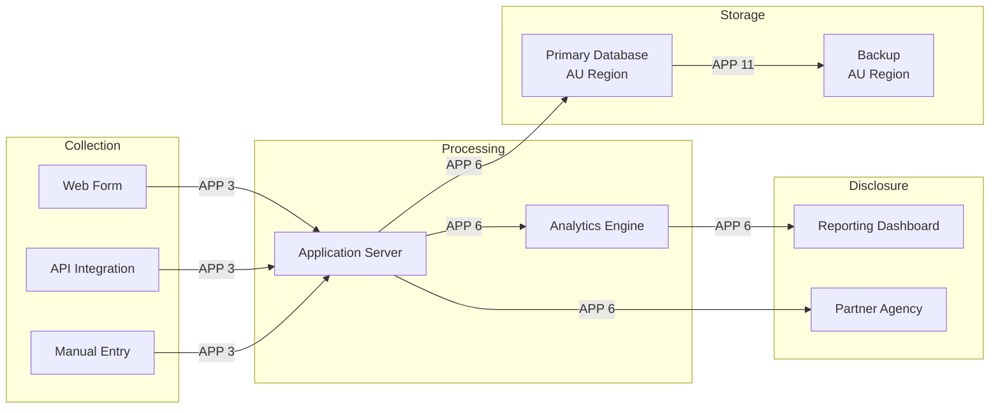

<!-- arckit-overlay-template: au-ai-assurance-template.md -->

# AI Assurance Assessment

> **Template Origin**: Community | **ArcKit Version**: [VERSION] | **Command**:
> `/arckit:au-ai-assurance`

## Document Control

<!-- DOC-CONTROL-HEADER -->
<!-- Resolved at command-execution time per _partials/RENDERING.md. -->

## Revision History

| Version   | Date         | Author    | Changes                                                 | Approved By | Approval Date |
| --------- | ------------ | --------- | ------------------------------------------------------- | ----------- | ------------- |
| [VERSION] | [YYYY-MM-DD] | ArcKit AI | Initial creation from `/arckit:au-ai-assurance` command | PENDING     | PENDING       |

---

## Executive Summary

[Two to three paragraphs: AI system, deployment phase, regulatory frameworks in
scope, overall assurance posture, key gaps.]

---

## 1. AI System Description

| Field                               | Value                                                                                       |
| ----------------------------------- | ------------------------------------------------------------------------------------------- |
| **System Name**                     | [System name]                                                                               |
| **Purpose**                         | [What the AI does and for whom]                                                             |
| **AI Capability Type**              | [Generative / Predictive / Decision-Support / Decision-Making / Agentic / Multi-Modal]      |
| **Deployment Phase**                | [Research / Pilot / Production]                                                             |
| **Foundation Model**                | [Model + version + vendor — e.g., Claude Opus 4 / GPT-4 / Gemini 2.0 / open-source Llama 3] |
| **Training-Data Sources**           | [Public / proprietary / mixed; classification level]                                        |
| **Inference-Data Sources**          | [User input / database / API / mixed]                                                       |
| **Decisions Affecting Individuals** | [Yes — describe / No / Decision-support only]                                               |
| **Human-in-the-Loop Posture**       | [Always / Threshold-triggered / None]                                                       |
| **Population Affected**             | [Internal users / customers / public / regulated cohort]                                    |
| **Assessment Date**                 | [YYYY-MM-DD]                                                                                |
| **AI Accountable Officer**          | [Name + role]                                                                               |

---

## 2. DTA Responsible AI Policy v2.0 Compliance

| Accountability                                        | Status     | Evidence                          | Gap   | Mitigation |
| ----------------------------------------------------- | ---------- | --------------------------------- | ----- | ---------- |
| 1. Accountability — designated AI accountable officer | [✅/⚠️/❌] | [Evidence]                        | [Gap] | [Action]   |
| 2. Transparency — public AI use disclosure            | [✅/⚠️/❌] | [Evidence]                        | [Gap] | [Action]   |
| 3. Risk-based approach — AI risk assessment performed | [✅/⚠️/❌] | [Evidence]                        | [Gap] | [Action]   |
| 4. Quality data + design integrity                    | [✅/⚠️/❌] | [Evidence]                        | [Gap] | [Action]   |
| 5. Privacy + security (cross-ref PIA + ISM + E8)      | [✅/⚠️/❌] | [Cite ARC-{P}-AUPIA, AUISM, AUE8] | [Gap] | [Action]   |
| 6. Human oversight + redress                          | [✅/⚠️/❌] | [Evidence]                        | [Gap] | [Action]   |

---

## 3. AU AI Ethics Principles Alignment

| Principle                                      | Status     | Evidence                      | Gap   | Mitigation |
| ---------------------------------------------- | ---------- | ----------------------------- | ----- | ---------- |
| 1. Human, societal and environmental wellbeing | [✅/⚠️/❌] | [Evidence]                    | [Gap] | [Action]   |
| 2. Human-centred values                        | [✅/⚠️/❌] | [Evidence]                    | [Gap] | [Action]   |
| 3. Fairness                                    | [✅/⚠️/❌] | [Cite Fairness Assessment §6] | [Gap] | [Action]   |
| 4. Privacy protection and security             | [✅/⚠️/❌] | [Cite PIA + E8 + ISM]         | [Gap] | [Action]   |
| 5. Reliability and safety                      | [✅/⚠️/❌] | [Evidence]                    | [Gap] | [Action]   |
| 6. Transparency and explainability             | [✅/⚠️/❌] | [Evidence]                    | [Gap] | [Action]   |
| 7. Contestability                              | [✅/⚠️/❌] | [Evidence]                    | [Gap] | [Action]   |
| 8. Accountability                              | [✅/⚠️/❌] | [Evidence]                    | [Gap] | [Action]   |

---

## 4. AU Essential AI Practices (AI6) Alignment

National AI Centre (NAIC) operational practices for safe and responsible AI
adoption — see
[Guidance for AI Adoption: Foundations](https://www.ai.gov.au/staying-safe-and-responsible/essential-ai-practices/guidance-ai-adoption-foundations)
and the deeper
[Implementation Guidance](https://www.ai.gov.au/staying-safe-and-responsible/essential-ai-practices/guidance-ai-adoption-implementation-guidance)
(each practice has Getting started + Next steps prompts on the source).

| # | Practice                                | Status         | Evidence                                                                                 | Gap   | Action   |
| - | --------------------------------------- | -------------- | ---------------------------------------------------------------------------------------- | ----- | -------- |
| 1 | Decide who is accountable               | [✅/⚠️/❌/N/A] | [Cite accountable AI officer designation; cross-ref DTA Responsible AI Policy section 2] | [Gap] | [Action] |
| 2 | Understand impacts and plan accordingly | [✅/⚠️/❌/N/A] | [Cite impact assessment / PIA where relevant]                                            | [Gap] | [Action] |
| 3 | Measure and manage risks                | [✅/⚠️/❌/N/A] | [Cite RISK register entries; AI-specific risk methodology]                               | [Gap] | [Action] |
| 4 | Share essential information             | [✅/⚠️/❌/N/A] | [Cite transparency artefacts; AI use disclosure; user-facing notices]                    | [Gap] | [Action] |
| 5 | Test and monitor                        | [✅/⚠️/❌/N/A] | [Cite testing methodology; monitoring dashboards; drift detection]                       | [Gap] | [Action] |
| 6 | Maintain human control                  | [✅/⚠️/❌/N/A] | [Cite human-in-the-loop posture; intervention pathways; redress mechanism]               | [Gap] | [Action] |

**Cross-framework note**: AI6 practices align closely with the DTA Responsible
AI Policy v2.0 six accountabilities (section 2 of this assessment) but are
framed as adoption _practices_ rather than policy _accountabilities_. Use both
lenses; the differences in framing surface different evidence gaps.

---

## 5. ISO 42001 Readiness

| Clause | Topic                       | Readiness  | Notes   |
| ------ | --------------------------- | ---------- | ------- |
| 4      | Context of the organisation | [✅/⚠️/❌] | [Notes] |
| 5      | Leadership                  | [✅/⚠️/❌] | [Notes] |
| 6      | Planning                    | [✅/⚠️/❌] | [Notes] |
| 7      | Support                     | [✅/⚠️/❌] | [Notes] |
| 8      | Operation                   | [✅/⚠️/❌] | [Notes] |
| 9      | Performance evaluation      | [✅/⚠️/❌] | [Notes] |
| 10     | Improvement                 | [✅/⚠️/❌] | [Notes] |

**Certification position**: [Targeting certification / Internal alignment only /
Not pursuing]

---

## 6. Privacy Act AI-Decision Notification (Dec 2026)

| Aspect                                                      | Detail                                                |
| ----------------------------------------------------------- | ----------------------------------------------------- |
| **Substantially-automated decisions affecting individuals** | [Yes / No]                                            |
| **Notification mechanism**                                  | [Implemented / Planned for Dec 2026 / Not applicable] |
| **What individuals are told**                               | [Description of notification content]                 |
| **Opt-out pathway**                                         | [Yes — describe / Not applicable]                     |
| **Cross-reference**                                         | [ARC-{P}-AUPIA-v* APP 6 + APP 11]                     |

---

## 7. Fairness Assessment

| Aspect                          | Detail                                                                       |
| ------------------------------- | ---------------------------------------------------------------------------- |
| **Methodology**                 | [E.g., demographic parity, equalised odds, predictive parity]                |
| **Protected Attributes Tested** | [List — race, ethnicity, gender, age, disability, geographic, socioeconomic] |
| **Test Population Segments**    | [Description]                                                                |
| **Fairness Metrics + Results**  | [Metric: result, threshold, pass/fail per segment]                           |
| **Residual Fairness Risks**     | [Description]                                                                |
| **Validated by**                | [Internal / External fairness specialist]                                    |

---

## 8. Security of AI Training + Inference Data

| Aspect                            | Detail                                                                                 |
| --------------------------------- | -------------------------------------------------------------------------------------- |
| **Training-Data Classification**  | [UNOFFICIAL / OFFICIAL / OFFICIAL:Sensitive / PROTECTED — note model can memorise PII] |
| **Inference-Data Classification** | [Same scale; consider input + output PII risk]                                         |
| **Prompt-Injection Defences**     | [Implemented / Planned]                                                                |
| **Model-Extraction Defences**     | [Implemented / Planned]                                                                |
| **Training-Data Sanitisation**    | [Process description]                                                                  |
| **E8 Cross-Reference**            | [ARC-{P}-AUE8-v* — Strategies 1, 4, 11 most relevant]                                  |
| **ISM Cross-Reference**           | [ARC-{P}-AUISM-v* Domain 9 + 12]                                                       |

---

## 9. Model Lifecycle Governance

| Aspect                           | Detail                             |
| -------------------------------- | ---------------------------------- |
| **Version Control**              | [Tooling + cadence]                |
| **Change Management**            | [Process for model updates]        |
| **Drift Detection**              | [Metrics + alerting]               |
| **Retraining Cadence**           | [Trigger conditions]               |
| **Retirement / Sunset Criteria** | [Description]                      |
| **Audit Trail**                  | [Inference logs retention + scope] |

---

## 10. Vendor / Foundation-Model Disclosure

| Aspect                          | Detail                                                 |
| ------------------------------- | ------------------------------------------------------ |
| **Vendor Name**                 | [E.g., Anthropic / OpenAI / Google]                    |
| **Model + Version**             | [E.g., Claude Sonnet 5 (session default)]              |
| **Vendor AI Policy Compliance** | [Vendor's published AI policy alignment]               |
| **Training-Data Provenance**    | [Disclosed / Partially disclosed / Not disclosed]      |
| **Inference Region**            | [AU / US / EU / global]                                |
| **IP / Copyright Position**     | [Vendor indemnification stance; user-content rights]   |
| **Data-Use Policy**             | [Whether prompts/completions used for vendor training] |

---

## 11. Recommendations

### Quick Wins ( < 30 days)

| # | Recommendation   | Framework                            | Effort       |
| - | ---------------- | ------------------------------------ | ------------ |
| 1 | [Recommendation] | [DTA / AIEP / ISO42001 / PrivacyAct] | [Low/Medium] |

### Short-Term (30–90 days)

| # | Recommendation   | Framework   | Effort        |
| - | ---------------- | ----------- | ------------- |
| 1 | [Recommendation] | [Framework] | [Medium/High] |

### Medium-Term (90–180 days)

| # | Recommendation   | Framework   | Effort |
| - | ---------------- | ----------- | ------ |
| 1 | [Recommendation] | [Framework] | [High] |

---

## 12. External References

### ArcKit Evidence Integration

| Evidence Area            | ArcKit Artefact                         | How It Supports AI Assurance                                                        | Gap / Follow-up   |
| ------------------------ | --------------------------------------- | ----------------------------------------------------------------------------------- | ----------------- |
| AI data and prompt flows | `/arckit:dfd` / ARC-_-DFD-_             | Training, inference, prompt, output, disclosure, and feedback flows                 | [Gap / follow-up] |
| AI data inventory        | `/arckit:data-model` / ARC-_-DATA-_     | Training, inference, prompt, output, personal, sensitive, and derived data entities | [Gap / follow-up] |
| AI risks                 | `/arckit:risk` / ARC-_-RISK-_           | Bias, drift, prompt injection, model extraction, privacy, and sovereignty risks     | [Gap / follow-up] |
| Obligation traceability  | `/arckit:traceability` / ARC-_-TRAC-_   | DTA policy, AI6, ethics, Privacy Act, and control mappings                          | [Gap / follow-up] |
| Coverage view            | `/arckit:graph-report`                  | AU assurance coverage across privacy, data, risk, and traceability artefacts        | [Gap / follow-up] |
| Capability uplift        | `/arckit:maturity-model` / ARC-_-MMOD-_ | AI governance and model lifecycle maturity baseline and roadmap                     | [Gap / follow-up] |

### Document Register

| Doc ID   | Filename                                            | Type                 | Source             | Description                                                |
| -------- | --------------------------------------------------- | -------------------- | ------------------ | ---------------------------------------------------------- |
| DTAAI    | DTA Responsible AI Policy v2.0                      | Policy               | digital.gov.au     | Effective Dec 2025                                         |
| AUAIEP   | AU AI Ethics Principles                             | Framework            | industry.gov.au    | 8 voluntary principles                                     |
| AI6F     | AU Essential AI Practices — Foundations             | Operational Guidance | ai.gov.au (NAIC)   | 6 essential practices for safe and responsible AI adoption |
| AI6IG    | AU Essential AI Practices — Implementation Guidance | Operational Guidance | ai.gov.au (NAIC)   | Per-practice Getting started + Next steps prompts          |
| ISO42001 | ISO 42001:2023 (AS adopted Feb 2024)                | Standard             | standards.org.au   | AI Management Systems                                      |
| PA88     | Privacy Act 1988 (Cth)                              | Legislation          | legislation.gov.au | AI-decision notification Dec 2026                          |
| AUPIA    | ARC-{P}-AUPIA-v*                                    | ArcKit Artefact      | projects/          | APP 6 + APP 11 cross-ref                                   |
| AUE8     | ARC-{P}-AUE8-v*                                     | ArcKit Artefact      | projects/          | E8 cross-ref                                               |
| AUISM    | ARC-{P}-AUISM-v*                                    | ArcKit Artefact      | projects/          | ISM cross-ref                                              |

### Citations

| Citation ID | Doc ID | Page/Section | Category | Quoted Passage |
| ----------- | ------ | ------------ | -------- | -------------- |
| —           | —      | —            | —        | —              |

### Unreferenced Documents

| Filename | Source Location | Reason |
| -------- | --------------- | ------ |
| —        | —               | —      |

### Verification

| Standard                                            | URL                                                                                                                          | Verification Date |
| --------------------------------------------------- | ---------------------------------------------------------------------------------------------------------------------------- | ----------------- |
| DTA Responsible AI Policy                           | https://www.digital.gov.au/policy/ai/policy                                                                                  | [YYYY-MM-DD]      |
| AU AI Ethics Principles                             | https://www.industry.gov.au/publications/australias-artificial-intelligence-ethics-framework/australias-ai-ethics-principles | [YYYY-MM-DD]      |
| AU Essential AI Practices (AI6) — Foundations       | https://www.ai.gov.au/staying-safe-and-responsible/essential-ai-practices/guidance-ai-adoption-foundations                   | [YYYY-MM-DD]      |
| AU Essential AI Practices — Implementation Guidance | https://www.ai.gov.au/staying-safe-and-responsible/essential-ai-practices/guidance-ai-adoption-implementation-guidance       | [YYYY-MM-DD]      |
| Privacy Act 1988                                    | https://www.legislation.gov.au/Details/C2024C00301                                                                           | [YYYY-MM-DD]      |

---

## Visual Evidence Decision Rule

Generate companion visual artefacts only when the available evidence includes
enough structure to identify real nodes and relationships. If evidence is
incomplete but structurally useful, create a clearly marked draft visual with
`Pending Input` labels. If structural evidence is insufficient, do not create a
diagram; record a Visual Evidence Gap and list the minimum inputs needed.

---

**Generated by**: ArcKit `/arckit:au-ai-assurance` command **Generated on**:
[DATE] **ArcKit Version**: [VERSION] **Project**: [PROJECT_NAME] **Model**:
[AI_MODEL]

<!-- arckit-overlay-template: au-disp-attestation-template.md -->

# DISP Member Self-Attestation Pack

> **Template Origin**: Community | **ArcKit Version**: [VERSION] | **Command**:
> `/arckit:au-disp-attestation`

## Document Control

<!-- DOC-CONTROL-HEADER -->
<!-- Resolved at command-execution time per _partials/RENDERING.md. -->

## Revision History

| Version   | Date         | Author    | Changes                                                     | Approved By | Approval Date |
| --------- | ------------ | --------- | ----------------------------------------------------------- | ----------- | ------------- |
| [VERSION] | [YYYY-MM-DD] | ArcKit AI | Initial creation from `/arckit:au-disp-attestation` command | PENDING     | PENDING       |

---

## Executive Summary

[Two to three paragraphs: organisation, DISP level sought, current attestation
readiness, key gaps, target attestation date.]

---

## 1. Organisation Profile

| Field                          | Value                                        |
| ------------------------------ | -------------------------------------------- |
| **Legal Entity**               | [Full name + ABN]                            |
| **Trading Names**              | [If applicable]                              |
| **Primary Business Activity**  | [e.g., Infrastructure Advisory]              |
| **Headcount**                  | [Total + by site]                            |
| **Sites**                      | [Office locations + cloud-tenant region]     |
| **Defence Contracts in Scope** | [Active / pipeline contracts requiring DISP] |
| **DISP Level Sought**          | [Level 1 / 2 / 3]                            |
| **Target Attestation Date**    | [YYYY-MM-DD]                                 |

---

## 2. DISP Level Sought

| Aspect                       | Detail                                                                                  |
| ---------------------------- | --------------------------------------------------------------------------------------- |
| **Level**                    | [Level 1 / 2 / 3]                                                                       |
| **Regulatory Driver**        | [Specific contract / panel mandate / pipeline anticipation]                             |
| **Justification**            | [Why this level — types of Defence work, classified content handling]                   |
| **Anticipated Defence Work** | [UNCLASSIFIED / OFFICIAL / OFFICIAL:Sensitive / PROTECTED — content categories handled] |

---

## 3. Security Officer Designation

| Aspect                           | Detail                                                                                 |
| -------------------------------- | -------------------------------------------------------------------------------------- |
| **Chief Security Officer (CSO)** | [Name + role title]                                                                    |
| **CSO Authority**                | [Reporting line, signing authority, budget authority across the four security domains] |
| **CSO Clearance Level**          | [Baseline / NV1 / NV2 / PV]                                                            |
| **Deputy CSO / Backup**          | [Name + role + clearance]                                                              |
| **CSO Contact**                  | [Email / phone for Defence engagement]                                                 |
| **Vetting Status Verified**      | [Yes / In progress / Not yet]                                                          |

---

## 4. Four Security Domains Coverage

### Domain 1: Governance

| Aspect                    | Detail         |
| ------------------------- | -------------- |
| **Implementation Status** | [✅ / ⚠️ / ❌] |

**Evidence**: [Security policy framework, risk management plan, audit cadence,
incident management process, change control. Cite ISM applicability statement
[ARC-{P}-AUISM] Domain 1 + 4]

**Gaps**: [List]

**Remediation**: [Actions, owners, target dates]

**Sign-off**: [Accountable officer + date]

---

### Domain 2: Personnel Security

| Aspect                      | Detail                                                    |
| --------------------------- | --------------------------------------------------------- |
| **Implementation Status**   | [✅ / ⚠️ / ❌]                                            |
| **Cleared Personnel Count** | [By clearance level — Baseline: n, NV1: n, NV2: n, PV: n] |
| **Vetting Workflow**        | [In-house / outsourced; turnaround time]                  |

**Evidence**: [Clearance verification process, security awareness training
programme, separation of duties model, off-boarding clearance debrief procedure,
pre/post-leave briefing for cleared personnel. Cite ISM Domain 5]

**Gaps**: [List]

**Remediation**: [Actions, owners, target dates]

**Sign-off**: [Accountable officer + date]

---

### Domain 3: Physical Security

| Aspect                    | Detail                                              |
| ------------------------- | --------------------------------------------------- |
| **Implementation Status** | [✅ / ⚠️ / ❌ / Inherited from IRAP cloud provider] |

**Evidence**: [Facility access controls, ICT equipment lifecycle, secure media
handling, equipment disposal. For cloud-only systems, cite cloud provider IRAP
scope statement (Microsoft IRAP PROTECTED date / AWS IRAP date / GCP IRAP
date) + customer-side responsibility implementation]

**Gaps**: [Specific cloud-shared-responsibility gaps]

**Remediation**: [Actions, owners, target dates]

**Sign-off**: [Accountable officer + date]

---

### Domain 4: Information & Cyber Security

| Aspect                          | Detail             |
| ------------------------------- | ------------------ |
| **Implementation Status**       | [✅ / ⚠️ / ❌]     |
| **E8 Posture Reference**        | [ARC-{P}-AUE8-v*]  |
| **ISM Applicability Reference** | [ARC-{P}-AUISM-v*] |

**Evidence**: [Defer to E8 posture artefact for E8 ML2 evidence; ISM
applicability for additional controls. Specifically address: cryptography
(Domain 12), gateway security (Domain 13), monitoring (Domain 11), BCP
(cross-references E8 Strategy 8)]

**Gaps**: [Beyond E8 ML2, list ISM-domain-specific gaps]

**Remediation**: [Actions, owners, target dates]

**Sign-off**: [Accountable officer + date]

---

## 5. Essential Eight ML2 Evidence Per Strategy

(Summarised from `ARC-{P}-AUE8-v*` — refer to that artefact for evidence
detail.)

| # | Strategy                    | Current ML | ML2 Evidence       | Gap to ML2 | Sign-off         |
| - | --------------------------- | ---------- | ------------------ | ---------- | ---------------- |
| 1 | Application Control         | [ML0–3]    | [Evidence summary] | [Gap]      | [Officer + date] |
| 2 | Patch Applications          | [ML0–3]    | [Evidence summary] | [Gap]      | [Officer + date] |
| 3 | Configure MS Office Macros  | [ML0–3]    | [Evidence summary] | [Gap]      | [Officer + date] |
| 4 | User Application Hardening  | [ML0–3]    | [Evidence summary] | [Gap]      | [Officer + date] |
| 5 | Restrict Admin Privileges   | [ML0–3]    | [Evidence summary] | [Gap]      | [Officer + date] |
| 6 | Patch Operating Systems     | [ML0–3]    | [Evidence summary] | [Gap]      | [Officer + date] |
| 7 | Multi-Factor Authentication | [ML0–3]    | [Evidence summary] | [Gap]      | [Officer + date] |
| 8 | Regular Backups             | [ML0–3]    | [Evidence summary] | [Gap]      | [Officer + date] |

---

## 6. ISM Applicability Highlights

(Summarised from `ARC-{P}-AUISM-v*`.)

| ISM Domain                                | Material to DISP     | Implementation         | Gap   |
| ----------------------------------------- | -------------------- | ---------------------- | ----- |
| 1. Cyber Security Governance              | High                 | [✅/⚠️/❌]             | [Gap] |
| 3. Outsourced Services (MSP boundary)     | High                 | [✅/⚠️/❌]             | [Gap] |
| 4. Security Documentation (SSP, SRMP)     | High                 | [✅/⚠️/❌]             | [Gap] |
| 5. Personnel Security                     | High (DISP-specific) | [✅/⚠️/❌]             | [Gap] |
| 10. System Management (privileged access) | High                 | [✅/⚠️/❌]             | [Gap] |
| 11. System Monitoring (audit retention)   | High                 | [✅/⚠️/❌]             | [Gap] |
| 12. Cryptography                          | Medium               | [✅/⚠️/❌]             | [Gap] |
| 15. Cloud and IaaS Considerations         | High (if cloud-only) | [✅/⚠️/❌ / Inherited] | [Gap] |

---

## 7. Foreign Ownership, Control or Influence (FOCI) Declaration

| Aspect                                   | Detail                                                  |
| ---------------------------------------- | ------------------------------------------------------- |
| **Foreign Ownership > 5%**               | [Yes / No — if Yes: nation, percentage, entity]         |
| **Foreign Board Members**                | [Number, nationalities, role authority]                 |
| **Foreign Personnel with System Access** | [Number, nationalities, access scope]                   |
| **Foreign Supply-Chain Dependencies**    | [Description]                                           |
| **FOCI Mitigation Plan**                 | [If applicable, summary; cite supporting documentation] |

---

## 8. Supply Chain Security

| Tier 1 Supplier  | Service    | Attestation Held           | Last Reviewed | Cleared for DISP Level |
| ---------------- | ---------- | -------------------------- | ------------- | ---------------------- |
| [MSP name]       | M365 admin | [SOC 2 / ISO 27001 / IRAP] | [YYYY-MM-DD]  | [Level 1/2/3]          |
| [Cloud Provider] | IaaS/PaaS  | [IRAP PROTECTED date]      | [YYYY-MM-DD]  | [Level 1/2/3]          |
| [SaaS Provider]  | [Service]  | [Attestation]              | [YYYY-MM-DD]  | [Level 1/2/3]          |

**Supply-Chain Risk Management Process**: [Describe vendor onboarding, ongoing
review, exit procedures]

---

## 9. Incident Response & Reporting

| Aspect                                      | Detail                                                          |
| ------------------------------------------- | --------------------------------------------------------------- |
| **Incident Response Plan**                  | [Document reference]                                            |
| **24-Hour Defence Notification Capability** | [✅ / ⚠️ / ❌]                                                  |
| **OAIC NDB Scheme Integration**             | [✅ / ⚠️ / ❌; cite NDB playbook ARC-{P}-AUNDB-v* if available] |
| **Last Tabletop / Live Exercise**           | [YYYY-MM-DD]                                                    |
| **Lessons Learned Process**                 | [Description]                                                   |

---

## 10. Security Awareness Training

| Aspect                          | Detail                                                              |
| ------------------------------- | ------------------------------------------------------------------- |
| **Programme Name**              | [E.g., DISP-aligned cyber awareness in ELMO]                        |
| **Modules**                     | [Mandatory / role-specific / clearance-holder additional briefings] |
| **Completion Rate (last 12mo)** | [%]                                                                 |
| **Refresher Cadence**           | [Annual / event-driven]                                             |
| **Cleared-Personnel Briefings** | [Pre-leave / post-leave / change-of-role]                           |

---

## 11. Annual Self-Audit Plan

| Aspect                 | Detail                                               |
| ---------------------- | ---------------------------------------------------- |
| **Scope**              | [Four domains coverage; specific control sample]     |
| **Methodology**        | [Self-assessment + evidence review + sample testing] |
| **Frequency**          | [Annual minimum; on-major-change additional]         |
| **Evidence Retention** | [Years]                                              |
| **Last Audit Date**    | [YYYY-MM-DD]                                         |
| **Next Scheduled**     | [YYYY-MM-DD]                                         |

---

## 12. Attestation Statement

I/we attest that the information in this pack is accurate to the best of my/our
knowledge as at the date below. We commit to maintaining the security posture
described, completing the listed remediation actions by their target dates, and
notifying Defence promptly of any material change to the four security domains.

| Role                         | Name | Signature | Date         |
| ---------------------------- | ---- | --------- | ------------ |
| Chief Security Officer       |      |           |              |
| Director / Managing Director |      |           |              |
| Date of Attestation          |      |           | [YYYY-MM-DD] |
| Re-Attestation Due           |      |           | [YYYY-MM-DD] |

---

## 13. External References

### Upstream ArcKit Evidence

| Evidence Area         | ArcKit Artefact                         | How It Supports DISP Attestation                                                       | Gap / Follow-up   |
| --------------------- | --------------------------------------- | -------------------------------------------------------------------------------------- | ----------------- |
| Operational ownership | `/arckit:servicenow` / ARC-_-SNOW-_     | ServiceNow/CMDB CIs, support groups, incident queues, change controls, supplier access | [Gap / follow-up] |
| Residual risks        | `/arckit:risk` / ARC-_-RISK-_           | DISP gaps, risk acceptance, treatment ownership, renewal risks                         | [Gap / follow-up] |
| Claim provenance      | `/arckit:traceability` / ARC-_-TRAC-_   | DISP claims mapped to AU artefacts, policies, controls, owners, and evidence records   | [Gap / follow-up] |
| Coverage view         | `/arckit:graph-report`                  | AUDISP coverage across AU compliance, risk, traceability, and operations artefacts     | [Gap / follow-up] |
| Capability uplift     | `/arckit:maturity-model` / ARC-_-MMOD-_ | Governance, personnel, physical, cyber, and supplier maturity roadmap                  | [Gap / follow-up] |

| Artefact                        | Doc-ID              | Cross-Reference                                      |
| ------------------------------- | ------------------- | ---------------------------------------------------- |
| ASD Essential Eight Posture     | `ARC-{P}-AUE8-v*`   | E8 maturity evidence per Strategy in section 6       |
| ASD ISM Applicability           | `ARC-{P}-AUISM-v*`  | ISM control coverage per domain in section 6         |
| Privacy Impact Assessment       | `ARC-{P}-AUPIA-v*`  | APP 11 personal-information protection evidence      |
| Notifiable Data Breach Playbook | `ARC-{P}-AUNDB-v*`  | Incident-response capability evidence                |
| PSPF Compliance Assessment      | `ARC-{P}-AUPSPF-v*` | Physical / personnel / governance security evidence  |
| DTA Digital Service Standard    | `ARC-{P}-AUDSS-v*`  | Service-design assurance evidence (where applicable) |
| AI Assurance Assessment         | `ARC-{P}-AUAIA-v*`  | AI-system risk-control evidence (where applicable)   |

### Document Register

| Doc ID | Filename                           | Type            | Source         | Description                                            |
| ------ | ---------------------------------- | --------------- | -------------- | ------------------------------------------------------ |
| DISP   | DISP Membership Pack               | Standard        | defence.gov.au | DISP application + evidence framework — edition [DATE] |
| AUE8   | ARC-{P}-AUE8-v*                    | ArcKit Artefact | projects/      | Essential Eight evidence                               |
| AUISM  | ARC-{P}-AUISM-v*                   | ArcKit Artefact | projects/      | ISM applicability evidence                             |
| AUPIA  | ARC-{P}-AUPIA-v*                   | ArcKit Artefact | projects/      | Privacy Act + APP 11 evidence                          |
| AUNDB  | ARC-{P}-AUNDB-v*                   | ArcKit Artefact | projects/      | NDB playbook evidence (if available)                   |
| ASDISM | ASD Information Security Manual    | Standard        | cyber.gov.au   | Underlying control framework                           |
| E8MM   | ASD Essential Eight Maturity Model | Standard        | cyber.gov.au   | E8 ML2 minimum reference                               |

### Citations

| Citation ID | Doc ID | Page/Section | Category | Quoted Passage |
| ----------- | ------ | ------------ | -------- | -------------- |
| —           | —      | —            | —        | —              |

### Unreferenced Documents

| Filename | Source Location | Reason |
| -------- | --------------- | ------ |
| —        | —               | —      |

### Verification

| Standard | URL                                                                                                                                | Verification Date |
| -------- | ---------------------------------------------------------------------------------------------------------------------------------- | ----------------- |
| DISP     | https://www.defence.gov.au/business-industry/programs/defence-industry-security-program                                            | [YYYY-MM-DD]      |
| ASD ISM  | https://www.cyber.gov.au/resources-business-and-government/essential-cyber-security/ism                                            | [YYYY-MM-DD]      |
| ASD E8   | https://www.cyber.gov.au/resources-business-and-government/essential-cyber-security/essential-eight/essential-eight-maturity-model | [YYYY-MM-DD]      |

---

## Visual Evidence Decision Rule

Generate companion visual artefacts only when the available evidence includes
enough structure to identify real nodes and relationships. If evidence is
incomplete but structurally useful, create a clearly marked draft visual with
`Pending Input` labels. If structural evidence is insufficient, do not create a
diagram; record a Visual Evidence Gap and list the minimum inputs needed.

---

**Generated by**: ArcKit `/arckit:au-disp-attestation` command **Generated on**:
[DATE] **ArcKit Version**: [VERSION] **Project**: [PROJECT_NAME] **Model**:
[AI_MODEL]

<!-- arckit-overlay-template: au-dss-template.md -->

# DTA Digital Service Standard Compliance Assessment

> **Template Origin**: Community | **ArcKit Version**: [VERSION] | **Command**:
> `/arckit:au-dss`

## Document Control

<!-- DOC-CONTROL-HEADER -->
<!-- Resolved at command-execution time per _partials/RENDERING.md. -->

## Revision History

| Version   | Date         | Author    | Changes                                        | Approved By | Approval Date |
| --------- | ------------ | --------- | ---------------------------------------------- | ----------- | ------------- |
| [VERSION] | [YYYY-MM-DD] | ArcKit AI | Initial creation from `/arckit:au-dss` command | PENDING     | PENDING       |

---

## Executive Summary

[Two to three paragraphs: service under assessment, whether and from when the
Standard applies to it, current compliance posture against the 10 criteria, key
gaps, exemptions sought, and readiness to report compliance to the DTA.]

---

## Service Context

| Field                                                   | Value                                                                                                              |
| ------------------------------------------------------- | ------------------------------------------------------------------------------------------------------------------ |
| **Service Name**                                        | [Service name]                                                                                                     |
| **Owning Agency**                                       | [Department / Agency]                                                                                              |
| **Service Type**                                        | [Informational / Transactional]                                                                                    |
| **Audience**                                            | [Public-facing / Staff-facing / Both]                                                                              |
| **New, Replacement or Existing**                        | [New / Replacement / Existing]                                                                                     |
| **Subject to the Investment Oversight Framework (IOF)** | [Yes / No]                                                                                                         |
| **Standard Applies From**                               | [1 July 2024 (new or replacement service) / 1 July 2025 (existing public-facing service) / Not mandatory — reason] |
| **Service Phase**                                       | [Discovery / Alpha / Beta / Live]                                                                                  |
| **Annual Transactions**                                 | [Volume or estimate]                                                                                               |
| **Assessment Date**                                     | [YYYY-MM-DD]                                                                                                       |
| **Assessor**                                            | [Name and role]                                                                                                    |

---

## Digital Service Standard Assessment

### Criterion 1: Have a Clear Intent

| Aspect     | Detail                                                      |
| ---------- | ----------------------------------------------------------- |
| **Status** | [✅ Met / ⚠️ Partially Met / ❌ Not Met / Exemption sought] |

**Evidence**: [Business case for change, survey of the policy and service
landscape, understanding of the service lifecycle, agile methodology adopted]

**Gaps**: [Problem not defined, no business case, policy landscape not surveyed]

**Remediation**: [Actions, owners, dates]

---

### Criterion 2: Know Your User

| Aspect     | Detail                                                      |
| ---------- | ----------------------------------------------------------- |
| **Status** | [✅ Met / ⚠️ Partially Met / ❌ Not Met / Exemption sought] |

**Evidence**: [Users and their contexts understood, user research methods and
findings, designs tested and validated with users]

**Gaps**: [Missing research, unvalidated assumptions, user groups not covered]

**Remediation**: [Actions, owners, dates]

---

### Criterion 3: Leave No One Behind

| Aspect                              | Detail                                                                          |
| ----------------------------------- | ------------------------------------------------------------------------------- |
| **Status**                          | [✅ Met / ⚠️ Partially Met / ❌ Not Met / Exemption sought]                     |
| **WCAG Version and Level Achieved** | [e.g., WCAG 2.2 AA / below target — state the target from current DTA guidance] |

**Evidence**: [Diversity of users understood, design for marginalised users,
compliance with the Disability Discrimination Act 1992, the latest WCAG version
and the Australian Government Style Manual, accessibility testing with assistive
technologies, feedback mechanism, non-digital experience considered]

**Gaps**: [WCAG failures, untested assistive technologies, no feedback
mechanism, user groups excluded]

**Remediation**: [Actions, owners, dates]

---

### Criterion 4: Connect Services

| Aspect     | Detail                                                      |
| ---------- | ----------------------------------------------------------- |
| **Status** | [✅ Met / ⚠️ Partially Met / ❌ Not Met / Exemption sought] |

**Evidence**: [Designed for interoperability, related services joined up,
integration points and shared identity or data exchanges]

**Gaps**: [Isolated service, duplicated user steps across services, undocumented
integrations]

**Remediation**: [Actions, owners, dates]

---

### Criterion 5: Build Trust in Design

| Aspect                          | Detail                                                      |
| ------------------------------- | ----------------------------------------------------------- |
| **Status**                      | [✅ Met / ⚠️ Partially Met / ❌ Not Met / Exemption sought] |
| **E8 Posture Reference**        | [ARC-{P}-AUE8-v{V} if available]                            |
| **ISM Applicability Reference** | [ARC-{P}-AUISM-v{V} if available]                           |

**Evidence**: [Transparent data handling, security measures implemented (E8
maturity, ISM controls, IRAP status), reliability and availability, accountable
service owner]

**Gaps**: [E8 strategies below target, opaque data handling, no reliability
targets, unclear accountability]

**Remediation**: [Actions, owners, dates]

---

### Criterion 6: Don't Reinvent the Wheel

| Aspect     | Detail                                                      |
| ---------- | ----------------------------------------------------------- |
| **Status** | [✅ Met / ⚠️ Partially Met / ❌ Not Met / Exemption sought] |

**Evidence**: [Common platforms, patterns and standards reused ("build once, use
many times"), common and seamless experience with other government services,
data reused where possible]

**Gaps**: [Bespoke builds where a common platform exists, inconsistent patterns,
data collected again that government already holds]

**Remediation**: [Actions, owners, dates]

---

### Criterion 7: Do No Harm

| Aspect            | Detail                                                      |
| ----------------- | ----------------------------------------------------------- |
| **Status**        | [✅ Met / ⚠️ Partially Met / ❌ Not Met / Exemption sought] |
| **PIA Reference** | [ARC-{P}-AUPIA-v{V} if available]                           |

**Evidence**: [Users' digital rights protected, privacy impacts understood (PIA,
APP compliance), limits of the data understood, adverse and unintended
consequences assessed]

**Gaps**: [Missing PIA, unassessed automated decisions, data used beyond its
limits]

**Remediation**: [Actions, owners, dates]

---

### Criterion 8: Innovate with Purpose

| Aspect                     | Detail                                                      |
| -------------------------- | ----------------------------------------------------------- |
| **Status**                 | [✅ Met / ⚠️ Partially Met / ❌ Not Met / Exemption sought] |
| **AI Assurance Reference** | [ARC-{P}-AUAIA-v{V} if AI is in scope]                      |

**Evidence**: [Clear intent for any new technology, guidance on critical and
emerging technologies followed, interoperability maintained, adoption of new
technology tracked]

**Gaps**: [Technology adopted without a defined purpose, emerging-technology
guidance not applied, adoption not measured]

**Remediation**: [Actions, owners, dates]

---

### Criterion 9: Monitor Your Service

| Aspect     | Detail                                                      |
| ---------- | ----------------------------------------------------------- |
| **Status** | [✅ Met / ⚠️ Partially Met / ❌ Not Met / Exemption sought] |

**Evidence**: [Baseline established, performance indicators identified,
measurement tooling, reporting and improvement cadence]

**Gaps**: [No baseline, missing indicators, no reporting]

**Remediation**: [Actions, owners, dates]

---

### Criterion 10: Keep It Relevant

| Aspect     | Detail                                                      |
| ---------- | ----------------------------------------------------------- |
| **Status** | [✅ Met / ⚠️ Partially Met / ❌ Not Met / Exemption sought] |

**Evidence**: [Improvement across the service's life driven by user feedback,
regular assessments scheduled, service upgrades communicated to users]

**Gaps**: [No improvement roadmap, no scheduled reassessment, changes not
communicated]

**Remediation**: [Actions, owners, dates]

---

## Compliance Summary

| #  | Criterion                | Status               | Gap Count |
| -- | ------------------------ | -------------------- | --------- |
| 1  | Have a clear intent      | [✅/⚠️/❌/Exemption] | [n]       |
| 2  | Know your user           | [✅/⚠️/❌/Exemption] | [n]       |
| 3  | Leave no one behind      | [✅/⚠️/❌/Exemption] | [n]       |
| 4  | Connect services         | [✅/⚠️/❌/Exemption] | [n]       |
| 5  | Build trust in design    | [✅/⚠️/❌/Exemption] | [n]       |
| 6  | Don't reinvent the wheel | [✅/⚠️/❌/Exemption] | [n]       |
| 7  | Do no harm               | [✅/⚠️/❌/Exemption] | [n]       |
| 8  | Innovate with purpose    | [✅/⚠️/❌/Exemption] | [n]       |
| 9  | Monitor your service     | [✅/⚠️/❌/Exemption] | [n]       |
| 10 | Keep it relevant         | [✅/⚠️/❌/Exemption] | [n]       |

**Overall**: [n] Met | [n] Partially Met | [n] Not Met | [n] Exemption sought

**Exemptions sought**: [Criterion, rationale and status under the DTA
Compliance, Reporting and Exemption Guide — or "None"]

---

## Assessment Readiness

Top risks to meeting all 10 criteria and reporting compliance to the DTA, and to
moving to the next Service Design and Delivery Process phase.

| Risk               | Criterion | Impact            | Mitigation          |
| ------------------ | --------- | ----------------- | ------------------- |
| [Risk description] | [#]       | [High/Medium/Low] | [Mitigation action] |

---

## External References

## ArcKit Evidence Integration

| Evidence Area                 | ArcKit Artefact                         | How It Supports DSS Assessment                                                          | Gap / Follow-up   |
| ----------------------------- | --------------------------------------- | --------------------------------------------------------------------------------------- | ----------------- |
| Service architecture          | `/arckit:diagram` / ARC-_-DIAG-_        | Service boundaries, channels, dependencies, security zones, and user journeys           | [Gap / follow-up] |
| Service data flows            | `/arckit:dfd` / ARC-_-DFD-_             | Privacy, integration, non-digital channel, analytics, and reporting flows               | [Gap / follow-up] |
| Data governance               | `/arckit:data-model` / ARC-_-DATA-_     | Personal data, analytics, reporting, retention, and data-quality evidence               | [Gap / follow-up] |
| Live operations               | `/arckit:servicenow` / ARC-_-SNOW-_     | Service ownership, support groups, SLAs, incident routing, and change workflows         | [Gap / follow-up] |
| Delivery and compliance risks | `/arckit:risk` / ARC-_-RISK-_           | Criteria gaps, launch risks, and remediation ownership                                  | [Gap / follow-up] |
| Criteria traceability         | `/arckit:traceability` / ARC-_-TRAC-_   | DSS criteria mapped to requirements, evidence, owners, and remediation actions          | [Gap / follow-up] |
| Coverage view                 | `/arckit:graph-report`                  | AUDSS coverage across architecture, privacy, security, risk, and traceability artefacts | [Gap / follow-up] |
| Capability uplift             | `/arckit:maturity-model` / ARC-_-MMOD-_ | Service maturity across discovery, delivery, operations, and measurement                | [Gap / follow-up] |

### Document Register

| Doc ID | Filename                                   | Type     | Source Location | Description                  |
| ------ | ------------------------------------------ | -------- | --------------- | ---------------------------- |
| DSS    | DTA Digital Service Standard (10 criteria) | Standard | digital.gov.au  | Primary assessment framework |

### Citations

| Citation ID | Doc ID | Page/Section | Category | Quoted Passage |
| ----------- | ------ | ------------ | -------- | -------------- |
| —           | —      | —            | —        | —              |

### Unreferenced Documents

| Filename | Source Location | Reason |
| -------- | --------------- | ------ |
| —        | —               | —      |

---

## Visual Evidence Decision Rule

Generate companion visual artefacts only when the available evidence includes
enough structure to identify real nodes and relationships. If evidence is
incomplete but structurally useful, create a clearly marked draft visual with
`Pending Input` labels. If structural evidence is insufficient, do not create a
diagram; record a Visual Evidence Gap and list the minimum inputs needed.

---

**Generated by**: ArcKit `/arckit:au-dss` command **Generated on**: [DATE]
**ArcKit Version**: [VERSION] **Project**: [PROJECT_NAME] **Model**: [AI_MODEL]

<!-- arckit-overlay-template: au-e8-posture-template.md -->

# ASD Essential Eight Maturity Posture Assessment

> **Template Origin**: Community | **ArcKit Version**: [VERSION] | **Command**:
> `/arckit:au-e8-posture`

## Document Control

<!-- DOC-CONTROL-HEADER -->
<!-- Resolved at command-execution time per _partials/RENDERING.md. -->

## Revision History

| Version   | Date         | Author    | Changes                                               | Approved By | Approval Date |
| --------- | ------------ | --------- | ----------------------------------------------------- | ----------- | ------------- |
| [VERSION] | [YYYY-MM-DD] | ArcKit AI | Initial creation from `/arckit:au-e8-posture` command | PENDING     | PENDING       |

---

## Executive Summary

[Two to three paragraphs: system under assessment, current overall E8 maturity
posture, highest-priority gaps, and DISP compliance position if applicable.]

---

## System Context

| Field                      | Value                                                             |
| -------------------------- | ----------------------------------------------------------------- |
| **System Name**            | [System name]                                                     |
| **Classification**         | [UNOFFICIAL / OFFICIAL / OFFICIAL:Sensitive / PROTECTED / SECRET] |
| **Deployment Model**       | [Cloud (SaaS/PaaS/IaaS) / On-Premise / Hybrid]                    |
| **IRAP Assessment Status** | [Assessed / In Progress / Not Required / Not Started]             |
| **Cloud Provider(s)**      | [AWS / Azure / GCP / Other — with IRAP status]                    |
| **Data Sovereignty**       | [All data in AU / Some offshore / Sovereign cloud]                |
| **DISP Member**            | [Yes (Level 1/2/3) / No / Not Applicable]                         |
| **Assessment Date**        | [YYYY-MM-DD]                                                      |
| **Assessor**               | [Name and role]                                                   |

---

## Essential Eight Maturity Assessment

### 1. Application Control

| Aspect                     | Detail                                          |
| -------------------------- | ----------------------------------------------- |
| **Current Maturity Level** | [ML0 / ML1 / ML2 / ML3]                         |
| **Target Maturity Level**  | [ML0 / ML1 / ML2 / ML3]                         |
| **Regulatory Driver**      | [DISP ML2 / PSPF / Contractual / Risk appetite] |

**Evidence of Current State**:

[Description of current application control measures — whitelisting tools,
policy enforcement, coverage scope.]

**Gap Analysis**:

| ML Level | Sub-Control               | Status                    | Gap Description |
| -------- | ------------------------- | ------------------------- | --------------- |
| ML1      | [Sub-control description] | [Met / Partial / Not Met] | [Gap detail]    |
| ML2      | [Sub-control description] | [Met / Partial / Not Met] | [Gap detail]    |
| ML3      | [Sub-control description] | [Met / Partial / Not Met] | [Gap detail]    |

**Remediation Actions**:

| Action               | Owner       | Target Date  | Priority                         |
| -------------------- | ----------- | ------------ | -------------------------------- |
| [Action description] | [Role/Name] | [YYYY-MM-DD] | [Critical / High / Medium / Low] |

---

### 2. Patch Applications

| Aspect                     | Detail                                          |
| -------------------------- | ----------------------------------------------- |
| **Current Maturity Level** | [ML0 / ML1 / ML2 / ML3]                         |
| **Target Maturity Level**  | [ML0 / ML1 / ML2 / ML3]                         |
| **Regulatory Driver**      | [DISP ML2 / PSPF / Contractual / Risk appetite] |

**Evidence of Current State**:

[Description of patching process — tools, SLAs, coverage, internet-facing vs
internal.]

**Gap Analysis**:

| ML Level | Sub-Control               | Status                    | Gap Description |
| -------- | ------------------------- | ------------------------- | --------------- |
| ML1      | [Sub-control description] | [Met / Partial / Not Met] | [Gap detail]    |
| ML2      | [Sub-control description] | [Met / Partial / Not Met] | [Gap detail]    |
| ML3      | [Sub-control description] | [Met / Partial / Not Met] | [Gap detail]    |

**Remediation Actions**:

| Action               | Owner       | Target Date  | Priority                         |
| -------------------- | ----------- | ------------ | -------------------------------- |
| [Action description] | [Role/Name] | [YYYY-MM-DD] | [Critical / High / Medium / Low] |

---

### 3. Configure Microsoft Office Macro Settings

| Aspect                     | Detail                                          |
| -------------------------- | ----------------------------------------------- |
| **Current Maturity Level** | [ML0 / ML1 / ML2 / ML3]                         |
| **Target Maturity Level**  | [ML0 / ML1 / ML2 / ML3]                         |
| **Regulatory Driver**      | [DISP ML2 / PSPF / Contractual / Risk appetite] |

**Evidence of Current State**:

[Description of macro policy — Group Policy settings, trusted locations, signing
requirements.]

**Gap Analysis**:

| ML Level | Sub-Control               | Status                    | Gap Description |
| -------- | ------------------------- | ------------------------- | --------------- |
| ML1      | [Sub-control description] | [Met / Partial / Not Met] | [Gap detail]    |
| ML2      | [Sub-control description] | [Met / Partial / Not Met] | [Gap detail]    |
| ML3      | [Sub-control description] | [Met / Partial / Not Met] | [Gap detail]    |

**Remediation Actions**:

| Action               | Owner       | Target Date  | Priority                         |
| -------------------- | ----------- | ------------ | -------------------------------- |
| [Action description] | [Role/Name] | [YYYY-MM-DD] | [Critical / High / Medium / Low] |

---

### 4. User Application Hardening

| Aspect                     | Detail                                          |
| -------------------------- | ----------------------------------------------- |
| **Current Maturity Level** | [ML0 / ML1 / ML2 / ML3]                         |
| **Target Maturity Level**  | [ML0 / ML1 / ML2 / ML3]                         |
| **Regulatory Driver**      | [DISP ML2 / PSPF / Contractual / Risk appetite] |

**Evidence of Current State**:

[Description of browser hardening, email client configuration, Office settings,
ad-blocking, Java/Flash removal.]

**Gap Analysis**:

| ML Level | Sub-Control               | Status                    | Gap Description |
| -------- | ------------------------- | ------------------------- | --------------- |
| ML1      | [Sub-control description] | [Met / Partial / Not Met] | [Gap detail]    |
| ML2      | [Sub-control description] | [Met / Partial / Not Met] | [Gap detail]    |
| ML3      | [Sub-control description] | [Met / Partial / Not Met] | [Gap detail]    |

**Remediation Actions**:

| Action               | Owner       | Target Date  | Priority                         |
| -------------------- | ----------- | ------------ | -------------------------------- |
| [Action description] | [Role/Name] | [YYYY-MM-DD] | [Critical / High / Medium / Low] |

---

### 5. Restrict Administrative Privileges

| Aspect                     | Detail                                          |
| -------------------------- | ----------------------------------------------- |
| **Current Maturity Level** | [ML0 / ML1 / ML2 / ML3]                         |
| **Target Maturity Level**  | [ML0 / ML1 / ML2 / ML3]                         |
| **Regulatory Driver**      | [DISP ML2 / PSPF / Contractual / Risk appetite] |

**Evidence of Current State**:

[Description of admin account management — PAM tools, JIT access, separation of
duties, regular review cadence.]

**Gap Analysis**:

| ML Level | Sub-Control               | Status                    | Gap Description |
| -------- | ------------------------- | ------------------------- | --------------- |
| ML1      | [Sub-control description] | [Met / Partial / Not Met] | [Gap detail]    |
| ML2      | [Sub-control description] | [Met / Partial / Not Met] | [Gap detail]    |
| ML3      | [Sub-control description] | [Met / Partial / Not Met] | [Gap detail]    |

**Remediation Actions**:

| Action               | Owner       | Target Date  | Priority                         |
| -------------------- | ----------- | ------------ | -------------------------------- |
| [Action description] | [Role/Name] | [YYYY-MM-DD] | [Critical / High / Medium / Low] |

---

### 6. Patch Operating Systems

| Aspect                     | Detail                                          |
| -------------------------- | ----------------------------------------------- |
| **Current Maturity Level** | [ML0 / ML1 / ML2 / ML3]                         |
| **Target Maturity Level**  | [ML0 / ML1 / ML2 / ML3]                         |
| **Regulatory Driver**      | [DISP ML2 / PSPF / Contractual / Risk appetite] |

**Evidence of Current State**:

[Description of OS patching — WSUS/SCCM/Intune, Linux patching, patching SLAs,
unsupported OS inventory.]

**Gap Analysis**:

| ML Level | Sub-Control               | Status                    | Gap Description |
| -------- | ------------------------- | ------------------------- | --------------- |
| ML1      | [Sub-control description] | [Met / Partial / Not Met] | [Gap detail]    |
| ML2      | [Sub-control description] | [Met / Partial / Not Met] | [Gap detail]    |
| ML3      | [Sub-control description] | [Met / Partial / Not Met] | [Gap detail]    |

**Remediation Actions**:

| Action               | Owner       | Target Date  | Priority                         |
| -------------------- | ----------- | ------------ | -------------------------------- |
| [Action description] | [Role/Name] | [YYYY-MM-DD] | [Critical / High / Medium / Low] |

---

### 7. Multi-Factor Authentication

| Aspect                     | Detail                                          |
| -------------------------- | ----------------------------------------------- |
| **Current Maturity Level** | [ML0 / ML1 / ML2 / ML3]                         |
| **Target Maturity Level**  | [ML0 / ML1 / ML2 / ML3]                         |
| **Regulatory Driver**      | [DISP ML2 / PSPF / Contractual / Risk appetite] |

**Evidence of Current State**:

[Description of MFA coverage — identity provider, MFA methods (FIDO2,
authenticator app, SMS), coverage scope (VPN, email, admin portals, cloud
services).]

**Gap Analysis**:

| ML Level | Sub-Control               | Status                    | Gap Description |
| -------- | ------------------------- | ------------------------- | --------------- |
| ML1      | [Sub-control description] | [Met / Partial / Not Met] | [Gap detail]    |
| ML2      | [Sub-control description] | [Met / Partial / Not Met] | [Gap detail]    |
| ML3      | [Sub-control description] | [Met / Partial / Not Met] | [Gap detail]    |

**Remediation Actions**:

| Action               | Owner       | Target Date  | Priority                         |
| -------------------- | ----------- | ------------ | -------------------------------- |
| [Action description] | [Role/Name] | [YYYY-MM-DD] | [Critical / High / Medium / Low] |

---

### 8. Regular Backups

| Aspect                     | Detail                                          |
| -------------------------- | ----------------------------------------------- |
| **Current Maturity Level** | [ML0 / ML1 / ML2 / ML3]                         |
| **Target Maturity Level**  | [ML0 / ML1 / ML2 / ML3]                         |
| **Regulatory Driver**      | [DISP ML2 / PSPF / Contractual / Risk appetite] |

**Evidence of Current State**:

[Description of backup strategy — RPO/RTO, backup scope, offline/immutable
copies, restore testing cadence.]

**Gap Analysis**:

| ML Level | Sub-Control               | Status                    | Gap Description |
| -------- | ------------------------- | ------------------------- | --------------- |
| ML1      | [Sub-control description] | [Met / Partial / Not Met] | [Gap detail]    |
| ML2      | [Sub-control description] | [Met / Partial / Not Met] | [Gap detail]    |
| ML3      | [Sub-control description] | [Met / Partial / Not Met] | [Gap detail]    |

**Remediation Actions**:

| Action               | Owner       | Target Date  | Priority                         |
| -------------------- | ----------- | ------------ | -------------------------------- |
| [Action description] | [Role/Name] | [YYYY-MM-DD] | [Critical / High / Medium / Low] |

---

## Maturity Summary Matrix

| # | Mitigation Strategy         | Current ML | Target ML | Gap Count | Priority                   |
| - | --------------------------- | ---------- | --------- | --------- | -------------------------- |
| 1 | Application Control         | [ML0–3]    | [ML0–3]   | [n]       | [Critical/High/Medium/Low] |
| 2 | Patch Applications          | [ML0–3]    | [ML0–3]   | [n]       | [Critical/High/Medium/Low] |
| 3 | Configure MS Office Macros  | [ML0–3]    | [ML0–3]   | [n]       | [Critical/High/Medium/Low] |
| 4 | User Application Hardening  | [ML0–3]    | [ML0–3]   | [n]       | [Critical/High/Medium/Low] |
| 5 | Restrict Admin Privileges   | [ML0–3]    | [ML0–3]   | [n]       | [Critical/High/Medium/Low] |
| 6 | Patch Operating Systems     | [ML0–3]    | [ML0–3]   | [n]       | [Critical/High/Medium/Low] |
| 7 | Multi-Factor Authentication | [ML0–3]    | [ML0–3]   | [n]       | [Critical/High/Medium/Low] |
| 8 | Regular Backups             | [ML0–3]    | [ML0–3]   | [n]       | [Critical/High/Medium/Low] |

**Overall Posture**: [ML0 / ML1 / ML2 / ML3] (lowest common level across all
eight strategies)

---

## DISP Compliance Position

| Assessment                         | Result                                               |
| ---------------------------------- | ---------------------------------------------------- |
| **DISP Member**                    | [Yes / No / Not Applicable]                          |
| **Required Level**                 | ML2 (all eight strategies)                           |
| **Current Compliance**             | [Compliant / Non-Compliant — n strategies below ML2] |
| **Strategies Below ML2**           | [List strategies and current ML]                     |
| **Estimated Remediation Timeline** | [Timeframe to achieve ML2 compliance]                |

---

## Cloud-Specific Considerations

| E8 Strategy                 | Shared Responsibility Model    | Notes                  |
| --------------------------- | ------------------------------ | ---------------------- |
| Application Control         | [Customer / Shared / Provider] | [Cloud-specific notes] |
| Patch Applications          | [Customer / Shared / Provider] | [Cloud-specific notes] |
| Configure MS Office Macros  | [Customer / Shared / Provider] | [Cloud-specific notes] |
| User Application Hardening  | [Customer / Shared / Provider] | [Cloud-specific notes] |
| Restrict Admin Privileges   | [Customer / Shared / Provider] | [Cloud-specific notes] |
| Patch Operating Systems     | [Customer / Shared / Provider] | [Cloud-specific notes] |
| Multi-Factor Authentication | [Customer / Shared / Provider] | [Cloud-specific notes] |
| Regular Backups             | [Customer / Shared / Provider] | [Cloud-specific notes] |

---

## Recommendations

### Quick Wins ( < 30 days)

| # | Recommendation   | E8 Strategy | Target ML | Effort       |
| - | ---------------- | ----------- | --------- | ------------ |
| 1 | [Recommendation] | [Strategy]  | [ML]      | [Low/Medium] |

### Short-Term (30–90 days)

| # | Recommendation   | E8 Strategy | Target ML | Effort        |
| - | ---------------- | ----------- | --------- | ------------- |
| 1 | [Recommendation] | [Strategy]  | [ML]      | [Medium/High] |

### Medium-Term (90–180 days)

| # | Recommendation   | E8 Strategy | Target ML | Effort |
| - | ---------------- | ----------- | --------- | ------ |
| 1 | [Recommendation] | [Strategy]  | [ML]      | [High] |

---

## External References

> This section provides traceability from generated content back to source
> documents.

## ArcKit Evidence Integration

| Evidence Area        | ArcKit Artefact                         | How It Supports E8 Posture                                                           | Gap / Follow-up   |
| -------------------- | --------------------------------------- | ------------------------------------------------------------------------------------ | ----------------- |
| Security risks       | `/arckit:risk` / ARC-_-RISK-_           | E8 gaps, treatment owners, residual risks, and acceptance decisions                  | [Gap / follow-up] |
| Control traceability | `/arckit:traceability` / ARC-_-TRAC-_   | E8 strategies mapped to requirements, ISM controls, DISP claims, and risk treatments | [Gap / follow-up] |
| Coverage view        | `/arckit:graph-report`                  | AUE8 coverage and AU compliance readiness across project artefacts                   | [Gap / follow-up] |
| Capability uplift    | `/arckit:maturity-model` / ARC-_-MMOD-_ | Cyber mitigation maturity roadmap beyond the current E8 assessment                   | [Gap / follow-up] |

### Document Register

| Doc ID | Filename                           | Type     | Source Location | Description                  |
| ------ | ---------------------------------- | -------- | --------------- | ---------------------------- |
| E8MM   | ASD Essential Eight Maturity Model | Standard | cyber.gov.au    | Primary assessment framework |

### Citations

| Citation ID | Doc ID | Page/Section | Category | Quoted Passage |
| ----------- | ------ | ------------ | -------- | -------------- |
| —           | —      | —            | —        | —              |

### Unreferenced Documents

| Filename | Source Location | Reason |
| -------- | --------------- | ------ |
| —        | —               | —      |

---

## Visual Evidence Decision Rule

Generate companion visual artefacts only when the available evidence includes
enough structure to identify real nodes and relationships. If evidence is
incomplete but structurally useful, create a clearly marked draft visual with
`Pending Input` labels. If structural evidence is insufficient, do not create a
diagram; record a Visual Evidence Gap and list the minimum inputs needed.

---

**Generated by**: ArcKit `/arckit:au-e8-posture` command **Generated on**:
[DATE] **ArcKit Version**: [VERSION] **Project**: [PROJECT_NAME] **Model**:
[AI_MODEL]

<!-- arckit-overlay-template: au-ism-controls-template.md -->

# ASD Information Security Manual (ISM) Control Applicability Statement

> **Template Origin**: Community | **ArcKit Version**: [VERSION] | **Command**:
> `/arckit:au-ism-controls`

## Document Control

<!-- DOC-CONTROL-HEADER -->
<!-- Resolved at command-execution time per _partials/RENDERING.md. -->

## Revision History

| Version   | Date         | Author    | Changes                                                 | Approved By | Approval Date |
| --------- | ------------ | --------- | ------------------------------------------------------- | ----------- | ------------- |
| [VERSION] | [YYYY-MM-DD] | ArcKit AI | Initial creation from `/arckit:au-ism-controls` command | PENDING     | PENDING       |

---

## Executive Summary

[Two to three paragraphs: system under assessment, classification, ISM edition
used, overall control applicability posture, key gaps, and IRAP / DISP
cross-reference position.]

---

## System Context

| Field                      | Value                                                             |
| -------------------------- | ----------------------------------------------------------------- |
| **System Name**            | [System name]                                                     |
| **Classification**         | [UNOFFICIAL / OFFICIAL / OFFICIAL:Sensitive / PROTECTED / SECRET] |
| **Deployment Model**       | [Cloud (SaaS/PaaS/IaaS) / On-Premise / Hybrid]                    |
| **IRAP Assessment Status** | [Assessed (date) / In Progress / Not Required / Not Started]      |
| **IRAP Scope**             | [What's in scope / Cloud provider's IRAP boundary referenced]     |
| **DISP Member**            | [Yes (Level 1/2/3) / In Progress / No]                            |
| **ISM Edition Used**       | [e.g., March 2026 — verification date]                            |
| **Sovereignty**            | [All data in AU / Some offshore / Sovereign cloud]                |
| **Assessment Date**        | [YYYY-MM-DD]                                                      |
| **Assessor**               | [Name and role]                                                   |

---

## Control Domain Applicability Matrix

ISM controls are organised into 17 domains. Applicability depends on the
system's classification — controls flagged for the system's _highest
classification of processed information_ apply.

| #  | Domain                        | Applies | Implementation | Notes                                               |
| -- | ----------------------------- | ------- | -------------- | --------------------------------------------------- |
| 1  | Cyber Security Governance     | [Y/N]   | [✅/⚠️/❌]     | [Notes]                                             |
| 2  | Cyber Security Incidents      | [Y/N]   | [✅/⚠️/❌]     | [Cross-ref NDB playbook]                            |
| 3  | Outsourced Services           | [Y/N]   | [✅/⚠️/❌]     | [MSP boundary, supply chain]                        |
| 4  | Security Documentation        | [Y/N]   | [✅/⚠️/❌]     | [SSP, SRMP]                                         |
| 5  | Personnel Security            | [Y/N]   | [✅/⚠️/❌]     | [Clearance levels]                                  |
| 6  | Physical Security             | [Y/N]   | [✅/⚠️/❌]     | [Cloud-only systems may N/A this in part]           |
| 7  | Communications Infrastructure | [Y/N]   | [✅/⚠️/❌]     | [Often N/A for pure-cloud]                          |
| 8  | ICT Equipment Security        | [Y/N]   | [✅/⚠️/❌]     | [Endpoint lifecycle]                                |
| 9  | System Hardening              | [Y/N]   | [✅/⚠️/❌]     | [Cross-ref E8]                                      |
| 10 | System Management             | [Y/N]   | [✅/⚠️/❌]     | [Admin governance, vuln mgmt]                       |
| 11 | System Monitoring             | [Y/N]   | [✅/⚠️/❌]     | [SIEM, audit retention]                             |
| 12 | Cryptography                  | [Y/N]   | [✅/⚠️/❌]     | [ASD-approved algorithms, key mgmt]                 |
| 13 | Gateway Security              | [Y/N]   | [✅/⚠️/❌]     | [Content filtering, DLP]                            |
| 14 | Data Transfer                 | [Y/N]   | [✅/⚠️/❌]     | [Cross-domain, cross-system]                        |
| 15 | Cloud and IaaS Considerations | [Y/N]   | [✅/⚠️/❌]     | [Inherit from IRAP cloud provider where applicable] |
| 16 | Working-Off-Site Security     | [Y/N]   | [✅/⚠️/❌]     | [Remote work, mobile, BYOD]                         |
| 17 | Evaluation Activities         | [Y/N]   | [✅/⚠️/❌]     | [Common Criteria, FIPS]                             |

---

## Per-Domain Control Applicability Assessment

### Domain 1: Cyber Security Governance

| Aspect                  | Detail                                                              |
| ----------------------- | ------------------------------------------------------------------- |
| **Applies**             | [Yes / No]                                                          |
| **Implementation**      | [✅ / ⚠️ / ❌]                                                      |
| **Applicable Controls** | [List ISM control identifiers — e.g., ISM-0027, ISM-0714, ISM-1567] |

**Evidence**: [Security risk management plan, security documentation, change
management process, accountable security officer]

**Gaps**: [Specific control IDs not implemented + gap description]

**Remediation**: [Actions, owners, target dates]

**Compensating Controls**: [If any]

---

### Domain 2: Cyber Security Incidents

| Aspect                  | Detail                         |
| ----------------------- | ------------------------------ |
| **Applies**             | [Yes / No]                     |
| **Implementation**      | [✅ / ⚠️ / ❌]                 |
| **Applicable Controls** | [List ISM control identifiers] |

**Evidence**: [Incident response plan, NDB playbook reference
(`ARC-{P}-AUNDB-v*`), 24/7 monitoring posture]

**Gaps**: [Specific control IDs not implemented]

**Remediation**: [Actions, owners, target dates]

---

### Domain 3: Outsourced Services

| Aspect                  | Detail                                 |
| ----------------------- | -------------------------------------- |
| **Applies**             | [Yes — MSP / cloud providers in scope] |
| **Implementation**      | [✅ / ⚠️ / ❌]                         |
| **Applicable Controls** | [List]                                 |

**Evidence**: [MSP contractual security flow-down, supply-chain attestation
review, IRAP-assessed cloud service inheritance, MSP-held admin role inventory]

**Gaps**: [Specific control IDs not implemented]

**Remediation**: [Actions, owners, target dates]

---

### Domain 4: Security Documentation

| Aspect                  | Detail         |
| ----------------------- | -------------- |
| **Applies**             | [Yes]          |
| **Implementation**      | [✅ / ⚠️ / ❌] |
| **Applicable Controls** | [List]         |

**Evidence**: [System Security Plan (SSP), Security Risk Management Plan (SRMP),
Continuous Monitoring Plan, Incident Response Plan]

**Gaps**: [Specific control IDs not implemented]

**Remediation**: [Actions, owners, target dates]

---

### Domain 5: Personnel Security

| Aspect                  | Detail                                              |
| ----------------------- | --------------------------------------------------- |
| **Applies**             | [Yes]                                               |
| **Implementation**      | [✅ / ⚠️ / ❌]                                      |
| **Applicable Controls** | [List — varies by classification + DISP membership] |

**Evidence**: [Security clearance verification process, security awareness
training, separation of duties, foreign national handling]

**Gaps**: [Specific control IDs]

**Remediation**: [Actions, owners, target dates]

---

### Domain 6: Physical Security

| Aspect             | Detail                                                                      |
| ------------------ | --------------------------------------------------------------------------- |
| **Applies**        | [Yes / Partial — cloud-only systems may inherit from cloud provider's IRAP] |
| **Implementation** | [✅ / ⚠️ / ❌ / Inherited from IRAP cloud provider]                         |

**Evidence**: [Facility access controls, ICT equipment lifecycle, media
handling]

**Gaps**: [Specific control IDs]

**Remediation**: [Actions, owners, target dates]

---

### Domain 7: Communications Infrastructure

| Aspect             | Detail                             |
| ------------------ | ---------------------------------- |
| **Applies**        | [Often N/A for pure-cloud systems] |
| **Implementation** | [Inherited / N/A]                  |

**Notes**: For pure-cloud systems (SaaS/PaaS/IaaS), this domain typically
inherits from the cloud provider's IRAP attestation.

---

### Domain 8: ICT Equipment Security

| Aspect                  | Detail                    |
| ----------------------- | ------------------------- |
| **Applies**             | [Yes for endpoint estate] |
| **Implementation**      | [✅ / ⚠️ / ❌]            |
| **Applicable Controls** | [List]                    |

**Evidence**: [Endpoint hardening, secure media handling, sanitisation
procedures, equipment disposal]

**Gaps**: [Specific control IDs]

**Remediation**: [Actions, owners, target dates]

---

### Domain 9: System Hardening

| Aspect                  | Detail            |
| ----------------------- | ----------------- |
| **Applies**             | [Yes]             |
| **Implementation**      | [✅ / ⚠️ / ❌]    |
| **Applicable Controls** | [List]            |
| **E8 Cross-Reference**  | [ARC-{P}-AUE8-v*] |

**Evidence**: [Operating system hardening, application hardening, authentication
mechanisms, network security] — **defer to E8 posture artefact for E8-mapped
controls**.

**Gaps**: [Beyond-E8 ISM control gaps]

**Remediation**: [Actions, owners, target dates]

---

### Domain 10: System Management

| Aspect                  | Detail         |
| ----------------------- | -------------- |
| **Applies**             | [Yes]          |
| **Implementation**      | [✅ / ⚠️ / ❌] |
| **Applicable Controls** | [List]         |

**Evidence**: [Privileged access management, vulnerability management, change
management, configuration management]

**Gaps**: [Specific control IDs]

**Remediation**: [Actions, owners, target dates]

---

### Domain 11: System Monitoring

| Aspect                  | Detail         |
| ----------------------- | -------------- |
| **Applies**             | [Yes]          |
| **Implementation**      | [✅ / ⚠️ / ❌] |
| **Applicable Controls** | [List]         |

**Evidence**: [Event logging, audit retention (typically 7 years for OFFICIAL+),
SIEM integration, security metrics]

**Gaps**: [Specific control IDs]

**Remediation**: [Actions, owners, target dates]

---

### Domain 12: Cryptography

| Aspect                  | Detail                       |
| ----------------------- | ---------------------------- |
| **Applies**             | [Yes for any encrypted data] |
| **Implementation**      | [✅ / ⚠️ / ❌]               |
| **Applicable Controls** | [List]                       |

**Evidence**: [ASD-Approved Cryptographic Algorithms (AACA) used; ASD-Approved
Cryptographic Protocols (AACP) used; key lifecycle management; HSM use]

**Gaps**: [Specific control IDs]

**Remediation**: [Actions, owners, target dates]

---

### Domain 13: Gateway Security

| Aspect                  | Detail                                   |
| ----------------------- | ---------------------------------------- |
| **Applies**             | [Yes for systems with internet boundary] |
| **Implementation**      | [✅ / ⚠️ / ❌]                           |
| **Applicable Controls** | [List]                                   |

**Evidence**: [Gateway architecture, content filtering, DLP, certificate
management]

**Gaps**: [Specific control IDs]

**Remediation**: [Actions, owners, target dates]

---

### Domain 14: Data Transfer

| Aspect                  | Detail                                              |
| ----------------------- | --------------------------------------------------- |
| **Applies**             | [Yes if cross-domain or cross-system data movement] |
| **Implementation**      | [✅ / ⚠️ / ❌]                                      |
| **Applicable Controls** | [List]                                              |

**Evidence**: [Cross-domain solutions, secure file transfer, data import/export
controls, sanitisation at boundary]

**Gaps**: [Specific control IDs]

**Remediation**: [Actions, owners, target dates]

---

### Domain 15: Cloud and IaaS Considerations

| Aspect                              | Detail                                                                                      |
| ----------------------------------- | ------------------------------------------------------------------------------------------- |
| **Applies**                         | [Yes for any cloud-hosted system]                                                           |
| **Implementation**                  | [✅ / ⚠️ / ❌ / Inherited from IRAP cloud provider]                                         |
| **Applicable Controls**             | [List]                                                                                      |
| **IRAP Cloud Provider Inheritance** | [Microsoft Azure (IRAP PROTECTED date), AWS (IRAP date), GCP (IRAP date) — list applicable] |

**Evidence**: [Cloud provider IRAP scope statements, customer-side
responsibility implementation, sovereignty configuration]

**Gaps**: [Specific control IDs not satisfied by inheritance]

**Remediation**: [Actions, owners, target dates]

---

### Domain 16: Working-Off-Site Security

| Aspect             | Detail                         |
| ------------------ | ------------------------------ |
| **Applies**        | [Yes if remote work supported] |
| **Implementation** | [✅ / ⚠️ / ❌]                 |

**Evidence**: [Remote work policy, BYOD posture, mobile device management,
secure remote access]

**Gaps**: [Specific control IDs]

**Remediation**: [Actions, owners, target dates]

---

### Domain 17: Evaluation Activities

| Aspect             | Detail                                                      |
| ------------------ | ----------------------------------------------------------- |
| **Applies**        | [Yes if Common Criteria / FIPS-evaluated products in scope] |
| **Implementation** | [✅ / ⚠️ / ❌]                                              |

**Evidence**: [Common Criteria / FIPS 140-2 product use, evaluated
configurations]

**Gaps**: [Specific control IDs]

**Remediation**: [Actions, owners, target dates]

---

## ISM-to-E8 Cross-Reference

| E8 Strategy                        | Primary ISM Domain(s)                       | Notes                                                                                                              |
| ---------------------------------- | ------------------------------------------- | ------------------------------------------------------------------------------------------------------------------ |
| Application Control                | 9 (System Hardening), 13 (Gateway Security) | App allowlist + boundary control                                                                                   |
| Patch Applications                 | 9, 10 (System Management)                   | Vulnerability + patch management                                                                                   |
| Configure MS Office Macro Settings | 9                                           | Application hardening sub-control                                                                                  |
| User Application Hardening         | 9                                           | Endpoint application configuration                                                                                 |
| Restrict Administrative Privileges | 5 (Personnel), 10 (System Management)       | Privileged access mgmt                                                                                             |
| Patch Operating Systems            | 9, 10                                       | OS-level patching                                                                                                  |
| Multi-Factor Authentication        | 9, 12 (Cryptography)                        | Authentication mechanism                                                                                           |
| Regular Backups                    | 10 (System Management)                      | The ISM places data backup and restoration controls in its Guidelines for System Management; BCP + restore testing |

---

## Compliance Summary

| Domain                            | Applies | Status     | Applicable Controls | Implemented | Gap Count |
| --------------------------------- | ------- | ---------- | ------------------- | ----------- | --------- |
| 1. Cyber Security Governance      | [Y/N]   | [✅/⚠️/❌] | [n]                 | [n]         | [n]       |
| 2. Cyber Security Incidents       | [Y/N]   | [✅/⚠️/❌] | [n]                 | [n]         | [n]       |
| 3. Outsourced Services            | [Y/N]   | [✅/⚠️/❌] | [n]                 | [n]         | [n]       |
| 4. Security Documentation         | [Y/N]   | [✅/⚠️/❌] | [n]                 | [n]         | [n]       |
| 5. Personnel Security             | [Y/N]   | [✅/⚠️/❌] | [n]                 | [n]         | [n]       |
| 6. Physical Security              | [Y/N]   | [✅/⚠️/❌] | [n]                 | [n]         | [n]       |
| 7. Communications Infrastructure  | [Y/N]   | [✅/⚠️/❌] | [n]                 | [n]         | [n]       |
| 8. ICT Equipment Security         | [Y/N]   | [✅/⚠️/❌] | [n]                 | [n]         | [n]       |
| 9. System Hardening               | [Y/N]   | [✅/⚠️/❌] | [n]                 | [n]         | [n]       |
| 10. System Management             | [Y/N]   | [✅/⚠️/❌] | [n]                 | [n]         | [n]       |
| 11. System Monitoring             | [Y/N]   | [✅/⚠️/❌] | [n]                 | [n]         | [n]       |
| 12. Cryptography                  | [Y/N]   | [✅/⚠️/❌] | [n]                 | [n]         | [n]       |
| 13. Gateway Security              | [Y/N]   | [✅/⚠️/❌] | [n]                 | [n]         | [n]       |
| 14. Data Transfer                 | [Y/N]   | [✅/⚠️/❌] | [n]                 | [n]         | [n]       |
| 15. Cloud and IaaS Considerations | [Y/N]   | [✅/⚠️/❌] | [n]                 | [n]         | [n]       |
| 16. Working-Off-Site Security     | [Y/N]   | [✅/⚠️/❌] | [n]                 | [n]         | [n]       |
| 17. Evaluation Activities         | [Y/N]   | [✅/⚠️/❌] | [n]                 | [n]         | [n]       |

**Overall**: [n] Implemented / [n] Applicable = [n]% applicability score.

---

## IRAP Assessment Position

| Item                           | Detail                                                       |
| ------------------------------ | ------------------------------------------------------------ |
| **IRAP Assessment Status**     | [Assessed (date) / In Progress / Not Required / Not Started] |
| **IRAP Scope**                 | [Description of system boundary assessed]                    |
| **Residual Risks Accepted**    | [List residual risks accepted by Authorising Officer]        |
| **Re-Assessment Cadence**      | [Annual / On-major-change]                                   |
| **Cloud Provider Inheritance** | [Microsoft Azure / AWS / GCP — IRAP scope citation]          |

---

## Recommendations

### Quick Wins ( < 30 days)

| # | Recommendation   | ISM Control(s) | Domain | Effort       |
| - | ---------------- | -------------- | ------ | ------------ |
| 1 | [Recommendation] | [Control IDs]  | [#]    | [Low/Medium] |

### Short-Term (30–90 days)

| # | Recommendation   | ISM Control(s) | Domain | Effort        |
| - | ---------------- | -------------- | ------ | ------------- |
| 1 | [Recommendation] | [Control IDs]  | [#]    | [Medium/High] |

### Medium-Term (90–180 days)

| # | Recommendation   | ISM Control(s) | Domain | Effort |
| - | ---------------- | -------------- | ------ | ------ |
| 1 | [Recommendation] | [Control IDs]  | [#]    | [High] |

---

## ArcKit Evidence Integration

| Evidence Area           | ArcKit Artefact                         | How It Supports ISM Applicability                                                   | Gap / Follow-up   |
| ----------------------- | --------------------------------------- | ----------------------------------------------------------------------------------- | ----------------- |
| Architecture boundaries | `/arckit:diagram` / ARC-_-DIAG-_        | System boundaries, gateways, hosting, zones, inherited controls                     | [Gap / follow-up] |
| Data transfer evidence  | `/arckit:dfd` / ARC-_-DFD-_             | Data-transfer, gateway, integration, and cross-domain flow controls                 | [Gap / follow-up] |
| Classification evidence | `/arckit:data-model` / ARC-_-DATA-_     | Classification, retention, owner, and information-handling control applicability    | [Gap / follow-up] |
| Operational ownership   | `/arckit:servicenow` / ARC-_-SNOW-_     | ServiceNow/CMDB CIs, support groups, incident queues, change controls, dependencies | [Gap / follow-up] |
| Control risks           | `/arckit:risk` / ARC-_-RISK-_           | Residual ISM control gaps and treatment ownership                                   | [Gap / follow-up] |
| Control traceability    | `/arckit:traceability` / ARC-_-TRAC-_   | ISM controls mapped to requirements, evidence, risks, PSPF, and DISP claims         | [Gap / follow-up] |
| Coverage view           | `/arckit:graph-report`                  | AUISM coverage across AU compliance, architecture, risk, and operations artefacts   | [Gap / follow-up] |
| Capability uplift       | `/arckit:maturity-model` / ARC-_-MMOD-_ | ISM control maturity baseline and uplift roadmap                                    | [Gap / follow-up] |

## External References

### Document Register

| Doc ID | Filename                        | Type            | Source       | Description                                |
| ------ | ------------------------------- | --------------- | ------------ | ------------------------------------------ |
| ASDISM | ASD Information Security Manual | Standard        | cyber.gov.au | Primary control framework — edition [DATE] |
| AUE8   | ARC-{P}-AUE8-v*                 | ArcKit Artefact | projects/    | E8 posture cross-reference (Domain 9)      |

### Citations

| Citation ID | Doc ID | Section | Category | Quoted Passage |
| ----------- | ------ | ------- | -------- | -------------- |
| —           | —      | —       | —        | —              |

### Unreferenced Documents

| Filename | Source Location | Reason |
| -------- | --------------- | ------ |
| —        | —               | —      |

### Verification

| Standard                             | URL                                                                                     | Verification Date |
| ------------------------------------ | --------------------------------------------------------------------------------------- | ----------------- |
| ASD Information Security Manual      | https://www.cyber.gov.au/resources-business-and-government/essential-cyber-security/ism | [YYYY-MM-DD]      |
| Protective Security Policy Framework | https://www.protectivesecurity.gov.au/                                                  | [YYYY-MM-DD]      |
| IRAP                                 | https://www.cyber.gov.au/about-us/programs-and-services/irap                            | [YYYY-MM-DD]      |

---

## Visual Evidence Decision Rule

Generate companion visual artefacts only when the available evidence includes
enough structure to identify real nodes and relationships. If evidence is
incomplete but structurally useful, create a clearly marked draft visual with
`Pending Input` labels. If structural evidence is insufficient, do not create a
diagram; record a Visual Evidence Gap and list the minimum inputs needed.

---

**Generated by**: ArcKit `/arckit:au-ism-controls` command **Generated on**:
[DATE] **ArcKit Version**: [VERSION] **Project**: [PROJECT_NAME] **Model**:
[AI_MODEL]

<!-- arckit-overlay-template: au-ndb-playbook-template.md -->

# Notifiable Data Breach (NDB) Response Playbook

> **Template Origin**: Community | **ArcKit Version**: [VERSION] | **Command**:
> `/arckit:au-ndb-playbook`

## Document Control

<!-- DOC-CONTROL-HEADER -->
<!-- Resolved at command-execution time per _partials/RENDERING.md. -->

## Revision History

| Version   | Date         | Author    | Changes                                                 | Approved By | Approval Date |
| --------- | ------------ | --------- | ------------------------------------------------------- | ----------- | ------------- |
| [VERSION] | [YYYY-MM-DD] | ArcKit AI | Initial creation from `/arckit:au-ndb-playbook` command | PENDING     | PENDING       |

---

## Executive Summary

[One to two paragraphs: APP entity status, NDB scheme applicability, playbook
readiness, last test date, key risks.]

---

## 1. Entity Profile

| Field                                    | Value                                                             |
| ---------------------------------------- | ----------------------------------------------------------------- |
| **APP Entity Status**                    | [Australian Government agency / APP organisation per s 6C / s 6D] |
| **Privacy Officer**                      | [Name + role + contact]                                           |
| **Accountable Officer for NDB Response** | [Name + role; named single accountable officer]                   |
| **Business Hours Response Team Lead**    | [Name + role + contact]                                           |
| **After-Hours Response Team Lead**       | [Name + role + 24/7 contact]                                      |
| **External Legal Counsel**               | [Firm name + contact]                                             |
| **Communications Lead**                  | [Name + role]                                                     |
| **CISO / Security Officer**              | [Name + role; cross-ref ARC-{P}-AUE8 governance]                  |
| **Last Tabletop Exercise**               | [YYYY-MM-DD]                                                      |
| **Last Live Incident**                   | [YYYY-MM-DD or N/A]                                               |

---

## 2. NDB Eligibility Test (Decision Tree)

```text
Step 1: Has there been unauthorised access to,
         unauthorised disclosure of, or loss of
         personal information?
       │
       ├── No  → Not an eligible data breach. Document as
       │         "incident — not eligible". STOP.
       │
       └── Yes
           │
           ▼
Step 2: Is serious harm likely to result to one
         or more individuals?
         (Financial loss, identity theft, emotional
         distress, physical safety, reputational harm)
       │
       ├── No (assessed conservatively) → Not eligible. Document. STOP.
       │
       └── Yes
           │
           ▼
Step 3: Can the entity remediate through reasonable
         steps to prevent the serious harm?
       │
       ├── Yes → Take reasonable steps. If steps successful, NOT eligible
       │         for notification (document the reasonable-steps action).
       │         If steps fail or cannot be applied in time, return to
       │         Step 2.
       │
       └── No  → ELIGIBLE DATA BREACH.
                 Prepare the statement and give it to the OAIC as soon
                 as practicable (s 26WK), then notify affected
                 individuals as soon as practicable (s 26WL).
                 Do NOT wait for Day 30 — 30 days is the limit for
                 assessing a suspected breach (s 26WH), not a
                 notification deadline.
```

> **Two clocks.** The s 26WH assessment clock starts when the entity becomes
> aware of reasonable grounds to _suspect_ an eligible data breach; the
> assessment must be completed within 30 days. The notification duty starts when
> the entity has reasonable grounds to _believe_ an eligible data breach has
> occurred, at any point, including Day 0; notification is then due as soon as
> practicable.

---

## 3. Assessment and Notification Timeline

### Clock A — Assessment of a suspected breach (s 26WH): 30 days at most

| When                                   | Milestone                                                                                                                                                        | Owner                                      | Output                                                                |
| -------------------------------------- | ---------------------------------------------------------------------------------------------------------------------------------------------------------------- | ------------------------------------------ | --------------------------------------------------------------------- |
| **Day 0**                              | Aware of reasonable grounds to _suspect_ an eligible data breach → Contain → Activate playbook → Notify Privacy Officer + accountable officer → start assessment | SOC / detector + Privacy Officer           | Incident ticket, containment evidence, assessment start date recorded |
| **Day 0–3**                            | Forensic investigation → identify affected individuals + types of personal information involved                                                                  | Security Officer + Privacy Officer         | Scope statement                                                       |
| **Day 3–7**                            | Serious-harm assessment per individual cohort → identify and take remedial action                                                                                | Privacy Officer + Legal + Security Officer | Harm assessment, remedial-action evidence                             |
| **[Target date, well inside 30 days]** | Assessment decision: eligible / not eligible, with reasons                                                                                                       | Privacy Officer                            | Assessment record                                                     |
| **Day 30 (ceiling)**                   | Assessment must be complete. If it is not, record why and escalate — this is a compliance failure, not a planned milestone                                       | Privacy Officer + accountable officer      | Escalation record                                                     |

### Clock B — Notification of an eligible data breach (ss 26WK, 26WL): as soon as practicable

Clock B starts at the **belief point**: the moment the entity has reasonable
grounds to _believe_ an eligible data breach has occurred. That can be Day 0 (a
plain breach needs no assessment) or any day during Clock A. It never waits for
Clock A's Day 30.

| When                                           | Milestone                                                                                                                                        | Owner                                         | Output                      |
| ---------------------------------------------- | ------------------------------------------------------------------------------------------------------------------------------------------------ | --------------------------------------------- | --------------------------- |
| **Belief point**                               | Stop assessing; record the date and the grounds for the belief                                                                                   | Privacy Officer                               | Belief record               |
| **As soon as practicable**                     | Prepare the s 26WK statement from the pre-approved template → legal review + sign-off under pre-agreed delegations                               | Privacy Officer + Legal + accountable officer | Approved statement          |
| **As soon as practicable**                     | Give the statement to the OAIC                                                                                                                   | Privacy Officer                               | OAIC submission receipt     |
| **As soon as practicable after the statement** | Notify affected individuals: all individuals, only those at risk of serious harm, or by publication where direct notification is not practicable | Privacy Officer + Comms                       | Individual notification log |
| **As required**                                | Public statement → media response → regulator follow-up                                                                                          | Comms + accountable officer                   | Public statement; media log |

### After the incident

| When                          | Milestone                                                                  | Owner                              | Output                        |
| ----------------------------- | -------------------------------------------------------------------------- | ---------------------------------- | ----------------------------- |
| **Within 90 days of closure** | Post-incident review → lessons learned → AUE8/AUISM/AUPIA artefact updates | Privacy Officer + Security Officer | Post-incident review document |

---

## 4. Roles & Responsibilities (RACI)

| Role                                 | Detect | Contain | Assess Eligibility | Notify OAIC | Notify Individuals | Public Statement | Lessons Learned |
| ------------------------------------ | ------ | ------- | ------------------ | ----------- | ------------------ | ---------------- | --------------- |
| Privacy Officer                      | I      | I       | **R+A**            | **R**       | **R**              | C                | **R+A**         |
| Security Officer / CISO              | I      | **R+A** | C                  | I           | I                  | I                | C               |
| SOC / Detection team                 | **R**  | C       | I                  | I           | I                  | I                | I               |
| Accountable Officer (Director / CEO) | I      | I       | A                  | A           | A                  | **R+A**          | A               |
| Legal Counsel                        | I      | C       | C                  | C           | C                  | **R+A**          | C               |
| Communications                       | I      | I       | I                  | I           | C                  | **R+A**          | C               |
| Affected business owner              | I      | C       | C                  | I           | I                  | I                | C               |

R = Responsible · A = Accountable · C = Consulted · I = Informed

---

## 5. Detection + Containment Procedures

### Detection sources

- SIEM alerts (cross-ref ARC-{P}-AUE8 + ARC-{P}-AUISM Domain 11)
- Customer / data-subject reports (front-line intake to Privacy Officer)
- Vendor / supply-chain notification (cross-ref AUDISP supply-chain provisions)
- Insider report
- Regulator notification
- Media discovery

### Immediate containment

- Isolate affected systems (cross-ref ARC-{P}-AUE8 incident response capability)
- Preserve evidence (logs, system images) per ISM Domain 11 retention
- Engage forensic capability (internal SOC + external IR retainer)
- **Do not** publicly comment until eligibility assessment complete

---

## 6. Assessment Procedure

### Three statutory tests

1. Unauthorised access / disclosure / loss
2. Likely serious harm
3. No reasonable-steps remediation

### Serious-harm criteria (broadly read)

- **Financial harm**: identity theft, financial loss, fraud
- **Emotional / psychological harm**: humiliation, anxiety, stress
- **Physical safety**: violence, intimidation, stalking
- **Reputational harm**: defamation, social impact
- **Discrimination harm**: protected attributes exposure
- **Loss of opportunity**: employment, services, insurance

### Reasonable-steps test

- Encryption recovery (e.g., breach is of encrypted data + key not compromised)
- Wiping recovered devices
- Rapid password reset + MFA enforcement
- Data deletion at recipient (with verification)
- Court order / contractual return of data

If reasonable steps **successful**, document and treat as a non-eligible
incident. If **unsuccessful or unavailable**, eligible breach — proceed to
notification.

---

## 7. OAIC Notification Form Content

Required fields per OAIC NDB form:

- Entity name + contact details
- Description of the breach (concise factual summary)
- Kind of information involved (PII categories)
- Likely consequences for individuals (serious-harm assessment)
- Recommendations for affected individuals (e.g., change passwords, monitor
  accounts, contact IDCare)
- Steps the entity has taken / will take to remediate

### Sample notification text (placeholder — adapt per incident)

> [Entity name] regrets to advise that a data breach occurred on [DATE]
> affecting [INDIVIDUAL COHORT — number + type]. The breach involved
> [INFORMATION CATEGORY]. The breach is believed to have been caused by [CAUSE].
> We have taken the following steps to contain the breach: [STEPS]. Affected
> individuals are advised to: [RECOMMENDATIONS]. Please contact our Privacy
> Officer at [CONTACT] with any questions.

---

## 8. Individual Notification Approach

| Aspect                          | Detail                                                                         |
| ------------------------------- | ------------------------------------------------------------------------------ |
| **Direct or publication-based** | [Direct preferred where contactable; publication where direct not practicable] |
| **Channel**                     | [Email primary; SMS / postal mail backup; published notice if required]        |
| **Language + accessibility**    | [Plain-English; alternative formats on request]                                |
| **Content**                     | [What happened, what info, what consequences, what to do, who to contact]      |
| **Cohort segmentation**         | [Tailor notification by data-subject category if appropriate]                  |

---

## 9. Communications Plan

| Audience                                               | Channel                               | Pre-Approved Holding Statement  |
| ------------------------------------------------------ | ------------------------------------- | ------------------------------- |
| Internal staff                                         | All-staff email + leadership briefing | [Holding statement]             |
| Affected individuals                                   | Direct (email/SMS/post)               | [Per §8]                        |
| OAIC                                                   | OAIC NDB form                         | [Per §7]                        |
| Media                                                  | Statement + spokesperson              | [Pre-written holding statement] |
| Sector regulator (if applicable — APRA / AHPRA / etc.) | Sector reporting channel              | [Per sector requirement]        |

---

## 10. Post-Incident Review

Conducted within 90 days of incident closure.

| Aspect                           | Detail                                                             |
| -------------------------------- | ------------------------------------------------------------------ |
| **Root cause analysis**          | [5-whys methodology]                                               |
| **Control effectiveness review** | [What worked, what didn't]                                         |
| **Artefact updates triggered**   | [AUE8 strategy refresh / AUISM domain refresh / AUPIA APP refresh] |
| **Lessons learned cycle**        | [Action register; review at next risk forum]                       |
| **Tabletop exercise refresh**    | [Update annual exercise scenario based on incident pattern]        |

---

## 11. Coordination With Other Reporting Obligations

| Obligation                                   | Trigger                                | Timeline                 | Coordination Note                                                                       |
| -------------------------------------------- | -------------------------------------- | ------------------------ | --------------------------------------------------------------------------------------- |
| SOCI cyber incident (if SOCI-covered entity) | Significant operational impact         | 12 hours                 | Runs parallel to NDB; coordinate so 12hr report doesn't pre-commit eligibility position |
| SOCI cyber incident (relevant impact)        | Relevant impact                        | 72 hours                 | As above                                                                                |
| DISP-relevant incident                       | Defence-classified content involvement | 24 hours                 | Cross-ref ARC-{P}-AUDISP-v* incident reporting                                          |
| Sector regulator (e.g., APRA CPS 234)        | Material information security incident | 72 hours                 | Sector-specific                                                                         |
| EU GDPR (if EU residents affected)           | Personal data breach                   | 72 hours                 | Concurrent jurisdiction — legal counsel coordinate                                      |
| NZ Privacy Act (if NZ residents)             | Notifiable privacy breach              | "As soon as practicable" | Trans-Tasman coordination                                                               |

---

## 12. Tabletop Exercise Plan

| Aspect                             | Detail                                                                        |
| ---------------------------------- | ----------------------------------------------------------------------------- |
| **Cadence**                        | [Annual minimum; semi-annual recommended]                                     |
| **Last Exercise**                  | [YYYY-MM-DD]                                                                  |
| **Next Scheduled**                 | [YYYY-MM-DD]                                                                  |
| **Scenario Theme (next exercise)** | [E.g., ransomware on payroll system; insider exfiltration; vendor compromise] |
| **Participants**                   | [Privacy Officer, Security Officer, Legal, Comms, accountable officer]        |
| **Evidence Retention**             | [Years; storage location]                                                     |

---

## 13. External References

### ArcKit Evidence Integration

| Evidence Area             | ArcKit Artefact                       | How It Supports NDB Response                                                                       | Gap / Follow-up   |
| ------------------------- | ------------------------------------- | -------------------------------------------------------------------------------------------------- | ----------------- |
| Breach data flows         | `/arckit:dfd` / ARC-_-DFD-_           | Personal-information flows, external entities, stores, disclosure paths, and notification channels | [Gap / follow-up] |
| Affected data scope       | `/arckit:data-model` / ARC-_-DATA-_   | Personal-information entities, sensitive attributes, retention, owners, and affected cohorts       | [Gap / follow-up] |
| Incident workflow         | `/arckit:servicenow` / ARC-_-SNOW-_   | Incident queues, escalation groups, problem/change workflows, and evidence capture                 | [Gap / follow-up] |
| Breach risks              | `/arckit:risk` / ARC-_-RISK-_         | NDB risks, remediation, residual harm, and control treatment ownership                             | [Gap / follow-up] |
| Notification traceability | `/arckit:traceability` / ARC-_-TRAC-_ | Eligibility tests, decisions, notifications, controls, and lessons learned mapped to evidence      | [Gap / follow-up] |
| Coverage view             | `/arckit:graph-report`                | AUNDB coverage across privacy, security, risk, and traceability artefacts                          | [Gap / follow-up] |

### Document Register

| Doc ID   | Filename                         | Type            | Source             | Description                    |
| -------- | -------------------------------- | --------------- | ------------------ | ------------------------------ |
| PA88     | Privacy Act 1988 (Cth) Part IIIC | Legislation     | legislation.gov.au | NDB scheme statute             |
| OAIC-NDB | OAIC NDB scheme guidance         | Guidance        | oaic.gov.au        | Operational guidance           |
| AUPIA    | ARC-{P}-AUPIA-v*                 | ArcKit Artefact | projects/          | APP 11 cross-ref               |
| AUE8     | ARC-{P}-AUE8-v*                  | ArcKit Artefact | projects/          | Security baseline              |
| AUISM    | ARC-{P}-AUISM-v*                 | ArcKit Artefact | projects/          | Domain 2 (incidents) cross-ref |

### Citations

| Citation ID | Doc ID | Page/Section | Category | Quoted Passage |
| ----------- | ------ | ------------ | -------- | -------------- |
| —           | —      | —            | —        | —              |

### Unreferenced Documents

| Filename | Source Location | Reason |
| -------- | --------------- | ------ |
| —        | —               | —      |

### Verification

| Standard               | URL                                                      | Verification Date |
| ---------------------- | -------------------------------------------------------- | ----------------- |
| Privacy Act 1988 (Cth) | https://www.legislation.gov.au/Details/C2024C00301       | [YYYY-MM-DD]      |
| OAIC NDB Scheme        | https://www.oaic.gov.au/privacy/notifiable-data-breaches | [YYYY-MM-DD]      |

---

## Visual Evidence Decision Rule

Generate companion visual artefacts only when the available evidence includes
enough structure to identify real nodes and relationships. If evidence is
incomplete but structurally useful, create a clearly marked draft visual with
`Pending Input` labels. If structural evidence is insufficient, do not create a
diagram; record a Visual Evidence Gap and list the minimum inputs needed.

---

**Generated by**: ArcKit `/arckit:au-ndb-playbook` command **Generated on**:
[DATE] **ArcKit Version**: [VERSION] **Project**: [PROJECT_NAME] **Model**:
[AI_MODEL]

<!-- arckit-overlay-template: au-ot-security-template.md -->

# ASD Operational Technology Cyber Security Assessment

> **Template Origin**: Community | **ArcKit Version**: [VERSION] | **Command**:
> `/arckit:au-ot-security`

## Document Control

<!-- DOC-CONTROL-HEADER -->
<!-- Resolved at command-execution time per _partials/RENDERING.md. -->

## Revision History

| Version   | Date         | Author    | Changes                                                | Approved By | Approval Date |
| --------- | ------------ | --------- | ------------------------------------------------------ | ----------- | ------------- |
| [VERSION] | [YYYY-MM-DD] | ArcKit AI | Initial creation from `/arckit:au-ot-security` command | PENDING     | PENDING       |

---

## Executive Summary

[Summarise the OT environment, operational impact, safety constraints, overall
OT cyber posture, key connectivity risks, and the top remediation priorities.]

---

## OT Environment Context

| Field                                 | Value                                                                           |
| ------------------------------------- | ------------------------------------------------------------------------------- |
| **System / Environment Name**         | [Name]                                                                          |
| **Operational Function**              | [SCADA / ICS / BMS / field telemetry / industrial process / other]              |
| **Business Owner**                    | [Name / role]                                                                   |
| **Operational Owner**                 | [Name / role]                                                                   |
| **Safety Owner**                      | [Name / role]                                                                   |
| **Cyber Owner**                       | [Name / role]                                                                   |
| **Classification**                    | [UNOFFICIAL / OFFICIAL / OFFICIAL:Sensitive / PROTECTED / SECRET / N/A]         |
| **Critical Infrastructure Relevance** | [Yes / No / To be assessed]                                                     |
| **Safety Impact**                     | [Human safety / environmental / public service / operational continuity / none] |
| **Availability Requirement**          | [RTO / RPO / maximum tolerable outage]                                          |
| **Assessment Date**                   | [YYYY-MM-DD]                                                                    |

---

## ASD OT Guidance Alignment

| Guidance Area                   | Current Position                    | Evidence                  | Gap   | Action   |
| ------------------------------- | ----------------------------------- | ------------------------- | ----- | -------- |
| Principles of OT cyber security | [Implemented / Partial / Gap]       | [Evidence]                | [Gap] | [Action] |
| Definitive OT architecture view | [Implemented / Partial / Gap]       | [Evidence]                | [Gap] | [Action] |
| Secure OT connectivity          | [Implemented / Partial / Gap]       | [Evidence]                | [Gap] | [Action] |
| AI in OT, if applicable         | [N/A / Implemented / Partial / Gap] | [Evidence]                | [Gap] | [Action] |
| ISM / E8 cross-reference        | [Implemented / Partial / Gap]       | [AUISM / AUE8 references] | [Gap] | [Action] |

---

## Definitive OT Architecture View

| Required View            | Status                        | Evidence                                  | Owner   | Review Cadence |
| ------------------------ | ----------------------------- | ----------------------------------------- | ------- | -------------- |
| OT asset inventory       | [Current / Partial / Missing] | [CMDB / OT inventory / diagrams]          | [Owner] | [Cadence]      |
| Data flows and protocols | [Current / Partial / Missing] | [Network map / flow matrix]               | [Owner] | [Cadence]      |
| Connectivity paths       | [Current / Partial / Missing] | [Firewall rules / remote-access register] | [Owner] | [Cadence]      |
| Trust boundaries         | [Current / Partial / Missing] | [Zone model / conduit diagram]            | [Owner] | [Cadence]      |
| Supplier access paths    | [Current / Partial / Missing] | [Supplier register / PAM records]         | [Owner] | [Cadence]      |
| Safety dependencies      | [Current / Partial / Missing] | [Safety case / operations manual]         | [Owner] | [Cadence]      |

---

## ArcKit Architecture Evidence Map

| Evidence Area         | ArcKit Artefact                       | How It Supports OT Assessment                                                                   | Gap / Follow-up   |
| --------------------- | ------------------------------------- | ----------------------------------------------------------------------------------------------- | ----------------- |
| Architecture diagrams | `/arckit:diagram` / ARC-_-DIAG-_      | Context, container, deployment, network zone, and trust-boundary evidence                       | [Gap / follow-up] |
| Data flow diagrams    | `/arckit:dfd` / ARC-_-DFD-_           | OT data flows, protocols, stores, ingress/egress, and cross-boundary transfers                  | [Gap / follow-up] |
| Data model            | `/arckit:data-model` / ARC-_-DATA-_   | OT telemetry, event, asset, configuration, maintenance, and personal-information entities       | [Gap / follow-up] |
| ServiceNow / CMDB     | `/arckit:servicenow` / ARC-_-SNOW-_   | CMDB CIs, ownership, support groups, SLAs, incident routing, and change controls                | [Gap / follow-up] |
| Risk register         | `/arckit:risk` / ARC-_-RISK-_         | Residual OT cyber, safety, availability, and supplier-access risks                              | [Gap / follow-up] |
| Traceability matrix   | `/arckit:traceability` / ARC-_-TRAC-_ | Mapping from requirements to diagrams, flows, controls, risks, and recommendations              | [Gap / follow-up] |
| Graph report          | `/arckit:graph-report`                | Coverage view across AU compliance, architecture, risk, traceability, and operations artefacts  | [Gap / follow-up] |
| Maturity model        | `/arckit:maturity-model`              | Maturity view across architecture visibility, connectivity, monitoring, suppliers, and recovery | [Gap / follow-up] |

---

## IT/OT Segmentation and Trust Boundaries

[Describe zones, conduits, DMZs, jump hosts, PAWs, protocol gateways, firewall
policy, monitoring points, and any direct or temporary exceptions.]

| Boundary   | Purpose   | Control   | Monitoring   | Residual Risk |
| ---------- | --------- | --------- | ------------ | ------------- |
| [Boundary] | [Purpose] | [Control] | [Monitoring] | [Risk]        |

---

## Secure Connectivity and Remote Access

| Connectivity Pattern         | Business Case             | Exposure                             | Control Position                         | Gap / Risk |
| ---------------------------- | ------------------------- | ------------------------------------ | ---------------------------------------- | ---------- |
| Vendor remote support        | [Required / not required] | [Inbound / brokered / outbound only] | [MFA / PAM / JIT / logging]              | [Gap]      |
| OT-to-enterprise data flow   | [Purpose]                 | [Boundary]                           | [Gateway / broker / protocol validation] | [Gap]      |
| Cloud or SaaS integration    | [Purpose]                 | [Boundary]                           | [Outbound / DMZ / API gateway]           | [Gap]      |
| Emergency access             | [Purpose]                 | [Boundary]                           | [Break-glass process]                    | [Gap]      |
| Obsolete device connectivity | [Purpose]                 | [Boundary]                           | [Compensating controls]                  | [Gap]      |

---

## Supplier and Managed-Service Access

| Supplier / Provider | Access Needed | Privilege Level | Control Evidence        | Review Cadence |
| ------------------- | ------------- | --------------- | ----------------------- | -------------- |
| [Supplier]          | [Access]      | [Privilege]     | [Contract / PAM / logs] | [Cadence]      |

---

## Monitoring, Logging, and Incident Response

| Capability                 | Current Position              | Evidence   | Gap   | Action   |
| -------------------------- | ----------------------------- | ---------- | ----- | -------- |
| OT event logging           | [Implemented / Partial / Gap] | [Evidence] | [Gap] | [Action] |
| Boundary monitoring        | [Implemented / Partial / Gap] | [Evidence] | [Gap] | [Action] |
| SOC integration            | [Implemented / Partial / Gap] | [Evidence] | [Gap] | [Action] |
| Operational escalation     | [Implemented / Partial / Gap] | [Evidence] | [Gap] | [Action] |
| Isolation / containment    | [Implemented / Partial / Gap] | [Evidence] | [Gap] | [Action] |
| Recovery / manual fallback | [Implemented / Partial / Gap] | [Evidence] | [Gap] | [Action] |

---

## Safety, Availability, and Recovery Constraints

[Document constraints that affect patching, isolation, monitoring,
authentication, remote access, testing, and recovery. Include safety owner
approval requirements.]

---

## AI-in-OT Considerations

| Question                                                                        | Answer                              | Evidence / Follow-up |
| ------------------------------------------------------------------------------- | ----------------------------------- | -------------------- |
| Is AI used in OT monitoring, control, prediction, optimisation, or maintenance? | [Yes / No / Planned]                | [Evidence]           |
| Has an OT business case for AI been approved?                                   | [Yes / No / N/A]                    | [Evidence]           |
| Are AI outputs safety-impacting or advisory only?                               | [Safety-impacting / Advisory / N/A] | [Evidence]           |
| Are testing, monitoring, human oversight, and failsafe mechanisms defined?      | [Yes / Partial / No / N/A]          | [Evidence]           |
| Does this trigger `/arckit:au-ai-assurance`?                                    | [Yes / No]                          | [Reason]             |

---

## ISM and E8 Cross-Reference

| Artefact | Reference                      | How Used                                                                               |
| -------- | ------------------------------ | -------------------------------------------------------------------------------------- |
| AUE8     | [ARC-{P}-AUE8-v*]              | Enterprise cyber baseline; note OT constraints and compensating controls               |
| AUISM    | [ARC-{P}-AUISM-v*]             | ISM control evidence for IT/OT systems, monitoring, gateways, data transfer, incidents |
| RISK     | [ARC-{P}-RISK-v*]              | Residual OT risks and treatment plan                                                   |
| AUSOCI   | [ARC-{P}-AUSOCI-v* if present] | CIRMP cyber and information security hazard evidence                                   |

---

## Operations, CMDB, and Traceability Integration

| Integration Point      | Source Artefact              | Target Artefact / Register                    | Evidence to Maintain                      |
| ---------------------- | ---------------------------- | --------------------------------------------- | ----------------------------------------- |
| OT component ownership | ARC-_-DIAG-_ / ARC-_-SNOW-_  | CMDB CI owner and support group               | [Owner / support group / SLA]             |
| OT flow and dependency | ARC-_-DFD-_ / ARC-_-DATA-_   | CMDB relationship and traceability row        | [Flow / data entity / dependency]         |
| OT finding             | ARC-_-AUOT-_                 | Risk register and maturity-model assessment   | [Risk ID / maturity domain]               |
| OT control gap         | ARC-_-AUISM-_ / ARC-_-AUE8-_ | Traceability matrix and graph-report coverage | [Control / requirement / evidence status] |

---

## Recommendations

| Priority    | Action   | Owner   | Due Date | Evidence Update      | Residual Risk |
| ----------- | -------- | ------- | -------- | -------------------- | ------------- |
| Immediate   | [Action] | [Owner] | [Date]   | [Artefact / control] | [Risk]        |
| 30-90 days  | [Action] | [Owner] | [Date]   | [Artefact / control] | [Risk]        |
| 90-180 days | [Action] | [Owner] | [Date]   | [Artefact / control] | [Risk]        |
| Strategic   | [Action] | [Owner] | [Date]   | [Artefact / control] | [Risk]        |

Note any sector-specific obligations separately in the relevant sector overlay
or custom command.

---

## External References

### Authoritative Sources

| Ref   | Source                                                                                     | Version / Date Verified   | Relevance                                                    |
| ----- | ------------------------------------------------------------------------------------------ | ------------------------- | ------------------------------------------------------------ |
| OT-1  | ASD / ACSC Operational Technology environments                                             | [Date verified]           | OT guidance landing page                                     |
| OT-2  | Principles of operational technology cyber security                                        | [Date verified]           | Safety, availability, and OT cyber principles                |
| OT-3  | Creating and maintaining a definitive view of your operational technology architecture     | [Date verified]           | Architecture visibility and asset/data-flow record           |
| OT-4  | Secure connectivity principles for Operational Technology                                  | [Date verified]           | Connectivity, exposure, remote access, and boundary controls |
| OT-5  | Principles for the secure integration of Artificial Intelligence in Operational Technology | [Date verified / N/A]     | AI-in-OT governance and safeguards                           |
| AUISM | ASD Information Security Manual                                                            | [Edition / date verified] | Control evidence cross-reference                             |
| AUE8  | ASD Essential Eight                                                                        | [Version / date verified] | Enterprise cyber baseline                                    |

### Document Register

| Doc ID          | Filename | Type | Source Location | Description |
| --------------- | -------- | ---- | --------------- | ----------- |
| _None provided_ | —        | —    | —               | —           |

### Citations

| Citation ID | Doc ID | Page/Section | Category | Quoted Passage |
| ----------- | ------ | ------------ | -------- | -------------- |
| —           | —      | —            | —        | —              |

### Unreferenced Documents

| Filename | Source Location | Reason |
| -------- | --------------- | ------ |
| —        | —               | —      |

---

## Visual Evidence Decision Rule

Generate companion visual artefacts only when the available evidence includes
enough structure to identify real nodes and relationships. If evidence is
incomplete but structurally useful, create a clearly marked draft visual with
`Pending Input` labels. If structural evidence is insufficient, do not create a
diagram; record a Visual Evidence Gap and list the minimum inputs needed.

---

**Generated by**: ArcKit `/arckit:au-ot-security` command **Generated on**:
[DATE] **ArcKit Version**: [VERSION] **Project**: [PROJECT_NAME] **Model**:
[AI_MODEL]

<!-- arckit-overlay-template: au-pia-template.md -->

# Privacy Impact Assessment (Privacy Act 1988)

> **Template Origin**: Community | **ArcKit Version**: [VERSION] | **Command**:
> `/arckit:au-pia`

## Document Control

<!-- DOC-CONTROL-HEADER -->
<!-- Resolved at command-execution time per _partials/RENDERING.md. -->

## Revision History

| Version   | Date         | Author    | Changes                                        | Approved By | Approval Date |
| --------- | ------------ | --------- | ---------------------------------------------- | ----------- | ------------- |
| [VERSION] | [YYYY-MM-DD] | ArcKit AI | Initial creation from `/arckit:au-pia` command | PENDING     | PENDING       |

---

## Executive Summary

[Two to three paragraphs: project under assessment, personal information
involved, overall privacy risk posture, key findings and recommendations.]

---

## Project Description

| Field                          | Value                                                                    |
| ------------------------------ | ------------------------------------------------------------------------ |
| **Project Name**               | [Project name]                                                           |
| **Owning Agency**              | [Department / Agency]                                                    |
| **Project Phase**              | [Discovery / Alpha / Beta / Live]                                        |
| **Data Subjects**              | [Citizens / Employees / Contractors / Business entities]                 |
| **Personal Information Types** | [Contact details / Identity / Financial / Health / Criminal / Biometric] |
| **Sensitive Information**      | [Yes — categories / No]                                                  |
| **Estimated Data Volume**      | [Number of records / data subjects]                                      |
| **AI/Automated Decisions**     | [Yes — describe / No]                                                    |
| **Assessment Date**            | [YYYY-MM-DD]                                                             |
| **Privacy Officer**            | [Name and role]                                                          |

---

## Information Flows



[Replace with actual information flows for the project. Annotate each flow with
the governing APP.]

---

## APP Compliance Assessment

### APP 1 — Open and Transparent Management

| Aspect      | Detail                                                     |
| ----------- | ---------------------------------------------------------- |
| **Applies** | [Yes / No]                                                 |
| **Status**  | [✅ Compliant / ⚠️ Partially Compliant / ❌ Non-Compliant] |

**Evidence**: [Privacy policy published, privacy management plan, complaints
process, staff training]

**Risk**: [Likelihood] × [Impact] = [Risk Level]

**Mitigation**: [Actions, owners, dates]

---

### APP 2 — Anonymity and Pseudonymity

| Aspect      | Detail                                                     |
| ----------- | ---------------------------------------------------------- |
| **Applies** | [Yes / No]                                                 |
| **Status**  | [✅ Compliant / ⚠️ Partially Compliant / ❌ Non-Compliant] |

**Evidence**: [Option to transact anonymously/pseudonymously, exceptions
documented]

**Risk**: [Likelihood] × [Impact] = [Risk Level]

**Mitigation**: [Actions, owners, dates]

---

### APP 3 — Collection of Solicited Personal Information

| Aspect      | Detail                                                     |
| ----------- | ---------------------------------------------------------- |
| **Applies** | [Yes / No]                                                 |
| **Status**  | [✅ Compliant / ⚠️ Partially Compliant / ❌ Non-Compliant] |

**Evidence**: [Collection limited to necessary information, lawful basis,
consent for sensitive information (APP 3.3)]

**Risk**: [Likelihood] × [Impact] = [Risk Level]

**Mitigation**: [Actions, owners, dates]

---

### APP 4 — Dealing with Unsolicited Personal Information

| Aspect      | Detail                                                     |
| ----------- | ---------------------------------------------------------- |
| **Applies** | [Yes / No]                                                 |
| **Status**  | [✅ Compliant / ⚠️ Partially Compliant / ❌ Non-Compliant] |

**Evidence**: [Process for unsolicited information — assess, retain or destroy]

**Risk**: [Likelihood] × [Impact] = [Risk Level]

**Mitigation**: [Actions, owners, dates]

---

### APP 5 — Notification of Collection

| Aspect      | Detail                                                     |
| ----------- | ---------------------------------------------------------- |
| **Applies** | [Yes / No]                                                 |
| **Status**  | [✅ Compliant / ⚠️ Partially Compliant / ❌ Non-Compliant] |

**Evidence**: [Collection notices, privacy statements at point of collection,
matters covered in notice]

**Risk**: [Likelihood] × [Impact] = [Risk Level]

**Mitigation**: [Actions, owners, dates]

---

### APP 6 — Use or Disclosure

| Aspect      | Detail                                                     |
| ----------- | ---------------------------------------------------------- |
| **Applies** | [Yes / No]                                                 |
| **Status**  | [✅ Compliant / ⚠️ Partially Compliant / ❌ Non-Compliant] |

**Evidence**: [Use limited to primary purpose, secondary use exceptions
documented, disclosure register]

**Risk**: [Likelihood] × [Impact] = [Risk Level]

**Mitigation**: [Actions, owners, dates]

---

### APP 7 — Direct Marketing

| Aspect      | Detail                                                           |
| ----------- | ---------------------------------------------------------------- |
| **Applies** | [Yes / No]                                                       |
| **Status**  | [✅ Compliant / ⚠️ Partially Compliant / ❌ Non-Compliant / N/A] |

**Evidence**: [Direct marketing controls, opt-out mechanism, consent records]

**Risk**: [Likelihood] × [Impact] = [Risk Level]

**Mitigation**: [Actions, owners, dates]

---

### APP 8 — Cross-Border Disclosure

| Aspect      | Detail                                                     |
| ----------- | ---------------------------------------------------------- |
| **Applies** | [Yes / No]                                                 |
| **Status**  | [✅ Compliant / ⚠️ Partially Compliant / ❌ Non-Compliant] |

**Evidence**: [Data residency, cloud hosting regions, offshore processing,
reasonable steps to ensure APP compliance by overseas recipient]

**Overseas Recipients**:

| Recipient | Country   | Purpose   | APP Compliance Mechanism                          |
| --------- | --------- | --------- | ------------------------------------------------- |
| [Name]    | [Country] | [Purpose] | [Contract / Consent / Substantially similar laws] |

**Risk**: [Likelihood] × [Impact] = [Risk Level]

**Mitigation**: [Actions, owners, dates]

---

### APP 9 — Government Related Identifiers

| Aspect      | Detail                                                     |
| ----------- | ---------------------------------------------------------- |
| **Applies** | [Yes / No]                                                 |
| **Status**  | [✅ Compliant / ⚠️ Partially Compliant / ❌ Non-Compliant] |

**Evidence**: [Government identifiers used (TFN, Medicare, myGovID), adoption
restrictions, disclosure controls]

**Risk**: [Likelihood] × [Impact] = [Risk Level]

**Mitigation**: [Actions, owners, dates]

---

### APP 10 — Quality of Personal Information

| Aspect      | Detail                                                     |
| ----------- | ---------------------------------------------------------- |
| **Applies** | [Yes / No]                                                 |
| **Status**  | [✅ Compliant / ⚠️ Partially Compliant / ❌ Non-Compliant] |

**Evidence**: [Data quality processes, validation at collection, update
mechanisms, accuracy checks]

**Risk**: [Likelihood] × [Impact] = [Risk Level]

**Mitigation**: [Actions, owners, dates]

---

### APP 11 — Security of Personal Information

| Aspect                   | Detail                                                     |
| ------------------------ | ---------------------------------------------------------- |
| **Applies**              | [Yes / No]                                                 |
| **Status**               | [✅ Compliant / ⚠️ Partially Compliant / ❌ Non-Compliant] |
| **E8 Posture Reference** | [ARC-{P}-AUE8-v{V} if available]                           |

**Evidence**: [Security controls — encryption, access controls, E8 maturity
level, destruction/de-identification procedures]

**Risk**: [Likelihood] × [Impact] = [Risk Level]

**Mitigation**: [Actions, owners, dates]

---

### APP 12 — Access to Personal Information

| Aspect      | Detail                                                     |
| ----------- | ---------------------------------------------------------- |
| **Applies** | [Yes / No]                                                 |
| **Status**  | [✅ Compliant / ⚠️ Partially Compliant / ❌ Non-Compliant] |

**Evidence**: [Access request process, response timeframes, FOI integration,
exceptions documented]

**Risk**: [Likelihood] × [Impact] = [Risk Level]

**Mitigation**: [Actions, owners, dates]

---

### APP 13 — Correction of Personal Information

| Aspect      | Detail                                                     |
| ----------- | ---------------------------------------------------------- |
| **Applies** | [Yes / No]                                                 |
| **Status**  | [✅ Compliant / ⚠️ Partially Compliant / ❌ Non-Compliant] |

**Evidence**: [Correction request process, notification of corrections to third
parties]

**Risk**: [Likelihood] × [Impact] = [Risk Level]

**Mitigation**: [Actions, owners, dates]

---

## APP Compliance Summary

| APP | Principle                           | Applies | Status         | Risk Level |
| --- | ----------------------------------- | ------- | -------------- | ---------- |
| 1   | Open and transparent management     | [Y/N]   | [✅/⚠️/❌]     | [H/M/L]    |
| 2   | Anonymity and pseudonymity          | [Y/N]   | [✅/⚠️/❌]     | [H/M/L]    |
| 3   | Collection of solicited information | [Y/N]   | [✅/⚠️/❌]     | [H/M/L]    |
| 4   | Unsolicited personal information    | [Y/N]   | [✅/⚠️/❌]     | [H/M/L]    |
| 5   | Notification of collection          | [Y/N]   | [✅/⚠️/❌]     | [H/M/L]    |
| 6   | Use or disclosure                   | [Y/N]   | [✅/⚠️/❌]     | [H/M/L]    |
| 7   | Direct marketing                    | [Y/N]   | [✅/⚠️/❌/N/A] | [H/M/L]    |
| 8   | Cross-border disclosure             | [Y/N]   | [✅/⚠️/❌]     | [H/M/L]    |
| 9   | Government related identifiers      | [Y/N]   | [✅/⚠️/❌]     | [H/M/L]    |
| 10  | Quality of personal information     | [Y/N]   | [✅/⚠️/❌]     | [H/M/L]    |
| 11  | Security of personal information    | [Y/N]   | [✅/⚠️/❌]     | [H/M/L]    |
| 12  | Access to personal information      | [Y/N]   | [✅/⚠️/❌]     | [H/M/L]    |
| 13  | Correction of personal information  | [Y/N]   | [✅/⚠️/❌]     | [H/M/L]    |

---

## Privacy Risk Register

| Risk ID | APP | Risk Description | Likelihood | Impact | Risk Level | Mitigation | Residual Risk |
| ------- | --- | ---------------- | ---------- | ------ | ---------- | ---------- | ------------- |
| PR-001  | [#] | [Description]    | [1-5]      | [1-5]  | [H/M/L]    | [Action]   | [H/M/L]       |

---

## Sensitive Information Assessment

| Category (Privacy Act s 6) | Processed | Consent Mechanism | Notes |
| -------------------------- | --------- | ----------------- | ----- |
| Racial or ethnic origin    | [Y/N]     | [Mechanism]       |       |
| Political opinions         | [Y/N]     | [Mechanism]       |       |
| Religious beliefs          | [Y/N]     | [Mechanism]       |       |
| Sexual orientation         | [Y/N]     | [Mechanism]       |       |
| Criminal record            | [Y/N]     | [Mechanism]       |       |
| Health information         | [Y/N]     | [Mechanism]       |       |
| Genetic information        | [Y/N]     | [Mechanism]       |       |
| Biometric information      | [Y/N]     | [Mechanism]       |       |
| Trade union membership     | [Y/N]     | [Mechanism]       |       |

---

## AI and Automated Decision-Making

| Aspect                                        | Detail                                                |
| --------------------------------------------- | ----------------------------------------------------- |
| **Uses AI/ML**                                | [Yes / No]                                            |
| **Automated decisions affecting individuals** | [Yes — describe / No]                                 |
| **Individual notification**                   | [Implemented / Planned for Dec 2026 / Not applicable] |
| **Human review mechanism**                    | [Describe]                                            |
| **Fairness assessment**                       | [Completed / In progress / Not started]               |
| **AU AI Assurance Reference**                 | [ARC-{P}-AUAIA-v{V} if available]                     |

---

## Recommendations

| # | Recommendation   | APP | Priority                   | Owner  | Target Date |
| - | ---------------- | --- | -------------------------- | ------ | ----------- |
| 1 | [Recommendation] | [#] | [Critical/High/Medium/Low] | [Role] | [Date]      |

---

## External References

## ArcKit Evidence Integration

| Evidence Area                  | ArcKit Artefact                       | How It Supports PIA                                                                               | Gap / Follow-up   |
| ------------------------------ | ------------------------------------- | ------------------------------------------------------------------------------------------------- | ----------------- |
| Information flows              | `/arckit:dfd` / ARC-_-DFD-_           | Collection, use, disclosure, cross-border transfer, retention, and disposal flows                 | [Gap / follow-up] |
| Personal-information inventory | `/arckit:data-model` / ARC-_-DATA-_   | APP-relevant entities, sensitive information, identifiers, owners, retention, and access controls | [Gap / follow-up] |
| Privacy risks                  | `/arckit:risk` / ARC-_-RISK-_         | Privacy harms, mitigation ownership, residual risks, and acceptance decisions                     | [Gap / follow-up] |
| APP traceability               | `/arckit:traceability` / ARC-_-TRAC-_ | APP obligations mapped to requirements, data entities, controls, and risks                        | [Gap / follow-up] |
| Coverage view                  | `/arckit:graph-report`                | AUPIA coverage across data-model, risk, traceability, and AU compliance artefacts                 | [Gap / follow-up] |

### Document Register

| Doc ID   | Filename                       | Type        | Source Location    | Description                 |
| -------- | ------------------------------ | ----------- | ------------------ | --------------------------- |
| PA88     | Privacy Act 1988 (Cth)         | Legislation | legislation.gov.au | Primary privacy legislation |
| OAIC-PIA | OAIC Guide to undertaking PIAs | Guidance    | oaic.gov.au        | PIA methodology guide       |

### Citations

| Citation ID | Doc ID | Page/Section | Category | Quoted Passage |
| ----------- | ------ | ------------ | -------- | -------------- |
| —           | —      | —            | —        | —              |

### Unreferenced Documents

| Filename | Source Location | Reason |
| -------- | --------------- | ------ |
| —        | —               | —      |

---

## Visual Evidence Decision Rule

Generate companion visual artefacts only when the available evidence includes
enough structure to identify real nodes and relationships. If evidence is
incomplete but structurally useful, create a clearly marked draft visual with
`Pending Input` labels. If structural evidence is insufficient, do not create a
diagram; record a Visual Evidence Gap and list the minimum inputs needed.

---

**Generated by**: ArcKit `/arckit:au-pia` command **Generated on**: [DATE]
**ArcKit Version**: [VERSION] **Project**: [PROJECT_NAME] **Model**: [AI_MODEL]

<!-- arckit-overlay-template: au-pspf-template.md -->

# PSPF Compliance Assessment

> **Template Origin**: Community | **ArcKit Version**: [VERSION] | **Command**:
> `/arckit:au-pspf`

## Document Control

<!-- DOC-CONTROL-HEADER -->
<!-- Resolved at command-execution time per _partials/RENDERING.md. -->

## Revision History

| Version   | Date         | Author    | Changes                                         | Approved By | Approval Date |
| --------- | ------------ | --------- | ----------------------------------------------- | ----------- | ------------- |
| [VERSION] | [YYYY-MM-DD] | ArcKit AI | Initial creation from `/arckit:au-pspf` command | PENDING     | PENDING       |

---

## Executive Summary

[Two to three paragraphs: entity, PSPF applicability, release assessed, posture
by domain, key gaps, annual protective security report status.]

---

## Entity Profile

| Field                                         | Value                                                                                                                                                                                                                 |
| --------------------------------------------- | --------------------------------------------------------------------------------------------------------------------------------------------------------------------------------------------------------------------- |
| **Entity Name**                               | [Entity name]                                                                                                                                                                                                         |
| **Entity Type**                               | [Non-corporate Commonwealth / Corporate Commonwealth / Wholly-owned Commonwealth company / State or territory agency holding Australian Government classified information / Service provider under deed or agreement] |
| **PSPF Applicability Driver**                 | [PGPA Act s 21 (must apply) / Better practice / Intergovernmental arrangement / Deed or agreement — cite clause]                                                                                                      |
| **Applicability Tags**                        | [All entities / plus any of DOS, TAE, AVA, SSPE, SOGS that apply to this entity]                                                                                                                                      |
| **Chief Security Officer (CSO)**              | [Name + role + clearance]                                                                                                                                                                                             |
| **Chief Information Security Officer (CISO)** | [Name + role]                                                                                                                                                                                                         |
| **CSO Authority**                             | [Reporting line, signing authority]                                                                                                                                                                                   |
| **PSPF Release Assessed**                     | [E.g., PSPF Release 2026 — verification date]                                                                                                                                                                         |
| **Last Annual Protective Security Report**    | [Reporting period + submission date, or N/A]                                                                                                                                                                          |
| **Assessment Date**                           | [YYYY-MM-DD]                                                                                                                                                                                                          |
| **Assessor**                                  | [Name + role]                                                                                                                                                                                                         |

---

## Requirement Scoping

The PSPF sets out policy across six security domains (Governance, Risk,
Information, Technology, Personnel, Physical). Requirements are numbered
individually and tagged with a domain code and an applicability. Scope from the
PSPF List of Requirements for the release assessed.

| Domain      | Code | Requirements in Scope | Requirements Scoped Out     | Scoping Notes |
| ----------- | ---- | --------------------- | --------------------------- | ------------- |
| Governance  | GOV  | [n — list numbers]    | [n — list numbers + reason] | [Notes]       |
| Risk        | RISK | [n]                   | [n]                         | [Notes]       |
| Information | INFO | [n]                   | [n]                         | [Notes]       |
| Technology  | TECH | [n]                   | [n]                         | [Notes]       |
| Personnel   | PER  | [n]                   | [n]                         | [Notes]       |
| Physical    | PHYS | [n]                   | [n]                         | [Notes]       |

---

## Governance Domain (GOV)

Release 2026 sections 1–4: whole-of-government and entity protective security
roles (Accountable Authority, CSO, CISO, security practitioners, security
governance); security planning, practices and procedures, continuous monitoring,
positive security culture, awareness training, security incidents and
investigations; protective security reporting.

| Req #  | Section                            | Requirement (paraphrased) | Reporting Type                      | Status         | Evidence   | Gap   | Remediation (owner, date) |
| ------ | ---------------------------------- | ------------------------- | ----------------------------------- | -------------- | ---------- | ----- | ------------------------- |
| [0000] | [e.g., 2.2 Chief Security Officer] | [Requirement]             | [Performance / Yes/No / Yes/No/N/A] | [✅/⚠️/❌/N/A] | [Evidence] | [Gap] | [Action, owner, date]     |

**Domain notes**: [Security plan currency, incident management process
(cross-ref ARC-{P}-AUNDB-v* for personal-information breaches), awareness
training coverage]

---

## Risk Domain (RISK)

Release 2026 sections 5–8: security risk tolerance and management process;
third-party risk management (procurement, outsourcing and contract management,
lifecycle); countering foreign interference and espionage, including insider
threat programs; contingency planning (exceptional circumstances, alternative
mitigations, business continuity, emergency management).

| Req #  | Section                                                      | Requirement (paraphrased) | Reporting Type | Status         | Evidence   | Gap   | Remediation (owner, date) |
| ------ | ------------------------------------------------------------ | ------------------------- | -------------- | -------------- | ---------- | ----- | ------------------------- |
| [0000] | [e.g., 6.1 Procurement, Outsourcing and Contract Management] | [Requirement]             | [Type]         | [✅/⚠️/❌/N/A] | [Evidence] | [Gap] | [Action, owner, date]     |

**Domain notes**: [Risk tolerance recorded in the security plan; supplier
security clauses; insider threat program; business continuity plan currency]

---

## Information Domain (INFO)

Release 2026 sections 9–12: originator responsibilities, security
classifications and caveats, minimum protections and handling, protective
markings; information holdings and asset registers; information disposal;
need-to-know and domestic and international information sharing.

| Req #  | Section                              | Requirement (paraphrased) | Reporting Type | Status         | Evidence                                             | Gap   | Remediation (owner, date) |
| ------ | ------------------------------------ | ------------------------- | -------------- | -------------- | ---------------------------------------------------- | ----- | ------------------------- |
| [0000] | [e.g., 9.2 Security Classifications] | [Requirement]             | [Type]         | [✅/⚠️/❌/N/A] | [Evidence — cite ARC-{P}-DATA-v* for classification] | [Gap] | [Action, owner, date]     |

**Domain notes**: [Classification and marking practice, information asset
register, disposal, sharing arrangements]

---

## Technology Domain (TECH)

Release 2026 sections 13–15: technology lifecycle management (the ASD ISM
applied; technology estate and asset stocktake; technology system authorisation;
asset storage and disposal); cyber security strategy and the Essential Eight to
Maturity Level Two; cyber security programs (gateway security, secure cloud,
hosting and data centres, Systems of Government Significance).

| Aspect                  | Detail                                                                          |
| ----------------------- | ------------------------------------------------------------------------------- |
| **ISM Cross-Reference** | [ARC-{P}-AUISM-v*]                                                              |
| **E8 Cross-Reference**  | [ARC-{P}-AUE8-v* — current maturity against the Maturity Level Two requirement] |

| Req #  | Section                                  | Requirement (paraphrased) | Reporting Type | Status         | Evidence                                            | Gap   | Remediation (owner, date) |
| ------ | ---------------------------------------- | ------------------------- | -------------- | -------------- | --------------------------------------------------- | ----- | ------------------------- |
| [0000] | [e.g., 13.1 Information Security Manual] | [Requirement]             | [Type]         | [✅/⚠️/❌/N/A] | [Defer to ISM applicability statement + E8 posture] | [Gap] | [Action, owner, date]     |

**Domain notes**: [System authorisation status, technology asset stocktake,
gateway arrangements]

---

## Personnel Domain (PER)

Release 2026 sections 16–22: pre-employment screening; temporary, ongoing and
remote access to resources; security clearances, Authorised Vetting Agencies and
sponsorship; the vetting process; Australian officials and office holders;
maintenance and ongoing assessment; separation.

| Req #  | Section                            | Requirement (paraphrased) | Reporting Type | Status         | Evidence                                                 | Gap   | Remediation (owner, date) |
| ------ | ---------------------------------- | ------------------------- | -------------- | -------------- | -------------------------------------------------------- | ----- | ------------------------- |
| [0000] | [e.g., 22.1 Debriefing Procedures] | [Requirement]             | [Type]         | [✅/⚠️/❌/N/A] | [Evidence — clearance levels, not individual identities] | [Gap] | [Action, owner, date]     |

**Domain notes**: [Pre-employment screening coverage, clearance maintenance,
separation and debrief workflow with named owners]

---

## Physical Domain (PHYS)

Release 2026 sections 23–25: physical security lifecycle (plan, design and
modify, construct or lease, operate and maintain entity facilities); security
zones and their certification and accreditation; physical security measures and
controls (containers, doors and locks, access control, alarms, guards, technical
surveillance countermeasures).

| Aspect          | Detail                                                                           |
| --------------- | -------------------------------------------------------------------------------- |
| **Inheritance** | [Host-organisation facilities / cloud provider IRAP scope — cite source; or N/A] |

| Req #  | Section                     | Requirement (paraphrased) | Reporting Type | Status         | Evidence   | Gap   | Remediation (owner, date) |
| ------ | --------------------------- | ------------------------- | -------------- | -------------- | ---------- | ----- | ------------------------- |
| [0000] | [e.g., 24.1 Security Zones] | [Requirement]             | [Type]         | [✅/⚠️/❌/N/A] | [Evidence] | [Gap] | [Action, owner, date]     |

**Domain notes**: [Facility security plan, zone certification, inherited
controls]

---

## Annual Protective Security Report

| Aspect                                            | Detail                                                                                        |
| ------------------------------------------------- | --------------------------------------------------------------------------------------------- |
| **Reporting Obligation**                          | [Required (applicable Commonwealth entity) / Not required — reason]                           |
| **Reporting Period**                              | [Financial year]                                                                              |
| **Submission Channel**                            | [PSPF Reporting Portal (up to PROTECTED) / Offline Reporting Template (SECRET or TOP SECRET)] |
| **Submitter**                                     | [CSO or delegate]                                                                             |
| **Last Submission to Department of Home Affairs** | [YYYY-MM-DD]                                                                                  |
| **Accountable Authority Approval**                | [Name + date]                                                                                 |
| **Report to Responsible Minister**                | [Date provided]                                                                               |
| **ASD Cyber Security Survey**                     | [Submitted / Due — date]                                                                      |
| **Material Improvements Since Last Report**       | [Description]                                                                                 |
| **Identified Issues for Next Cycle**              | [Description]                                                                                 |

---

## Compliance Summary

| Domain      | Code | In Scope | ✅ Implemented | ⚠️ Partial | ❌ Not Implemented | N/A | Domain Posture |
| ----------- | ---- | -------- | -------------- | ---------- | ------------------ | --- | -------------- |
| Governance  | GOV  | [n]      | [n]            | [n]        | [n]                | [n] | [Summary]      |
| Risk        | RISK | [n]      | [n]            | [n]        | [n]                | [n] | [Summary]      |
| Information | INFO | [n]      | [n]            | [n]        | [n]                | [n] | [Summary]      |
| Technology  | TECH | [n]      | [n]            | [n]        | [n]                | [n] | [Summary]      |
| Personnel   | PER  | [n]      | [n]            | [n]        | [n]                | [n] | [Summary]      |
| Physical    | PHYS | [n]      | [n]            | [n]        | [n]                | [n] | [Summary]      |

**Overall PSPF posture**: [Statement across the six domains, naming the domains
with the most material gaps]

---

## Recommendations

### Quick Wins ( < 30 days)

| # | Recommendation   | Domain / Req #                     | Effort       |
| - | ---------------- | ---------------------------------- | ------------ |
| 1 | [Recommendation] | [Domain code + requirement number] | [Low/Medium] |

### Short-Term (30–90 days)

| # | Recommendation   | Domain / Req #                     | Effort        |
| - | ---------------- | ---------------------------------- | ------------- |
| 1 | [Recommendation] | [Domain code + requirement number] | [Medium/High] |

### Medium-Term (90–180 days)

| # | Recommendation   | Domain / Req #                     | Effort |
| - | ---------------- | ---------------------------------- | ------ |
| 1 | [Recommendation] | [Domain code + requirement number] | [High] |

---

## ArcKit Evidence Integration

| Evidence Area              | ArcKit Artefact                         | How It Supports PSPF Assessment                                                           | Gap / Follow-up   |
| -------------------------- | --------------------------------------- | ----------------------------------------------------------------------------------------- | ----------------- |
| Security boundaries        | `/arckit:diagram` / ARC-_-DIAG-_        | Deployment, facility, physical/logical boundary, and remote-access evidence               | [Gap / follow-up] |
| Information classification | `/arckit:data-model` / ARC-_-DATA-_     | Classification, sensitivity, retention, information ownership, and handling requirements  | [Gap / follow-up] |
| Supporting services        | `/arckit:servicenow` / ARC-_-SNOW-_     | ServiceNow/CMDB ownership, support groups, supporting services, incident/change workflows | [Gap / follow-up] |
| PSPF risks                 | `/arckit:risk` / ARC-_-RISK-_           | Requirement gaps, annual reporting findings, and treatment ownership                      | [Gap / follow-up] |
| Requirement traceability   | `/arckit:traceability` / ARC-_-TRAC-_   | PSPF requirements mapped to policies, controls, owners, evidence, and actions             | [Gap / follow-up] |
| Coverage view              | `/arckit:graph-report`                  | AUPSPF coverage across AU compliance, risk, traceability, and operations artefacts        | [Gap / follow-up] |
| Capability uplift          | `/arckit:maturity-model` / ARC-_-MMOD-_ | Security governance maturity baseline and uplift roadmap                                  | [Gap / follow-up] |

## External References

### Document Register

| Doc ID   | Filename                                              | Type            | Source                    | Description                                            |
| -------- | ----------------------------------------------------- | --------------- | ------------------------- | ------------------------------------------------------ |
| PSPF     | Protective Security Policy Framework — Release [YEAR] | Standard        | protectivesecurity.gov.au | Primary framework                                      |
| PSPF-LOR | PSPF Release [YEAR] — List of Requirements            | Standard        | protectivesecurity.gov.au | Requirement numbers, applicability and reporting types |
| AUE8     | ARC-{P}-AUE8-v*                                       | ArcKit Artefact | projects/                 | E8 cross-ref (Technology domain)                       |
| AUISM    | ARC-{P}-AUISM-v*                                      | ArcKit Artefact | projects/                 | ISM cross-ref (Technology domain)                      |
| AUPIA    | ARC-{P}-AUPIA-v*                                      | ArcKit Artefact | projects/                 | PIA cross-ref (Information and Personnel domains)      |
| AUDISP   | ARC-{P}-AUDISP-v*                                     | ArcKit Artefact | projects/                 | DISP cross-ref where applicable                        |

### Citations

| Citation ID | Doc ID | Section | Category | Quoted Passage |
| ----------- | ------ | ------- | -------- | -------------- |
| —           | —      | —       | —        | —              |

### Unreferenced Documents

| Filename | Source Location | Reason |
| -------- | --------------- | ------ |
| —        | —               | —      |

### Verification

| Standard | URL                                                                                     | Verification Date |
| -------- | --------------------------------------------------------------------------------------- | ----------------- |
| PSPF     | https://www.protectivesecurity.gov.au/pspf-annual-release                               | [YYYY-MM-DD]      |
| ASD ISM  | https://www.cyber.gov.au/resources-business-and-government/essential-cyber-security/ism | [YYYY-MM-DD]      |

---

## Visual Evidence Decision Rule

Generate companion visual artefacts only when the available evidence includes
enough structure to identify real nodes and relationships. If evidence is
incomplete but structurally useful, create a clearly marked draft visual with
`Pending Input` labels. If structural evidence is insufficient, do not create a
diagram; record a Visual Evidence Gap and list the minimum inputs needed.

---

**Generated by**: ArcKit `/arckit:au-pspf` command **Generated on**: [DATE]
**ArcKit Version**: [VERSION] **Project**: [PROJECT_NAME] **Model**: [AI_MODEL]

<!-- arckit-overlay-template: au-soci-cirmp-template.md -->

# SOCI Act / Critical Infrastructure Risk Management Program Pack

> **Template Origin**: Community | **ArcKit Version**: [VERSION] | **Command**:
> `/arckit:au-soci-cirmp`

## Document Control

<!-- DOC-CONTROL-HEADER -->
<!-- Resolved at command-execution time per _partials/RENDERING.md. -->
<!-- Note: SOCI protected information is distinct from PSPF PROTECTED classification. -->

## Revision History

| Version   | Date         | Author    | Changes                                               | Approved By | Approval Date |
| --------- | ------------ | --------- | ----------------------------------------------------- | ----------- | ------------- |
| [VERSION] | [YYYY-MM-DD] | ArcKit AI | Initial creation from `/arckit:au-soci-cirmp` command | PENDING     | PENDING       |

---

## Executive Summary

[Summarise likely SOCI applicability, critical asset context, CIRMP readiness,
highest material risks, reporting obligations, and immediate evidence gaps.]

---

## Critical Asset and Responsible Entity Context

| Field                                       | Value                                                                                                                                                                                                                                                        |
| ------------------------------------------- | ------------------------------------------------------------------------------------------------------------------------------------------------------------------------------------------------------------------------------------------------------------ |
| **Asset / System Name**                     | [Name]                                                                                                                                                                                                                                                       |
| **SOCI Sector**                             | [Communications / Financial services and markets / Data storage or processing / Defence industry / Higher education and research / Energy / Food and grocery / Healthcare and medical / Space technology / Transport / Water and sewerage / To be confirmed] |
| **Asset Class**                             | [Asset class / threshold / to be confirmed]                                                                                                                                                                                                                  |
| **Responsible Entity**                      | [Entity]                                                                                                                                                                                                                                                     |
| **Operator**                                | [Entity]                                                                                                                                                                                                                                                     |
| **Direct Interest Holders**                 | [Known / to be confirmed]                                                                                                                                                                                                                                    |
| **Regulator**                               | [CISC / sector regulator / other]                                                                                                                                                                                                                            |
| **Board / Governing Body**                  | [Board / council / governing body]                                                                                                                                                                                                                           |
| **Protected Information Handling Required** | [Yes / No / To be confirmed]                                                                                                                                                                                                                                 |
| **Assessment Date**                         | [YYYY-MM-DD]                                                                                                                                                                                                                                                 |

---

## SOCI Applicability Assessment

| Obligation Area                        | Applies?             | Evidence   | Gap / Legal Confirmation Needed |
| -------------------------------------- | -------------------- | ---------- | ------------------------------- |
| Critical asset registration            | [Yes / No / Unclear] | [Evidence] | [Gap]                           |
| Responsible entity obligations         | [Yes / No / Unclear] | [Evidence] | [Gap]                           |
| Written CIRMP                          | [Yes / No / Unclear] | [Evidence] | [Gap]                           |
| Annual CIRMP report                    | [Yes / No / Unclear] | [Evidence] | [Gap]                           |
| Cyber incident reporting               | [Yes / No / Unclear] | [Evidence] | [Gap]                           |
| Protected information obligations      | [Yes / No / Unclear] | [Evidence] | [Gap]                           |
| Government assistance powers awareness | [Yes / No / Unclear] | [Evidence] | [Gap]                           |

---

## ArcKit Architecture and Data Evidence Map

| Evidence Area         | ArcKit Artefact                       | How It Supports CIRMP                                                                                  | Gap / Follow-up   |
| --------------------- | ------------------------------------- | ------------------------------------------------------------------------------------------------------ | ----------------- |
| Architecture diagrams | `/arckit:diagram` / ARC-_-DIAG-_      | Critical components, boundaries, deployment zones, third parties, and operational dependencies         | [Gap / follow-up] |
| Data flow diagrams    | `/arckit:dfd` / ARC-_-DFD-_           | Protected information flows, operational data flows, external entities, stores, and reporting pathways | [Gap / follow-up] |
| Data model            | `/arckit:data-model` / ARC-_-DATA-_   | Protected information, personal information, critical data, classification, retention, and owners      | [Gap / follow-up] |
| ServiceNow / CMDB     | `/arckit:servicenow` / ARC-_-SNOW-_   | CMDB CIs, service dependencies, support groups, SLAs, incident queues, and change controls             | [Gap / follow-up] |
| Risk register         | `/arckit:risk` / ARC-_-RISK-_         | Material risks, residual risks, treatments, and risk owners                                            | [Gap / follow-up] |
| Traceability matrix   | `/arckit:traceability` / ARC-_-TRAC-_ | Mapping from SOCI obligations to requirements, evidence, owners, controls, and actions                 | [Gap / follow-up] |
| Graph report          | `/arckit:graph-report`                | Coverage view across AU compliance, architecture, risk, traceability, and operations artefacts         | [Gap / follow-up] |
| Maturity model        | `/arckit:maturity-model`              | Maturity view across cyber, personnel, supply chain, physical, natural hazard, and governance domains  | [Gap / follow-up] |

---

## CIRMP Governance Model

| Governance Element              | Current Position              | Evidence   | Owner   | Gap   |
| ------------------------------- | ----------------------------- | ---------- | ------- | ----- |
| Accountable executive           | [Defined / Partial / Missing] | [Evidence] | [Owner] | [Gap] |
| Board / governing body approval | [Defined / Partial / Missing] | [Evidence] | [Owner] | [Gap] |
| Risk committee oversight        | [Defined / Partial / Missing] | [Evidence] | [Owner] | [Gap] |
| Annual report preparation       | [Defined / Partial / Missing] | [Evidence] | [Owner] | [Gap] |
| Evidence repository             | [Defined / Partial / Missing] | [Evidence] | [Owner] | [Gap] |
| Review cadence                  | [Defined / Partial / Missing] | [Evidence] | [Owner] | [Gap] |

---

## CIRMP Hazard Domain Assessment

| Hazard Domain                  | Material Risks | Relevant Impact | Existing Controls | Evidence                                    | Gap   | Owner   |
| ------------------------------ | -------------- | --------------- | ----------------- | ------------------------------------------- | ----- | ------- |
| Cyber and information security | [Risks]        | [Impact]        | [Controls]        | [AUE8 / AUISM / AUOT / AUPIA / AUNDB]       | [Gap] | [Owner] |
| Personnel                      | [Risks]        | [Impact]        | [Controls]        | [Screening / access / training]             | [Gap] | [Owner] |
| Supply chain                   | [Risks]        | [Impact]        | [Controls]        | [Supplier register / contracts / assurance] | [Gap] | [Owner] |
| Physical security              | [Risks]        | [Impact]        | [Controls]        | [Facility controls / access logs]           | [Gap] | [Owner] |
| Natural hazards                | [Risks]        | [Impact]        | [Controls]        | [BCP / DR / resilience plan]                | [Gap] | [Owner] |

---

## Cyber and Information Security Evidence

| Evidence Source | Reference               | Use in CIRMP                                  |
| --------------- | ----------------------- | --------------------------------------------- |
| AUE8            | [ARC-{P}-AUE8-v*]       | Essential Eight cyber baseline                |
| AUISM           | [ARC-{P}-AUISM-v*]      | ISM control applicability and gaps            |
| AUOT            | [ARC-{P}-AUOT-v* / N/A] | OT cyber evidence where the asset includes OT |
| AUPIA           | [ARC-{P}-AUPIA-v*]      | Privacy and information handling evidence     |
| AUNDB           | [ARC-{P}-AUNDB-v*]      | Breach and incident notification process      |
| RISK            | [ARC-{P}-RISK-v*]       | Residual material risks and treatments        |

---

## Personnel, Supply Chain, Physical Security, and Natural Hazard Evidence

| Domain            | Evidence Held                                                   | Evidence Gap | Action   |
| ----------------- | --------------------------------------------------------------- | ------------ | -------- |
| Personnel         | [Screening, access governance, critical worker controls]        | [Gap]        | [Action] |
| Supply chain      | [Major supplier list, privileged supplier access, contracts]    | [Gap]        | [Action] |
| Physical security | [Physical critical components, access control, visitor process] | [Gap]        | [Action] |
| Natural hazards   | [BCP, resilience plan, disaster recovery, dependency maps]      | [Gap]        | [Action] |

---

## Incident Reporting and Notification Pathways

| Scenario                               | Reporting Trigger | Timeframe                   | Owner   | Evidence / Procedure |
| -------------------------------------- | ----------------- | --------------------------- | ------- | -------------------- |
| Cyber incident with relevant impact    | [Trigger]         | [12-hour / 72-hour / other] | [Owner] | [Procedure]          |
| Personal information breach            | [NDB trigger]     | [OAIC timeframe]            | [Owner] | [AUNDB reference]    |
| Physical security incident             | [Trigger]         | [Timeframe]                 | [Owner] | [Procedure]          |
| Supplier incident                      | [Trigger]         | [Timeframe]                 | [Owner] | [Procedure]          |
| Protected information disclosure issue | [Trigger]         | [Timeframe]                 | [Owner] | [Procedure]          |

---

## Annual Report and Attestation Readiness

| Requirement                          | Current Position        | Evidence   | Gap   |
| ------------------------------------ | ----------------------- | ---------- | ----- |
| CIRMP documented and approved        | [Ready / Partial / Gap] | [Evidence] | [Gap] |
| CIRMP operating evidence collected   | [Ready / Partial / Gap] | [Evidence] | [Gap] |
| Material risks reviewed              | [Ready / Partial / Gap] | [Evidence] | [Gap] |
| Board / governing body approval path | [Ready / Partial / Gap] | [Evidence] | [Gap] |
| Annual report submission owner       | [Ready / Partial / Gap] | [Evidence] | [Gap] |

---

## Operations, CMDB, and Traceability Integration

| Integration Point            | Source Artefact               | Target Artefact / Register                                   | Evidence to Maintain             |
| ---------------------------- | ----------------------------- | ------------------------------------------------------------ | -------------------------------- |
| Critical component ownership | ARC-_-DIAG-_ / ARC-_-SNOW-_   | CMDB CI owner, support group, SLA, and incident queue        | [Owner / support / SLA]          |
| Protected-information flow   | ARC-_-DFD-_ / ARC-_-DATA-_    | Traceability matrix and protected-information register       | [Flow / entity / classification] |
| CIRMP material risk          | ARC-_-AUSOCI-_                | Risk register and maturity-model assessment                  | [Risk ID / maturity domain]      |
| Annual report evidence       | ARC-_-AUSOCI-_ / ARC-_-TRAC-_ | Graph-report coverage and board/governing-body evidence pack | [Evidence status / approver]     |

---

## Cross-Sector vs Sector-Specific Obligations

This artefact covers general SOCI/CIRMP obligations. Record sector-specific
overlays separately.

| Sector-Specific Area               | In Scope Here? | Follow-up Artefact                            |
| ---------------------------------- | -------------- | --------------------------------------------- |
| AESCSF energy maturity             | No             | `/arckit:au-aescsf` when available            |
| AER ring-fencing                   | No             | `/arckit:au-energy-compliance` when available |
| NER / NGR obligations              | No             | `/arckit:au-energy-compliance` when available |
| AEMO market/system obligations     | No             | `/arckit:au-energy-compliance` when available |
| Other sector regulator obligations | No             | Sector-specific overlay or custom command     |

---

## Recommendations

| Priority    | Action   | Owner   | Due Date | Evidence Update       | Residual Risk |
| ----------- | -------- | ------- | -------- | --------------------- | ------------- |
| Immediate   | [Action] | [Owner] | [Date]   | [Artefact / register] | [Risk]        |
| 30-90 days  | [Action] | [Owner] | [Date]   | [Artefact / register] | [Risk]        |
| 90-180 days | [Action] | [Owner] | [Date]   | [Artefact / register] | [Risk]        |
| Strategic   | [Action] | [Owner] | [Date]   | [Artefact / register] | [Risk]        |

---

## External References

### Authoritative Sources

| Ref    | Source                                                                        | Version / Date Verified       | Relevance                                 |
| ------ | ----------------------------------------------------------------------------- | ----------------------------- | ----------------------------------------- |
| SOCI-1 | Security of Critical Infrastructure Act 2018 (SOCI)                           | [Date verified]               | Primary legal framework                   |
| SOCI-2 | Security of Critical Infrastructure Act 2018, Federal Register of Legislation | [Compilation / date verified] | Authoritative legal text                  |
| SOCI-3 | CISC Regulatory obligations                                                   | [Date verified]               | Operational obligation guidance           |
| SOCI-4 | Responsible Entity CIRMP annual report guidance                               | [Date verified]               | Annual reporting and approval expectation |
| SOCI-5 | Protected information under the SOCI Act                                      | [Date verified]               | Protected-information handling            |
| AUE8   | ASD Essential Eight                                                           | [Version / date verified]     | Cyber baseline evidence                   |
| AUISM  | ASD Information Security Manual                                               | [Edition / date verified]     | Control evidence cross-reference          |

### Document Register

| Doc ID          | Filename | Type | Source Location | Description |
| --------------- | -------- | ---- | --------------- | ----------- |
| _None provided_ | —        | —    | —               | —           |

### Citations

| Citation ID | Doc ID | Page/Section | Category | Quoted Passage |
| ----------- | ------ | ------------ | -------- | -------------- |
| —           | —      | —            | —        | —              |

### Unreferenced Documents

| Filename | Source Location | Reason |
| -------- | --------------- | ------ |
| —        | —               | —      |

---

## Visual Evidence Decision Rule

Generate companion visual artefacts only when the available evidence includes
enough structure to identify real nodes and relationships. If evidence is
incomplete but structurally useful, create a clearly marked draft visual with
`Pending Input` labels. If structural evidence is insufficient, do not create a
diagram; record a Visual Evidence Gap and list the minimum inputs needed.

---

**Generated by**: ArcKit `/arckit:au-soci-cirmp` command **Generated on**:
[DATE] **ArcKit Version**: [VERSION] **Project**: [PROJECT_NAME] **Model**:
[AI_MODEL]
