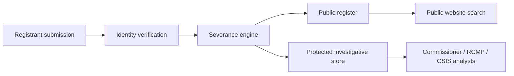

<!-- arckit-overlay-template: ca-aia-template.md -->

# Canada Algorithmic Impact Assessment

> **Template Origin**: Community | **ArcKit Version**: [VERSION] | **Command**:
> `/arckit:ca-aia`

## Document Control

<!-- DOC-CONTROL-HEADER -->
<!-- Resolved at command-execution time per _partials/RENDERING.md. -->

## Revision History

| Version   | Date         | Author    | Changes                                | Approved By | Approval Date |
| --------- | ------------ | --------- | -------------------------------------- | ----------- | ------------- |
| [VERSION] | [YYYY-MM-DD] | ArcKit AI | Initial creation from `/arckit:ca-aia` | [PENDING]   | [PENDING]     |

## Executive Summary

[Two to three paragraphs describing the automated decision-making system, the
decisions automated or assisted, the computed Impact Level (I, II, III, or IV),
the headline mitigations triggered by that level (peer review tier, transparency
notice, recourse), and the residual algorithmic-risk posture. Note any open
peer-review nominations or pending reassessment items.]

## System Description

| Item                      | Value                                                                                                             |
| ------------------------- | ----------------------------------------------------------------------------------------------------------------- |
| Department / agency       | [name]                                                                                                            |
| System / service name     | [name]                                                                                                            |
| Purpose                   | [what the system does in plain language; what outcome it is intended to produce]                                  |
| Decisions automated       | [the specific decisions automated or assisted — eligibility / triage / scoring / classification / routing / etc.] |
| Affected populations      | [Canadian residents / federal employees / clients of programme X / etc.]                                          |
| Training data lineage     | [sources, vintage, licensing — high-level summary; full detail in Training-Data Provenance section]               |
| Vendor / model provenance | [supplier, model family, open-source vs proprietary, hosting jurisdiction]                                        |
| Owner                     | [accountable role]                                                                                                |
| Operator                  | [internal team / contractor / processor running the model]                                                        |
| Accountable executive     | [ADM / DG / equivalent]                                                                                           |
| Lifecycle stage           | [Concept / Design / Build / Pilot / Live / Modification]                                                          |

## Levels I–IV Questionnaire Scoring

The Impact Level is determined by score across the six dimensions of the TBS
_Algorithmic Impact Assessment Tool_. Each dimension is scored with evidence
cited; the overall Impact Level (I, II, III, or IV) is computed from the totals
per the Directive's threshold matrix.

### Dimension 1 — Project

| Question                                                                         | Score   | Evidence           |
| -------------------------------------------------------------------------------- | ------- | ------------------ |
| [project-scope question — e.g. is the project line-of-business or experimental?] | [0–N]   | [reference / cite] |
| [project-scope question]                                                         | [0–N]   | [reference / cite] |
| **Sub-total**                                                                    | **[N]** |                    |

### Dimension 2 — System

| Question                                                                                | Score   | Evidence           |
| --------------------------------------------------------------------------------------- | ------- | ------------------ |
| [system-design question — e.g. degree of autonomy, integration with downstream systems] | [0–N]   | [reference / cite] |
| [system-design question]                                                                | [0–N]   | [reference / cite] |
| **Sub-total**                                                                           | **[N]** |                    |

### Dimension 3 — Algorithm

| Question                                                          | Score   | Evidence           |
| ----------------------------------------------------------------- | ------- | ------------------ |
| [algorithm question — model family, explainability, transparency] | [0–N]   | [reference / cite] |
| [algorithm question]                                              | [0–N]   | [reference / cite] |
| **Sub-total**                                                     | **[N]** |                    |

### Dimension 4 — Decision

| Question                                               | Score   | Evidence           |
| ------------------------------------------------------ | ------- | ------------------ |
| [decision question — reversibility, stakes, frequency] | [0–N]   | [reference / cite] |
| [decision question]                                    | [0–N]   | [reference / cite] |
| **Sub-total**                                          | **[N]** |                    |

### Dimension 5 — Impact

| Question                                                              | Score   | Evidence           |
| --------------------------------------------------------------------- | ------- | ------------------ |
| [impact question — affected population size, vulnerability, severity] | [0–N]   | [reference / cite] |
| [impact question]                                                     | [0–N]   | [reference / cite] |
| **Sub-total**                                                         | **[N]** |                    |

### Dimension 6 — Data

| Question                                                   | Score   | Evidence           |
| ---------------------------------------------------------- | ------- | ------------------ |
| [data question — sensitivity, provenance, consent posture] | [0–N]   | [reference / cite] |
| [data question]                                            | [0–N]   | [reference / cite] |
| **Sub-total**                                              | **[N]** |                    |

### Computed Level

| Item                                | Value                                 |
| ----------------------------------- | ------------------------------------- |
| Raw score (sum of sub-totals)       | [N]                                   |
| Mitigation score (controls applied) | [N]                                   |
| Net score                           | [N]                                   |
| **Computed Impact Level**           | **[I / II / III / IV]**               |
| Threshold matrix reference          | TBS Directive on ADM, current version |

> The questionnaire output is the source of truth. Self-declaring a lower level
> to avoid peer-review obligations is a Directive breach.

## Per-Level Mitigation Requirements

Mitigations below reflect the Directive's mandated requirements for the computed
Level. Mark items not required at the computed Level as `N/A`; do not omit rows
— reviewers expect to see the full schedule.

| Mitigation                                               | Required at Level    | Implementation status                                   | Owner               |
| -------------------------------------------------------- | -------------------- | ------------------------------------------------------- | ------------------- |
| Peer review — internal                                   | II (and above)       | [Planned / In-progress / Complete]                      | [Architecture lead] |
| Peer review — external (academic / civil society)        | III, IV              | [Reviewer named / Reviewer pending / N/A at Level I–II] | [Architecture lead] |
| Transparency notice (bilingual per `ca-ola`)             | All Levels           | [Published / Drafted / Pending]                         | [Service owner]     |
| Pre-launch publication (≥30 days before launch)          | III, IV              | [Date scheduled / Pending / N/A at Level I–II]          | [Service owner]     |
| Human-in-the-loop design — override paths                | II, III, IV          | [Designed / Implemented / N/A at Level I]               | [Service designer]  |
| Human-in-the-loop design — escalation thresholds         | II, III, IV          | [Designed / Implemented / N/A at Level I]               | [Service designer]  |
| Quality assurance — training/test data validation        | All Levels           | [Complete / In-progress]                                | [Data steward]      |
| Quality assurance — ongoing monitoring & drift detection | All Levels           | [Operational / Planned]                                 | [Operator]          |
| Recourse mechanism — appeal to a human decision-maker    | All Levels           | [Designed / Implemented]                                | [Service owner]     |
| Recourse mechanism — explanation rights                  | All Levels           | [Designed / Implemented]                                | [Service owner]     |
| AIA publication on Open Government portal                | All Levels (default) | [Published / Pending / Exempt — cross-ref `ca-soia`]    | [ATIP coordinator]  |

## Algorithmic Risks Register

| Risk                                                                 | Type           | Likelihood         | Impact             | Mitigation                                                                                    | Residual           |
| -------------------------------------------------------------------- | -------------- | ------------------ | ------------------ | --------------------------------------------------------------------------------------------- | ------------------ |
| Selection bias from non-representative training data                 | Bias           | [Low / Med / High] | [Low / Med / High] | [data audit; representativeness sampling; targeted top-up data collection]                    | [Low / Med / High] |
| Label bias from historical decision patterns                         | Bias           | [Low / Med / High] | [Low / Med / High] | [label audit; relabel sample with diverse reviewers; documented label rubric]                 | [Low / Med / High] |
| Concept drift — population shifts over time                          | Drift          | [Low / Med / High] | [Low / Med / High] | [drift-detection metrics; refresh-cadence trigger; rollback plan]                             | [Low / Med / High] |
| Data drift — input distribution shift                                | Drift          | [Low / Med / High] | [Low / Med / High] | [input-distribution monitoring; alert thresholds; retraining trigger]                         | [Low / Med / High] |
| Proxy variables for protected grounds                                | Fairness       | [Low / Med / High] | [Low / Med / High] | [feature audit; proxy-detection tests; remove or constrain proxies]                           | [Low / Med / High] |
| Distributional unfairness across protected grounds                   | Fairness       | [Low / Med / High] | [Low / Med / High] | [disaggregated performance metrics; fairness-constrained training; published fairness report] | [Low / Med / High] |
| Contestability gap — affected individual cannot challenge a decision | Contestability | [Low / Med / High] | [Low / Med / High] | [recourse mechanism; explanation rights; published appeal SLA]                                | [Low / Med / High] |
| Severity — irreversible adverse decision on a vulnerable individual  | Severity       | [Low / Med / High] | [Low / Med / High] | [human-in-the-loop for high-stakes branches; mandatory review threshold]                      | [Low / Med / High] |

Cross-reference `risk` for the project-level continuation of these entries.

## Training-Data Provenance

| Dataset                    | Source                                                     | Licence                                                 | Refresh cadence                     | Drift trigger                                | Steward        |
| -------------------------- | ---------------------------------------------------------- | ------------------------------------------------------- | ----------------------------------- | -------------------------------------------- | -------------- |
| [training set name]        | [internal programme / partner agency / open data / vendor] | [licence terms — including downstream use restrictions] | [annual / quarterly / event-driven] | [metric and threshold that triggers refresh] | [data steward] |
| [validation set name]      | [source]                                                   | [licence]                                               | [cadence]                           | [drift trigger]                              | [steward]      |
| [test set name]            | [source]                                                   | [licence]                                               | [cadence]                           | [drift trigger]                              | [steward]      |
| [synthetic data — if used] | [generator / process]                                      | [licence / provenance note]                             | [cadence]                           | [drift trigger]                              | [steward]      |

> Where a dataset is sourced from a vendor, capture the contractual data-rights
> position and exit-portability of the dataset as part of the licence column.

## Disclosure Plan

| Audience                                            | Channel                                     | Cadence                                                              | Bilingual?         | Notes                                                               |
| --------------------------------------------------- | ------------------------------------------- | -------------------------------------------------------------------- | ------------------ | ------------------------------------------------------------------- |
| Public — affected individuals                       | Transparency notice on service page         | At launch and on material change                                     | Yes — per `ca-ola` | Plain-language explanation of decisions automated and recourse path |
| Public — open-government audience                   | Open Government portal — AIA publication    | At launch (≥30 days pre-launch for Level III/IV) and on reassessment | Yes — per `ca-ola` | Default is open publication; severance only on specific exemption   |
| Internal — peer reviewers                           | Direct sharing of AIA + supporting evidence | At assessment and on reassessment                                    | Working language   | Peer review tier set by computed Level                              |
| Internal — Departmental Security Officer            | Security review channel                     | Pre-launch                                                           | Working language   | Severance review for Protected B/C content                          |
| OPC (where personal information is processed)       | OPC notification channel                    | Pre-launch (≥30 days)                                                | Working language   | Cross-reference `ca-pia`                                            |
| National-security exemption holders (if applicable) | Restricted briefing                         | As required                                                          | Working language   | Cross-reference `ca-soia`; document the exemption rationale         |

## Reassessment Triggers

| Trigger                                                                            | Action                                                                               | SLA                                            |
| ---------------------------------------------------------------------------------- | ------------------------------------------------------------------------------------ | ---------------------------------------------- |
| Material change to training data                                                   | Re-run questionnaire; update Provenance table; re-publish AIA                        | Before next deployment                         |
| Model retraining or replacement                                                    | Re-run questionnaire; re-trigger peer review at the appropriate tier                 | Before next deployment                         |
| Decision-boundary change (new outcomes; widened population)                        | Re-run questionnaire; re-trigger peer review; update transparency notice             | Before next deployment                         |
| Operating-environment change (new jurisdiction; new partner agency; new processor) | Re-run questionnaire; reassess cross-border posture (cross-ref `ca-cloud-residency`) | Before change goes live                        |
| Incident — bias finding, drift breach, contestability complaint upheld             | Targeted reassessment of affected dimensions; mitigation plan                        | Within 30 days of confirmed incident           |
| Periodic reassessment                                                              | Full questionnaire re-run                                                            | Annual (default); accelerated for Level III/IV |

## Open Items

| Item                                                     | Owner               | Due          | Status                |
| -------------------------------------------------------- | ------------------- | ------------ | --------------------- |
| Resolve open questionnaire scores marked `<TBC>`         | [Architecture lead] | [YYYY-MM-DD] | [Open / Closed]       |
| Nominate external peer reviewers (Level III/IV)          | [Architecture lead] | [YYYY-MM-DD] | [Open / Closed / N/A] |
| Publish AIA on Open Government portal                    | [ATIP coordinator]  | [YYYY-MM-DD] | [Open / Closed]       |
| Publish bilingual transparency notice                    | [Service owner]     | [YYYY-MM-DD] | [Open / Closed]       |
| Confirm recourse mechanism implementation and SLA        | [Service owner]     | [YYYY-MM-DD] | [Open / Closed]       |
| Trigger `ca-pia` if personal information is in scope     | [ATIP coordinator]  | [YYYY-MM-DD] | [Open / Closed]       |
| Trigger `ca-soia` if national-security exemption claimed | [Privacy Counsel]   | [YYYY-MM-DD] | [Open / Closed / N/A] |

## External References

### Document Register

| Doc ID      | Title                                                  | URL                                                       | Verified date |
| ----------- | ------------------------------------------------------ | --------------------------------------------------------- | ------------- |
| CA-TBS-ADM  | TBS Directive on Automated Decision-Making             | <https://www.tbs-sct.canada.ca/pol/doc-eng.aspx?id=32592> | [YYYY-MM-DD]  |
| CA-AIA-TOOL | Algorithmic Impact Assessment Tool (TBS questionnaire) | <https://open.canada.ca/en/algorithmic-impact-assessment> | [YYYY-MM-DD]  |
| CA-OLA      | Official Languages Act                                 | <https://laws-lois.justice.gc.ca/eng/acts/O-3.01/>        | [YYYY-MM-DD]  |
| CA-PRIV-ACT | Privacy Act (R.S.C., 1985, c. P-21)                    | <https://laws-lois.justice.gc.ca/eng/acts/P-21/>          | [YYYY-MM-DD]  |

### Citations

| Citation     | Doc ID      | Section                                                         | Used in                           |
| ------------ | ----------- | --------------------------------------------------------------- | --------------------------------- |
| [ADM-1]      | CA-TBS-ADM  | Levels I–IV threshold matrix                                    | Levels I–IV Questionnaire Scoring |
| [ADM-2]      | CA-TBS-ADM  | Peer review obligations by Level                                | Per-Level Mitigation Requirements |
| [ADM-3]      | CA-TBS-ADM  | Notification requirement (≥30 days pre-launch for Level III/IV) | Per-Level Mitigation Requirements |
| [ADM-4]      | CA-TBS-ADM  | Human-in-the-loop and recourse requirements                     | Per-Level Mitigation Requirements |
| [ADM-5]      | CA-TBS-ADM  | Open-publication default                                        | Disclosure Plan                   |
| [ADM-6]      | CA-TBS-ADM  | Reassessment on material change                                 | Reassessment Triggers             |
| [AIA-TOOL-1] | CA-AIA-TOOL | Six-dimension questionnaire                                     | Levels I–IV Questionnaire Scoring |
| [OLA-1]      | CA-OLA      | Bilingualism for public-facing services                         | Disclosure Plan                   |

### Unreferenced Documents

[List any documents read during generation but not cited, or "None".]

<!-- arckit-overlay-template: ca-atip-template.md -->

# Canada ATIP Reconciliation

> **Template Origin**: Community | **ArcKit Version**: [VERSION] | **Command**:
> `/arckit:ca-atip`

## Document Control

<!-- DOC-CONTROL-HEADER -->
<!-- Resolved at command-execution time per _partials/RENDERING.md. -->

## Revision History

| Version   | Date         | Author    | Changes                                 | Approved By | Approval Date |
| --------- | ------------ | --------- | --------------------------------------- | ----------- | ------------- |
| [VERSION] | [YYYY-MM-DD] | ArcKit AI | Initial creation from `/arckit:ca-atip` | [PENDING]   | [PENDING]     |

## Executive Summary

[Two to three paragraphs describing the system's information holdings, the
headline ATI Act exemption posture per holding, the Privacy Act §4–§8 disclosure
footprint, the severance design for any hybrid public/protected views, and any
open issues that block ATIP readiness.]

## Information Holdings Inventory

| Holding                        | Category (Public / Protected / Classified) | PIB ref             | Owner                     | Lifecycle               |
| ------------------------------ | ------------------------------------------ | ------------------- | ------------------------- | ----------------------- |
| [registrant identity record]   | Protected B                                | [PIB number or NEW] | [ATIP coordinator]        | [Live / Pilot / Design] |
| [public-facing register entry] | Public                                     | n/a                 | [Programme owner]         | [Live]                  |
| [investigative case file]      | Protected B / Classified                   | [PIB number]        | [investigative authority] | [Live]                  |
| [audit trail / severance log]  | Protected B                                | [PIB number or NEW] | [ATIP coordinator]        | [Live]                  |
| [aggregate analytics dataset]  | Public / Protected (per field)             | [PIB number or NEW] | [Analytics lead]          | [Design]                |

> Categorise every dataset that surfaces in the data model. A holding without an
> explicit category is a launch blocker.

## Access to Information Act Mapping

| Holding                                     | Exemption section                                       | Justification                                                                    | Severance applies |
| ------------------------------------------- | ------------------------------------------------------- | -------------------------------------------------------------------------------- | ----------------- |
| [investigative case file]                   | §16(1)(c) law enforcement / investigations              | [why the disclosure could reasonably be expected to be injurious to enforcement] | Yes               |
| [investigative case file — designated body) | §16.1 designated investigative bodies                   | [where the holding originates from a §16.1 body]                                 | Yes               |
| [audit working paper]                       | §16.5 audits                                            | [where audit working papers fall within §16.5]                                   | Yes               |
| [protected disclosure complaint]            | §16.6 protected disclosures                             | [PSDPA whistleblower context]                                                    | Yes               |
| [foreign-government correspondence]         | §13 obtained in confidence                              | [identify originating government / international organisation]                   | Yes               |
| [federal-provincial briefing]               | §14 federal-provincial affairs                          | [where disclosure could be injurious to FP affairs]                              | Yes               |
| [security-cleared briefing]                 | §15 international affairs / defence / national security | [identify which §15 head applies]                                                | Yes               |
| [personal information element]              | §19 (refers to Privacy Act)                             | [§19 is NOT blanket — test against §8(2) routine uses before invoking]           | Yes               |
| [policy advice / option memo]               | §21 advice and recommendations                          | [within §21(1)(a)/(b) and the 20-year sunset]                                    | Partial           |
| [legal opinion]                             | §23 solicitor-client privilege                          | [identify the privilege; do not assert without basis]                            | Yes               |
| [Schedule II statute prohibition]           | §24 statutory prohibitions                              | [identify the specific Schedule II provision]                                    | Yes               |

> Per row, the justification must be specific enough for the OIC to follow on
> review under §30. Asserting §16 or §15 without specifying the head is a common
> defect.

## Privacy Act §4–§8 Register

| Activity                                                             | Section                                                           | Justification                                                        | Notes                                                |
| -------------------------------------------------------------------- | ----------------------------------------------------------------- | -------------------------------------------------------------------- | ---------------------------------------------------- |
| [collect legal name and address]                                     | §4                                                                | [collection relates directly to programme X — cite enabling statute] | [link to PIA element row]                            |
| [collect identity directly from individual]                          | §5                                                                | [direct collection where reasonably possible]                        | n/a                                                  |
| [collect identity from CRA cross-reference]                          | §5(2) — exception to direct collection                            | [identify the exception relied on under §5(2)/(3)]                   | [link to PIA element row]                            |
| [use for eligibility decisioning]                                    | §7 — purpose of collection                                        | [exact original purpose]                                             | n/a                                                  |
| [use for fraud analytics]                                            | §7(a) — consistent use                                            | [explain reasonable expectation by individual]                       | [requires consistent-use letter to TBS InfoSource]   |
| [disclose to other federal institution for joint programme]          | §8(2)(a) — consistent use                                         | [routine-use letter (a)]                                             | [bilateral MOU reference]                            |
| [disclose to investigative body under federal/provincial law]        | §8(2)(e) — investigation                                          | [routine-use letter (e); cite investigative authority]               | [link to Information Sharing Agreement]              |
| [disclose to processor under contractual safeguards]                 | §8(2)(f) — agreement                                              | [routine-use letter (f); cite agreement]                             | [cross-border? cross-reference `ca-cloud-residency`] |
| [disclose to OPC on access request]                                  | §8(2)(c) — compliance with order or to comply with rules of court | [where applicable]                                                   | n/a                                                  |
| [disclose with consent of the individual]                            | §8(2)(b) — consent                                                | [identify how consent is captured and revocable]                     | n/a                                                  |
| [public-interest disclosure to a person whose interests it benefits] | §8(2)(m) — public interest                                        | [Minister gives written notice to OPC under §8(5)]                   | [extraordinary; document rationale]                  |

> Each §8(2)(a)–(m) letter must be matched to the actual disclosure scenario. Do
> not aggregate dissimilar disclosures under one row.

## Severance Design

The severance regime governs every transition from a Protected or Classified
holding to a Public view, and from one user role to another within a Protected
holding.

### Field-Level Severance Rules

| Field                            | View — Public | View — Protected      | View — Classified | Exemption(s) cited                 |
| -------------------------------- | ------------- | --------------------- | ----------------- | ---------------------------------- |
| [registrant legal name]          | Reveal        | Reveal                | Reveal            | n/a                                |
| [registrant home address]        | Mask          | Reveal                | Reveal            | §19; Privacy Act §8                |
| [foreign principal name]         | Reveal        | Reveal                | Reveal            | n/a                                |
| [investigative officer identity] | Mask          | Mask                  | Reveal            | §16(1)(c); §15                     |
| [financial flow amount]          | Banded        | Reveal                | Reveal            | §20 third-party (where applicable) |
| [risk score / triage outcome]    | Mask          | Mask                  | Reveal            | §16(1)(c); §21 advice              |
| [free-text narrative]            | Mask          | Reveal with redaction | Reveal            | §19; §16; §21 (per content)        |

### Severance Audit Log Schema

| Field                               | Reviewer role                      | Exemption cited                                                 | Output                                                                         |
| ----------------------------------- | ---------------------------------- | --------------------------------------------------------------- | ------------------------------------------------------------------------------ |
| [field name]                        | [ATIP analyst / delegated officer] | [§13 / §14 / §15 / §16 / §19 / §21 / §23 / §24 — specific head] | [redacted character count, justification reference, retained/deleted, version] |
| [composite redaction]               | [Senior ATIP analyst]              | [multiple — list each head]                                     | [linked justification memo ref]                                                |
| [late re-redaction on consultation] | [ATIP coordinator]                 | [as cited]                                                      | [reason for change; original release recall ref]                               |

> Every redaction event must produce one row above. Severance without per-field
> audit trails will not withstand OIC review.

### Re-Identification Risk Register

| Risk                                                                   | Likelihood         | Impact             | Mitigation                                                        | Residual           |
| ---------------------------------------------------------------------- | ------------------ | ------------------ | ----------------------------------------------------------------- | ------------------ |
| Public register cross-referenced with adjacent open data               | [Low / Med / High] | [Low / Med / High] | [k-anonymity threshold; banded fields; suppression rules]         | [Low / Med / High] |
| Protected view metadata (timestamps, IDs) leaks through severance gaps | [Low / Med / High] | [Low / Med / High] | [strip metadata on export; review severance tooling output]       | [Low / Med / High] |
| Aggregate analytics enabling re-identification of small cohorts        | [Low / Med / High] | [Low / Med / High] | [minimum cell size; differential-privacy noise where appropriate] | [Low / Med / High] |
| Triangulation across release tranches                                  | [Low / Med / High] | [Low / Med / High] | [tranche-aware severance; cumulative-disclosure ledger]           | [Low / Med / High] |

## ATIP Request Workflow

1. **Intake** — request received via designated channel; identity verification;
   clarification dialogue where the request is broad.
2. **Triage** — locate responsive records; categorise per Information Holdings
   Inventory; identify exemptions in play.
3. **Consultation under §27** — notify affected third parties (other
   institutions, originating governments, third-party suppliers under §20)
   within statutory timelines.
4. **Severance** — apply field-level severance rules; produce audit log entries
   per redaction.
5. **Release** — issue release package or refusal; publication of refusals where
   institutional policy requires.
6. **Complaint pathway** — OIC complaint under §30; institutional response;
   potential Federal Court review under §41.

| Step                              | SLA                             | Owner                          | Notes                                           |
| --------------------------------- | ------------------------------- | ------------------------------ | ----------------------------------------------- |
| Acknowledge receipt               | Within 5 business days          | ATIP coordinator               | n/a                                             |
| Initial response                  | 30 days from receipt per §7     | ATIP analyst                   | clock starts at receipt of fee where applicable |
| §9 extension notice (if required) | Before the 30-day clock expires | ATIP coordinator               | written notice with reasons and stated timeline |
| §27 third-party consultation      | Within statutory window         | ATIP analyst                   | [identify specific third parties]               |
| Severance and release             | Per extended deadline           | ATIP analyst + Senior reviewer | audit log per redaction                         |

### Extension justification template (§9)

| Field                                    | Value                                                                                           |
| ---------------------------------------- | ----------------------------------------------------------------------------------------------- |
| Original deadline                        | [YYYY-MM-DD]                                                                                    |
| §9 head invoked                          | §9(1)(a) / (b) / (c)                                                                            |
| Reason                                   | [e.g. large volume of records; consultations required; interferes unreasonably with operations] |
| Extended deadline                        | [YYYY-MM-DD]                                                                                    |
| Notice issued to requester               | [YYYY-MM-DD]                                                                                    |
| OIC notified (where extension > 30 days) | [YYYY-MM-DD or N/A]                                                                             |

## Annual Report Mapping

| Reportable item                                   | Source          | Period        | Reporting authority                                    |
| ------------------------------------------------- | --------------- | ------------- | ------------------------------------------------------ |
| ATI requests received, granted, refused, extended | Request tracker | Fiscal year   | OIC + departmental ATI annual report to Parliament     |
| Privacy Act requests and complaints               | Request tracker | Fiscal year   | OPC + departmental Privacy annual report to Parliament |
| Personal Information Banks and InfoSource updates | PIB register    | Continuous    | TBS InfoSource                                         |
| OIC investigations and findings                   | Complaints log  | Fiscal year   | OIC                                                    |
| OPC investigations and findings                   | Complaints log  | Fiscal year   | OPC                                                    |
| Material modifications triggering PIA refresh     | Change log      | On occurrence | TBS + OPC notification                                 |

## Open Issues

| Item                                                | Owner             | Due          | Status          |
| --------------------------------------------------- | ----------------- | ------------ | --------------- |
| Resolve `<TBC>` exemption rationales                | ATIP coordinator  | [YYYY-MM-DD] | [Open / Closed] |
| Update PIB entry in TBS InfoSource for new holdings | ATIP coordinator  | [YYYY-MM-DD] | [Open / Closed] |
| Confirm §27 third-party consultation list           | ATIP analyst      | [YYYY-MM-DD] | [Open / Closed] |
| Validate severance tooling against audit log schema | Architecture lead | [YYYY-MM-DD] | [Open / Closed] |
| Resolve re-identification risks marked High         | Architecture lead | [YYYY-MM-DD] | [Open / Closed] |
| Cross-reference data-model classification flags     | Data architect    | [YYYY-MM-DD] | [Open / Closed] |

## External References

### Document Register

| Doc ID        | Title                                                                 | URL                                                                                                                                                               | Verified date |
| ------------- | --------------------------------------------------------------------- | ----------------------------------------------------------------------------------------------------------------------------------------------------------------- | ------------- |
| CA-ATI-ACT    | Access to Information Act (R.S.C., 1985, c. A-1)                      | <https://laws-lois.justice.gc.ca/eng/acts/A-1/>                                                                                                                   | [YYYY-MM-DD]  |
| CA-PRIV-ACT   | Privacy Act (R.S.C., 1985, c. P-21)                                   | <https://laws-lois.justice.gc.ca/eng/acts/P-21/>                                                                                                                  | [YYYY-MM-DD]  |
| CA-OIC        | Office of the Information Commissioner of Canada — published guidance | <https://www.oic-ci.gc.ca/>                                                                                                                                       | [YYYY-MM-DD]  |
| CA-OPC        | Office of the Privacy Commissioner of Canada — published guidance     | <https://www.priv.gc.ca/>                                                                                                                                         | [YYYY-MM-DD]  |
| CA-TBS-ATI    | TBS Directive on Access to Information Requests                       | <https://www.tbs-sct.canada.ca/pol/doc-eng.aspx?id=18310>                                                                                                         | [YYYY-MM-DD]  |
| CA-TBS-PIA    | TBS Directive on Privacy Impact Assessment                            | <https://www.tbs-sct.canada.ca/pol/doc-eng.aspx?id=18308>                                                                                                         | [YYYY-MM-DD]  |
| CA-INFOSOURCE | TBS InfoSource — Personal Information Banks register                  | <https://www.canada.ca/en/treasury-board-secretariat/services/access-information-privacy/access-information/information-about-programs-information-holdings.html> | [YYYY-MM-DD]  |

### Citations

| Citation | Doc ID      | Section                                                   | Used in                           |
| -------- | ----------- | --------------------------------------------------------- | --------------------------------- |
| [ATI-1]  | CA-ATI-ACT  | §7 — 30-day clock                                         | ATIP Request Workflow             |
| [ATI-2]  | CA-ATI-ACT  | §9 — extensions                                           | ATIP Request Workflow             |
| [ATI-3]  | CA-ATI-ACT  | §13 — obtained in confidence                              | Access to Information Act Mapping |
| [ATI-4]  | CA-ATI-ACT  | §14 — federal-provincial affairs                          | Access to Information Act Mapping |
| [ATI-5]  | CA-ATI-ACT  | §15 — international affairs / defence / national security | Access to Information Act Mapping |
| [ATI-6]  | CA-ATI-ACT  | §16 / §16.1–§16.6 — law enforcement and investigations    | Access to Information Act Mapping |
| [ATI-7]  | CA-ATI-ACT  | §19 — personal information                                | Access to Information Act Mapping |
| [ATI-8]  | CA-ATI-ACT  | §21 — advice and recommendations                          | Access to Information Act Mapping |
| [ATI-9]  | CA-ATI-ACT  | §23 — solicitor-client privilege                          | Access to Information Act Mapping |
| [ATI-10] | CA-ATI-ACT  | §24 — statutory prohibitions (Schedule II)                | Access to Information Act Mapping |
| [ATI-11] | CA-ATI-ACT  | §27 — third-party consultation                            | ATIP Request Workflow             |
| [ATI-12] | CA-ATI-ACT  | §30 — OIC complaints                                      | ATIP Request Workflow             |
| [PRIV-1] | CA-PRIV-ACT | §4 — collection authority                                 | Privacy Act §4–§8 Register        |
| [PRIV-2] | CA-PRIV-ACT | §5 — direct collection (and §5(2)/(3) exceptions)         | Privacy Act §4–§8 Register        |
| [PRIV-3] | CA-PRIV-ACT | §7 / §7(a) — use limited to purpose / consistent use      | Privacy Act §4–§8 Register        |
| [PRIV-4] | CA-PRIV-ACT | §8(2)(a)–(m) — routine-use disclosure letters             | Privacy Act §4–§8 Register        |

### Unreferenced Documents

[List any documents read during generation but not cited, or "None".]

<!-- arckit-overlay-template: ca-charter-template.md -->

# Canada Charter Rights Design Review

> **Template Origin**: Community | **ArcKit Version**: [VERSION] | **Command**:
> `/arckit:ca-charter`

## Document Control

<!-- DOC-CONTROL-HEADER -->
<!-- Resolved at command-execution time per _partials/RENDERING.md. -->

## Revision History

| Version   | Date         | Author    | Changes                                    | Approved By | Approval Date |
| --------- | ------------ | --------- | ------------------------------------------ | ----------- | ------------- |
| [VERSION] | [YYYY-MM-DD] | ArcKit AI | Initial creation from `/arckit:ca-charter` | [PENDING]   | [PENDING]     |

## Executive Summary

[Two to three paragraphs describing the system, the Charter sections engaged
(default for FITAA-class apps: s.2(b), s.2(d), s.7, s.8, s.15), the headline
risks per right, the Oakes proportionality posture, the residual rating, and the
DOJ counsel sign-off status. Note any open items — pending sign-offs,
jurisprudence verification, or design changes required to clear residual risk.]

## Charter Engagement Surface

| Section                                     | Engaged? (Y / N)                         | Justification                                                                                             |
| ------------------------------------------- | ---------------------------------------- | --------------------------------------------------------------------------------------------------------- |
| s.2(a) — freedom of conscience and religion | [Y / N]                                  | [One-paragraph reasoning. If N, state why religious-belief and conscience interests are not engaged.]     |
| s.2(b) — freedom of expression              | [Y / N — default Y for FITAA-class apps] | [Identify chilling-effect surface: advocacy, journalism, academic inquiry, diaspora speech.]              |
| s.2(c) — freedom of peaceful assembly       | [Y / N]                                  | [Reasoning.]                                                                                              |
| s.2(d) — freedom of association             | [Y / N — default Y for FITAA-class apps] | [Identify disincentive surface: civil-society engagement, diaspora communities, political associations.]  |
| s.7 — life, liberty, security of the person | [Y / N — default Y for FITAA-class apps] | [Identify any deprivation: liberty effects of registration, security-of-person effects of disclosure.]    |
| s.8 — search and seizure                    | [Y / N — default Y for FITAA-class apps] | [Identify reasonable-expectation-of-privacy interests; reference the PIA personal-information inventory.] |
| s.15 — equality                             | [Y / N — default Y for FITAA-class apps] | [Identify protected-ground populations subject to differential impact.]                                   |

## s.2 Analysis

### s.2(a) — Freedom of Conscience and Religion

| Engagement                                                                                                  | Risk                                                                                | Mitigation                                  | Residual           |
| ----------------------------------------------------------------------------------------------------------- | ----------------------------------------------------------------------------------- | ------------------------------------------- | ------------------ |
| [Religious-belief interests engaged by, e.g., classification of religious advocacy as registrable activity] | [Suppression of religious expression; differential burden on religious communities] | [Carve-out / threshold / process safeguard] | [Low / Med / High] |

### s.2(b) — Freedom of Expression

| Engagement                                                    | Risk                                                                      | Mitigation                                                       | Residual           |
| ------------------------------------------------------------- | ------------------------------------------------------------------------- | ---------------------------------------------------------------- | ------------------ |
| [Chilling effect on advocacy / journalism / academic inquiry] | [Self-censorship; reduced public-interest reporting; advocacy withdrawal] | [Journalism / academic exemption; threshold tests; appeal route] | [Low / Med / High] |
| [Public-register disclosure of speech-adjacent activity]      | [Reputational harm; over-disclosure beyond transparency objective]        | [Severance rules; minimum-data-on-public-register principle]     | [Low / Med / High] |

### s.2(c) — Freedom of Peaceful Assembly

| Engagement                                              | Risk                                  | Mitigation                       | Residual           |
| ------------------------------------------------------- | ------------------------------------- | -------------------------------- | ------------------ |
| [Registration capturing convening / event organisation] | [Disincentive to legitimate assembly] | [Threshold / exemption / appeal] | [Low / Med / High] |

### s.2(d) — Freedom of Association

| Engagement                                             | Risk                                                                        | Mitigation                                                     | Residual           |
| ------------------------------------------------------ | --------------------------------------------------------------------------- | -------------------------------------------------------------- | ------------------ |
| [Disincentive to civil-society or diaspora engagement] | [Withdrawal of legitimate association; chilling of community organising]    | [Carve-outs; identity-verification minimisation; appeal route] | [Low / Med / High] |
| [Differential impact on diaspora communities]          | [Disproportionate registration burden on particular national-origin groups] | [Substantive-equality review; differential-impact monitoring]  | [Low / Med / High] |

## s.7 Analysis

| Engagement                                                                              | Deprivation                                                                               | Procedural Safeguard                                                                                                    | Residual           |
| --------------------------------------------------------------------------------------- | ----------------------------------------------------------------------------------------- | ----------------------------------------------------------------------------------------------------------------------- | ------------------ |
| [Liberty interest engaged by registration obligation backed by penal consequences]      | [Risk of penal sanction for non-registration; impact on freedom of movement / employment] | [Notice; right to representation; appeal to independent decision-maker; principles of fundamental justice per _Carter_] | [Low / Med / High] |
| [Security of person engaged by disclosure of registrant identity in sensitive contexts] | [Risk of harassment, threats, or transnational repression following disclosure]           | [Threat-assessment screen; protective-disclosure carve-out; severance to protected register]                            | [Low / Med / High] |

## s.8 Analysis

| Engagement                                                          | Reasonable Expectation of Privacy Analysis                                                                               | Warrant or Production-Order Interface                                                                | Residual           |
| ------------------------------------------------------------------- | ------------------------------------------------------------------------------------------------------------------------ | ---------------------------------------------------------------------------------------------------- | ------------------ |
| [Collection of registrant / foreign-principal personal information] | [REP analysis under _Hunter v Southam_: subjective expectation, objective reasonableness, totality of the circumstances] | [Production-order workflow; warrant requirement for any compelled access beyond statutory authority] | [Low / Med / High] |
| [Investigative back-end interfaces with RCMP / CSIS]                | [Heightened REP for investigative metadata; _R v Spencer_ line on subscriber identifiers]                                | [Severance audit per `ca-atip`; warrant or production-order required for compelled disclosure]       | [Low / Med / High] |
| [Cross-reference to PIA personal-information inventory]             | [REP analysis grounded in PIA-classified data elements]                                                                  | [Lawful-authority chain per Privacy Act §4–§8]                                                       | [Low / Med / High] |

## s.15 Analysis

| Protected Ground                                         | Differential Impact                                                       | Substantive-Equality Test                                                                                  | Residual           |
| -------------------------------------------------------- | ------------------------------------------------------------------------- | ---------------------------------------------------------------------------------------------------------- | ------------------ |
| Race, national or ethnic origin, colour                  | [Disproportionate registration burden on specific diaspora communities]   | [Distinction creating disadvantage; perpetuation of pre-existing disadvantage; not merely formal equality] | [Low / Med / High] |
| Religion                                                 | [Targeting of religious advocacy / community structures]                  | [Substantive impact on religious communities; not formal neutrality]                                       | [Low / Med / High] |
| Sex, gender identity, sexual orientation                 | [Differential exposure / harassment risk on disclosure]                   | [Substantive impact across gendered patterns of advocacy and online harassment]                            | [Low / Med / High] |
| Age                                                      | [Younger / older user-experience burden of registration]                  | [Substantive accessibility test]                                                                           | [Low / Med / High] |
| Mental or physical disability                            | [Accessibility of registration channels; cognitive burden of compliance]  | [WCAG / accommodation duty; substantive-equality lens, not formal lens]                                    | [Low / Med / High] |
| Analogous grounds (e.g. citizenship, immigration status) | [Differential impact on permanent residents, foreign nationals, refugees] | [Court-recognised analogous-ground test]                                                                   | [Low / Med / High] |

## Oakes Proportionality Analysis

> Run the four-step test for **each engaged right**. Partial analysis is a
> common review failure.

### Right: s.2(b) — Freedom of Expression

| Step                               | Question                                                                                                     | Answer                                                                                                             |
| ---------------------------------- | ------------------------------------------------------------------------------------------------------------ | ------------------------------------------------------------------------------------------------------------------ |
| Pressing and substantial objective | What is the objective the limit serves, and is it pressing and substantial in a free and democratic society? | [Objective + evidence of substantiality]                                                                           |
| Rational connection                | Is the means rationally connected to the objective?                                                          | [Yes / No — explain]                                                                                               |
| Minimal impairment                 | Does the design impair the right as little as reasonably possible?                                           | [Identify the least-restrictive alternatives considered and why this design is at the minimum-impairment frontier] |
| Proportional effects               | Do the salutary effects outweigh the deleterious effects on the right-holder?                                | [Reasoning]                                                                                                        |

### Right: s.2(d) — Freedom of Association

| Step                               | Question                             | Answer   |
| ---------------------------------- | ------------------------------------ | -------- |
| Pressing and substantial objective | [As above for the association limit] | [Answer] |
| Rational connection                | [As above]                           | [Answer] |
| Minimal impairment                 | [As above]                           | [Answer] |
| Proportional effects               | [As above]                           | [Answer] |

### Right: s.7 — Life, Liberty, Security of the Person

| Step                               | Question   | Answer   |
| ---------------------------------- | ---------- | -------- |
| Pressing and substantial objective | [As above] | [Answer] |
| Rational connection                | [As above] | [Answer] |
| Minimal impairment                 | [As above] | [Answer] |
| Proportional effects               | [As above] | [Answer] |

### Right: s.8 — Search and Seizure

| Step                               | Question                                            | Answer   |
| ---------------------------------- | --------------------------------------------------- | -------- |
| Pressing and substantial objective | [As above for the search / production-order regime] | [Answer] |
| Rational connection                | [As above]                                          | [Answer] |
| Minimal impairment                 | [As above]                                          | [Answer] |
| Proportional effects               | [As above]                                          | [Answer] |

### Right: s.15 — Equality

| Step                               | Question                                      | Answer   |
| ---------------------------------- | --------------------------------------------- | -------- |
| Pressing and substantial objective | [As above for the differential-impact effect] | [Answer] |
| Rational connection                | [As above]                                    | [Answer] |
| Minimal impairment                 | [As above]                                    | [Answer] |
| Proportional effects               | [As above]                                    | [Answer] |

## Mitigation Register

| Charter Risk                                             | Mitigation                                                                | Owner                          | Status          | Residual           |
| -------------------------------------------------------- | ------------------------------------------------------------------------- | ------------------------------ | --------------- | ------------------ |
| s.2(b) chilling effect on advocacy / journalism          | [Journalism / academic exemption + appeal route]                          | [Service Owner]                | [Open / Closed] | [Low / Med / High] |
| s.2(d) disincentive to diaspora civil-society engagement | [Carve-outs + identity-verification minimisation]                         | [Service Owner]                | [Open / Closed] | [Low / Med / High] |
| s.7 liberty effect of penal-backed registration          | [Notice + representation + appeal to independent decision-maker]          | [Departmental Justice Counsel] | [Open / Closed] | [Low / Med / High] |
| s.7 security-of-person effect of disclosure              | [Threat-assessment screen + protective severance]                         | [DSO + Service Owner]          | [Open / Closed] | [Low / Med / High] |
| s.8 over-collection beyond statutory authority           | [Lawful-authority chain per PIA + warrant interface for compelled access] | [Privacy Counsel]              | [Open / Closed] | [Low / Med / High] |
| s.15 differential impact on protected groups             | [Substantive-equality monitoring + targeted accommodation]                | [Service Owner + DOJ Counsel]  | [Open / Closed] | [Low / Med / High] |

## DOJ Counsel Sign-Off Block

> Charter design review without named counsel sign-off is a draft, not an
> artefact. Constitutional matters route to DOJ HQ.

| Role                                                    | Counsel | Date         | Conditions                                            |
| ------------------------------------------------------- | ------- | ------------ | ----------------------------------------------------- |
| Departmental Justice Counsel                            | [name]  | [YYYY-MM-DD] | [conditions / open items / further analysis required] |
| DOJ HQ Constitutional Advisor (where the risk warrants) | [name]  | [YYYY-MM-DD] | [conditions / open items]                             |
| ATIP coordinator (s.8 / privacy-adjacent matters)       | [name]  | [YYYY-MM-DD] | [conditions / open items]                             |
| Departmental Security Officer (s.7 security-of-person)  | [name]  | [YYYY-MM-DD] | [conditions / open items]                             |
| ADM accountable                                         | [name]  | [YYYY-MM-DD] | [conditions / open items]                             |

## External References

### Document Register

| Doc ID              | Title                                                                    | URL                                                                  | Verified date |
| ------------------- | ------------------------------------------------------------------------ | -------------------------------------------------------------------- | ------------- |
| CA-CHARTER          | Canadian Charter of Rights and Freedoms (Constitution Act, 1982, Part I) | <https://laws-lois.justice.gc.ca/eng/const/page-12.html>             | [YYYY-MM-DD]  |
| CA-OAKES            | _R v Oakes_ [1986] 1 SCR 103                                             | <https://scc-csc.lexum.com/scc-csc/scc-csc/en/item/117/index.do>     | [YYYY-MM-DD]  |
| CA-HUNTER           | _Hunter v Southam_ [1984] 2 SCR 145                                      | <https://scc-csc.lexum.com/scc-csc/scc-csc/en/item/5274/index.do>    | [YYYY-MM-DD]  |
| CA-SPENCER          | _R v Spencer_ [2014] 2 SCR 212                                           | <https://scc-csc.lexum.com/scc-csc/scc-csc/en/item/14233/index.do>   | [YYYY-MM-DD]  |
| CA-CARTER           | _Carter v Canada (AG)_ [2015] 1 SCR 331                                  | <https://scc-csc.lexum.com/scc-csc/scc-csc/en/item/14637/index.do>   | [YYYY-MM-DD]  |
| CA-DOJ-CHARTER-STMT | DOJ Charter Statements guidance                                          | <https://www.justice.gc.ca/eng/csj-sjc/pl/charter-charte/index.html> | [YYYY-MM-DD]  |

### Citations

| Citation    | Doc ID              | Section                                                       | Used in                        |
| ----------- | ------------------- | ------------------------------------------------------------- | ------------------------------ |
| [CHARTER-1] | CA-CHARTER          | s.1 — reasonable limits, justification under Oakes            | Oakes Proportionality Analysis |
| [CHARTER-2] | CA-CHARTER          | s.2 — fundamental freedoms                                    | s.2 Analysis                   |
| [CHARTER-3] | CA-CHARTER          | s.7 — life, liberty, security of the person                   | s.7 Analysis                   |
| [CHARTER-4] | CA-CHARTER          | s.8 — search and seizure                                      | s.8 Analysis                   |
| [CHARTER-5] | CA-CHARTER          | s.15 — equality                                               | s.15 Analysis                  |
| [OAKES-1]   | CA-OAKES            | Four-step proportionality test                                | Oakes Proportionality Analysis |
| [HUNTER-1]  | CA-HUNTER           | Reasonable expectation of privacy                             | s.8 Analysis                   |
| [SPENCER-1] | CA-SPENCER          | Subscriber-identifier REP in digital contexts                 | s.8 Analysis                   |
| [CARTER-1]  | CA-CARTER           | Principles of fundamental justice under s.7                   | s.7 Analysis                   |
| [DOJ-CS-1]  | CA-DOJ-CHARTER-STMT | Charter Statement methodology and counsel-engagement guidance | DOJ Counsel Sign-Off Block     |

### Unreferenced Documents

[List any documents read during generation but not cited, or "None".]

<!-- arckit-overlay-template: ca-cloud-residency-template.md -->

# Canada Sovereign Cloud Residency Assessment

> **Template Origin**: Community | **ArcKit Version**: [VERSION] | **Command**:
> `/arckit:ca-cloud-residency`

## Document Control

<!-- DOC-CONTROL-HEADER -->
<!-- Resolved at command-execution time per _partials/RENDERING.md. -->

## Revision History

| Version   | Date         | Author    | Changes                                            | Approved By | Approval Date |
| --------- | ------------ | --------- | -------------------------------------------------- | ----------- | ------------- |
| [VERSION] | [YYYY-MM-DD] | ArcKit AI | Initial creation from `/arckit:ca-cloud-residency` | [PENDING]   | [PENDING]     |

## Executive Summary

[Two to three paragraphs describing the system, the system-level categorisation
(UNCLASSIFIED / Protected A / Protected B / Protected C / CONFIDENTIAL / SECRET
/ TOP SECRET), the residency expectation at rest / in transit / in processing,
the sovereign cloud option recommended (AWS Canada / Azure Canada / Google Cloud
Canada / SSC-brokered / hybrid), the CLOUD-Act exposure posture and the named
risk acceptance, the exit-portability cadence, and any pending Protected B
authorisations or sub-processor flags. Note any conditions imposed by the
security authority on go-live.]

## Workload Categorisation

> Pull the system-level categorisation from `ARC-<id>-ITSG-*.md` if present.
> Otherwise, score Confidentiality (C), Integrity (I), and Availability (A) per
> the TBS _Standard on Security Categorization_ injury-based matrix and
> aggregate to a system-level categorisation using the high-water mark.

| Asset                                        | Confidentiality (L/M/H)    | Integrity (L/M/H)          | Availability (L/M/H)       | Aggregate (L/M/H) | Protected Level                                                                               |
| -------------------------------------------- | -------------------------- | -------------------------- | -------------------------- | ----------------- | --------------------------------------------------------------------------------------------- |
| [Asset 1 — e.g. citizen application records] | [score + injury rationale] | [score + injury rationale] | [score + injury rationale] | [aggregate]       | [UNCLASSIFIED / Protected A / Protected B / Protected C / CONFIDENTIAL / SECRET / TOP SECRET] |
| [Asset 2 — e.g. analytic data lake]          | [score]                    | [score]                    | [score]                    | [aggregate]       | [level]                                                                                       |
| [Asset 3 — e.g. cryptographic key material]  | [score]                    | [score]                    | [score]                    | [aggregate]       | [level]                                                                                       |

**System-level categorisation**: [high-water mark across the inventory] —
[one-paragraph rationale, with a pointer to the ITSG SoA if it has been
generated]

## Residency Requirement Statement

> Capture residency for data at rest, in transit, and in processing. Note backup
> and DR location requirements. Surface policy-derived constraints (Privacy Act
> §8, lawful-authority drivers) and data-class-derived constraints (Indigenous
> data per `ca-ocap`, Cabinet confidence, classified material).

| Requirement                                    | Source                                             | Constraint                                                                    | Notes                                            |
| ---------------------------------------------- | -------------------------------------------------- | ----------------------------------------------------------------------------- | ------------------------------------------------ |
| Data at rest in Canada                         | [TBS Direction § / `NFR-LOC-*` / `DR-*` / `PIA-*`] | [In-Canada region only / Encrypted at rest with BYOK / HYOK]                  | [exception envelope, if any]                     |
| Data in transit through Canadian network paths | [Source]                                           | [No transit through foreign network points-of-presence / TLS 1.3+ end-to-end] | [interconnect plan reference]                    |
| Data in processing on Canadian compute         | [Source]                                           | [In-region compute only / no cross-border managed-service backhaul]           | [list any managed services flagged for backhaul] |
| Backup residency                               | [Source]                                           | [In-Canada / cross-region within Canada / out-of-country prohibited]          | [backup window and recovery point]               |
| Disaster recovery location                     | [Source]                                           | [Secondary Canadian region required / hot-warm-cold posture]                  | [RTO / RPO from REQ NFR-AVL]                     |
| Indigenous-data handling (if applicable)       | [`ca-ocap` / DR-* / Crown-Indigenous policy]       | [OCAP principles applied; processing rights restricted]                       | [data-sovereignty rights holder named]           |
| Personal-information residency                 | [PIA / Privacy Act §8 / DR-*]                      | [Privacy Act §8 routine use cited; cross-border transfer disclosed in PIA]    | [routine-use reference]                          |

## Sovereign Cloud Options Matrix

> For each option, name the region(s), the current Protected B authorisation
> status with verification date, the foreign-government access exposure, the
> cost band relative to the cheapest in-Canada option, and any managed-services
> availability gaps.

| Provider            | Region                                                                 | Protected B Authorisation Status (as of [YYYY-MM-DD])                                   | CLOUD-Act / Foreign-Access Exposure                                                             | Cost Band                           | Managed-Services Gaps                                             |
| ------------------- | ---------------------------------------------------------------------- | --------------------------------------------------------------------------------------- | ----------------------------------------------------------------------------------------------- | ----------------------------------- | ----------------------------------------------------------------- |
| AWS Canada          | Central — Montréal (`ca-central-1`)                                    | [Authorised / Conditional / Pending — verification date]                                | US-incorporated CSP — US CLOUD Act applies; FISA-702 / EO-12333 reach for US-collected metadata | [$ / $$ / $$$ relative to cheapest] | [services available in US regions but absent from `ca-central-1`] |
| AWS Canada          | West — Calgary (`ca-west-1`)                                           | [GA / Limited GA / Pending — verification date; federal authorisation scope to confirm] | Same CLOUD-Act posture as `ca-central-1`                                                        | [band]                              | [services lagging `ca-central-1`]                                 |
| Azure Canada        | Canada Central — Toronto                                               | [status — verification date]                                                            | US-incorporated CSP — CLOUD Act applies; entity-level legal process risk                        | [band]                              | [services lagging US regions]                                     |
| Azure Canada        | Canada East — Quebec City                                              | [status — verification date]                                                            | Same CLOUD-Act posture as Canada Central                                                        | [band]                              | [services lagging Canada Central]                                 |
| Google Cloud Canada | Montréal (`northamerica-northeast1`)                                   | [status — verification date]                                                            | US-incorporated CSP — CLOUD Act applies                                                         | [band]                              | [services lagging GCP US regions]                                 |
| Google Cloud Canada | Toronto (`northamerica-northeast2`)                                    | [status — verification date]                                                            | Same CLOUD-Act posture as Montréal                                                              | [band]                              | [services lagging Montréal]                                       |
| SSC-brokered        | Multi-CSP under SSC vehicles (e.g. `EN578-191593/H/ZF` and successors) | [Inherited authorisation envelope where SSC has issued the broker-level ATO]            | Inherited from underlying CSP; CLOUD Act exposure unchanged                                     | [band]                              | [scope limited to brokered services on the published catalogue]   |

**Recommended option**: [Provider + Region] — [one-paragraph rationale tying the
recommendation to the categorisation, the residency requirement statement, the
CLOUD-Act risk acceptance, and the cost band]. **Named risk accepter** for
residual CLOUD-Act exposure: [role + name + ADR reference].

## GC Cloud Brokering Service Path

> SSC brokering scaffolds the departmental authorisation but does not transfer
> the departmental ATO obligation. Capture the steps and the role split.

| Step                           | SSC Role                                                            | Departmental Role                                                                                                            | Artefact                                        |
| ------------------------------ | ------------------------------------------------------------------- | ---------------------------------------------------------------------------------------------------------------------------- | ----------------------------------------------- |
| Service intake and eligibility | [SSC brokering team confirms vehicle coverage and CSP availability] | [Departmental architect submits intake]                                                                                      | [Intake form / SSC reference number]            |
| Inheritance assessment         | [SSC publishes the inherited ATO components and the residual scope] | [Departmental security authority confirms the inherited boundary]                                                            | [Inheritance memo]                              |
| Departmental authorisation     | [SSC supports evidence requests]                                    | [Departmental Authorising Official issues the system ATO over the inherited components]                                      | [Departmental ATO letter]                       |
| Operate and re-authorise       | [SSC re-publishes inherited components on its cycle]                | [Departmental security authority operates the system within the inherited envelope and re-authorises on the published cycle] | [Continuous monitoring + re-authorisation memo] |

## Foreign Subprocessor Analysis

> Cloud Service Provider supply-chain residency. Walk the published
> sub-processor lists and flag any whose primary jurisdiction sits outside
> Canada.

| CSP     | Service                                           | Sub-processor          | Jurisdiction                       | Notes                                                            |
| ------- | ------------------------------------------------- | ---------------------- | ---------------------------------- | ---------------------------------------------------------------- |
| [CSP 1] | [Service — e.g. observability, ML inference, CDN] | [Sub-processor entity] | [Country / state of incorporation] | [Material exposure — data plane / control plane / metadata only] |
| [CSP 2] | [Service]                                         | [Sub-processor]        | [Jurisdiction]                     | [Notes]                                                          |
| [CSP 3] | [Service]                                         | [Sub-processor]        | [Jurisdiction]                     | [Notes]                                                          |
| [CSP 4] | [Service — bundled third party]                   | [Sub-processor]        | [Jurisdiction]                     | [Notes]                                                          |

## Exit / Portability Plan

> Numbered runbook plus a per-asset table. The plan must be rehearsed on a
> published cadence — exit on paper is not exit.

1. **Trigger inventory** — list the events that initiate exit (categorisation
   upgrade, supplier flag, contract termination, sovereignty-policy change).
2. **Bulk export** — name the export tooling per workload, the staging location
   (in-Canada object storage, departmental SAN), and the transfer window.
3. **State replication** — describe how warm state (databases, queues, in-flight
   workflows) is replicated to the destination during cutover.
4. **Format portability** — confirm the stored formats are portable (Parquet /
   ORC / Avro for analytics; OCI for containers; standard SQL dumps for
   relational state) and flag any proprietary lakehouse or managed-service
   formats that need transformation.
5. **Identity and IAM cutover** — re-root the trust chain to the destination
   IdP; revoke source-tenant credentials.
6. **Operational-runbook rebuild** — identify runbooks coupled to
   source-CSP-specific tooling and rebuild them on the destination.
7. **Dry-run cadence** — schedule and rehearse the exit at least annually;
   capture the actual time-to-exit and update the budget.

| Exit Asset             | Format                                | Tooling                                            | Dry-run Cadence        |
| ---------------------- | ------------------------------------- | -------------------------------------------------- | ---------------------- |
| [Application database] | [Postgres dump / Parquet snapshot]    | [Tool — e.g. AWS DMS / Azure DMS / native pg_dump] | [Annual / Semi-annual] |
| [Analytics lake]       | [Parquet / ORC]                       | [Spark export job / Glue / Synapse export]         | [Cadence]              |
| [Container images]     | [OCI tarball]                         | [skopeo / oras / native registry export]           | [Cadence]              |
| [Object storage]       | [Native objects + manifest]           | [aws s3 sync / azcopy / gsutil]                    | [Cadence]              |
| [IAM / identity]       | [SCIM export + IdP claim mapping doc] | [SCIM bridge / IdP export]                         | [Cadence]              |

## Cross-Border Transfer Analysis

> Where federal data crosses the border, document the transfer, cite the lawful
> authority, and note CLOUD-Act exposure even for workloads operationally hosted
> in Canada.

| Transfer                                                              | Direction                                                 | Authority Cited                                    | Justification                                                 |
| --------------------------------------------------------------------- | --------------------------------------------------------- | -------------------------------------------------- | ------------------------------------------------------------- |
| [Transfer 1 — e.g. CDN egress to US edge POP]                         | [Outbound to US]                                          | [Privacy Act §8 routine use ref / contractual TIA] | [Operational rationale + residual exposure note]              |
| [Transfer 2 — e.g. observability backhaul]                            | [Outbound to US managed observability]                    | [Authority]                                        | [Justification + mitigation, e.g. data minimisation, hashing] |
| [Transfer 3 — e.g. foreign administrative access (CSP support staff)] | [Logical access from foreign jurisdiction]                | [Authority — SSC contract clause / TBS Direction]  | [Just-in-time access + audit + key-custody mitigations]       |
| [Transfer 4 — CLOUD-Act-driven exposure, in-Canada operation]         | [Latent legal exposure even with no operational outbound] | [Documented acceptance — named accepter]           | [Risk acceptance rationale and ADR reference]                 |

## Operational Topology

| Region                                        | Availability Zone(s)                 | Network Path                                      | Encryption-in-Transit                              | Peering / Interconnect                                                        |
| --------------------------------------------- | ------------------------------------ | ------------------------------------------------- | -------------------------------------------------- | ----------------------------------------------------------------------------- |
| [Primary — e.g. `ca-central-1`]               | [AZs in scope]                       | [Private link / transit gateway / VPN]            | [TLS 1.3 / mTLS / IPsec / MACsec where applicable] | [Direct Connect / ExpressRoute / Cloud Interconnect — bandwidth + redundancy] |
| [Secondary — e.g. `ca-west-1` or Canada East] | [AZs]                                | [Path]                                            | [Posture]                                          | [Interconnect — DR-only / active-active]                                      |
| [Edge / CDN]                                  | [N/A or named PoPs]                  | [Path]                                            | [Posture]                                          | [Peering]                                                                     |
| [Backup / DR target]                          | [Cross-region within Canada AZ list] | [Replication path — async / sync / snapshot ship] | [Posture]                                          | [Dedicated link or public path]                                               |

**Encryption key custody**: [BYOK / HYOK / external key store / CSP-managed].
**Key store location**: [In-Canada HSM / cloud-native KMS / on-premises HSM with
cloud bridge]. **Identity trust root**: [In-Canada IdP / federated to a foreign
tenant — flag if foreign]. **Privileged-access provenance**: [Just-in-time
access only / no foreign-jurisdiction administrative access / break-glass
procedure documented].

## Shared Responsibility Matrix

> Capture which residency control sits with the CSP, with SSC under brokering,
> and with the department. The matrix is the single source of truth for "who
> answers to TBS for this control" — overlap is acceptable, gaps are findings.

| Control Area                  | CSP Responsibility                                    | SSC Responsibility (if brokered)          | Departmental Responsibility                   |
| ----------------------------- | ----------------------------------------------------- | ----------------------------------------- | --------------------------------------------- |
| Physical region location      | [In-Canada region operation]                          | [Vehicle scope confirmation]              | [Region selection in deployment IaC]          |
| Encryption at rest            | [Native KMS availability]                             | [Inherited KMS configuration baseline]    | [BYOK / HYOK rotation, key custody, deletion] |
| Encryption in transit         | [TLS termination at CSP boundary]                     | [N/A or shared baseline]                  | [End-to-end TLS, mTLS between services]       |
| Sub-processor management      | [CSP publishes sub-processor list and notice cadence] | [SSC tracks broker-scoped sub-processors] | [Departmental review against PIA and DPIA]    |
| Foreign administrative access | [CSP support staff access controls]                   | [SSC contractual clauses]                 | [Just-in-time approval, audit, and review]    |
| Cross-border transfer logging | [CSP region selection and routing]                    | [Broker-level auditing]                   | [Privacy Act §8 routine-use register]         |

## Open Items

| ID   | Description                                                                                                                                                       | Owner   | Due Date     | Status                        |
| ---- | ----------------------------------------------------------------------------------------------------------------------------------------------------------------- | ------- | ------------ | ----------------------------- |
| OI-1 | [Outstanding sovereign-cloud option choice / pending Protected B authorisation / unresolved sub-processor flag / exit dry-run schedule / authorisation condition] | [Role]  | [YYYY-MM-DD] | [Open / In Progress / Closed] |
| OI-2 | [item]                                                                                                                                                            | [owner] | [date]       | [status]                      |

## External References

### Document Register

| Doc ID         | Title                                                                       | URL                                                                                                                | Verified date |
| -------------- | --------------------------------------------------------------------------- | ------------------------------------------------------------------------------------------------------------------ | ------------- |
| CA-TBS-CLOUD   | TBS Direction on the Secure Use of Commercial Cloud Services                | <https://www.tbs-sct.canada.ca/pol/doc-eng.aspx?id=32600>                                                          | [YYYY-MM-DD]  |
| CA-GC-CAS      | Government of Canada Cloud Adoption Strategy                                | <https://www.canada.ca/en/government/system/digital-government/digital-government-innovations/cloud-services.html> | [YYYY-MM-DD]  |
| CA-ITSP-50-103 | CSE ITSP.50.103 Guidance on Security Categorization of Cloud-Based Services | <https://cyber.gc.ca/en/guidance/itsp50103-guidance-security-categorization-cloud-based-services>                  | [YYYY-MM-DD]  |
| CA-SSC-BROKER  | SSC Cloud Brokering Service                                                 | <https://www.canada.ca/en/shared-services/services/it-modernization/cloud-services.html>                           | [YYYY-MM-DD]  |
| CA-PRIV-ACT    | Privacy Act (R.S.C., 1985, c. P-21) — §8 routine uses                       | <https://laws-lois.justice.gc.ca/eng/acts/p-21/>                                                                   | [YYYY-MM-DD]  |

### Citations

| Citation        | Doc ID         | Section                                                         | Used in                         |
| --------------- | -------------- | --------------------------------------------------------------- | ------------------------------- |
| [TBS-CLOUD-1]   | CA-TBS-CLOUD   | Residency expectations at Protected B and above                 | Residency Requirement Statement |
| [TBS-CLOUD-2]   | CA-TBS-CLOUD   | CSP risk-management and assurance posture                       | Sovereign Cloud Options Matrix  |
| [GC-CAS-1]      | CA-GC-CAS      | Cloud-first / public-cloud-by-default posture and exceptions    | Workload Categorisation         |
| [ITSP-50-103-1] | CA-ITSP-50-103 | Categorisation of cloud-based services and inheritance          | Workload Categorisation         |
| [SSC-BROKER-1]  | CA-SSC-BROKER  | Cloud brokering steps and inherited ATO components              | GC Cloud Brokering Service Path |
| [PRIV-ACT-1]    | CA-PRIV-ACT    | Privacy Act §8 routine-use authority for cross-border transfers | Cross-Border Transfer Analysis  |

### Unreferenced Documents

[List any documents read during generation but not cited, or "None".]

<!-- arckit-overlay-template: ca-fitaa-template.md -->

# Canada FITAA Compliance Assessment

> **Template Origin**: Community | **ArcKit Version**: [VERSION] | **Command**:
> `/arckit:ca-fitaa`

## Document Control

<!-- DOC-CONTROL-HEADER -->
<!-- Resolved at command-execution time per _partials/RENDERING.md. -->

## Revision History

| Version   | Date         | Author    | Changes                                  | Approved By | Approval Date |
| --------- | ------------ | --------- | ---------------------------------------- | ----------- | ------------- |
| [VERSION] | [YYYY-MM-DD] | ArcKit AI | Initial creation from `/arckit:ca-fitaa` | [PENDING]   | [PENDING]     |

## Executive Summary

[Two to three paragraphs describing the project's exposure to FITAA, the
registration model adopted, the public-vs-protected severance posture, and the
headline Charter §2 risk findings. Note any statutory-currency caveats — section
numbers or regulations that were `<TBC at draft time>`.]

## Activity Scoping

| Item                    | Value                                                                                                                           |
| ----------------------- | ------------------------------------------------------------------------------------------------------------------------------- |
| Department / agency     | [name]                                                                                                                          |
| Service / programme     | [name]                                                                                                                          |
| Activities under review | [advocacy / convening / communications / engagement / etc.]                                                                     |
| In-scope arrangements   | [arrangements with foreign principals to influence government decisions / political processes / public discourse]               |
| Excluded categories     | [journalism, academic research, diplomatic activity — subject to standard FITAA exemptions, cite section `<TBC at draft time>`] |
| Decision-tree outcome   | [REGISTRABLE / NOT REGISTRABLE / MIXED — explain]                                                                               |

### Decision Tree (textual)

1. Is there an arrangement with a foreign principal? — [Y/N]
2. Is the arrangement intended to influence a government / political /
   public-discourse outcome? — [Y/N]
3. Does an exclusion apply (journalism, academic research, diplomatic activity)?
   — [Y/N, cite `<TBC at draft time>`]
4. Outcome: [REGISTRABLE / NOT REGISTRABLE / MIXED]

## Arrangement Register Design

| Field                  | Public / Protected | Source                     | Notes                                             |
| ---------------------- | ------------------ | -------------------------- | ------------------------------------------------- |
| Registrant identity    | Public             | Registrant submission      | Verified per workflow step 2                      |
| Foreign principal      | Public             | Registrant submission      | Identity verified                                 |
| Activity type          | Public             | Registrant submission      | Controlled vocabulary                             |
| Start / end dates      | Public             | Registrant submission      | Material change → 14-day update                   |
| Financial flows        | Public / Protected | Registrant submission      | Public bands; granular figures protected          |
| Investigative metadata | Protected          | Commissioner / RCMP / CSIS | National-security exemptions per ATIP-Act §15/§16 |
| Severance map          | Protected          | System-generated           | Audited per `ca-atip` rules                       |

Material-change cadence: registrants must update the register within **14 days**
of a material change. The system MUST enforce a 14-day reminder + lockout if the
registrant misses the window.

## Registration Workflow

| Step                                 | Channel                          | Owner                 | SLA                               | Notes             |
| ------------------------------------ | -------------------------------- | --------------------- | --------------------------------- | ----------------- |
| 1. Submission                        | Web (bilingual) / paper fallback | Registrant            | n/a                               | Per `ca-ola`      |
| 2. Identity verification             | [identity proofing approach]     | Commissioner's office | [SLA]                             | Risk-tiered       |
| 3. Acknowledgement + registration ID | Email + portal                   | System                | Same business day                 | Bilingual         |
| 4. Public register publication       | Web                              | System                | Within `<TBC>` of acknowledgement | Severance applied |
| 5. Material-change update            | Web                              | Registrant            | Within 14 days of change          | 14-day clock      |

## Public Register vs Protected Investigative Data



| Severance rule                    | Field                      | Public outcome                 | Protected outcome                            |
| --------------------------------- | -------------------------- | ------------------------------ | -------------------------------------------- |
| National-security exemption       | Investigative metadata     | Suppressed                     | Visible to cleared analysts                  |
| Personal-information minimisation | Granular financial figures | Bands only                     | Full figures                                 |
| Withdrawal                        | Withdrawn registration     | Tombstone retained per `<TBC>` | Full record retained for investigative cycle |
| Correction                        | Erroneous fact             | Public correction notice       | Audit trail preserved                        |

Cross-reference `ca-atip` for the formal severance design and `ca-pia` for the
personal-information minimisation rationale.

## Commissioner Liaison Protocol

| Trigger                    | Cadence           | Contact                                    | Artefact                    |
| -------------------------- | ----------------- | ------------------------------------------ | --------------------------- |
| Suspected non-registration | Ad hoc            | Commissioner's office (designated liaison) | Referral memo               |
| Suspected falsification    | Ad hoc            | Commissioner's office + RCMP               | Evidence package            |
| Routine reporting          | Quarterly         | Commissioner's office                      | Quarterly compliance report |
| RCMP / CSIS coordination   | Per `ca-soia` MOU | Departmental security officer              | MOU + tasking record        |
| Annual report contribution | Annual            | Commissioner's office                      | Departmental return         |

## Charter Risk Register

Cross-reference `ca-charter` for the full Charter §2 expression and association
analysis.

| Charter section               | Risk                                                           | Mitigation                                                                                                                             | Residual              |
| ----------------------------- | -------------------------------------------------------------- | -------------------------------------------------------------------------------------------------------------------------------------- | --------------------- |
| s.2(b) Freedom of expression  | Chilling effect on advocacy / journalism                       | Tight scoping of registrable activity; journalism exclusion clearly applied; tombstone-only public record after withdrawal             | [Low / Medium / High] |
| s.2(b) Freedom of expression  | Over-broad public exposure of registrant identity              | Severance engine; public bands not granular figures; option for protected-only registration in narrow categories `<TBC at draft time>` | [Low / Medium / High] |
| s.2(d) Freedom of association | Disincentive to legitimate diaspora / civil-society engagement | Clear public-interest framing; bilingual plain-language guidance; community-engagement plan                                            | [Low / Medium / High] |
| s.2(d) Freedom of association | Disproportionate burden on small civil-society organisations   | Tiered registration burden; small-volume exemption `<TBC>`                                                                             | [Low / Medium / High] |

## Compliance Schedule (registrant-side)

| Trigger                      | Clock                          | Owner      | Penalty exposure                                                              |
| ---------------------------- | ------------------------------ | ---------- | ----------------------------------------------------------------------------- |
| New registrable arrangement  | 14 days from arrangement start | Registrant | FITAA offence §`<TBC at draft time>` — fine up to `<TBC>`                     |
| Material change              | 14 days from change            | Registrant | FITAA offence §`<TBC at draft time>` — fine up to `<TBC>`                     |
| End of arrangement           | 14 days from end               | Registrant | FITAA offence §`<TBC at draft time>` — fine up to `<TBC>`                     |
| False / misleading statement | At submission                  | Registrant | FITAA offence §`<TBC at draft time>` — fine up to `<TBC>` and/or imprisonment |
| Failure to register          | Continuing offence             | Registrant | FITAA offence §`<TBC at draft time>` — daily-accrual fine `<TBC>`             |

## Open Items

Explicit statutory currency caveats — review and update before publication.

- FITAA Regulations: status `<TBC at draft time>` — verify against Canada
  Gazette II at the verification date below.
- FITAA section numbering for offences and exemptions: marked
  `<TBC at draft time>` throughout; reconcile against the consolidated Justice
  Laws text.
- Commissioner's published guidance: identify any operational guidance issued
  after the verification date and incorporate.
- ATIP-Act severance design: pending `ca-atip` artefact.
- Charter §2 detailed analysis: pending `ca-charter` artefact.
- Privacy Impact Assessment: pending `ca-pia` artefact.
- Algorithmic Impact Assessment: required if registration triage uses any
  automated decision-making — pending `ca-aia` artefact.
- Bilingual content review: pending `ca-ola` artefact.
- RCMP / CSIS MOU: pending `ca-soia` artefact.

## External References

### Document Register

| Doc ID        | Title                                                                             | URL                                                      | Verified date |
| ------------- | --------------------------------------------------------------------------------- | -------------------------------------------------------- | ------------- |
| CA-FITAA-2024 | Foreign Influence Transparency and Accountability Act (Bill C-70, 2024)           | <https://laws-lois.justice.gc.ca/>                       | [YYYY-MM-DD]  |
| CA-FITAA-REG  | FITAA Regulations (status: `<TBC at draft time>`)                                 | <https://gazette.gc.ca/>                                 | [YYYY-MM-DD]  |
| CA-OCFIT      | Office of the Commissioner of Foreign Influence Transparency — published guidance | [URL when published]                                     | [YYYY-MM-DD]  |
| CA-CHARTER    | Canadian Charter of Rights and Freedoms                                           | <https://laws-lois.justice.gc.ca/eng/const/page-12.html> | [YYYY-MM-DD]  |
| CA-ATIP-ACT   | Access to Information Act                                                         | <https://laws-lois.justice.gc.ca/eng/acts/A-1/>          | [YYYY-MM-DD]  |

### Citations

| Citation    | Doc ID        | Section                                         | Used in                       |
| ----------- | ------------- | ----------------------------------------------- | ----------------------------- |
| [FITAA-1]   | CA-FITAA-2024 | Activity scoping triggers `<TBC at draft time>` | Activity Scoping              |
| [FITAA-2]   | CA-FITAA-2024 | Registration obligations `<TBC at draft time>`  | Arrangement Register Design   |
| [FITAA-3]   | CA-FITAA-2024 | Offences and penalties `<TBC at draft time>`    | Compliance Schedule           |
| [CHARTER-1] | CA-CHARTER    | s.2(b)                                          | Charter Risk Register         |
| [CHARTER-2] | CA-CHARTER    | s.2(d)                                          | Charter Risk Register         |
| [ATIP-1]    | CA-ATIP-ACT   | §15 (national security)                         | Public vs Protected severance |
| [ATIP-2]    | CA-ATIP-ACT   | §16 (law enforcement)                           | Public vs Protected severance |

### Unreferenced Documents

[List any documents read during generation but not cited, or "None".]

<!-- arckit-overlay-template: ca-gc-digital-standards-template.md -->

# Canada GC Digital Standards Conformance Scorecard

> **Template Origin**: Community | **ArcKit Version**: [VERSION] | **Command**:
> `/arckit:ca-gc-digital-standards`

## Document Control

<!-- DOC-CONTROL-HEADER -->
<!-- Resolved at command-execution time per _partials/RENDERING.md. -->

## Revision History

| Version   | Date         | Author    | Changes                                                 | Approved By | Approval Date |
| --------- | ------------ | --------- | ------------------------------------------------------- | ----------- | ------------- |
| [VERSION] | [YYYY-MM-DD] | ArcKit AI | Initial creation from `/arckit:ca-gc-digital-standards` | [PENDING]   | [PENDING]     |

## Executive Summary

[Two to three paragraphs describing the service, the conformance posture across
the 10 GC Digital Standards, the top remediation actions, the per-standard
maturity headline, and any standards stuck at Initial. Note any cross-cutting
concerns — accessibility shortfalls, default-private working, or unresolved
ethical-AI items.]

## Service Description

| Item                | Value                                                                      |
| ------------------- | -------------------------------------------------------------------------- |
| Department / agency | [name]                                                                     |
| Service name        | [name]                                                                     |
| Owner               | [accountable role / ADM]                                                   |
| Operator            | [internal team / contractor / processor]                                   |
| User populations    | [Canadians / federal employees / clients of programme X / etc.]            |
| Lifecycle stage     | [Concept / Alpha / Beta / Live / Modification / Retirement]                |
| Key artefacts       | [REQ, service-assessment, retrospectives, accessibility audits — link IDs] |

## Per-Standard Assessment

### Standard 1 — Design with users

| Dimension           | Value                                                                                         |
| ------------------- | --------------------------------------------------------------------------------------------- |
| Evidence            | [user-research outputs, usability tests, beta findings — link artefacts]                      |
| Gaps                | [missing user groups, unrepresented official-language cohort, accessibility gaps in research] |
| Remediation actions | [actions to close gaps]                                                                       |
| Owner               | [role]                                                                                        |
| Target date         | [YYYY-MM-DD]                                                                                  |
| Maturity            | [Initial / Repeatable / Defined / Measured / Optimising]                                      |

### Standard 2 — Iterate and improve frequently

| Dimension           | Value                                                                 |
| ------------------- | --------------------------------------------------------------------- |
| Evidence            | [release cadence, retro outputs, A/B tests, telemetry-driven changes] |
| Gaps                | [batch releases, no feedback loop, missing CI/CD coverage]            |
| Remediation actions | [actions to close gaps]                                               |
| Owner               | [role]                                                                |
| Target date         | [YYYY-MM-DD]                                                          |
| Maturity            | [Initial / Repeatable / Defined / Measured / Optimising]              |

### Standard 3 — Work in the open by default

| Dimension           | Value                                                                            |
| ------------------- | -------------------------------------------------------------------------------- |
| Evidence            | [open repos, public design notes, GitHub presence, blog posts, ADRs in the open] |
| Gaps                | [default-private repos, time-boxed exceptions overdue, no public roadmap]        |
| Remediation actions | [actions to close gaps]                                                          |
| Owner               | [role]                                                                           |
| Target date         | [YYYY-MM-DD]                                                                     |
| Maturity            | [Initial / Repeatable / Defined / Measured / Optimising]                         |

### Standard 4 — Use open standards and solutions

| Dimension           | Value                                                                          |
| ------------------- | ------------------------------------------------------------------------------ |
| Evidence            | [adoption of open standards, OSS components, registers of approved technology] |
| Gaps                | [proprietary lock-in, missing open API contracts, unjustified bespoke build]   |
| Remediation actions | [actions to close gaps]                                                        |
| Owner               | [role]                                                                         |
| Target date         | [YYYY-MM-DD]                                                                   |
| Maturity            | [Initial / Repeatable / Defined / Measured / Optimising]                       |

### Standard 5 — Address security and privacy risks

| Dimension           | Value                                                                                            |
| ------------------- | ------------------------------------------------------------------------------------------------ |
| Evidence            | [PIA, ITSG-33 controls, ATO, threat-risk assessment — cross-reference `ca-pia` and `ca-itsg-33`] |
| Gaps                | [missing PIA, expired ATO, unmitigated threats]                                                  |
| Remediation actions | [actions to close gaps]                                                                          |
| Owner               | [role]                                                                                           |
| Target date         | [YYYY-MM-DD]                                                                                     |
| Maturity            | [Initial / Repeatable / Defined / Measured / Optimising]                                         |

### Standard 6 — Build in accessibility from the start

| Dimension           | Value                                                                                                               |
| ------------------- | ------------------------------------------------------------------------------------------------------------------- |
| Evidence            | [WCAG 2.1 AA / 2.2 AA audit, automated and manual testing, assistive-tech reviews, departmental Accessibility Plan] |
| Gaps                | [unresolved WCAG criteria, missing manual audit, no plain-language alternatives]                                    |
| Remediation actions | [actions to close gaps — referencing the _Accessible Canada Act_ statutory floor]                                   |
| Owner               | [role — accessibility lead]                                                                                         |
| Target date         | [YYYY-MM-DD]                                                                                                        |
| Maturity            | [Initial / Repeatable / Defined / Measured / Optimising]                                                            |

### Standard 7 — Empower staff to deliver better services

| Dimension           | Value                                                                                  |
| ------------------- | -------------------------------------------------------------------------------------- |
| Evidence            | [tooling access, training, multi-disciplinary teams, devolved decision rights]         |
| Gaps                | [restricted tooling, classification-creep blocking productivity, decision bottlenecks] |
| Remediation actions | [actions to close gaps]                                                                |
| Owner               | [role]                                                                                 |
| Target date         | [YYYY-MM-DD]                                                                           |
| Maturity            | [Initial / Repeatable / Defined / Measured / Optimising]                               |

### Standard 8 — Be good data stewards

| Dimension           | Value                                                                               |
| ------------------- | ----------------------------------------------------------------------------------- |
| Evidence            | [data inventory, retention schedule, open-data publication, lineage documentation]  |
| Gaps                | [no retention enforcement, missing PIB linkage, no open-data candidates identified] |
| Remediation actions | [actions to close gaps]                                                             |
| Owner               | [role — data steward]                                                               |
| Target date         | [YYYY-MM-DD]                                                                        |
| Maturity            | [Initial / Repeatable / Defined / Measured / Optimising]                            |

### Standard 9 — Design ethical services

| Dimension           | Value                                                                                                  |
| ------------------- | ------------------------------------------------------------------------------------------------------ |
| Evidence            | [AIA outputs, fairness testing, bias audits, ethical-review board sign-off — cross-reference `ca-aia`] |
| Gaps                | [missing AIA, no bias audit, no human-in-the-loop on automated decisions]                              |
| Remediation actions | [actions to close gaps]                                                                                |
| Owner               | [role]                                                                                                 |
| Target date         | [YYYY-MM-DD]                                                                                           |
| Maturity            | [Initial / Repeatable / Defined / Measured / Optimising]                                               |

### Standard 10 — Collaborate widely

| Dimension           | Value                                                                                                          |
| ------------------- | -------------------------------------------------------------------------------------------------------------- |
| Evidence            | [cross-departmental working groups, GC Notify / GC Forms / Code reuse, partnerships with provinces / academia] |
| Gaps                | [siloed delivery, no reuse of GC platforms, partner agencies excluded]                                         |
| Remediation actions | [actions to close gaps]                                                                                        |
| Owner               | [role]                                                                                                         |
| Target date         | [YYYY-MM-DD]                                                                                                   |
| Maturity            | [Initial / Repeatable / Defined / Measured / Optimising]                                                       |

## Cross-Cutting Themes

| Theme                                                         | Standards touched | Status                                  | Action                                                                  |
| ------------------------------------------------------------- | ----------------- | --------------------------------------- | ----------------------------------------------------------------------- |
| Accessibility (WCAG 2.1 AA / 2.2 AA, _Accessible Canada Act_) | 6                 | [Conformant / Partial / Non-conformant] | [audit close-out, statutory plan refresh]                               |
| Open data and open code                                       | 3, 4, 8           | [Conformant / Partial / Non-conformant] | [open repos, publish open data, justify exceptions]                     |
| Ethical AI                                                    | 9                 | [Conformant / Partial / Non-conformant] | [AIA via `ca-aia`, fairness testing, oversight]                         |
| User research practice                                        | 1, 2              | [Conformant / Partial / Non-conformant] | [continuous research, OL coverage, accessibility-inclusive recruitment] |

## Maturity Roadmap

| Standard                                     | Current maturity                                         | Target maturity | Milestone   | Date         | Owner  |
| -------------------------------------------- | -------------------------------------------------------- | --------------- | ----------- | ------------ | ------ |
| 1 — Design with users                        | [Initial / Repeatable / Defined / Measured / Optimising] | [target]        | [milestone] | [YYYY-MM-DD] | [role] |
| 2 — Iterate and improve frequently           | [current]                                                | [target]        | [milestone] | [YYYY-MM-DD] | [role] |
| 3 — Work in the open by default              | [current]                                                | [target]        | [milestone] | [YYYY-MM-DD] | [role] |
| 4 — Use open standards and solutions         | [current]                                                | [target]        | [milestone] | [YYYY-MM-DD] | [role] |
| 5 — Address security and privacy risks       | [current]                                                | [target]        | [milestone] | [YYYY-MM-DD] | [role] |
| 6 — Build in accessibility from the start    | [current]                                                | [target]        | [milestone] | [YYYY-MM-DD] | [role] |
| 7 — Empower staff to deliver better services | [current]                                                | [target]        | [milestone] | [YYYY-MM-DD] | [role] |
| 8 — Be good data stewards                    | [current]                                                | [target]        | [milestone] | [YYYY-MM-DD] | [role] |
| 9 — Design ethical services                  | [current]                                                | [target]        | [milestone] | [YYYY-MM-DD] | [role] |
| 10 — Collaborate widely                      | [current]                                                | [target]        | [milestone] | [YYYY-MM-DD] | [role] |

## Open Items

| Item                                                                          | Owner                | Due          | Status          |
| ----------------------------------------------------------------------------- | -------------------- | ------------ | --------------- |
| Close WCAG 2.1 AA / 2.2 AA audit findings                                     | [Accessibility lead] | [YYYY-MM-DD] | [Open / Closed] |
| Publish open repositories per Standard 3                                      | [Engineering lead]   | [YYYY-MM-DD] | [Open / Closed] |
| Trigger `ca-aia` if automated decision-making is in scope                     | [Architecture lead]  | [YYYY-MM-DD] | [Open / Closed] |
| Refresh PIA via `ca-pia` if personal information is processed                 | [ATIP coordinator]   | [YYYY-MM-DD] | [Open / Closed] |
| Update Accessibility Plan / progress report under the _Accessible Canada Act_ | [Accessibility lead] | [YYYY-MM-DD] | [Open / Closed] |

## External References

### Document Register

| Doc ID    | Title                                      | URL                                                                                                                       | Verified date |
| --------- | ------------------------------------------ | ------------------------------------------------------------------------------------------------------------------------- | ------------- |
| CA-DIGSTD | TBS Government of Canada Digital Standards | <https://www.canada.ca/en/government/system/digital-government/government-canada-digital-standards.html>                  | [YYYY-MM-DD]  |
| CA-PSD    | TBS Policy on Service and Digital          | <https://www.tbs-sct.canada.ca/pol/doc-eng.aspx?id=32603>                                                                 | [YYYY-MM-DD]  |
| CA-DSD    | TBS Directive on Service and Digital       | <https://www.tbs-sct.canada.ca/pol/doc-eng.aspx?id=32601>                                                                 | [YYYY-MM-DD]  |
| CA-DOSP   | TBS Digital Operations Strategic Plan      | <https://www.canada.ca/en/government/system/digital-government/government-canada-digital-operations-strategic-plans.html> | [YYYY-MM-DD]  |
| CA-ACA    | Accessible Canada Act (S.C. 2019, c. 10)   | <https://laws-lois.justice.gc.ca/eng/acts/A-0.6/>                                                                         | [YYYY-MM-DD]  |
| CA-ACR    | Accessible Canada Regulations              | <https://laws-lois.justice.gc.ca/eng/regulations/SOR-2021-241/>                                                           | [YYYY-MM-DD]  |

### Citations

| Citation   | Doc ID    | Section                                                                                   | Used in                                     |
| ---------- | --------- | ----------------------------------------------------------------------------------------- | ------------------------------------------- |
| [DIGSTD-1] | CA-DIGSTD | Standard 1 — Design with users                                                            | Standard 1 assessment                       |
| [DIGSTD-3] | CA-DIGSTD | Standard 3 — Work in the open by default                                                  | Standard 3 assessment, Cross-Cutting Themes |
| [DIGSTD-6] | CA-DIGSTD | Standard 6 — Build in accessibility from the start                                        | Standard 6 assessment, Cross-Cutting Themes |
| [DIGSTD-9] | CA-DIGSTD | Standard 9 — Design ethical services                                                      | Standard 9 assessment, Cross-Cutting Themes |
| [PSD-1]    | CA-PSD    | Policy on Service and Digital — accountability for the Digital Standards                  | Per-Standard Assessment, Important notes    |
| [DSD-1]    | CA-DSD    | Directive on Service and Digital — implementation requirements                            | Per-Standard Assessment                     |
| [ACA-1]    | CA-ACA    | Statutory accessibility floor — accessibility plans, feedback processes, progress reports | Standard 6 assessment, Cross-Cutting Themes |
| [ACR-1]    | CA-ACR    | Accessible Canada Regulations — published reporting tranches                              | Standard 6 assessment                       |

### Unreferenced Documents

[List any documents read during generation but not cited, or "None".]

<!-- arckit-overlay-template: ca-itsg-33-template.md -->

# Canada ITSG-33 Statement of Applicability

> **Template Origin**: Community | **ArcKit Version**: [VERSION] | **Command**:
> `/arckit:ca-itsg-33`

## Document Control

<!-- DOC-CONTROL-HEADER -->
<!-- Resolved at command-execution time per _partials/RENDERING.md. -->

## Revision History

| Version   | Date         | Author    | Changes                                    | Approved By | Approval Date |
| --------- | ------------ | --------- | ------------------------------------------ | ----------- | ------------- |
| [VERSION] | [YYYY-MM-DD] | ArcKit AI | Initial creation from `/arckit:ca-itsg-33` | [PENDING]   | [PENDING]     |

## Executive Summary

[Two to three paragraphs describing the system, the system-level categorisation
(UNCLASSIFIED / Protected A / Protected B / Protected C / CONFIDENTIAL / SECRET
/ TOP SECRET), the selected control profile (PBMM / PBMM-Cloud / Secret-High /
Top-Secret-High), the headline tailoring posture, the count of Compensating
Controls, the CMVP / FIPS 140-3 validation status, the supply chain posture
under the _Direction on Vulnerable Suppliers_, and the authorisation status.
Note any open items — pending CMVP confirmations, unresolved supplier flags, or
conditions imposed by the authorising official.]

## Information Asset Categorisation

> Score Confidentiality (C), Integrity (I), and Availability (A) per the TBS
> _Standard on Security Categorization_ injury-based matrix (Low / Medium /
> High). Aggregate to a system-level categorisation using the high-water mark
> across the asset inventory.

| Asset                                        | Confidentiality (L/M/H)    | Integrity (L/M/H)          | Availability (L/M/H)       | Aggregate (L/M/H) | Categorisation Level                                                                          |
| -------------------------------------------- | -------------------------- | -------------------------- | -------------------------- | ----------------- | --------------------------------------------------------------------------------------------- |
| [Asset 1 — e.g. citizen application records] | [score + injury rationale] | [score + injury rationale] | [score + injury rationale] | [aggregate]       | [UNCLASSIFIED / Protected A / Protected B / Protected C / CONFIDENTIAL / SECRET / TOP SECRET] |
| [Asset 2 — e.g. payment instructions]        | [score + injury rationale] | [score + injury rationale] | [score + injury rationale] | [aggregate]       | [level]                                                                                       |
| [Asset 3 — e.g. audit logs]                  | [score + injury rationale] | [score + injury rationale] | [score + injury rationale] | [aggregate]       | [level]                                                                                       |
| [Asset 4 — e.g. cryptographic key material]  | [score + injury rationale] | [score + injury rationale] | [score + injury rationale] | [aggregate]       | [level]                                                                                       |

**System-level categorisation**: [high-water mark across the inventory] —
[one-paragraph rationale]

## Control Profile Selection

| Selected Profile                                    | Categorisation Rationale                                   | Tailoring Summary                                                                                      | Approver                             |
| --------------------------------------------------- | ---------------------------------------------------------- | ------------------------------------------------------------------------------------------------------ | ------------------------------------ |
| [PBMM / PBMM-Cloud / Secret-High / Top-Secret-High] | [why this profile matches the system-level categorisation] | [count of additions / removals / parameter overrides + one-line summary; full detail in the SoA below] | [Security Authority — name and role] |

## Statement of Applicability

> Per ITSG-33, structured by the 16 NIST SP 800-53-derived control families.
> Mark each control as **Applicable**, **Not Applicable**, or **Compensating
> Control**. Where Compensating, name the substitute control and capture the
> residual-risk acceptance rationale.

### AC — Access Control

| Control | Applicable / NA / Compensating | Tailoring                               | Rationale | Compensating Control (if any)           |
| ------- | ------------------------------ | --------------------------------------- | --------- | --------------------------------------- |
| AC-*    | [A / NA / C]                   | [parameter values, additions, removals] | [why]     | [substitute + residual-risk acceptance] |

### AU — Audit and Accountability

| Control | Applicable / NA / Compensating | Tailoring   | Rationale | Compensating Control (if any) |
| ------- | ------------------------------ | ----------- | --------- | ----------------------------- |
| AU-*    | [A / NA / C]                   | [tailoring] | [why]     | [substitute]                  |

### CA — Security Assessment and Authorization

| Control | Applicable / NA / Compensating | Tailoring   | Rationale | Compensating Control (if any) |
| ------- | ------------------------------ | ----------- | --------- | ----------------------------- |
| CA-*    | [A / NA / C]                   | [tailoring] | [why]     | [substitute]                  |

### CM — Configuration Management

| Control | Applicable / NA / Compensating | Tailoring   | Rationale | Compensating Control (if any) |
| ------- | ------------------------------ | ----------- | --------- | ----------------------------- |
| CM-*    | [A / NA / C]                   | [tailoring] | [why]     | [substitute]                  |

### CP — Contingency Planning

| Control | Applicable / NA / Compensating | Tailoring   | Rationale | Compensating Control (if any) |
| ------- | ------------------------------ | ----------- | --------- | ----------------------------- |
| CP-*    | [A / NA / C]                   | [tailoring] | [why]     | [substitute]                  |

### IA — Identification and Authentication

| Control | Applicable / NA / Compensating | Tailoring   | Rationale | Compensating Control (if any) |
| ------- | ------------------------------ | ----------- | --------- | ----------------------------- |
| IA-*    | [A / NA / C]                   | [tailoring] | [why]     | [substitute]                  |

### IR — Incident Response

| Control | Applicable / NA / Compensating | Tailoring   | Rationale | Compensating Control (if any) |
| ------- | ------------------------------ | ----------- | --------- | ----------------------------- |
| IR-*    | [A / NA / C]                   | [tailoring] | [why]     | [substitute]                  |

### MA — Maintenance

| Control | Applicable / NA / Compensating | Tailoring   | Rationale | Compensating Control (if any) |
| ------- | ------------------------------ | ----------- | --------- | ----------------------------- |
| MA-*    | [A / NA / C]                   | [tailoring] | [why]     | [substitute]                  |

### MP — Media Protection

| Control | Applicable / NA / Compensating | Tailoring   | Rationale | Compensating Control (if any) |
| ------- | ------------------------------ | ----------- | --------- | ----------------------------- |
| MP-*    | [A / NA / C]                   | [tailoring] | [why]     | [substitute]                  |

### PE — Physical and Environmental Protection

| Control | Applicable / NA / Compensating | Tailoring   | Rationale | Compensating Control (if any) |
| ------- | ------------------------------ | ----------- | --------- | ----------------------------- |
| PE-*    | [A / NA / C]                   | [tailoring] | [why]     | [substitute]                  |

### PL — Planning

| Control | Applicable / NA / Compensating | Tailoring   | Rationale | Compensating Control (if any) |
| ------- | ------------------------------ | ----------- | --------- | ----------------------------- |
| PL-*    | [A / NA / C]                   | [tailoring] | [why]     | [substitute]                  |

### PS — Personnel Security

| Control | Applicable / NA / Compensating | Tailoring   | Rationale | Compensating Control (if any) |
| ------- | ------------------------------ | ----------- | --------- | ----------------------------- |
| PS-*    | [A / NA / C]                   | [tailoring] | [why]     | [substitute]                  |

### RA — Risk Assessment

| Control | Applicable / NA / Compensating | Tailoring   | Rationale | Compensating Control (if any) |
| ------- | ------------------------------ | ----------- | --------- | ----------------------------- |
| RA-*    | [A / NA / C]                   | [tailoring] | [why]     | [substitute]                  |

### SA — System and Services Acquisition

| Control | Applicable / NA / Compensating | Tailoring   | Rationale | Compensating Control (if any) |
| ------- | ------------------------------ | ----------- | --------- | ----------------------------- |
| SA-*    | [A / NA / C]                   | [tailoring] | [why]     | [substitute]                  |

### SC — System and Communications Protection

| Control | Applicable / NA / Compensating | Tailoring   | Rationale | Compensating Control (if any) |
| ------- | ------------------------------ | ----------- | --------- | ----------------------------- |
| SC-*    | [A / NA / C]                   | [tailoring] | [why]     | [substitute]                  |

### SI — System and Information Integrity

| Control | Applicable / NA / Compensating | Tailoring   | Rationale | Compensating Control (if any) |
| ------- | ------------------------------ | ----------- | --------- | ----------------------------- |
| SI-*    | [A / NA / C]                   | [tailoring] | [why]     | [substitute]                  |

## Cryptographic Module Validation

> Every cryptographic module protecting Protected B and above must hold a
> current CMVP / FIPS 140-3 certificate. Modules off the active CMVP list are
> findings, not negotiation items.

| Module                                          | Vendor   | CMVP Certificate # | Validation Level (FIPS 140-3) | Algorithm Scope                       | Status (Active / Historical / Not Validated)                                   |
| ----------------------------------------------- | -------- | ------------------ | ----------------------------- | ------------------------------------- | ------------------------------------------------------------------------------ |
| [Module 1 — e.g. TLS module on the API gateway] | [vendor] | [#xxxx]            | [Level 1 / 2 / 3 / 4]         | [AES-GCM, RSA-OAEP, ECDSA-P256, etc.] | [Active / Historical / Not Validated — finding if Historical or Not Validated] |
| [Module 2 — e.g. database TDE module]           | [vendor] | [#xxxx]            | [Level]                       | [scope]                               | [status]                                                                       |
| [Module 3 — e.g. signing key HSM]               | [vendor] | [#xxxx]            | [Level]                       | [scope]                               | [status]                                                                       |

## Supply Chain Security

> Apply the TBS _Direction on Vulnerable Suppliers_ and the published
> sanctioned-entities list across the full inventory: prime, sub-processors,
> telecommunications equipment subject to PSPC restrictions, and managed
> services with inherited supplier dependencies.

| Supplier                                               | Tier (Prime / Sub-processor / Equipment / Managed Service) | Vulnerable Suppliers Screen (Pass / Flag / Fail) | Sanctioned-Entities Screen (Pass / Flag / Fail) | Status / Action                           |
| ------------------------------------------------------ | ---------------------------------------------------------- | ------------------------------------------------ | ----------------------------------------------- | ----------------------------------------- |
| [Supplier 1 — prime contractor]                        | [tier]                                                     | [Pass / Flag / Fail + rationale]                 | [Pass / Flag / Fail + rationale]                | [Cleared / Mitigation in place / Blocker] |
| [Supplier 2 — sub-processor or named third party]      | [tier]                                                     | [screen]                                         | [screen]                                        | [status]                                  |
| [Supplier 3 — telecommunications or network equipment] | [tier]                                                     | [screen]                                         | [screen]                                        | [status]                                  |
| [Supplier 4 — managed service / hyperscaler / SaaS]    | [tier]                                                     | [screen]                                         | [screen]                                        | [status]                                  |

## Continuous Monitoring Plan

| Family | Control   | Frequency                                           | Tool / Evidence Source                       | Reporting Cadence      | Owner  |
| ------ | --------- | --------------------------------------------------- | -------------------------------------------- | ---------------------- | ------ |
| AC     | [Control] | [Continuous / Daily / Monthly / Quarterly / Annual] | [SIEM / IAM analytics / config-as-code repo] | [Cadence + recipients] | [Role] |
| AU     | [Control] | [Frequency]                                         | [Tool]                                       | [Cadence]              | [Role] |
| CA     | [Control] | [Frequency]                                         | [Tool]                                       | [Cadence]              | [Role] |
| CM     | [Control] | [Frequency]                                         | [Tool]                                       | [Cadence]              | [Role] |
| CP     | [Control] | [Frequency]                                         | [Tool]                                       | [Cadence]              | [Role] |
| IA     | [Control] | [Frequency]                                         | [Tool]                                       | [Cadence]              | [Role] |
| IR     | [Control] | [Frequency]                                         | [Tool]                                       | [Cadence]              | [Role] |
| MA     | [Control] | [Frequency]                                         | [Tool]                                       | [Cadence]              | [Role] |
| MP     | [Control] | [Frequency]                                         | [Tool]                                       | [Cadence]              | [Role] |
| PE     | [Control] | [Frequency]                                         | [Tool]                                       | [Cadence]              | [Role] |
| PL     | [Control] | [Frequency]                                         | [Tool]                                       | [Cadence]              | [Role] |
| PS     | [Control] | [Frequency]                                         | [Tool]                                       | [Cadence]              | [Role] |
| RA     | [Control] | [Frequency]                                         | [Tool]                                       | [Cadence]              | [Role] |
| SA     | [Control] | [Frequency]                                         | [Tool]                                       | [Cadence]              | [Role] |
| SC     | [Control] | [Frequency]                                         | [Tool]                                       | [Cadence]              | [Role] |
| SI     | [Control] | [Frequency]                                         | [Tool]                                       | [Cadence]              | [Role] |

**Re-categorisation triggers**: [list — new data elements; new processing
purposes; change of operating environment; change of supplier; security incident
materially altering the threat picture; expiry of the authorisation cycle]

## Authorisation Chain

| Role                                   | Holder | Authorisation Date | Conditions                                   | Re-authorisation Trigger                                  |
| -------------------------------------- | ------ | ------------------ | -------------------------------------------- | --------------------------------------------------------- |
| System Owner                           | [name] | [YYYY-MM-DD]       | [conditions, if any]                         | [trigger — periodic + event-driven]                       |
| Security Authority                     | [name] | [YYYY-MM-DD]       | [conditions, if any]                         | [trigger]                                                 |
| Authorising Official (ADM or delegate) | [name] | [YYYY-MM-DD]       | [conditions imposed on go-live or operation] | [periodic re-authorisation cycle + event-driven triggers] |

## Open Items

| ID   | Description                                                                                                          | Owner   | Due Date     | Status                        |
| ---- | -------------------------------------------------------------------------------------------------------------------- | ------- | ------------ | ----------------------------- |
| OI-1 | [Outstanding tailoring decision / unfinished CMVP confirmation / unresolved supplier flag / authorisation condition] | [Role]  | [YYYY-MM-DD] | [Open / In Progress / Closed] |
| OI-2 | [item]                                                                                                               | [owner] | [date]       | [status]                      |

## External References

### Document Register

| Doc ID        | Title                                                                                                  | URL                                                                                          | Verified date |
| ------------- | ------------------------------------------------------------------------------------------------------ | -------------------------------------------------------------------------------------------- | ------------- |
| CA-ITSG-33    | ITSG-33 — IT Security Risk Management: A Lifecycle Approach (CSE / Canadian Centre for Cyber Security) | <https://cyber.gc.ca/en/guidance/itsg-33>                                                    | [YYYY-MM-DD]  |
| CA-TBS-CAT    | TBS Standard on Security Categorization                                                                | <https://www.tbs-sct.canada.ca/pol/doc-eng.aspx?id=16578>                                    | [YYYY-MM-DD]  |
| CA-TBS-PGS    | TBS Policy on Government Security                                                                      | <https://www.tbs-sct.canada.ca/pol/doc-eng.aspx?id=16578>                                    | [YYYY-MM-DD]  |
| CA-VULN-SUP   | TBS Direction on Vulnerable Suppliers                                                                  | <https://www.canada.ca/en/government/system/digital-government/online-security-privacy.html> | [YYYY-MM-DD]  |
| CA-CMVP       | CMVP Active Validated Modules List                                                                     | <https://csrc.nist.gov/projects/cryptographic-module-validation-program/validated-modules>   | [YYYY-MM-DD]  |
| CA-FIPS-140-3 | FIPS 140-3 — Security Requirements for Cryptographic Modules                                           | <https://csrc.nist.gov/publications/detail/fips/140/3/final>                                 | [YYYY-MM-DD]  |

### Citations

| Citation     | Doc ID        | Section                                                       | Used in                          |
| ------------ | ------------- | ------------------------------------------------------------- | -------------------------------- |
| [ITSG33-1]   | CA-ITSG-33    | Categorisation methodology                                    | Information Asset Categorisation |
| [ITSG33-2]   | CA-ITSG-33    | Control profiles (PBMM / PBMM-Cloud / Secret / Top Secret)    | Control Profile Selection        |
| [ITSG33-3]   | CA-ITSG-33    | 16-family control catalogue                                   | Statement of Applicability       |
| [TBS-CAT-1]  | CA-TBS-CAT    | Injury-based C / I / A scoring matrix                         | Information Asset Categorisation |
| [TBS-PGS-1]  | CA-TBS-PGS    | Authorisation chain and re-authorisation cycle                | Authorisation Chain              |
| [VULN-SUP-1] | CA-VULN-SUP   | Supplier screening obligations and scope                      | Supply Chain Security            |
| [CMVP-1]     | CA-CMVP       | Active validated modules list — modules off-list are findings | Cryptographic Module Validation  |
| [FIPS-1]     | CA-FIPS-140-3 | Validation levels (1–4) and algorithm scope                   | Cryptographic Module Validation  |

### Unreferenced Documents

[List any documents read during generation but not cited, or "None".]

<!-- arckit-overlay-template: ca-ocap-template.md -->

# Canada First Nations OCAP® Sovereignty Assessment

> **Template Origin**: Community | **ArcKit Version**: [VERSION] | **Command**:
> `/arckit:ca-ocap`
>
> 🪶 **OCAP® notice**: OCAP® is a registered trademark of the First Nations
> Information Governance Centre (FNIGC). The OCAP® principles describe a
> _relationship_, not a checklist. This template supports — but does not
> substitute for — direct engagement with FNIGC and the affected First
> Nation(s), Métis, and Inuit communities.

## Document Control

<!-- DOC-CONTROL-HEADER -->
<!-- Resolved at command-execution time per _partials/RENDERING.md. -->
<!-- Note: OCAP-relevant artefacts may carry community-protected information that exceeds the federal classification scheme. Mark accordingly and capture the override in Open Items. -->

## Revision History

| Version   | Date         | Author    | Changes                                 | Approved By | Approval Date |
| --------- | ------------ | --------- | --------------------------------------- | ----------- | ------------- |
| [VERSION] | [YYYY-MM-DD] | ArcKit AI | Initial creation from `/arckit:ca-ocap` | [PENDING]   | [PENDING]     |

## Executive Summary

[Two to three paragraphs describing the system, the Indigenous data in scope,
the FNIGC pre-engagement status, the headline OCAP findings (or that this
artefact is a planning scaffold awaiting engagement), and any open items. Name
the affected First Nation(s), Métis Nation governing member(s), and Inuit
population(s) in scope.]

## FNIGC Pre-Engagement Confirmation

| Item                              | Value                                                                                                 |
| --------------------------------- | ----------------------------------------------------------------------------------------------------- |
| Engagement booked or in progress? | [yes / no / in progress / N/A — explain]                                                              |
| Date of engagement (if scheduled) | [YYYY-MM-DD]                                                                                          |
| FNIGC engagement contact          | [name, role, email]                                                                                   |
| Community engagement contact(s)   | [First Nation(s), Métis Nation governing member(s), Inuit organisation(s) — named contact per nation] |
| Engagement nature                 | [scoping conversation / data-sharing-agreement workshop / governance review / other]                  |
| Status                            | [CONFIRMED / IN PROGRESS / NOT CONFIRMED — PLANNING SCAFFOLD / N/A]                                   |

### Planning Scaffold Mode

- [ ] Engagement NOT confirmed — assessment is a planning scaffold only.
      Subsequent sections are deferred until engagement.

> **Gate behaviour**: If the box above is ticked, the remaining sections must be
> left as planning scaffolding only and the artefact header status set to
> `PLANNING SCAFFOLD — INCOMPLETE`. The architect must engage FNIGC and
> community representatives before completing this assessment.

#### Engagement Letter Scaffold (used only when engagement is not confirmed)

```text
To: [FNIGC engagement coordinator]
From: [Departmental ADM / accountable signatory]
Subject: OCAP® pre-engagement request — [project / service name]

[Department / agency] is designing [system / service] which will process [brief
description of Indigenous data in scope]. Datasets in scope: [list].
We request a pre-engagement conversation under the FNIGC OCAP® framework
to scope [ownership / control / access / possession] arrangements before
any system design is finalised.

Proposed timeline: [date range].
Departmental contacts: [accountable role + ATIP coordinator + privacy counsel].
```

## Indigenous Data Inventory

| Dataset             | First Nation(s) of origin | Data nature                                                                                 | Custodianship                                             | Transfer history                 | Sensitivity                                                         |
| ------------------- | ------------------------- | ------------------------------------------------------------------------------------------- | --------------------------------------------------------- | -------------------------------- | ------------------------------------------------------------------- |
| [dataset name / ID] | [First Nation(s) named]   | [administrative / statistical / traditional knowledge / biological / image / audio / video] | [community-held / co-held / federal-custodied — describe] | [origin and any prior transfers] | [community-protected / Protected B / Protected C / other — explain] |
| [dataset name / ID] | [First Nation(s) named]   | [as above]                                                                                  | [as above]                                                | [as above]                       | [as above]                                                          |

## OCAP Principles Mapping

> Provide one mapping block per dataset listed in the Indigenous Data Inventory.

### Dataset: [dataset name / ID]

#### Ownership

| Aspect                         | Statement                                                   |
| ------------------------------ | ----------------------------------------------------------- |
| Who holds collective ownership | [First Nation(s) / Métis Nation / Inuit organisation]       |
| How is ownership asserted      | [community resolution, treaty reference, historical record] |
| Supporting agreements          | [DSA reference, MOU, treaty article]                        |

#### Control

| Aspect                                  | Statement                                 |
| --------------------------------------- | ----------------------------------------- |
| Decision authority — use                | [governance body and decision rule]       |
| Decision authority — sharing            | [governance body and decision rule]       |
| Decision authority — publication        | [governance body and decision rule]       |
| Decision authority — deletion           | [governance body and decision rule]       |
| Decision authority — secondary analysis | [governance body and decision rule]       |
| Veto rights                             | [community body holding veto; conditions] |

#### Access

| Aspect                       | Statement                                                            |
| ---------------------------- | -------------------------------------------------------------------- |
| Who accesses                 | [named roles / institutions / researchers]                           |
| On what terms                | [purpose, time-limit, audit obligation]                              |
| Access tiering               | [public / community-only / restricted-research / individual-consent] |
| Consent withdrawal mechanism | [process and SLA]                                                    |

#### Possession

| Aspect                | Statement                                                 |
| --------------------- | --------------------------------------------------------- |
| Physical custody      | [where stored, in whose facility]                         |
| Digital custody       | [hosting jurisdiction, system, encryption posture]        |
| Backup arrangements   | [community-side, federal-side, redundancy]                |
| Repatriation triggers | [event-based: project end, breach, withdrawal of consent] |

## USAI Considerations (Métis data)

> Apply only where Métis Nation populations are in scope. The Métis Nation OCAS
> / USAI principles (Utility, Self-Determination, Access, Inter-relationships)
> are distinct from OCAP and must NOT be conflated.

| Dataset        | Métis Nation in scope                               | USAI principle applied                                        | Status                                     |
| -------------- | --------------------------------------------------- | ------------------------------------------------------------- | ------------------------------------------ |
| [dataset / ID] | [Métis Nation governing member: e.g. MNO, MNS, MNA] | [Utility / Self-Determination / Access / Inter-relationships] | [Confirmed / In progress / Not applicable] |

## ITK Principles Considerations (Inuit data)

> Apply only where Inuit populations are in scope. ITK _National Inuit Strategy
> on Research_ (NISR) and Inuit-Crown Partnership Committee guidance govern;
> OCAP and USAI do NOT substitute.

| Dataset        | Inuit population in scope                                             | ITK principle applied      | Status                                     |
| -------------- | --------------------------------------------------------------------- | -------------------------- | ------------------------------------------ |
| [dataset / ID] | [Inuit Nunangat region: Inuvialuit / Nunavut / Nunavik / Nunatsiavut] | [NISR principle reference] | [Confirmed / In progress / Not applicable] |

## Data Sharing Agreement Terms

> Used where data is shared between the federal institution and a First Nation,
> Métis Nation governing member, or Inuit organisation.

| Term                       | OCAP-aligned commitment                           | Status               |
| -------------------------- | ------------------------------------------------- | -------------------- |
| Indigenous co-signatory    | [named community signatory present]               | [In place / Pending] |
| Purpose limitation         | [explicit purpose, no broader use]                | [In place / Pending] |
| Time bound                 | [start / end dates with renewal trigger]          | [In place / Pending] |
| Revocability               | [community right to withdraw with effect on data] | [In place / Pending] |
| Audit rights               | [community right to inspect access logs]          | [In place / Pending] |
| Sub-processor restrictions | [no onward processors without community consent]  | [In place / Pending] |

## Repatriation Plan

> For data historically collected without informed consent, or data whose
> custodianship the community wishes to reclaim.

| Dataset        | Historical context                              | Return / Destroy decision                 | Method                                                                | Owner              | Date         |
| -------------- | ----------------------------------------------- | ----------------------------------------- | --------------------------------------------------------------------- | ------------------ | ------------ |
| [dataset / ID] | [collected when, by whom, under what authority] | [Return / Destroy / Negotiated retention] | [format-portable export / secure destruction / negotiated co-custody] | [accountable role] | [YYYY-MM-DD] |

## Co-Governance Arrangements

| Body                                          | Indigenous representation                               | Decision rule                           | Appeal pathway                                                 |
| --------------------------------------------- | ------------------------------------------------------- | --------------------------------------- | -------------------------------------------------------------- |
| [data-stewardship board / steering committee] | [number of seats / which nations / appointment process] | [consensus / majority / community-veto] | [escalation route — community → minister → independent review] |
| [working group]                               | [as above]                                              | [as above]                              | [as above]                                                     |

## Risks and Mitigation Register

| Risk                                                             | Likelihood         | Impact             | Mitigation                                                                                    | Residual           |
| ---------------------------------------------------------------- | ------------------ | ------------------ | --------------------------------------------------------------------------------------------- | ------------------ |
| Misuse of traditional knowledge                                  | [Low / Med / High] | [Low / Med / High] | [purpose-limitation; community veto on secondary use; audit]                                  | [Low / Med / High] |
| Secondary analysis without renewed consent                       | [Low / Med / High] | [Low / Med / High] | [secondary-use gate requires renewed community consent; cross-reference DSA]                  | [Low / Med / High] |
| Breach of trust through unauthorised disclosure                  | [Low / Med / High] | [Low / Med / High] | [community-protected classification; access logging; breach-notification clause to community] | [Low / Med / High] |
| UNDRIP Act misalignment                                          | [Low / Med / High] | [Low / Med / High] | [Article 31 review; Crown alignment commitment; legal review]                                 | [Low / Med / High] |
| Treating "Indigenous data" as a single regime                    | [Low / Med / High] | [Low / Med / High] | [maintain distinct OCAP / USAI / ITK tracks; separate engagement contacts per nation]         | [Low / Med / High] |
| Conflict between federal classification and community protection | [Low / Med / High] | [Low / Med / High] | [community-protected override recorded in Document Control; Open Item raised]                 | [Low / Med / High] |

## Open Items

| Item                                                              | Owner                                    | Due          | Status                |
| ----------------------------------------------------------------- | ---------------------------------------- | ------------ | --------------------- |
| Confirm FNIGC pre-engagement and lift planning scaffold flag      | [accountable role]                       | [YYYY-MM-DD] | [Open / Closed]       |
| Resolve community-protected classification override               | [DSO + ATIP coordinator]                 | [YYYY-MM-DD] | [Open / Closed]       |
| Complete USAI engagement with named Métis Nation governing member | [accountable role]                       | [YYYY-MM-DD] | [Open / Closed / N/A] |
| Complete ITK engagement with named Inuit organisation             | [accountable role]                       | [YYYY-MM-DD] | [Open / Closed / N/A] |
| Sign Data Sharing Agreement with each affected nation             | [accountable role + community signatory] | [YYYY-MM-DD] | [Open / Closed]       |
| Confirm UNDRIP Act Article 31 review by departmental legal        | [Privacy Counsel]                        | [YYYY-MM-DD] | [Open / Closed]       |

## External References

### Document Register

| Doc ID        | Title                                                                                 | URL                                                                                    | Verified date |
| ------------- | ------------------------------------------------------------------------------------- | -------------------------------------------------------------------------------------- | ------------- |
| CA-OCAP       | First Nations Principles of OCAP® — FNIGC                                             | <https://fnigc.ca/ocap-training/take-the-course/the-first-nations-principles-of-ocap/> | [YYYY-MM-DD]  |
| CA-FNIGC      | First Nations Information Governance Centre — homepage and guidance                   | <https://fnigc.ca/>                                                                    | [YYYY-MM-DD]  |
| CA-UNDRIP-ACT | United Nations Declaration on the Rights of Indigenous Peoples Act (S.C. 2021, c. 14) | <https://laws-lois.justice.gc.ca/eng/acts/U-2.2/>                                      | [YYYY-MM-DD]  |
| CA-UNDRIP-AP  | UNDRIP Act Action Plan (Department of Justice)                                        | <https://www.justice.gc.ca/eng/declaration/index.html>                                 | [YYYY-MM-DD]  |
| CA-USAI       | Métis Nation OCAS / USAI principles — Métis Nation Council                            | <https://www2.metisnation.ca/>                                                         | [YYYY-MM-DD]  |
| CA-ITK-NISR   | Inuit Tapiriit Kanatami — National Inuit Strategy on Research                         | <https://www.itk.ca/national-inuit-strategy-on-research/>                              | [YYYY-MM-DD]  |
| CA-PRIV-ACT   | Privacy Act (R.S.C., 1985, c. P-21)                                                   | <https://laws-lois.justice.gc.ca/eng/acts/P-21/>                                       | [YYYY-MM-DD]  |

### Citations

| Citation   | Doc ID        | Section                                                  | Used in                              |
| ---------- | ------------- | -------------------------------------------------------- | ------------------------------------ |
| [OCAP-1]   | CA-OCAP       | Ownership principle                                      | OCAP Principles Mapping — Ownership  |
| [OCAP-2]   | CA-OCAP       | Control principle                                        | OCAP Principles Mapping — Control    |
| [OCAP-3]   | CA-OCAP       | Access principle                                         | OCAP Principles Mapping — Access     |
| [OCAP-4]   | CA-OCAP       | Possession principle                                     | OCAP Principles Mapping — Possession |
| [UNDRIP-1] | CA-UNDRIP-ACT | Article 31 — cultural heritage and intellectual property | Risks and Mitigation Register        |
| [UNDRIP-2] | CA-UNDRIP-ACT | Crown commitment to align federal law                    | Executive Summary                    |
| [USAI-1]   | CA-USAI       | USAI principles applicable to Métis data                 | USAI Considerations                  |
| [ITK-1]    | CA-ITK-NISR   | NISR principles applicable to Inuit data                 | ITK Principles Considerations        |
| [FNIGC-1]  | CA-FNIGC      | OCAP® trademark and engagement protocol                  | FNIGC Pre-Engagement Confirmation    |

### Unreferenced Documents

[List any documents read during generation but not cited, or "None".]

<!-- arckit-overlay-template: ca-ola-template.md -->

# Canada Official Languages Act Review

> **Template Origin**: Community | **ArcKit Version**: [VERSION] | **Command**:
> `/arckit:ca-ola`

## Document Control

<!-- DOC-CONTROL-HEADER -->
<!-- Resolved at command-execution time per _partials/RENDERING.md. -->

## Revision History

| Version   | Date         | Author    | Changes                                | Approved By | Approval Date |
| --------- | ------------ | --------- | -------------------------------------- | ----------- | ------------- |
| [VERSION] | [YYYY-MM-DD] | ArcKit AI | Initial creation from `/arckit:ca-ola` | [PENDING]   | [PENDING]     |

## Executive Summary

[Two to three paragraphs describing the service, the OLA posture across Parts
IV, V, and VI, the active-offer mechanism, the Translation Bureau pipeline
maturity, and any "translation lag" risks identified. Note OQLF acknowledgement
where the service has Quebec exposure, and flag any open items that block launch
or substantive release.]

## Service Description

| Item                        | Value                                                                                                 |
| --------------------------- | ----------------------------------------------------------------------------------------------------- |
| Department / agency         | [name]                                                                                                |
| Service / programme         | [name]                                                                                                |
| Description                 | [what the service does, in plain language]                                                            |
| Owner                       | [accountable role]                                                                                    |
| Operator                    | [internal team / contractor / processor]                                                              |
| Audience                    | [Canadian public / federal employees / clients of programme X / regional populations]                 |
| Lifecycle stage             | [Concept / Design / Build / Pilot / Live / Modification]                                              |
| Bilingual designation basis | [significant demand / public-travel / head-office / designated bilingual office / Schedule reference] |

## Service Surface Inventory

| Surface                               | Channel   | Audience           | Bilingual posture                        | Active offer mechanism                                                 |
| ------------------------------------- | --------- | ------------------ | ---------------------------------------- | ---------------------------------------------------------------------- |
| [Public-facing screen — landing page] | Web       | Canadian public    | Bilingual (EN + FR equivalent)           | Bilingual greeting and language toggle on first paint                  |
| [Forms — service intake]              | Web       | Canadian public    | Bilingual                                | Toggle persists; both languages release-gated                          |
| [Notifications — email/SMS]           | Email/SMS | Service clients    | Bilingual                                | Language preference captured at intake; both content tracks maintained |
| [Error messages]                      | All       | All users          | Bilingual                                | Equivalent severity wording in both languages                          |
| [Public registers — open data]        | Web       | Canadian public    | Bilingual                                | Field labels and metadata in both languages                            |
| [Accessibility statement]             | Web       | Canadian public    | Bilingual                                | Linked from every page footer                                          |
| [Printed correspondence]              | Mail      | Service clients    | Bilingual                                | Cover page bilingual; body in user's language of choice                |
| [IVR scripts]                         | Phone     | Service clients    | Bilingual                                | Greeting in both official languages before menu                        |
| [Social media]                        | Social    | Canadian public    | Bilingual                                | Each post released in both languages simultaneously                    |
| [Internal admin console — example]    | Web       | Departmental staff | [Bilingual / EN-only with justification] | n/a (internal — Part V applies)                                        |

> Any unilingual surface must carry a written justification (audience
> exclusively in one official language, demonstrably no significant demand,
> etc.) and the justification must be reviewed at every refresh.

## Part IV — Communications with and Services to the Public

| Surface               | Bilingual obligation rationale          | Active-offer mechanism                 | Bilingual capacity at time of service           | Status                                      |
| --------------------- | --------------------------------------- | -------------------------------------- | ----------------------------------------------- | ------------------------------------------- |
| [Landing page]        | Significant demand (Schedule reference) | Bilingual greeting + persistent toggle | 24/7 EN/FR via translated content               | [Compliant / Gap / Remediation in progress] |
| [Service intake form] | Public-travel / national service        | Bilingual greeting + form labels       | Real-time validation in both languages          | [Compliant / Gap]                           |
| [IVR — first contact] | Designated bilingual office             | "Bonjour / Hello" opening before menu  | Bilingual agents available during service hours | [Compliant / Gap]                           |
| [Counter / in-person] | Designated bilingual office             | Bilingual signage + verbal greeting    | Bilingual staff present at all times of service | [Compliant / Gap]                           |
| [Public register]     | Significant demand                      | Bilingual UI + field metadata          | Both languages release-gated                    | [Compliant / Gap]                           |

> **Active offer is a verb, not a checkbox.** A passive bilingual sign does not
> satisfy the obligation — the greeting, the screen, the IVR opening, and the
> written initiation must all extend the offer before the user has to ask.

## Part V — Language of Work

| Tool / system                        | Region                                      | Designated language posture                   | Supervision language            | Status            |
| ------------------------------------ | ------------------------------------------- | --------------------------------------------- | ------------------------------- | ----------------- |
| [Service-delivery tooling — example] | National Capital Region                     | Both EN and FR fully available                | Bilingual supervision           | [Compliant / Gap] |
| [HR / staffing system]               | National Capital Region                     | Both EN and FR fully available                | Bilingual supervision           | [Compliant / Gap] |
| [Internal admin console]             | New Brunswick (officially bilingual)        | Both EN and FR fully available                | Bilingual supervision           | [Compliant / Gap] |
| [Helpdesk tooling]                   | Bilingual-designated parts of other regions | Both EN and FR fully available                | Bilingual supervision available | [Compliant / Gap] |
| [Reporting / analytics system]       | Unilingual regions                          | Single language acceptable; document audience | n/a                             | [Compliant / Gap] |

> The right to work in the official language of choice in designated bilingual
> regions extends to the tools and the supervision experience, not only to the
> spoken or written language at the workstation.

## Part VI — Federal Language Obligations

| Obligation                                                        | Programme touchpoint                                  | Mitigation                                                                        | Status            |
| ----------------------------------------------------------------- | ----------------------------------------------------- | --------------------------------------------------------------------------------- | ----------------- |
| Equitable participation of English- and French-speaking Canadians | [Recruitment / staffing data captured by this system] | [Equity reporting to OCHRO; bias review of any automated screening]               | [Compliant / Gap] |
| Non-discrimination on language grounds                            | [Eligibility, scoring, or routing logic]              | [Logic review for language-correlated proxies; appeal route documented]           | [Compliant / Gap] |
| Staffing impact — bilingual designation                           | [HR positions supported by this system]               | [Bilingual designation captured per position; capacity tracking]                  | [Compliant / Gap] |
| Career development support                                        | [Training / promotion pathways supported]             | [Equal access in both languages; second-language training reflected in workflows] | [Compliant / Gap] |

## Equivalent Quality Assessment

| Surface               | Content depth                       | Usability                       | Response time              | Release cadence              | Status            |
| --------------------- | ----------------------------------- | ------------------------------- | -------------------------- | ---------------------------- | ----------------- |
| [Landing page]        | Identical content in both languages | Equivalent UX in both languages | Same SLA in both languages | Both released simultaneously | [Compliant / Gap] |
| [Service intake form] | Identical fields and help text      | Equivalent error handling       | Same processing time       | Both released simultaneously | [Compliant / Gap] |
| [Notifications]       | Identical message body              | Equivalent layout               | Same dispatch cadence      | Both released simultaneously | [Compliant / Gap] |
| [Public register]     | Identical record schema             | Equivalent search experience    | Same query latency         | Both released simultaneously | [Compliant / Gap] |
| [IVR]                 | Identical menu structure            | Equivalent prompt clarity       | Equivalent wait time       | Both updated simultaneously  | [Compliant / Gap] |

> "Translation will follow" releases violate the OLA. Release-gating in both
> languages is the only durable enforcement.

## Translation Pipeline

| Content class                        | Lead time         | Cadence               | Owner                                | Release-gate                                 |
| ------------------------------------ | ----------------- | --------------------- | ------------------------------------ | -------------------------------------------- |
| Web content (standard)               | [N business days] | [Weekly / on-demand]  | [Content owner + Translation Bureau] | Hold release until both languages signed off |
| Forms and labels                     | [N business days] | [Per-release]         | [Content owner + Translation Bureau] | Both languages in same deployment unit       |
| Notifications and templates          | [N business days] | [Per-template change] | [Service owner + Translation Bureau] | Both templates validated before activation   |
| Error messages                       | [N business days] | [Per-release]         | [Engineering + Translation Bureau]   | Both released with the same change set       |
| Public registers — schema and labels | [N business days] | [Per-schema change]   | [Data owner + Translation Bureau]    | Both released simultaneously                 |
| Social media                         | [Same-day]        | [Per-post]            | [Communications team]                | Each post in both languages at publish time  |
| Printed correspondence               | [N business days] | [Per-template change] | [Service owner + Translation Bureau] | Both versions on file before send            |

> Predictable cadence beats ad-hoc engagement. Build the Translation Bureau lead
> time into the delivery plan; do not absorb it as a release-time delay.

## OQLF Acknowledgement

| Surface                                 | Quebec exposure                         | OQLF consideration                                                                             | Federal supremacy note                                                                            |
| --------------------------------------- | --------------------------------------- | ---------------------------------------------------------------------------------------------- | ------------------------------------------------------------------------------------------------- |
| [Public-facing service in Quebec]       | Material Quebec audience                | OQLF _Charter of the French Language_ applies to suppliers and contractors operating in Quebec | Federal supremacy holds for the federal entity; document the supplier-side OQLF obligation        |
| [Service hosted/operated in Quebec]     | Service hosted on Quebec infrastructure | OQLF may apply to the hosting supplier and to communications with Quebec residents             | Federal entity is bound by the OLA; Quebec-based suppliers are concurrently bound by OQLF         |
| [Procurement and contracting in Quebec] | Suppliers in Quebec                     | OQLF applies to supplier internal operations and consumer-facing materials                     | Federal entity is not bound by OQLF, but supplier obligations affect deliverable language posture |
| [Marketing and engagement in Quebec]    | Quebec audience                         | OQLF advertising and signage rules apply to suppliers placing federal communications           | Document the parallel obligation in the supplier brief                                            |

> OQLF does not bind federal entities directly, but it does bind their
> Quebec-based suppliers and contractors. The acknowledgement is a documentation
> duty, not a compliance duty under federal law.

## Risk and Mitigation Register

| Risk                                                                      | Likelihood         | Impact             | Mitigation                                                                                                          | Residual           |
| ------------------------------------------------------------------------- | ------------------ | ------------------ | ------------------------------------------------------------------------------------------------------------------- | ------------------ |
| Complaint to the Commissioner of Official Languages on Part IV (services) | [Low / Med / High] | [Low / Med / High] | [Active offer evidenced; bilingual capacity at time of service; release-gating in both languages]                   | [Low / Med / High] |
| Court remedy under Part X                                                 | [Low / Med / High] | [Low / Med / High] | [Documented compliance regime; redress procedure in place; Commissioner consultation history]                       | [Low / Med / High] |
| "Translation lag" release violating equal quality                         | [Low / Med / High] | [Low / Med / High] | [Both-languages release-gate; deployment unit holds both content tracks]                                            | [Low / Med / High] |
| Internal tooling Part V invisibility                                      | [Low / Med / High] | [Low / Med / High] | [Tooling EN/FR availability audited per region; supervision language captured per role]                             | [Low / Med / High] |
| OQLF supplier non-compliance in Quebec                                    | [Low / Med / High] | [Low / Med / High] | [Supplier brief includes OQLF clauses; supplier audit on Quebec-facing deliverables]                                | [Low / Med / High] |
| Reputational risk from public unilingual release                          | [Low / Med / High] | [Low / Med / High] | [Communications playbook gates social media in both languages; incident playbook on inadvertent unilingual release] | [Low / Med / High] |

## Open Items

| Item                                                           | Owner                   | Due          | Status          |
| -------------------------------------------------------------- | ----------------------- | ------------ | --------------- |
| [Translation Bureau lead time confirmation per content class]  | [Service owner]         | [YYYY-MM-DD] | [Open / Closed] |
| [Active-offer signage refresh on legacy surfaces]              | [Service owner]         | [YYYY-MM-DD] | [Open / Closed] |
| [Part V audit of internal tooling in designated regions]       | [Operations lead]       | [YYYY-MM-DD] | [Open / Closed] |
| [OQLF supplier clauses inserted into Quebec procurement]       | [Procurement lead]      | [YYYY-MM-DD] | [Open / Closed] |
| [Bill C-13 phasing-in provisions tracked via Order in Council] | [Privacy / OLA counsel] | [YYYY-MM-DD] | [Open / Closed] |

## External References

### Document Register

| Doc ID    | Title                                                                                                                  | URL                                                           | Verified date |
| --------- | ---------------------------------------------------------------------------------------------------------------------- | ------------------------------------------------------------- | ------------- |
| CA-OLA    | Official Languages Act (R.S.C., 1985, c. 31 (4th Supp.))                                                               | <https://laws-lois.justice.gc.ca/eng/acts/O-3.01/>            | [YYYY-MM-DD]  |
| CA-C13    | An Act for the Substantive Equality of Canada's Official Languages (S.C. 2023, c. 15)                                  | <https://laws-lois.justice.gc.ca/eng/annualstatutes/2023_15/> | [YYYY-MM-DD]  |
| CA-TBS-OL | TBS Policy on Official Languages                                                                                       | <https://www.tbs-sct.canada.ca/pol/doc-eng.aspx?id=26160>     | [YYYY-MM-DD]  |
| CA-OL-REG | Directive on the Implementation of the Official Languages (Communications with and Services to the Public) Regulations | <https://www.tbs-sct.canada.ca/pol/doc-eng.aspx?id=32522>     | [YYYY-MM-DD]  |
| CA-COL    | Commissioner of Official Languages — published guidance                                                                | <https://www.clo-ocol.gc.ca/>                                 | [YYYY-MM-DD]  |

### Citations

| Citation   | Doc ID    | Section                                                                   | Used in                                                  |
| ---------- | --------- | ------------------------------------------------------------------------- | -------------------------------------------------------- |
| [OLA-1]    | CA-OLA    | Part IV — Communications with and Services to the Public                  | Part IV — Communications with and Services to the Public |
| [OLA-2]    | CA-OLA    | Part V — Language of Work                                                 | Part V — Language of Work                                |
| [OLA-3]    | CA-OLA    | Part VI — Participation of English-speaking and French-speaking Canadians | Part VI — Federal Language Obligations                   |
| [OLA-4]    | CA-OLA    | Part VII — Advancement of English and French                              | Risk and Mitigation Register                             |
| [OLA-5]    | CA-OLA    | Part X — Court Remedy                                                     | Risk and Mitigation Register                             |
| [C13-1]    | CA-C13    | Substantive equality amendments to the OLA                                | Executive Summary; Part VI                               |
| [TBS-OL-1] | CA-TBS-OL | Active offer expectations                                                 | Part IV — Communications with and Services to the Public |
| [OL-REG-1] | CA-OL-REG | Significant demand and public-travel rules                                | Service Surface Inventory; Part IV                       |
| [COL-1]    | CA-COL    | Commissioner's complaint and audit guidance                               | Risk and Mitigation Register                             |

### Unreferenced Documents

[List any documents read during generation but not cited, or "None".]

<!-- arckit-overlay-template: ca-pia-template.md -->

# Canada Privacy Impact Assessment

> **Template Origin**: Community | **ArcKit Version**: [VERSION] | **Command**:
> `/arckit:ca-pia`

## Document Control

<!-- DOC-CONTROL-HEADER -->
<!-- Resolved at command-execution time per _partials/RENDERING.md. -->

## Revision History

| Version   | Date         | Author    | Changes                                | Approved By | Approval Date |
| --------- | ------------ | --------- | -------------------------------------- | ----------- | ------------- |
| [VERSION] | [YYYY-MM-DD] | ArcKit AI | Initial creation from `/arckit:ca-pia` | [PENDING]   | [PENDING]     |

## Executive Summary

[Two to three paragraphs describing the programme, the personal information
involved, the lawful authority for collection, the headline privacy risks and
residual posture, and the OPC notification decision. Note any open
lawful-authority items or PIB-registration gaps.]

## Programme / System Description

| Item                | Value                                                                    |
| ------------------- | ------------------------------------------------------------------------ |
| Department / agency | [name]                                                                   |
| Programme / service | [name]                                                                   |
| Description         | [what the system does, in plain language]                                |
| Owner               | [accountable role]                                                       |
| Operator            | [internal team / contractor / processor]                                 |
| Subject populations | [Canadian residents / federal employees / clients of programme X / etc.] |
| Lifecycle stage     | [Concept / Design / Build / Pilot / Live / Modification]                 |

### Personal Information Lifecycle (textual)

1. **Collect** — channel(s) and source(s) of personal information.
2. **Use** — internal processing, decision-making, analytics.
3. **Disclose** — recipients (internal Canadian gov, other jurisdictions,
   processors).
4. **Retain** — retention schedule reference and storage jurisdiction.
5. **Dispose** — destruction method and verification.

## Lawful Authority

| Authority cited                  | Section   | Justification                                                                                                    | Coverage                                           |
| -------------------------------- | --------- | ---------------------------------------------------------------------------------------------------------------- | -------------------------------------------------- |
| [Enabling statute or regulation] | [section] | [why this collection is necessary for the programme]                                                             | [collection / use / disclosure activities covered] |
| Privacy Act                      | §4        | Collection limited to information that relates directly to an operating programme or activity of the institution | Collection                                         |
| Privacy Act                      | §5        | Collection directly from the individual where reasonably possible                                                | Collection                                         |
| [TBC]                            | [TBC]     | [If unclear: BLOCKER for OPC notification — resolve before launch]                                               | [TBC]                                              |

> ⚠️ Collection without statutory authority is not lawful. Any `<TBC>` row above
> is a launch blocker.

## Personal Information Inventory

| Element                                              | Source                        | Purpose                            | Sensitivity           | Retention            | Disclosure recipients                   | PIB ref             |
| ---------------------------------------------------- | ----------------------------- | ---------------------------------- | --------------------- | -------------------- | --------------------------------------- | ------------------- |
| [e.g. legal name]                                    | [individual / partner agency] | [delivery of programme X]          | [Protected A / B / C] | [retention schedule] | [internal team / partner agency]        | [PIB number or NEW] |
| [contact details]                                    | [individual]                  | [communications / notification]    | [Protected A]         | [retention schedule] | [internal team]                         | [PIB number]        |
| [identifiers — SIN if applicable]                    | [individual / CRA]            | [authentication / cross-reference] | [Protected B]         | [retention schedule] | [internal team only]                    | [PIB number]        |
| [sensitive categories — health / immigration / etc.] | [individual / partner agency] | [eligibility determination]        | [Protected B / C]     | [retention schedule] | [internal team / OPC on access request] | [PIB number]        |

> Register or update the PIB entry in TBS InfoSource for every element above.
> Mark `NEW` where a new PIB is required.

## Necessity and Proportionality

### Pressing and Substantial Objective

| Question                            | Answer                                                                          |
| ----------------------------------- | ------------------------------------------------------------------------------- |
| What is the programme objective?    | [statement]                                                                     |
| Why is it pressing and substantial? | [evidence: statutory mandate, ministerial direction, public-interest rationale] |
| What is the cost of not acting?     | [evidence]                                                                      |

### Rational Connection

| Question                                                                   | Answer               |
| -------------------------------------------------------------------------- | -------------------- |
| How does collecting this personal information advance the objective?       | [reasoning]          |
| Are there evidence-based alternatives that do not require this collection? | [yes / no — explain] |

### Minimal Impairment

| Question                                                                              | Answer                                     |
| ------------------------------------------------------------------------------------- | ------------------------------------------ |
| Is each element the minimum needed?                                                   | [yes / no per element — link to inventory] |
| Are less intrusive alternatives available (aggregation, de-identification, sampling)? | [yes / no — explain]                       |
| Can collection be deferred to point of need rather than upfront?                      | [yes / no — explain]                       |

### Proportional Effects

| Question                                                      | Answer                 |
| ------------------------------------------------------------- | ---------------------- |
| What are the benefits to the public / subjects / institution? | [statement]            |
| What are the privacy intrusions?                              | [statement]            |
| Do the benefits outweigh the intrusion?                       | [yes / no — reasoning] |

## Privacy Risks and Mitigations

| Risk                                                | Likelihood         | Impact             | Mitigation                                                                                       | Residual           |
| --------------------------------------------------- | ------------------ | ------------------ | ------------------------------------------------------------------------------------------------ | ------------------ |
| Unauthorised disclosure of Protected B/C data       | [Low / Med / High] | [Low / Med / High] | [encryption at rest and in transit; access control; audit logging]                               | [Low / Med / High] |
| Function creep — use beyond stated purpose          | [Low / Med / High] | [Low / Med / High] | [purpose limitation in records of decision; consistent-use analysis under §7]                    | [Low / Med / High] |
| Inaccurate data leading to adverse decisions        | [Low / Med / High] | [Low / Med / High] | [§6(2) accuracy duty; correction procedure; manual review on edge cases]                         | [Low / Med / High] |
| Cross-border processing without adequate safeguards | [Low / Med / High] | [Low / Med / High] | [contractual safeguards; cross-reference `ca-cloud-residency`; data-localisation where required] | [Low / Med / High] |
| PIB not registered or out of date                   | [Low / Med / High] | [Low / Med / High] | [register / update PIB entry as part of this PIA]                                                | [Low / Med / High] |

Cross-reference `risk` for the project-level continuation of these entries.

## Transfers and Disclosures

| Recipient                                | §7 / §8 basis                                   | Routine use letter (§8(2) only) | Cross-border flag                          | Notes   |
| ---------------------------------------- | ----------------------------------------------- | ------------------------------- | ------------------------------------------ | ------- |
| [internal programme team]                | §7 — purpose of collection                      | n/a                             | No                                         | [notes] |
| [other federal institution]              | §8(2)(a) — consistent use                       | (a)                             | No                                         | [notes] |
| [investigative body]                     | §8(2)(e) — law enforcement / investigation      | (e)                             | No                                         | [notes] |
| [processor in foreign jurisdiction]      | §8(2)(f) — agreement                            | (f)                             | Yes — cross-reference `ca-cloud-residency` | [notes] |
| [in compelling-circumstances disclosure] | §8(2)(m) — public interest / individual benefit | (m)                             | [Yes / No]                                 | [notes] |

> Each §8(2) letter (a)–(m) must be matched to the actual disclosure scenario.
> Do not aggregate dissimilar disclosures under one row.

## Individual Rights

| Right                                  | Procedure                                                                                    | Channel                       | SLA                                       | Owner                              |
| -------------------------------------- | -------------------------------------------------------------------------------------------- | ----------------------------- | ----------------------------------------- | ---------------------------------- |
| §12 access to own personal information | [request intake → identity verification → retrieval → release with severance where required] | [ATIP portal / paper / email] | 30 days, extendable per §15               | ATIP coordinator                   |
| §13 PIB registration in TBS InfoSource | [register / update PIB entry; publish summary in InfoSource]                                 | TBS InfoSource                | At launch and on substantial modification | ATIP coordinator                   |
| Correction and annotation              | [correction request → assessment → correction or annotation per §12(2)]                      | [ATIP portal / paper]         | [SLA]                                     | ATIP coordinator                   |
| Complaint to OPC                       | [individual files complaint with OPC; institution responds to OPC investigation]             | OPC complaint channel         | Per OPC SLA                               | ATIP coordinator + Privacy Counsel |

## OPC Notification Trigger Analysis

| Trigger                                                                 | Decision                               | Justification | Date notified or N/A |
| ----------------------------------------------------------------------- | -------------------------------------- | ------------- | -------------------- |
| New programme involving personal information                            | [NOTIFY / N/A]                         | [reasoning]   | [YYYY-MM-DD or N/A]  |
| Substantial modification (new data, new purpose, new recipient)         | [NOTIFY / N/A]                         | [reasoning]   | [YYYY-MM-DD or N/A]  |
| New cross-border processing arrangement                                 | [NOTIFY / N/A]                         | [reasoning]   | [YYYY-MM-DD or N/A]  |
| Automated decision-making touching personal information                 | [NOTIFY / N/A — also trigger `ca-aia`] | [reasoning]   | [YYYY-MM-DD or N/A]  |
| Sensitive categories (health, immigration, criminal record, biometrics) | [NOTIFY / N/A]                         | [reasoning]   | [YYYY-MM-DD or N/A]  |

> The TBS Directive on PIA requires notification at least 30 days before launch
> for new programmes or substantial modifications. Plan accordingly — OPC
> consultation is not a sign-off formality.

## PIA Approval Chain

| Role                          | Approver    | Date         | Conditions                    |
| ----------------------------- | ----------- | ------------ | ----------------------------- |
| ATIP coordinator              | [name]      | [YYYY-MM-DD] | [conditions / open items]     |
| Privacy counsel               | [name]      | [YYYY-MM-DD] | [conditions / open items]     |
| Departmental Security Officer | [name]      | [YYYY-MM-DD] | [conditions / open items]     |
| ADM accountable               | [name]      | [YYYY-MM-DD] | [conditions / open items]     |
| Head of institution           | [name]      | [YYYY-MM-DD] | [conditions / open items]     |
| OPC notification              | [date sent] | [YYYY-MM-DD] | [response received / pending] |
| TBS notification              | [date sent] | [YYYY-MM-DD] | [response received / pending] |

## Action Tracker

| Action                                                      | Owner               | Due          | Status          |
| ----------------------------------------------------------- | ------------------- | ------------ | --------------- |
| Resolve `<TBC>` lawful-authority entries                    | [Privacy Counsel]   | [YYYY-MM-DD] | [Open / Closed] |
| Register / update PIB in TBS InfoSource                     | [ATIP coordinator]  | [YYYY-MM-DD] | [Open / Closed] |
| Submit OPC pre-launch notification (≥30 days before launch) | [ATIP coordinator]  | [YYYY-MM-DD] | [Open / Closed] |
| Cross-border safeguards — see `ca-cloud-residency`          | [Architecture lead] | [YYYY-MM-DD] | [Open / Closed] |
| Trigger `ca-aia` if automated decision-making is in scope   | [Architecture lead] | [YYYY-MM-DD] | [Open / Closed] |

## External References

### Document Register

| Doc ID        | Title                                                             | URL                                                                                                                                                               | Verified date |
| ------------- | ----------------------------------------------------------------- | ----------------------------------------------------------------------------------------------------------------------------------------------------------------- | ------------- |
| CA-PRIV-ACT   | Privacy Act (R.S.C., 1985, c. P-21)                               | <https://laws-lois.justice.gc.ca/eng/acts/P-21/>                                                                                                                  | [YYYY-MM-DD]  |
| CA-TBS-PIA    | TBS Directive on Privacy Impact Assessment                        | <https://www.tbs-sct.canada.ca/pol/doc-eng.aspx?id=18308>                                                                                                         | [YYYY-MM-DD]  |
| CA-OPC        | Office of the Privacy Commissioner of Canada — published guidance | <https://www.priv.gc.ca/>                                                                                                                                         | [YYYY-MM-DD]  |
| CA-INFOSOURCE | TBS InfoSource — Personal Information Banks register              | <https://www.canada.ca/en/treasury-board-secretariat/services/access-information-privacy/access-information/information-about-programs-information-holdings.html> | [YYYY-MM-DD]  |
| CA-PRIV-REG   | Privacy Regulations                                               | <https://laws-lois.justice.gc.ca/eng/regulations/SOR-83-508/>                                                                                                     | [YYYY-MM-DD]  |

### Citations

| Citation    | Doc ID      | Section                                                 | Used in                           |
| ----------- | ----------- | ------------------------------------------------------- | --------------------------------- |
| [PRIV-1]    | CA-PRIV-ACT | §4 — collection limited to relevant information         | Lawful Authority                  |
| [PRIV-2]    | CA-PRIV-ACT | §5 — collection directly from individual where possible | Lawful Authority                  |
| [PRIV-3]    | CA-PRIV-ACT | §6(2) — accuracy duty                                   | Privacy Risks and Mitigations     |
| [PRIV-4]    | CA-PRIV-ACT | §7 — use limited to purpose / consistent use            | Transfers and Disclosures         |
| [PRIV-5]    | CA-PRIV-ACT | §8 — disclosure restrictions                            | Transfers and Disclosures         |
| [PRIV-6]    | CA-PRIV-ACT | §8(2)(a)–(m) — routine-use disclosure letters           | Transfers and Disclosures         |
| [PRIV-7]    | CA-PRIV-ACT | §12 — right of access                                   | Individual Rights                 |
| [PRIV-8]    | CA-PRIV-ACT | §13 — PIB registration                                  | Individual Rights                 |
| [TBS-PIA-1] | CA-TBS-PIA  | Notification requirement (≥30 days before launch)       | OPC Notification Trigger Analysis |
| [TBS-PIA-2] | CA-TBS-PIA  | PIA approval chain                                      | PIA Approval Chain                |

### Unreferenced Documents

[List any documents read during generation but not cited, or "None".]

<!-- arckit-overlay-template: ca-pspc-template.md -->

# Canada Federal Procurement Strategy

> **Template Origin**: Community | **ArcKit Version**: [VERSION] | **Command**:
> `/arckit:ca-pspc`

## Document Control

<!-- DOC-CONTROL-HEADER -->
<!-- Resolved at command-execution time per _partials/RENDERING.md. -->

## Revision History

| Version   | Date         | Author    | Changes                                 | Approved By | Approval Date |
| --------- | ------------ | --------- | --------------------------------------- | ----------- | ------------- |
| [VERSION] | [YYYY-MM-DD] | ArcKit AI | Initial creation from `/arckit:ca-pspc` | [PENDING]   | [PENDING]     |

## Executive Summary

[Two to three paragraphs describing the procurement scope, the recommended route
(Standing Offer / Supply Arrangement / AgileIQ / RFP / set-aside), the binding
trade agreements, the PSAB contribution posture, the longest security-clearance
lead time on the critical path, and any open items that block solicitation
posting. State the recommended instrument by name (e.g. SBIPS, TBIPS,
ProServices, SA-AIDP, SA-Cyber, or bespoke RFP).]

## Procurement Scope

| Item                        | Value                                                                      |
| --------------------------- | -------------------------------------------------------------------------- |
| Department / agency         | [name]                                                                     |
| Procuring authority         | [contracting authority within PSPC or department]                          |
| Service / programme         | [name]                                                                     |
| Procurement description     | [plain-language description of what is being procured]                     |
| Goods / services breakdown  | [goods, professional services, cloud, software licences, managed services] |
| Estimated total value (CAD) | [range, including options]                                                 |
| Term                        | [base term + option years]                                                 |
| Options                     | [renewals, extensions, scope-expansion options]                            |
| Lifecycle stage             | [Concept / Design / Build / Pilot / Live / Modification]                   |

### Scope Items

| Scope item | Description   | Estimated value (CAD) | Term   | Notes   |
| ---------- | ------------- | --------------------- | ------ | ------- |
| [item 1]   | [description] | [value range]         | [term] | [notes] |
| [item 2]   | [description] | [value range]         | [term] | [notes] |

## Threshold Analysis

| Trade agreement                                                               | Current threshold (CAD) | This procurement value     | Coverage                          | Open-tendering obligation                                                 |
| ----------------------------------------------------------------------------- | ----------------------- | -------------------------- | --------------------------------- | ------------------------------------------------------------------------- |
| CFTA (Canadian Free Trade Agreement)                                          | [threshold]             | [crosses / does not cross] | [goods / services / construction] | [open tender on CanadaBuys, equivalent treatment, CITT complaint pathway] |
| CETA (Canada–EU Comprehensive Economic and Trade Agreement)                   | [threshold]             | [crosses / does not cross] | [goods / services / construction] | [non-discrimination for EU suppliers, open tendering]                     |
| CPTPP (Comprehensive and Progressive Agreement for Trans-Pacific Partnership) | [threshold]             | [crosses / does not cross] | [goods / services / construction] | [non-discrimination for CPTPP-party suppliers]                            |
| WTO-AGP (WTO Agreement on Government Procurement)                             | [threshold]             | [crosses / does not cross] | [goods / services / construction] | [non-discrimination for AGP-party suppliers]                              |

### Set-Aside Carve-Out

| Set-aside basis                                     | Trade-agreement carve-out                                                | Applies here? | Justification                                    |
| --------------------------------------------------- | ------------------------------------------------------------------------ | ------------- | ------------------------------------------------ |
| Procurement Strategy for Indigenous Business (PSAB) | CFTA Article 800 / CETA / CPTPP / WTO-AGP Indigenous-business carve-outs | [Yes / No]    | [reasoning anchored to supplier pool and policy] |
| National security exception                         | CFTA Article 803 / international equivalents                             | [Yes / No]    | [reasoning]                                      |
| Below-threshold open competition                    | n/a (CFTA does not apply)                                                | [Yes / No]    | [reasoning]                                      |

> Re-verify thresholds at the verification date. Thresholds adjust biennially
> and trade-agreement coverage evolves.

## Route Selection

| Route                       | Fit                          | Risk           | Timeline                              | Decision                       |
| --------------------------- | ---------------------------- | -------------- | ------------------------------------- | ------------------------------ |
| Standing Offer              | [scope fit / partial / poor] | [risk posture] | [weeks–months]                        | [Selected / Rejected — reason] |
| Supply Arrangement          | [scope fit / partial / poor] | [risk posture] | [weeks–months]                        | [Selected / Rejected — reason] |
| AgileIQ / Agile Procurement | [scope fit / partial / poor] | [risk posture] | [weeks–months]                        | [Selected / Rejected — reason] |
| Bespoke RFP / RFSO / RFSA   | [scope fit / partial / poor] | [risk posture] | [months]                              | [Selected / Rejected — reason] |
| PSAB set-aside              | [scope fit / partial / poor] | [risk posture] | [variable — depends on supplier pool] | [Selected / Rejected — reason] |

### Standing Offers / Supply Arrangements Considered

| Instrument                                                | Issuing authority   | Scope                                    | In-scope for this procurement? | Notes                   |
| --------------------------------------------------------- | ------------------- | ---------------------------------------- | ------------------------------ | ----------------------- |
| SBIPS — Solutions-Based Informatics Professional Services | PSPC                | Outcome-based informatics solutions      | [Yes / No / Partial]           | [scope-notice citation] |
| TBIPS — Task-Based Informatics Professional Services      | PSPC                | Resource-based informatics tasks         | [Yes / No / Partial]           | [scope-notice citation] |
| ProServices                                               | PSPC                | Multi-disciplinary professional services | [Yes / No / Partial]           | [scope-notice citation] |
| SA-AIDP — Supply Arrangement for AI / Data Profile        | PSPC                | AI and data professional services        | [Yes / No / Partial]           | [scope-notice citation] |
| SA-Cyber — Supply Arrangement for Cyber                   | PSPC                | Cybersecurity services                   | [Yes / No / Partial]           | [scope-notice citation] |
| [Other relevant instrument]                               | [issuing authority] | [scope]                                  | [Yes / No / Partial]           | [notes]                 |

### AgileIQ Fit Assessment

| Question                                                                         | Answer                 |
| -------------------------------------------------------------------------------- | ---------------------- |
| Can the scope be expressed as iterative task statements rather than fixed scope? | [Yes / No — reasoning] |
| Is rapid award required?                                                         | [Yes / No — reasoning] |
| Can the team accept incremental scope discovery?                                 | [Yes / No — reasoning] |
| AgileIQ recommended?                                                             | [Yes / No — reasoning] |

### RFP Justification (if bespoke)

| Question                                                       | Answer      |
| -------------------------------------------------------------- | ----------- |
| Why does no Standing Offer / Supply Arrangement fit?           | [reasoning] |
| Why does AgileIQ not fit?                                      | [reasoning] |
| What evaluation model is required that mandates a bespoke RFP? | [reasoning] |

## Procurement Strategy for Indigenous Business

| PSAB consideration                                | Decision                | Justification                                             | Departmental 5% contribution     |
| ------------------------------------------------- | ----------------------- | --------------------------------------------------------- | -------------------------------- |
| Mandatory set-aside (Indigenous-only competition) | [Applied / Not applied] | [supplier-pool analysis, trade-agreement carve-out]       | [contribution to rolling target] |
| Voluntary set-aside                               | [Applied / Not applied] | [reasoning]                                               | [contribution to rolling target] |
| Sub-contracting plan (Indigenous sub-contractors) | [Applied / Not applied] | [reasoning]                                               | [contribution to rolling target] |
| No PSAB participation                             | [Applied / Not applied] | [justification — evidence the supplier pool was assessed] | [zero contribution acknowledged] |

> The PSAB 5% target is a department-level rolling figure, not a per-procurement
> target. This procurement contributes to that rolling figure; document the
> contribution explicitly so the departmental return can roll it up. Identify
> suppliers through Indigenous Services Canada's PSAB-registered supplier
> directory.

## Security Clearance Requirements

| Role     | Clearance level      | Holder count | Typical lead time (new applicant) | Operational risk if late |
| -------- | -------------------- | ------------ | --------------------------------- | ------------------------ |
| [role 1] | [Reliability Status] | [count]      | [days–weeks]                      | [risk]                   |
| [role 2] | [Secret]             | [count]      | [weeks–months]                    | [risk]                   |
| [role 3] | [Top Secret]         | [count]      | [6–12+ months]                    | [risk]                   |
| [role 4] | [Top Secret SCI]     | [count]      | [12+ months]                      | [risk]                   |

### Critical Path

| Question                                                                                  | Answer                 |
| ----------------------------------------------------------------------------------------- | ---------------------- |
| Which clearance level is on the critical path?                                            | [level + reasoning]    |
| Are there incumbents with current clearances who can deliver during the clearance window? | [Yes / No — reasoning] |
| What is the contingency if clearance slips?                                               | [contingency plan]     |

> Top Secret and SCI clearances can take 6 to 12 or more months for new
> applicants. Identify clearance-eligible incumbents and budget the lead time
> into the delivery plan.

## Evaluation Framework Outline

| Criterion                           | Type                  | Weight | Source                        |
| ----------------------------------- | --------------------- | ------ | ----------------------------- |
| [mandatory criterion 1]             | Mandatory (pass/fail) | n/a    | [requirement ID]              |
| [mandatory criterion 2]             | Mandatory (pass/fail) | n/a    | [requirement ID]              |
| [point-rated technical 1]           | Point-rated           | [%]    | [requirement ID]              |
| [point-rated technical 2]           | Point-rated           | [%]    | [requirement ID]              |
| [point-rated approach 1]            | Point-rated           | [%]    | [requirement ID]              |
| [financial — total evaluated price] | Financial             | [%]    | [SOBC affordability envelope] |

> The detailed evaluation rubric (per-criterion scoring guidance,
> mandatory-evidence requirements, debrief artefacts) lives in the `evaluate`
> artefact. This section sets the dimensions and the weight envelope.

## Bid Solicitation Schedule

| Milestone                                | Date         | Owner                   | Dependency                         |
| ---------------------------------------- | ------------ | ----------------------- | ---------------------------------- |
| Market engagement (RFI / Industry Day)   | [YYYY-MM-DD] | [Procurement lead]      | [scope confirmed]                  |
| Draft solicitation                       | [YYYY-MM-DD] | [Procurement lead]      | [evaluation framework signed off]  |
| Formal posting on CanadaBuys             | [YYYY-MM-DD] | [Contracting authority] | [legal review]                     |
| Bid-receipt window closes                | [YYYY-MM-DD] | [Contracting authority] | [minimum window per Supply Manual] |
| Evaluation                               | [YYYY-MM-DD] | [Evaluation team]       | [bids received]                    |
| Debriefing offer to unsuccessful bidders | [YYYY-MM-DD] | [Contracting authority] | [evaluation complete]              |
| Standstill period ends                   | [YYYY-MM-DD] | [Contracting authority] | [debriefing window]                |
| Contract award                           | [YYYY-MM-DD] | [Contracting authority] | [standstill clear]                 |
| Post-award PSAB reporting                | [YYYY-MM-DD] | [Procurement lead]      | [departmental return cycle]        |

## Risks

| Risk                                                           | Likelihood         | Impact             | Mitigation                                                                               | Residual           |
| -------------------------------------------------------------- | ------------------ | ------------------ | ---------------------------------------------------------------------------------------- | ------------------ |
| Insufficient supplier pool (set-aside or niche service)        | [Low / Med / High] | [Low / Med / High] | [pre-market RFI; voluntary vs mandatory set-aside choice; sub-contracting plan]          | [Low / Med / High] |
| Security clearance bottleneck on critical path                 | [Low / Med / High] | [Low / Med / High] | [identify clearance-eligible incumbents; phased clearance; contingency staffing]         | [Low / Med / High] |
| Threshold dispute with bidders                                 | [Low / Med / High] | [Low / Med / High] | [re-verify thresholds at posting; clear value-aggregation methodology in solicitation]   | [Low / Med / High] |
| ITQ vs ITT vs RFP shape confusion                              | [Low / Med / High] | [Low / Med / High] | [clear instrument selection in route-selection table; legal review of solicitation form] | [Low / Med / High] |
| Contract-award challenge under CFTA Chapter 5 / CITT           | [Low / Med / High] | [Low / Med / High] | [auditable evaluation record; debriefing; standstill compliance; legal review]           | [Low / Med / High] |
| Sub-processor residency conflict                               | [Low / Med / High] | [Low / Med / High] | [cross-reference `ca-cloud-residency`; residency clause in solicitation]                 | [Low / Med / High] |
| OLA and accessibility obligations on supplier delivery surface | [Low / Med / High] | [Low / Med / High] | [bilingual delivery clauses; ACA conformance clauses; pass-through obligations]          | [Low / Med / High] |

Cross-reference `risk` for the project-level continuation of these entries.

## Open Items

| Item                                                                       | Owner              | Due          | Status          |
| -------------------------------------------------------------------------- | ------------------ | ------------ | --------------- |
| Confirm current Standing Offer / Supply Arrangement instrument numbers     | [Procurement lead] | [YYYY-MM-DD] | [Open / Closed] |
| Re-verify CFTA / CETA / CPTPP / WTO-AGP thresholds at posting              | [Procurement lead] | [YYYY-MM-DD] | [Open / Closed] |
| Confirm PSAB-registered suppliers via Indigenous Services Canada directory | [Procurement lead] | [YYYY-MM-DD] | [Open / Closed] |
| Identify clearance-eligible incumbents for critical-path roles             | [Delivery lead]    | [YYYY-MM-DD] | [Open / Closed] |
| Sign off detailed evaluation rubric in `evaluate`                          | [Evaluation lead]  | [YYYY-MM-DD] | [Open / Closed] |

## External References

### Document Register

| Doc ID        | Title                                                                     | URL                                                                                                                  | Verified date |
| ------------- | ------------------------------------------------------------------------- | -------------------------------------------------------------------------------------------------------------------- | ------------- |
| CA-PSPC-SM    | PSPC Supply Manual                                                        | <https://www.tpsgc-pwgsc.gc.ca/app-acq/sa-sm/index-eng.html>                                                         | [YYYY-MM-DD]  |
| CA-CFTA       | Canadian Free Trade Agreement                                             | <https://www.cfta-alec.ca/canadian-free-trade-agreement/>                                                            | [YYYY-MM-DD]  |
| CA-CETA       | Canada–EU Comprehensive Economic and Trade Agreement                      | <https://www.international.gc.ca/trade-commerce/trade-agreements-accords-commerciaux/agr-acc/ceta-aecg/index.aspx>   | [YYYY-MM-DD]  |
| CA-CPTPP      | Comprehensive and Progressive Agreement for Trans-Pacific Partnership     | <https://www.international.gc.ca/trade-commerce/trade-agreements-accords-commerciaux/agr-acc/cptpp-ptpgp/index.aspx> | [YYYY-MM-DD]  |
| CA-WTO-AGP    | WTO Agreement on Government Procurement                                   | <https://www.wto.org/english/tratop_e/gproc_e/gp_gpa_e.htm>                                                          | [YYYY-MM-DD]  |
| CA-PSAB       | Indigenous Services Canada — Procurement Strategy for Indigenous Business | <https://www.sac-isc.gc.ca/eng/1100100032802/1610549795508>                                                          | [YYYY-MM-DD]  |
| CA-CITT       | Canadian International Trade Tribunal — procurement complaints            | <https://www.citt-tcce.gc.ca/en/procurement>                                                                         | [YYYY-MM-DD]  |
| CA-CANADABUYS | CanadaBuys — federal tender notice service                                | <https://canadabuys.canada.ca/en>                                                                                    | [YYYY-MM-DD]  |

### Citations

| Citation    | Doc ID     | Section                                               | Used in                                      |
| ----------- | ---------- | ----------------------------------------------------- | -------------------------------------------- |
| [PSPC-1]    | CA-PSPC-SM | Route selection — Standing Offer / Supply Arrangement | Route Selection                              |
| [PSPC-2]    | CA-PSPC-SM | Solicitation forms — RFP / RFSO / RFSA                | Route Selection                              |
| [PSPC-3]    | CA-PSPC-SM | Bid-receipt windows and standstill                    | Bid Solicitation Schedule                    |
| [CFTA-1]    | CA-CFTA    | Open-tendering thresholds and obligations             | Threshold Analysis                           |
| [CFTA-2]    | CA-CFTA    | Chapter 5 — bid-challenge regime                      | Risks                                        |
| [CETA-1]    | CA-CETA    | Government procurement chapter — non-discrimination   | Threshold Analysis                           |
| [CPTPP-1]   | CA-CPTPP   | Government procurement chapter — non-discrimination   | Threshold Analysis                           |
| [WTO-AGP-1] | CA-WTO-AGP | Coverage schedules and thresholds                     | Threshold Analysis                           |
| [PSAB-1]    | CA-PSAB    | 5% departmental rolling target                        | Procurement Strategy for Indigenous Business |
| [PSAB-2]    | CA-PSAB    | Set-aside criteria and supplier directory             | Procurement Strategy for Indigenous Business |
| [CITT-1]    | CA-CITT    | Procurement complaint jurisdiction                    | Risks                                        |

### Unreferenced Documents

[List any documents read during generation but not cited, or "None".]

<!-- arckit-overlay-template: ca-soia-template.md -->

# Canada Security of Information Act Handling Plan

> **Template Origin**: Community | **ArcKit Version**: [VERSION] | **Command**:
> `/arckit:ca-soia`

## Document Control

<!-- DOC-CONTROL-HEADER -->
<!-- Resolved at command-execution time per _partials/RENDERING.md. -->
<!-- This artefact will frequently itself warrant a SECRET or higher classification. -->

## Revision History

| Version   | Date         | Author    | Changes                                 | Approved By | Approval Date |
| --------- | ------------ | --------- | --------------------------------------- | ----------- | ------------- |
| [VERSION] | [YYYY-MM-DD] | ArcKit AI | Initial creation from `/arckit:ca-soia` | [PENDING]   | [PENDING]     |

## Executive Summary

[Two to three paragraphs describing the system, the SOI scope (count of assets
meeting the _Security of Information Act_ s.8 definition), the highest
classification handled, the compartment count, the dominant transmission
channels, the breach-response posture, and the personnel-reliability envelope.
Note any open items — pending CSIS or RCMP MOUs, unresolved compartment
indoctrination backlogs, or unsettled CSIS Act amendments under Bill C-26 /
C-70.]

## SOI Inventory

> Every dataset, document, or artefact meeting the _Security of Information Act_
> s.8 definition of Special Operational Information. SOI is a statutory category
> — material qualifies by meeting s.8, not by departmental designation.

| Asset                                                 | SOIA s.8 Category                                                                                       | Originator                                                                   | Stewardship                                                         |
| ----------------------------------------------------- | ------------------------------------------------------------------------------------------------------- | ---------------------------------------------------------------------------- | ------------------------------------------------------------------- |
| [Asset 1 — e.g. raw intelligence reporting]           | [s.8 category — e.g. information about intelligence-gathering targets / methods / sources / identities] | [originator — e.g. CSIS, CSE, foreign liaison partner, departmental analyst] | [steward role — e.g. departmental security officer, programme lead] |
| [Asset 2 — e.g. source-protective material]           | [s.8 category]                                                                                          | [originator]                                                                 | [steward]                                                           |
| [Asset 3 — e.g. foreign-government-shared product]    | [s.8 category — flag Third-Party Rule]                                                                  | [originator — name the foreign service]                                      | [steward]                                                           |
| [Asset 4 — e.g. methods and techniques documentation] | [s.8 category]                                                                                          | [originator]                                                                 | [steward]                                                           |
| [Asset 5 — e.g. identities subject to s.8 protection] | [s.8 category]                                                                                          | [originator]                                                                 | [steward]                                                           |

**SOI scoping rationale**: [one paragraph anchoring each asset class to the s.8
definition — explicitly distinguish SOI from material that is merely classified
at SECRET / TOP SECRET but does not meet s.8.]

## Marking Matrix

> Per asset, the classification level, applicable caveats, and any compartments.
> Foreign-shared product carries originator caveats — the Third-Party Rule
> applies and redistribution requires originator consent.

| Asset                      | Classification                                                      | Caveats                                                                   | Compartments                            | Releasability                                             |
| -------------------------- | ------------------------------------------------------------------- | ------------------------------------------------------------------------- | --------------------------------------- | --------------------------------------------------------- |
| [Asset 1]                  | [UNCLASSIFIED / Protected A–C / CONFIDENTIAL / SECRET / TOP SECRET] | [CEO / NOFORN / FVEY / specific releasability tags — list all that apply] | [compartment 1, compartment 2 — or N/A] | [Releasable to: list of countries / partners / N/A]       |
| [Asset 2]                  | [classification]                                                    | [caveats]                                                                 | [compartments]                          | [releasability]                                           |
| [Asset 3 — foreign-shared] | [classification]                                                    | [originator caveat — Third-Party Rule applies]                            | [compartments]                          | [originator-controlled — redistribution requires consent] |
| [Asset 4]                  | [classification]                                                    | [caveats]                                                                 | [compartments]                          | [releasability]                                           |
| [Asset 5]                  | [classification]                                                    | [caveats]                                                                 | [compartments]                          | [releasability]                                           |

**Caveat legend**: CEO = Canadian Eyes Only; NOFORN = No Foreign Nationals; FVEY
= Five Eyes (releasable to AUS / CAN / GBR / NZL / USA); originator caveats
override departmental defaults.

## Handling Rules

> Sub-tables for at-rest, in-transit, and in-use rules per classification level.
> Encryption must be CMVP / FIPS 140-3-validated per the corresponding ITSG-33
> SoA.

### At Rest

| Classification             | Storage Approval                                                        | Encryption Standard                                                            | Access Logging                                   | Physical Storage Requirement                            |
| -------------------------- | ----------------------------------------------------------------------- | ------------------------------------------------------------------------------ | ------------------------------------------------ | ------------------------------------------------------- |
| Protected B                | [TBS-approved storage system]                                           | [AES-256 via active CMVP module]                                               | [logged + monthly review]                        | [secure facility, locked cabinet outside hours]         |
| Protected C / CONFIDENTIAL | [approved system + departmental security officer sign-off]              | [active CMVP module + key custody under two-person rule for keys above SECRET] | [logged + weekly review]                         | [Zone 3 facility per RCMP G1-026]                       |
| SECRET                     | [SECRET-approved enclave only — XNet / departmental SECRET storage]     | [SECRET-approved CMVP module + segregated key management]                      | [logged + weekly review + flagged anomalies]     | [Zone 4 facility, alarmed container, signed-out access] |
| TOP SECRET                 | [TOP SECRET-approved system only — Mandrake or equivalent SCIF storage] | [TOP SECRET-approved CMVP module + dedicated key infrastructure]               | [logged + daily review + indoctrinated reviewer] | [SCIF — RCMP G1-026 Zone 5 equivalent or higher]        |

### In Transit

| Classification             | Allowed Channels                                                                     | Encryption                                                       | Prohibitions                                                                                  |
| -------------------------- | ------------------------------------------------------------------------------------ | ---------------------------------------------------------------- | --------------------------------------------------------------------------------------------- |
| Protected B                | [departmental network + approved cloud per residency policy]                         | [TLS via active CMVP module]                                     | [no public Wi-Fi, no consumer messaging]                                                      |
| Protected C / CONFIDENTIAL | [departmental network + designated dark fibre + approved courier]                    | [SECRET-grade in transit even at CONFIDENTIAL]                   | [no internet egress without TBS-approved gateway]                                             |
| SECRET                     | [XNet / IRRINET / designated dark fibre / approved courier in two-envelope handling] | [SECRET-approved CMVP module]                                    | [no allied-shared infrastructure for CEO / NOFORN material]                                   |
| TOP SECRET                 | [Mandrake / SCIF-to-SCIF dedicated channel / cleared-courier double-cover]           | [TOP SECRET-approved CMVP module + dedicated key infrastructure] | [no transmission outside cleared facilities; no shared-tenant cloud regardless of encryption] |

### In Use

| Classification             | Screen Viewing                                                     | Printing                                                       | Removable Media                                     | Clean-Desk                                                  |
| -------------------------- | ------------------------------------------------------------------ | -------------------------------------------------------------- | --------------------------------------------------- | ----------------------------------------------------------- |
| Protected B                | [privacy filter + screen lock on absence]                          | [approved network printer + collected immediately]             | [approved encrypted USB only — logged]              | [enforced overnight; sweep at shift end]                    |
| Protected C / CONFIDENTIAL | [privacy filter + visitor screening + screen lock under 2 minutes] | [SECRET-grade printer + signed log]                            | [approved encrypted USB + two-person sign-out]      | [enforced; departmental security officer spot-check weekly] |
| SECRET                     | [SECRET-approved workstation in cleared area only]                 | [SECRET printer in cleared area + collected immediately + log] | [no USB; courier-only between SECRET enclaves]      | [enforced; alarm on uncovered material]                     |
| TOP SECRET                 | [SCIF-only viewing on TOP SECRET-approved terminal]                | [SCIF-only print + indoctrinated witness for collection]       | [no removable media; transfer is SCIF-to-SCIF only] | [SCIF clean-desk drill on every exit]                       |

## Transmission Channel Matrix

> True matrix of allowed channels per categorisation. Cell value = `Allowed` /
> `Not Allowed` / `Allowed with named caveat handling`.

| Channel                                          | UNCLASSIFIED | Protected B                   | CONFIDENTIAL | SECRET                                                   | TOP SECRET                                  |
| ------------------------------------------------ | ------------ | ----------------------------- | ------------ | -------------------------------------------------------- | ------------------------------------------- |
| Departmental email (TLS)                         | Allowed      | Allowed                       | Not Allowed  | Not Allowed                                              | Not Allowed                                 |
| Public internet (TLS to TBS-approved gateway)    | Allowed      | Allowed (per cloud residency) | Not Allowed  | Not Allowed                                              | Not Allowed                                 |
| Departmental SECRET network (XNet / IRRINET)     | Allowed      | Allowed                       | Allowed      | Allowed (CEO and NOFORN restrictions apply at the trunk) | Not Allowed                                 |
| Designated dark fibre between cleared facilities | Allowed      | Allowed                       | Allowed      | Allowed                                                  | Not Allowed                                 |
| Approved courier in two-envelope handling        | Allowed      | Allowed                       | Allowed      | Allowed                                                  | Allowed (with cleared-courier double-cover) |
| Mandrake / dedicated TOP SECRET channel          | Allowed      | Allowed                       | Allowed      | Allowed                                                  | Allowed                                     |
| SCIF-to-SCIF physical transfer                   | Allowed      | Allowed                       | Allowed      | Allowed                                                  | Allowed                                     |
| Allied-shared infrastructure (FVEY trunks)       | Allowed      | Allowed                       | Allowed      | Allowed (NOT for CEO or NOFORN)                          | Not Allowed                                 |
| Consumer messaging (SMS / WhatsApp / Signal)     | Not Allowed  | Not Allowed                   | Not Allowed  | Not Allowed                                              | Not Allowed                                 |

**Caveat footnotes**:

- CEO and NOFORN material is **not transmissible** over allied-shared
  infrastructure regardless of encryption level. Routing must keep the material
  on Canada-only trunks end to end.
- Foreign-shared product follows the originator's transmission caveats. Where
  the originator's caveat is more restrictive than this matrix, the originator's
  caveat governs.
- Unencrypted-link transmission is prohibited at all classifications above
  UNCLASSIFIED.

## Compartment / Need-to-Know Register

> Every compartment, its owner, the access-list size, the audit cadence, and the
> indoctrination requirement. Compartmentation defaults to deny — every access
> decision is an explicit need-to-know determination.

| Compartment     | Owner               | Access-List Size           | Audit Cadence                                                                      | Indoctrination Requirement                   |
| --------------- | ------------------- | -------------------------- | ---------------------------------------------------------------------------------- | -------------------------------------------- |
| [Compartment 1] | [role / individual] | [count + last review date] | [audit-log rotation cadence — e.g. weekly review by departmental security officer] | [training module + read-and-sign + briefing] |
| [Compartment 2] | [owner]             | [size + last review date]  | [cadence]                                                                          | [indoctrination]                             |
| [Compartment 3] | [owner]             | [size + last review date]  | [cadence]                                                                          | [indoctrination]                             |
| [Compartment 4] | [owner]             | [size + last review date]  | [cadence]                                                                          | [indoctrination]                             |

**Need-to-know review**: [paragraph describing the cadence at which the access
list is rebaselined — typical practice is a quarterly need-to-know review with
the access-list owner attesting in writing that every name on the list has a
current operational need.]

## Destruction and Sanitisation

> Approved destruction routes per asset class, anchored on CSE _ITSP.40.006 IT
> Media Sanitization_. Modules off the CMVP active list are findings.

| Asset Class                    | Method                                                                          | Approval                                                | Audit Record                                                                     |
| ------------------------------ | ------------------------------------------------------------------------------- | ------------------------------------------------------- | -------------------------------------------------------------------------------- |
| Paper Protected B              | [cross-cut shredder to CSE-approved standard]                                   | [departmental security officer sign-off]                | [destruction log retained 7 years]                                               |
| Paper SECRET / TOP SECRET      | [CSE-approved disintegrator + witnessed destruction]                            | [departmental security officer + indoctrinated witness] | [witnessed destruction certificate retained per departmental retention schedule] |
| Magnetic media (HDD)           | [degauss to CSE-approved level + physical destruction per ITSP.40.006]          | [ITSEC officer sign-off]                                | [serial-numbered destruction certificate retained]                               |
| Solid-state media (SSD / NVMe) | [crypto-erase + physical destruction per ITSP.40.006 — degauss is insufficient] | [ITSEC officer sign-off]                                | [serial-numbered destruction certificate retained]                               |
| Optical media                  | [shred or incineration per ITSP.40.006]                                         | [departmental security officer sign-off]                | [destruction log]                                                                |
| Cryptographic key material     | [zeroise per FIPS 140-3 + key-custody two-person witness]                       | [crypto custodian + witness]                            | [key-zeroisation log retained for the lifetime of any data the key protected]    |

## CSIS Act §16 / §19 Coordination

| Provision                                                                                                                                                               | System Role                                                                      | Coordination Contact                       | Artefact                                                 |
| ----------------------------------------------------------------------------------------------------------------------------------------------------------------------- | -------------------------------------------------------------------------------- | ------------------------------------------ | -------------------------------------------------------- |
| CSIS Act §12 (security intelligence collection)                                                                                                                         | [system role — e.g. consumer of CSIS reporting / N/A]                            | [departmental CSIS liaison]                | [reporting log + handling rules]                         |
| CSIS Act §16 (foreign intelligence — collection at the request of the Minister of Foreign Affairs or the Minister of National Defence, authorised by the Federal Court) | [system role — e.g. § 16 collection support / consumer of § 16 product / N/A]    | [Minister's office contact + CSIS liaison] | [Federal Court authorisation reference + handling rules] |
| CSIS Act §19 (disclosure framework — purposes for which CSIS may disclose information)                                                                                  | [system role — e.g. § 19 disclosure recipient / disclosure-onward conduit / N/A] | [departmental CSIS liaison]                | [§ 19 disclosure log + onward-handling rules]            |

**Handling notes**: Material collected under § 16 is foreign-intelligence
product and follows the Minister's caveats; § 19 disclosures from CSIS to a
recipient department carry the originator's onward-handling rules and the
Third-Party Rule applies.

## RCMP National Security Programme Liaison

| Trigger                                                                          | Team                                                         | Contact                    | Artefact                                      |
| -------------------------------------------------------------------------------- | ------------------------------------------------------------ | -------------------------- | --------------------------------------------- |
| [Suspected criminal disclosure obligations under _Stinchcombe_ / _McNeil_]       | [INSET — Integrated National Security Enforcement Team]      | [INSET liaison contact]    | [evidence-handling protocol + disclosure log] |
| [Sensitive criminal investigation touching SOI]                                  | [SI&IS — Sensitive Investigations and Intelligence Services] | [SI&IS liaison contact]    | [coordination MOU + handling rules]           |
| [Threat to critical infrastructure or persons protected under federal authority] | [Federal Policing — National Security]                       | [Federal Policing contact] | [coordination protocol + escalation tree]     |

## Breach Response Runbook

> Suspected unauthorised disclosure of SOI or other classified material. Initial
> containment must occur within minutes; forensic completeness follows.

1. **Within minutes — Containment.** Revoke access for the implicated account,
   isolate the affected system from the network, suspend any session in flight,
   and quarantine any media that may have been used in the incident.
2. **Within the first hour — Notification.** Departmental security officer
   notifies the Chief Security Officer, the ITSEC officer, and the CSE incident
   response team (Cyber Centre). Where SOI is implicated, notify the CSIS
   liaison; where criminal disclosure is plausible, notify the RCMP NSP liaison.
3. **Within 24 hours — Initial assessment.** Confirm the SOI / classified scope
   of the suspected disclosure, the recipient (known or unknown), and the route.
   Open a formal incident file under the departmental security incident
   management process.
4. **Within 72 hours — Privy Council Office notification (where applicable).**
   Where Cabinet-level confidence is implicated or the breach has
   whole-of-government impact, notify the PCO Security and Intelligence
   Secretariat.
5. **Within 30 days — Investigation report.** Complete the investigation report
   covering the scope, the route, the affected SOI, the disclosure recipient,
   the mitigating actions taken, and the recommended residual-risk treatment.
   File with the authorising official and update the operational risk register.
6. **At closure — Lessons learned and control update.** Update the SoA, the
   compartment register, and this handling plan with the control changes
   applied; brief the access list of the affected compartment.

### Escalation Table

| Severity          | Trigger                                                                         | Within   | Escalate To                                                    |
| ----------------- | ------------------------------------------------------------------------------- | -------- | -------------------------------------------------------------- |
| S1 — Catastrophic | [TOP SECRET / SOI confirmed disclosed to a hostile recipient]                   | 1 hour   | Chief Security Officer → Deputy Minister → PCO S&I Secretariat |
| S2 — Severe       | [SECRET / SOI confirmed disclosed to an unauthorised recipient]                 | 4 hours  | Chief Security Officer → Deputy Minister                       |
| S3 — Significant  | [Suspected unauthorised access to a compartment without confirmed exfiltration] | 24 hours | Departmental security officer → Chief Security Officer         |
| S4 — Localised    | [Mishandling event without confirmed disclosure]                                | 72 hours | Departmental security officer                                  |

## Personnel Reliability

| Role                            | Clearance                                       | Update Cycle                                                                                        | Briefing                                                          | Compartment Indoctrination |
| ------------------------------- | ----------------------------------------------- | --------------------------------------------------------------------------------------------------- | ----------------------------------------------------------------- | -------------------------- |
| [System Owner]                  | [TOP SECRET / SECRET / Reliability — per role]  | [5 years for TOP SECRET; 10 for SECRET; 5 for Reliability per TBS _Standard on Security Screening_] | [SOIA briefing on appointment + annual refresh]                   | [compartments held — list] |
| [Security Authority]            | [TOP SECRET]                                    | [5 years]                                                                                           | [SOIA + breach-response briefing on appointment + annual refresh] | [compartments held]        |
| [Departmental Security Officer] | [TOP SECRET]                                    | [5 years]                                                                                           | [SOIA + CSIS Act § 16 / § 19 briefing + annual refresh]           | [compartments held]        |
| [Crypto Custodian]              | [SECRET or TOP SECRET per key inventory]        | [per clearance level]                                                                               | [crypto-custody briefing + annual refresh]                        | [compartments held]        |
| [Operator / Analyst]            | [per task — Reliability through TOP SECRET SCI] | [per clearance level]                                                                               | [SOIA briefing on appointment + role-specific refresh]            | [compartments held]        |
| [Cleared Courier]               | [SECRET or TOP SECRET per route]                | [per clearance level]                                                                               | [courier protocol briefing + annual refresh]                      | [N/A — cleared route only] |

**Indoctrination protocol**: Read-and-sign for the compartment briefing;
departmental security officer countersigns and the access-list owner adds the
name to the compartment register. De-indoctrination at role exit is mandatory
and the access-list owner attests in writing.

## Open Items

| ID   | Description                                                                                                                                   | Owner                           | Due Date     | Status               |
| ---- | --------------------------------------------------------------------------------------------------------------------------------------------- | ------------------------------- | ------------ | -------------------- |
| OI-1 | [CSIS Act amendments under Bill C-26 / C-70 still settling — verify against the consolidated Justice Laws text at publication]                | [Security Authority]            | [YYYY-MM-DD] | [Open / In Progress] |
| OI-2 | [Pending MOU with CSIS or RCMP — name the compartment / route]                                                                                | [System Owner]                  | [YYYY-MM-DD] | [Open / In Progress] |
| OI-3 | [Pending compartment indoctrination backlog — name the compartment and the count]                                                             | [Departmental Security Officer] | [YYYY-MM-DD] | [Open / In Progress] |
| OI-4 | [Pending CMVP module re-validation for crypto in scope of this plan — list modules drifting toward Historical]                                | [Crypto Custodian]              | [YYYY-MM-DD] | [Open / In Progress] |
| OI-5 | **The artefact itself is likely classified.** Confirm storage, marking, and handling of this SOIA Handling Plan match the rules it describes. | [Departmental Security Officer] | [YYYY-MM-DD] | [Open]               |

## External References

### Document Register

| Doc ID         | Title                                                                                | URL                                                                                                        | Verified date |
| -------------- | ------------------------------------------------------------------------------------ | ---------------------------------------------------------------------------------------------------------- | ------------- |
| CA-SOIA        | Security of Information Act (R.S.C., 1985, c. O-5)                                   | <https://laws-lois.justice.gc.ca/eng/acts/O-5/>                                                            | [YYYY-MM-DD]  |
| CA-CSIS-ACT    | Canadian Security Intelligence Service Act (R.S.C., 1985, c. C-23)                   | <https://laws-lois.justice.gc.ca/eng/acts/C-23/>                                                           | [YYYY-MM-DD]  |
| CA-TBS-SCREEN  | TBS Standard on Security Screening                                                   | <https://www.tbs-sct.canada.ca/pol/doc-eng.aspx?id=28115>                                                  | [YYYY-MM-DD]  |
| CA-ITSP-40-006 | CSE ITSP.40.006 — IT Media Sanitization                                              | <https://cyber.gc.ca/en/guidance/it-media-sanitization-itsp40006>                                          | [YYYY-MM-DD]  |
| CA-ITSP-30-031 | CSE ITSP.30.031 v3 — User Authentication Guidance for Information Technology Systems | <https://cyber.gc.ca/en/guidance/user-authentication-guidance-information-technology-systems-itsp30031-v3> | [YYYY-MM-DD]  |
| CA-G1-026      | RCMP G1-026 — Guide to the Application of Physical Security Zones                    | <https://www.rcmp-grc.gc.ca/physec-secmat/pubs/g1-026-eng.htm>                                             | [YYYY-MM-DD]  |

### Citations

| Citation       | Doc ID         | Section                                                       | Used in                         |
| -------------- | -------------- | ------------------------------------------------------------- | ------------------------------- |
| [SOIA-1]       | CA-SOIA        | s.8 — Definition of Special Operational Information           | SOI Inventory                   |
| [SOIA-2]       | CA-SOIA        | Offences — unauthorised communication of SOI                  | Breach Response Runbook         |
| [CSIS-16]      | CA-CSIS-ACT    | s.16 — Foreign intelligence collection at Ministerial request | CSIS Act §16 / §19 Coordination |
| [CSIS-19]      | CA-CSIS-ACT    | s.19 — Disclosure framework                                   | CSIS Act §16 / §19 Coordination |
| [TBS-SCREEN-1] | CA-TBS-SCREEN  | Clearance levels and update cycles                            | Personnel Reliability           |
| [ITSP40006-1]  | CA-ITSP-40-006 | Media sanitisation lifecycle and methods per media class      | Destruction and Sanitisation    |
| [ITSP30031-1]  | CA-ITSP-30-031 | User authentication assurance levels                          | Handling Rules — In Use         |
| [G1-026-1]     | CA-G1-026      | Physical security zones and storage requirements              | Handling Rules — At Rest        |

### Unreferenced Documents

[List any documents read during generation but not cited, or "None".]
