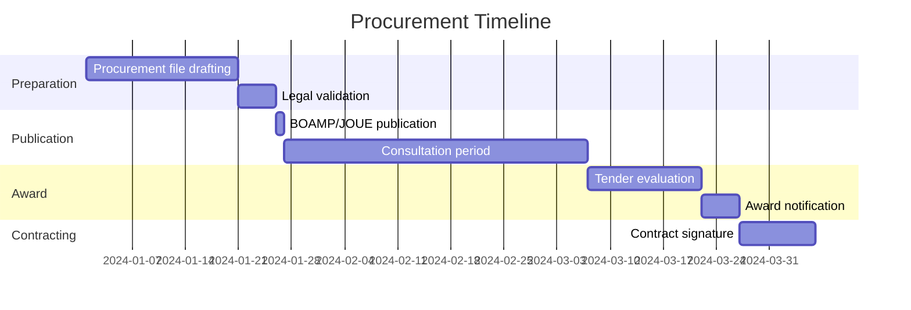

<!-- arckit-overlay-template: fr-algorithme-public-template.md -->

# Public Algorithm Transparency Notice

> **Template Origin**: Community | **ArcKit Version**: [VERSION] | **Command**:
> `/arckit:fr-algorithme-public`
>
> ⚠️ **Community-contributed** — not yet validated against current ANSSI/CNIL/EU
> regulatory text. Verify all citations before relying on output.

## Document Control

<!-- DOC-CONTROL-HEADER -->
<!-- Resolved at command-execution time per _partials/RENDERING.md. -->

## Revision History

| Version   | Date         | Author    | Changes                                              | Approved By | Approval Date |
| --------- | ------------ | --------- | ---------------------------------------------------- | ----------- | ------------- |
| [VERSION] | [YYYY-MM-DD] | ArcKit AI | Initial creation from `/arckit:fr-algorithme-public` | [PENDING]   | [PENDING]     |

## Algorithm Inventory Summary

| Algorithm        | Category                                     | Automated Decision       | Affects Citizens | Published |
| ---------------- | -------------------------------------------- | ------------------------ | ---------------- | --------- |
| [Algorithm name] | [Allocation / Scoring / Filtering / Ranking] | [Fully / Partially / No] | [Yes / No]       | ☐         |

---

## Legal Framework

### Obligation Scope (Article L311-3-1 CRPA)

Public administrations that issue individual decisions based wholly or in part
on algorithmic processing must inform the citizen of:

1. The existence of the algorithmic processing
2. The main parameters of the algorithm
3. The degree of influence each parameter has on the decision

This obligation applies to all **individual decisions** that **significantly
affect** the person concerned.

| Scoping Question                                  | Answer     | Obligation Triggered                  |
| ------------------------------------------------- | ---------- | ------------------------------------- |
| Is the entity a public administration?            | [Yes / No] | If yes, obligation may apply          |
| Does the system produce individual decisions?     | [Yes / No] | If yes, continue assessment           |
| Are decisions made wholly or partly by algorithm? | [Yes / No] | If yes, obligation applies            |
| Do decisions significantly affect citizens?       | [Yes / No] | If yes, proactive disclosure required |
| Are there applicable sector-specific exceptions?  | [Yes / No] | If yes, document exception            |

**Conclusion**: [Obligation applies / Partially applies / Does not apply — with
rationale]

---

## Algorithm 1: [Algorithm Name]

> Repeat this section for each algorithm subject to the transparency obligation.

### 1.1 Algorithm Identification

| Field                 | Value                                     |
| --------------------- | ----------------------------------------- |
| Algorithm name        | [Name]                                    |
| Algorithm ID          | ALGO-[PROJECT_ID]-01                      |
| Responsible authority | [Ministry / Directorate / Agency]         |
| Contact point         | [Email or web form for citizen enquiries] |
| Implementation date   | [YYYY-MM-DD]                              |
| Last updated          | [YYYY-MM-DD]                              |
| Publication URL       | [algorithmes.data.gouv.fr/[slug]]         |

### 1.2 Purpose and Context

| Field                       | Description                                                               |
| --------------------------- | ------------------------------------------------------------------------- |
| Purpose                     | [What decision or recommendation does this algorithm produce?]            |
| Administrative context      | [Which administrative process does it support?]                           |
| Legal basis for the process | [Legislation or regulation authorising the decision]                      |
| Decision type               | [Individual decision / Recommendation / Scoring / Prioritisation]         |
| Fully automated?            | [Yes — no human review / No — human decision-maker uses algorithm output] |
| Volume                      | [Approximately N decisions per year]                                      |

### 1.3 Algorithm Description

| Field          | Description                                                            |
| -------------- | ---------------------------------------------------------------------- |
| Algorithm type | [Rule-based / Statistical model / Machine learning / Hybrid]           |
| Main logic     | [Plain-language explanation of the algorithm's core logic — no jargon] |
| Inputs         | [List of data inputs: criteria, indicators, scores]                    |
| Output         | [Score / Classification / Decision / Ranked list]                      |
| Output scale   | [0–100 / A–D / Boolean]                                                |

### 1.4 Parameters and Their Influence

Parameters are the variables the algorithm uses when computing its output. This
section explains what each parameter is and how much influence it has on the
result.

| # | Parameter        | Description        | Data Source | Weight / Influence         | Justification                    |
| - | ---------------- | ------------------ | ----------- | -------------------------- | -------------------------------- |
| 1 | [Parameter name] | [What it measures] | [Source]    | [High / Medium / Low / N%] | [Why this parameter is relevant] |
| 2 | [Parameter name] |                    |             |                            |                                  |

**Influence note**: [Explain how parameters combine — e.g. "The final score is
the weighted sum of the three parameters above. Parameter 1 carries the most
weight because..."]

### 1.5 Data Used

| Data Type   | Source                                        | Personal Data | Legal Basis (if personal)         | Retention |
| ----------- | --------------------------------------------- | ------------- | --------------------------------- | --------- |
| [Data type] | [Source system / External DB / User-provided] | [Yes / No]    | [Art. 6(1)(e) GDPR — public task] | [Period]  |

### 1.6 Citizen Rights and Recourse

| Right                            | Mechanism                                                                                        |
| -------------------------------- | ------------------------------------------------------------------------------------------------ |
| Right to explanation             | Citizen may request explanation of the algorithmic decision from [contact point]                 |
| Right to human review            | Citizen may request a human decision-maker review the algorithmic output — [process description] |
| Right to contest                 | Citizen may contest the decision through [administrative appeal / judicial review]               |
| Right of access to personal data | GDPR Article 15 — contact [DPO]                                                                  |
| Response timeline                | Administration must respond to explanation requests within [30 days]                             |

---

## GDPR Intersection

[Complete if the algorithm processes personal data]

| Issue                                        | Assessment                                                                              |
| -------------------------------------------- | --------------------------------------------------------------------------------------- |
| Personal data in algorithm inputs            | [Yes / No — list data types]                                                            |
| Legal basis for processing                   | [Art. 6(1)(e) — public task / Other]                                                    |
| Automated decision-making under GDPR Art. 22 | [Fully automated individual decisions with legal/significant effects → Art. 22 applies] |
| DPIA required (Art. 35)                      | [Yes / No — systematic processing, profiling, or vulnerable groups trigger DPIA]        |
| Data minimisation                            | [Only data strictly necessary for the decision purpose is used]                         |
| Profiling                                    | [Algorithm constitutes profiling as defined in GDPR Art. 4(4): Yes / No]                |

---

## AI Act Intersection

[Complete if the algorithm uses machine learning or AI techniques]

| Issue                                 | Assessment                                                                              |
| ------------------------------------- | --------------------------------------------------------------------------------------- |
| AI system in scope of EU AI Act       | [Yes / No]                                                                              |
| High-risk category (Annex III)        | [e.g. Annex III point 5 — access to essential public services / Other / Not applicable] |
| Transparency obligations (Art. 13)    | [If high-risk: technical documentation, instructions for use, logging]                  |
| Human oversight requirement (Art. 14) | [If high-risk: human review capability required]                                        |
| Recommendation                        | [Run `/arckit:eu-ai-act` for full AI Act assessment]                                    |

---

## Publication and Maintenance

| Action                                                                  | Status | Target Date |
| ----------------------------------------------------------------------- | ------ | ----------- |
| Notice drafted and reviewed by legal team                               | ☐      |             |
| Published on algorithmes.data.gouv.fr                                   | ☐      |             |
| Published on the administration's own website                           | ☐      |             |
| Referenced in the administrative decision notification sent to citizens | ☐      |             |
| Review process defined for algorithm changes                            | ☐      |             |
| Contact point operational and responsive                                | ☐      |             |

---

**Generated by**: ArcKit `/arckit:fr-algorithme-public` command **Generated
on**: [YYYY-MM-DD] **ArcKit Version**: [VERSION] **Project**: [PROJECT_NAME]
**Model**: [AI_MODEL]

<!-- arckit-overlay-template: fr-anssi-carto-template.md -->

# ANSSI Information System Cartography

> **Template Origin**: Community | **ArcKit Version**: [VERSION] | **Command**:
> `/arckit:fr-anssi-carto`
>
> ⚠️ **Community-contributed** — not yet validated against current ANSSI/CNIL/EU
> regulatory text. Verify all citations before relying on output.

## Document Control

<!-- DOC-CONTROL-HEADER -->
<!-- Resolved at command-execution time per _partials/RENDERING.md. -->

## Revision History

| Version   | Date         | Author    | Changes                                        | Approved By | Approval Date |
| --------- | ------------ | --------- | ---------------------------------------------- | ----------- | ------------- |
| [VERSION] | [YYYY-MM-DD] | ArcKit AI | Initial creation from `/arckit:fr-anssi-carto` | [PENDING]   | [PENDING]     |

## Cartography Summary

| Level   | View                     | Components Identified               | Sensitive Flows |
| ------- | ------------------------ | ----------------------------------- | --------------- |
| Level 1 | Business (Métier)        | [N processes, N data assets]        | [N]             |
| Level 2 | Application (Applicatif) | [N applications, N services]        | [N]             |
| Level 3 | System/Infrastructure    | [N servers, N databases, N devices] | [N]             |
| Level 4 | Network (Réseau)         | [N segments, N interconnections]    | [N]             |

| Attack Surface Summary               | Count |
| ------------------------------------ | ----- |
| Internet-exposed entry points        | [N]   |
| Privileged administration interfaces | [N]   |
| Third-party interconnections         | [N]   |
| Unencrypted sensitive flows          | [N]   |

---

## Cartography Methodology

This cartography follows the ANSSI guide "Cartographie du système d'information"
(2021), which defines four reading levels to represent an information system at
increasing levels of technical detail. Each level answers a different question
for security analysis:

| Level                 | Question answered                                          | Audience               |
| --------------------- | ---------------------------------------------------------- | ---------------------- |
| Level 1 — Business    | What business processes and data does the system support?  | RSSI, management       |
| Level 2 — Application | Which applications and services implement those processes? | Architects, RSSI       |
| Level 3 — System      | Which physical/virtual systems host those applications?    | System administrators  |
| Level 4 — Network     | How are those systems interconnected and with the outside? | Network administrators |

---

## Level 1 — Business View (Vue Métier)

The business view identifies the essential values — the processes, information
assets, and services that matter to the organisation.

### 1.1 Business Processes

| ID   | Process        | Description   | Criticality                       | Data Classification    |
| ---- | -------------- | ------------- | --------------------------------- | ---------------------- |
| P-01 | [Process name] | [Description] | [Critical / Important / Standard] | [Classification level] |
| P-02 | [Process name] | [Description] |                                   |                        |

### 1.2 Essential Information Assets (Valeurs Métier)

| ID    | Asset        | Type                       | Owner   | Criticality                       |
| ----- | ------------ | -------------------------- | ------- | --------------------------------- |
| VM-01 | [Asset name] | [Data / Service / Process] | [Owner] | [Critical / Important / Standard] |
| VM-02 | [Asset name] |                            |         |                                   |

### 1.3 External Actors and Trusted Relationships

| Actor                   | Type                                    | Relationship            | Trust Level           |
| ----------------------- | --------------------------------------- | ----------------------- | --------------------- |
| [External organisation] | [Partner / Provider / Regulator / User] | [Nature of interaction] | [High / Medium / Low] |

---

## Level 2 — Application View (Vue Applicative)

The application view maps business processes to applications, services, and data
flows between them.

### 2.1 Application Inventory

| ID     | Application | Purpose       | Business Process | Criticality                       | Hosting                  |
| ------ | ----------- | ------------- | ---------------- | --------------------------------- | ------------------------ |
| APP-01 | [Name]      | [Description] | [P-xx]           | [Critical / Important / Standard] | [Cloud / On-prem / SaaS] |
| APP-02 | [Name]      |               |                  |                                   |                          |

### 2.2 Application Interdependencies

| Source | Destination | Flow Type                                 | Protocol              | Data Classification | Authentication         |
| ------ | ----------- | ----------------------------------------- | --------------------- | ------------------- | ---------------------- |
| APP-01 | APP-02      | [Synchronous API / Async / File transfer] | [HTTPS / SFTP / etc.] | [Level]             | [mTLS / OAuth2 / None] |

### 2.3 External Services and SaaS

| Service        | Provider   | Category                                 | Data Shared  | Contract Reference |
| -------------- | ---------- | ---------------------------------------- | ------------ | ------------------ |
| [Service name] | [Provider] | [Identity / Email / Storage / Analytics] | [Data types] | [Contract ID]      |

---

## Level 3 — System / Infrastructure View (Vue Système)

The system view maps applications to physical or virtual infrastructure
components.

### 3.1 Server Inventory

| ID     | Hostname / Role | OS   | Hosted Applications | Environment            | Location           | Criticality           |
| ------ | --------------- | ---- | ------------------- | ---------------------- | ------------------ | --------------------- |
| SRV-01 | [Hostname]      | [OS] | [APP-xx]            | [Prod / Staging / Dev] | [DC / AZ / Region] | [Critical / Standard] |

### 3.2 Database Inventory

| ID    | Database | DBMS                        | Data Owner | Classification | Encryption at Rest |
| ----- | -------- | --------------------------- | ---------- | -------------- | ------------------ |
| DB-01 | [Name]   | [PostgreSQL / MySQL / etc.] | [Owner]    | [Level]        | [Yes / No]         |

### 3.3 Active Directory and Identity Infrastructure

| Component               | Role          | Criticality | Admin Access Control |
| ----------------------- | ------------- | ----------- | -------------------- |
| [AD domain / IdP / PAM] | [Description] | [Critical]  | [Description]        |

### 3.4 Sensitive Equipment

| Equipment                        | Type | Purpose | Physical Location | Admin Interface Exposed    |
| -------------------------------- | ---- | ------- | ----------------- | -------------------------- |
| [Firewall / Load balancer / HSM] |      |         |                   | [Yes (internal only) / No] |

---

## Level 4 — Network View (Vue Réseau)

The network view maps physical and logical network segments and
interconnections.

### 4.1 Network Segments

| ID     | Segment Name | VLAN / Range  | Purpose                          | Security Zone                             | Systems       |
| ------ | ------------ | ------------- | -------------------------------- | ----------------------------------------- | ------------- |
| NET-01 | [Name]       | [10.x.x.x/24] | [Production / DMZ / Admin / Dev] | [Internet-facing / Internal / Restricted] | [SRV-xx list] |

### 4.2 External Interconnections

| ID     | Interconnection | Remote Party         | Protocol                | Encryption | Authentication      | Direction         |
| ------ | --------------- | -------------------- | ----------------------- | ---------- | ------------------- | ----------------- |
| ECX-01 | [Name]          | [Partner / Provider] | [MPLS / VPN / Internet] | [Yes / No] | [Certificate / PSK] | [In / Out / Both] |

> **Note**: This template uses `ECX-NN` (External Connection) rather than
> `INT-NN` because the universal requirement-ID pattern in
> `arckit-claude/hooks/hook-utils.mjs` reserves `INT-\d{1,3}` for Integration
> Requirements (REQ document IDs). Using `INT-NN` here would make every
> interconnection row appear as a "missed requirement" in `/arckit:traceability`
> and `/arckit:health` scans. Same pattern as the Azure-research template
> renaming `BR-N` → `BCK-N` (Backup & Recovery).

### 4.3 Internet Entry Points

| Entry Point   | Type                          | Protection                    | Exposed Services      |
| ------------- | ----------------------------- | ----------------------------- | --------------------- |
| [IP / Domain] | [Website / API / VPN / Email] | [WAF / DDoS / Firewall rules] | [Port / service list] |

### 4.4 Administration Channels

| Administration Path                | Access Method             | MFA        | Logging    | Restricted to     |
| ---------------------------------- | ------------------------- | ---------- | ---------- | ----------------- |
| [Jump host / Bastion / Direct SSH] | [SSH / RDP / Web console] | [Yes / No] | [Yes / No] | [IP range / Role] |

---

## 5. Sensitive Flows Analysis

Sensitive flows are data flows that cross trust boundaries, carry classified
data, or represent privileged access paths.

| Flow ID | Source      | Destination | Data        | Classification | Encrypted  | Risk                  |
| ------- | ----------- | ----------- | ----------- | -------------- | ---------- | --------------------- |
| FL-01   | [Component] | [Component] | [Data type] | [Level]        | [Yes / No] | [High / Medium / Low] |

---

## 6. Attack Surface Summary

| Attack Vector                | Entry Point    | Protection in Place        | Residual Exposure     |
| ---------------------------- | -------------- | -------------------------- | --------------------- |
| External web                 | [URL / IP]     | [WAF, CDN, firewall]       | [Low / Medium / High] |
| VPN / remote access          | [VPN endpoint] | [MFA, certificate]         |                       |
| Third-party interconnections | [ECX-xx]       | [Encryption, auth]         |                       |
| Supply chain (SaaS)          | [Service]      | [Contract, access control] |                       |
| Physical                     | [DC / Office]  | [Badge, CCTV]              |                       |

---

## 7. Recommendations

| Priority  | Finding                                    | Recommendation                  | Owner  | Target Date |
| --------- | ------------------------------------------ | ------------------------------- | ------ | ----------- |
| 🔴 High   | [e.g. Admin interface exposed to internet] | [Restrict to bastion host only] | [Role] | [Date]      |
| 🟠 Medium |                                            |                                 |        |             |
| 🟡 Low    |                                            |                                 |        |             |

---

**Generated by**: ArcKit `/arckit:fr-anssi-carto` command **Generated on**:
[YYYY-MM-DD] **ArcKit Version**: [VERSION] **Project**: [PROJECT_NAME]
**Model**: [AI_MODEL]

<!-- arckit-overlay-template: fr-anssi-template.md -->

# ANSSI Security Posture Assessment

> **Template Origin**: Community | **ArcKit Version**: [VERSION] | **Command**:
> `/arckit:fr-anssi`
>
> ⚠️ **Community-contributed** — not yet validated against current ANSSI/CNIL/EU
> regulatory text. Verify all citations before relying on output.

## Document Control

<!-- DOC-CONTROL-HEADER -->
<!-- Resolved at command-execution time per _partials/RENDERING.md. -->

## Revision History

| Version   | Date         | Author    | Changes                                  | Approved By | Approval Date |
| --------- | ------------ | --------- | ---------------------------------------- | ----------- | ------------- |
| [VERSION] | [YYYY-MM-DD] | ArcKit AI | Initial creation from `/arckit:fr-anssi` | [PENDING]   | [PENDING]     |

## Executive Summary

| Hygiene Guide Chapter                        | Total Measures | Implemented | Partial | Not Implemented |
| -------------------------------------------- | -------------- | ----------- | ------- | --------------- |
| I. Raise awareness and train                 | 3              | —           | —       | —               |
| II. Know the information system              | 4              | —           | —       | —               |
| III. Authenticate and control access         | 6              | —           | —       | —               |
| IV. Secure workstations                      | 5              | —           | —       | —               |
| V. Secure the network                        | 8              | —           | —       | —               |
| VI. Secure administration                    | 3              | —           | —       | —               |
| VII. Manage mobile working                   | 4              | —           | —       | —               |
| VIII. Keep the information system up to date | 2              | —           | —       | —               |
| IX. Monitor, audit, respond                  | 5              | —           | —       | —               |
| X. Going further                             | 2              | —           | —       | —               |
| **Total**                                    | **42**         | —           | —       | —               |

| Cloud Recommendations                                                         | Status                               |
| ----------------------------------------------------------------------------- | ------------------------------------ |
| ANSSI recommendations for hosting sensitive IS in the cloud (v1.0, July 2024) | [Applicable / Not applicable]        |
| Cloud provider trust level                                                    | [SecNumCloud / EU-qualified / Other] |

---

## 1. Scope and Applicable Guides

| Element                | Description                                                                   |
| ---------------------- | ----------------------------------------------------------------------------- |
| System studied         | [Name and brief description]                                                  |
| Assessment boundary    | [What is included / excluded]                                                 |
| Deployment environment | [Cloud / On-premise / Hybrid]                                                 |
| Primary ANSSI guide    | Guide d'hygiène informatique (version 2.0, 2017 — 42 measures in 10 chapters) |
| Supplementary guides   | [List applicable ANSSI technical guides]                                      |
| Regulatory context     | [OIV / OSE / Public sector / Private — affects applicability of measures]     |

---

## 2. ANSSI Guide d'Hygiène Informatique — 42 Measures

**Status codes**: ✅ Implemented | ⚠️ Partial | ❌ Not implemented | N/A Not
applicable

Status is assessed against each measure's _standard_ level. Where the guide also
defines a _renforcé_ (reinforced) level for a measure, record in Gap / Evidence
whether it is met or targeted.

### I — Raise Awareness and Train (Sensibiliser et former)

| # | Measure                                                | Status | Gap / Evidence |
| - | ------------------------------------------------------ | ------ | -------------- |
| 1 | Train operational teams in information system security |        |                |
| 2 | Raise users' awareness of basic IT security practices  |        |                |
| 3 | Control the risks of outsourced IT (infogérance)       |        |                |

### II — Know the Information System (Connaître le système d'information)

| # | Measure                                                                             | Status | Gap / Evidence |
| - | ----------------------------------------------------------------------------------- | ------ | -------------- |
| 4 | Identify the most sensitive information and servers, and maintain a network diagram |        |                |
| 5 | Keep an exhaustive, up-to-date inventory of privileged accounts                     |        |                |
| 6 | Organise joiner, leaver and change-of-role procedures for users                     |        |                |
| 7 | Allow only managed devices to connect to the organisation's network                 |        |                |

### III — Authenticate and Control Access (Authentifier et contrôler les accès)

| #  | Measure                                                                                         | Status | Gap / Evidence |
| -- | ----------------------------------------------------------------------------------------------- | ------ | -------------- |
| 8  | Identify each person accessing the system by name, and distinguish user and administrator roles |        |                |
| 9  | Assign the right permissions on the information system's sensitive resources                    |        |                |
| 10 | Define and check rules for choosing and sizing passwords                                        |        |                |
| 11 | Protect passwords stored on systems                                                             |        |                |
| 12 | Change default authentication credentials on devices and services                               |        |                |
| 13 | Use strong authentication wherever possible                                                     |        |                |

### IV — Secure Workstations (Sécuriser les postes)

| #  | Measure                                                                | Status | Gap / Evidence |
| -- | ---------------------------------------------------------------------- | ------ | -------------- |
| 14 | Apply a minimum security level across all IT equipment                 |        |                |
| 15 | Protect against threats from removable media                           |        |                |
| 16 | Use a centralised management tool to make security policies consistent |        |                |
| 17 | Enable and configure the local firewall on workstations                |        |                |
| 18 | Encrypt sensitive data sent over the Internet                          |        |                |

### V — Secure the Network (Sécuriser le réseau)

| #  | Measure                                                                    | Status | Gap / Evidence |
| -- | -------------------------------------------------------------------------- | ------ | -------------- |
| 19 | Segment the network and partition the zones from each other                |        |                |
| 20 | Secure Wi-Fi access networks and keep their uses separate                  |        |                |
| 21 | Use secure protocols wherever they exist                                   |        |                |
| 22 | Set up a secure Internet access gateway                                    |        |                |
| 23 | Partition Internet-facing services from the rest of the information system |        |                |
| 24 | Protect business email                                                     |        |                |
| 25 | Secure dedicated network interconnections with partners                    |        |                |
| 26 | Control and protect access to server rooms and technical premises          |        |                |

### VI — Secure Administration (Sécuriser l'administration)

| #  | Measure                                                                                      | Status | Gap / Evidence |
| -- | -------------------------------------------------------------------------------------------- | ------ | -------------- |
| 27 | Block Internet access from workstations or servers used to administer the information system |        |                |
| 28 | Use a dedicated, partitioned network to administer the information system                    |        |                |
| 29 | Limit administration rights on workstations to strict operational need                       |        |                |

### VII — Manage Mobile Working (Gérer le nomadisme)

| #  | Measure                                                              | Status | Gap / Evidence |
| -- | -------------------------------------------------------------------- | ------ | -------------- |
| 30 | Physically secure mobile devices                                     |        |                |
| 31 | Encrypt sensitive data, especially on equipment that could be lost   |        |                |
| 32 | Secure the network connection of devices used while working remotely |        |                |
| 33 | Adopt security policies dedicated to mobile terminals                |        |                |

### VIII — Keep the Information System Up to Date (Maintenir le système d'information à jour)

| #  | Measure                                                                                                | Status | Gap / Evidence |
| -- | ------------------------------------------------------------------------------------------------------ | ------ | -------------- |
| 34 | Define an update policy for information system components (including CERT-FR vulnerability monitoring) |        |                |
| 35 | Anticipate end of support for software and systems, and limit software dependencies                    |        |                |

### IX — Monitor, Audit, Respond (Superviser, auditer, réagir)

| #  | Measure                                                                         | Status | Gap / Evidence |
| -- | ------------------------------------------------------------------------------- | ------ | -------------- |
| 36 | Enable and configure logs on the most important components                      |        |                |
| 37 | Define and apply a backup policy for critical components                        |        |                |
| 38 | Carry out regular security checks and audits, then apply the corrective actions |        |                |
| 39 | Appoint an information system security lead and make them known to staff        |        |                |
| 40 | Define a security incident management procedure                                 |        |                |

### X — Going Further (Pour aller plus loin)

| #  | Measure                                      | Status | Gap / Evidence |
| -- | -------------------------------------------- | ------ | -------------- |
| 41 | Carry out a formal risk analysis             |        |                |
| 42 | Prefer ANSSI-qualified products and services |        |                |

---

## 3. ANSSI Cloud Hosting Recommendations for Sensitive IS (v1.0, July 2024)

[Complete if the system uses cloud services — IaaS, PaaS, SaaS, or hybrid]

### 3.1 Cloud Provider Assessment

| Criterion                     | Recommendation                                                                                                                                                                                | Status |
| ----------------------------- | --------------------------------------------------------------------------------------------------------------------------------------------------------------------------------------------- | ------ |
| IS category                   | [DR-level sensitive IS / sensitive IS under the State "cloud au centre" doctrine / sensitive IS of an OIV or OSE / SIIV] — ANSSI recommends the cloud offer types to favour for each category |        |
| Provider qualification        | Prefer SecNumCloud-qualified providers for sensitive data                                                                                                                                     |        |
| Data location                 | EU-only hosting for data subject to French law                                                                                                                                                |        |
| Extraterritorial law exposure | Assess US CLOUD Act / China MLSA applicability                                                                                                                                                |        |
| Encryption key management     | Customer-managed keys (BYOK) preferred                                                                                                                                                        |        |
| Incident response SLA         | Provider must notify within contractual timeframe                                                                                                                                             |        |
| Exit strategy                 | Data portability and reversibility contractually guaranteed                                                                                                                                   |        |

### 3.2 Cloud Architecture Security

| Requirement                                                          | Status | Gap |
| -------------------------------------------------------------------- | ------ | --- |
| Shared responsibility model documented                               |        |     |
| Identity and access management in cloud follows least privilege      |        |     |
| Cloud configuration hardening applied (CIS Benchmarks or equivalent) |        |     |
| Cloud activity logging enabled and sent to SIEM                      |        |     |
| API access secured with strong authentication                        |        |     |
| Secrets management solution in place (no credentials in code)        |        |     |

---

## 4. Gap Analysis and Remediation Plan

| Measure / Recommendation | Status | Priority | Owner  | Target Date |
| ------------------------ | ------ | -------- | ------ | ----------- |
| [Measure description]    | ❌     | 🔴 High  | [Role] | [Date]      |

**Priority levels**:

- 🔴 High: deploy before go-live or within 30 days
- 🟠 Medium: deploy within 90 days
- 🟡 Low: deploy within 12 months

### 4.1 Summary Score

| Metric                            | Count    |
| --------------------------------- | -------- |
| Measures fully implemented        | [N] / 42 |
| Measures partially implemented    | [N] / 42 |
| Measures not implemented          | [N] / 42 |
| Cloud recommendations applicable  | [N]      |
| Cloud recommendations implemented | [N]      |

---

**Generated by**: ArcKit `/arckit:fr-anssi` command **Generated on**:
[YYYY-MM-DD] **ArcKit Version**: [VERSION] **Project**: [PROJECT_NAME]
**Model**: [AI_MODEL]

<!-- arckit-overlay-template: fr-code-reuse-template.md -->

# Public Code Reuse Assessment

> **Template Origin**: Community | **ArcKit Version**: [VERSION] | **Command**:
> `/arckit:fr-code-reuse`
>
> ⚠️ **Community-contributed** — not yet validated against current ANSSI/CNIL/EU
> regulatory text. Verify all citations before relying on output.

## Document Control

<!-- DOC-CONTROL-HEADER -->
<!-- Resolved at command-execution time per _partials/RENDERING.md. -->

## Revision History

| Version   | Date         | Author    | Changes                                       | Approved By | Approval Date |
| --------- | ------------ | --------- | --------------------------------------------- | ----------- | ------------- |
| [VERSION] | [YYYY-MM-DD] | ArcKit AI | Initial creation from `/arckit:fr-code-reuse` | [PENDING]   | [PENDING]     |

## Executive Summary

| Component Need | code.gouv.fr Match   | SILL Match | Decision               | Effort Saved |
| -------------- | -------------------- | ---------- | ---------------------- | ------------ |
| [Component 1]  | [Yes / Partial / No] | [Yes / No] | [Reuse / Fork / Build] | [estimate]   |
| [Component 2]  |                      |            |                        |              |

**Build vs Reuse verdict**: [Reuse existing code for X% of components / Partial
reuse for Y components / Build from scratch — justification]

---

## Legal Framework

### Obligation to Reuse and Publish

French public administrations are subject to two complementary obligations:

**1. Reuse before build** (Circulaire PM n°6264/SG, 27 April 2021) The circular
instructs State administrations to strengthen the opening of public source code
and the use of free software. Searching for and reusing existing public code
before commissioning new development is how a project applies that policy. The
circular is an instruction to State administrations, not a statute.

**2. Publish custom code** (Loi République Numérique, Art. 16; DINUM mission
logiciels libres) Software developed by or for the administration must be
published as open source, except where national security, trade secrets, or
third-party rights prevent publication.

| Obligation                                      | Applicable             | Rationale                       |
| ----------------------------------------------- | ---------------------- | ------------------------------- |
| Search for existing public code before building | [Yes / No]             | [Rationale]                     |
| Publish code developed for this project         | [Yes / No / Partially] | [Rationale — exceptions if any] |
| Use SILL-recommended software where available   | [Yes — best practice]  |                                 |
| Contribute improvements back upstream           | [Yes — recommended]    |                                 |

---

## 1. Project Requirements Summary

Features and components being assessed for reuse:

| ID      | Component / Feature                | Technical Domain | Complexity            | Priority    |
| ------- | ---------------------------------- | ---------------- | --------------------- | ----------- |
| COMP-01 | [e.g. Identity and authentication] | [IAM]            | [High / Medium / Low] | [Must-have] |
| COMP-02 | [e.g. Document management]         | [ECM]            |                       |             |
| COMP-03 | [e.g. API gateway]                 | [Integration]    |                       |             |

---

## 2. code.gouv.fr Assessment

[code.gouv.fr](https://code.gouv.fr/sources/) lists open source code published
by French public administrations. Search by keyword, domain, or technology.]

### 2.1 Search Results

| Component | Search Terms Used | Results Found | Best Match            | Licence             | Actively Maintained  | Notes |
| --------- | ----------------- | ------------- | --------------------- | ------------------- | -------------------- | ----- |
| COMP-01   | [keywords]        | [N]           | [Repo name or "None"] | [MIT / EUPL / LGPL] | [Yes / No / Unknown] |       |
| COMP-02   |                   |               |                       |                     |                      |       |

### 2.2 Candidate Repository Assessment

For each promising match from code.gouv.fr:

| Field                            | COMP-01 Candidate               | COMP-02 Candidate |
| -------------------------------- | ------------------------------- | ----------------- |
| Repository                       | [URL]                           | [URL]             |
| Publishing entity                | [Ministry / Agency]             |                   |
| Last commit                      | [YYYY-MM-DD]                    |                   |
| Stars / forks                    | [N / N]                         |                   |
| Open issues                      | [N]                             |                   |
| Documentation quality            | [Good / Partial / Poor]         |                   |
| Test coverage                    | [Stated %]                      |                   |
| Community / contributors         | [Active / Dormant]              |                   |
| Deployment complexity            | [Docker / k8s / Manual]         |                   |
| Compatibility with project stack | [High / Medium / Low]           |                   |
| **Reuse recommendation**         | [✅ Reuse / ⚠️ Fork / ❌ Build] |                   |

---

## 3. SILL Assessment (Socle Interministériel de Logiciels Libres)

The [SILL](https://code.gouv.fr/sill/) is the recommended free and open source
software list for French public administrations. Software on the SILL has been
assessed by an interministerial working group and has a named referent in the
French administration.

### 3.1 SILL Matches

| Component | SILL Software    | Category        | Status                 | Referent Ministry | Version | Notes |
| --------- | ---------------- | --------------- | ---------------------- | ----------------- | ------- | ----- |
| COMP-01   | [e.g. Keycloak]  | [Identity]      | [In use / Recommended] | [DINUM]           | [v24]   |       |
| COMP-02   | [e.g. Nextcloud] | [Collaboration] |                        |                   |         |       |

### 3.2 SILL Compliance

| SILL Requirement                                     | Status | Notes |
| ---------------------------------------------------- | ------ | ----- |
| SILL consulted before vendor selection               | ☐      |       |
| SILL-listed alternatives documented where not chosen | ☐      |       |
| Rationale for not using SILL software documented     | ☐      |       |

---

## 4. European and International Public Code

Beyond French public code, the following sources should be consulted:

| Source                          | URL                        | Purpose                                      |
| ------------------------------- | -------------------------- | -------------------------------------------- |
| Joinup (EU)                     | joinup.ec.europa.eu        | EU institutions and member state public code |
| GitHub government organisations | github.com/[ministry-slug] | Other nation government repositories         |
| eGovernment Core Vocabularies   | data.europa.eu             | EU semantic interoperability components      |

### 4.1 Joinup / EU Public Code Results

| Component | EU Match         | Publisher                       | Licence | Notes |
| --------- | ---------------- | ------------------------------- | ------- | ----- |
| COMP-01   | [Name or "None"] | [EU institution / Member state] |         |       |

---

## 5. Open Source Licence Compatibility

For all reused components, verify licence compatibility with the project's
intended licence.

| Component | Candidate Licence     | Project Licence | Compatible               | Constraint                                        |
| --------- | --------------------- | --------------- | ------------------------ | ------------------------------------------------- |
| COMP-01   | [MIT / EUPL / GPL v3] | [EUPL-1.2]      | [Yes / No / Conditional] | [e.g. Copyleft requires publishing modifications] |

**EUPL-1.2 note**: The European Union Public Licence is the recommended licence
for public code in France (Circulaire 2021). It is compatible with GPL, LGPL,
AGPL, and several other major open source licences.

| Licence Type | Compatible with EUPL-1.2 | Notes                                             |
| ------------ | ------------------------ | ------------------------------------------------- |
| MIT          | Yes                      | Permissive                                        |
| Apache 2.0   | Yes                      | Permissive                                        |
| GPL v2       | Yes                      | Copyleft — project code becomes GPL               |
| GPL v3       | Yes                      | Copyleft                                          |
| LGPL         | Yes                      | Weak copyleft                                     |
| AGPL         | Yes                      | Strong copyleft — network use triggers obligation |
| EUPL         | Yes                      | Same licence                                      |
| Proprietary  | No                       | Cannot integrate into open source project         |

---

## 6. Contribution-Back Plan

Where the project uses or forks existing public code, the Circulaire 2021 and
DINUM mission logiciels libres encourage contributing improvements back
upstream.

| Component | Planned Contributions                     | Contribution Timeline     | Upstream Repository |
| --------- | ----------------------------------------- | ------------------------- | ------------------- |
| COMP-01   | [Bug fixes / New feature / Documentation] | [Within project delivery] | [URL]               |
| COMP-02   |                                           |                           |                     |

---

## 7. Decision Matrix

| Component | Option             | Total Effort | Risk   | Recommendation | Justification                                         |
| --------- | ------------------ | ------------ | ------ | -------------- | ----------------------------------------------------- |
| COMP-01   | Reuse as-is        | Low          | Low    | ✅ **Reuse**   | Meets 90% of requirements, active community           |
| COMP-02   | Fork and adapt     | Medium       | Medium | ⚠️ **Fork**    | Meets 60% of needs, requires 2 months adaptation      |
| COMP-03   | Build from scratch | High         | High   | ❌ **Build**   | No existing solution matches — document justification |

---

## 8. Reused Components Register

Final register of components selected for reuse. This feeds into procurement
documentation and the software bill of materials (SBOM).

| Component | Source                                | Repository | Version Pinned | Licence | Integration Method        | Maintenance Owner |
| --------- | ------------------------------------- | ---------- | -------------- | ------- | ------------------------- | ----------------- |
| [Name]    | code.gouv.fr / SILL / Joinup / GitHub | [URL]      | [v1.2.3]       | [MIT]   | [Dependency / Fork / API] | [Team]            |

---

**Generated by**: ArcKit `/arckit:fr-code-reuse` command **Generated on**:
[YYYY-MM-DD] **ArcKit Version**: [VERSION] **Project**: [PROJECT_NAME]
**Model**: [AI_MODEL]

<!-- arckit-overlay-template: fr-dinum-template.md -->

# DINUM Standards Compliance Assessment

> **Template Origin**: Community | **ArcKit Version**: [VERSION] | **Command**:
> `/arckit:fr-dinum`
>
> ⚠️ **Community-contributed** — not yet validated against current ANSSI/CNIL/EU
> regulatory text. Verify all citations before relying on output.

## Document Control

<!-- DOC-CONTROL-HEADER -->
<!-- Resolved at command-execution time per _partials/RENDERING.md. -->

## Revision History

| Version   | Date         | Author    | Changes                                  | Approved By | Approval Date |
| --------- | ------------ | --------- | ---------------------------------------- | ----------- | ------------- |
| [VERSION] | [YYYY-MM-DD] | ArcKit AI | Initial creation from `/arckit:fr-dinum` | [PENDING]   | [PENDING]     |

## Executive Summary

| Referential          | Compliance Level                 | Critical Gaps | Next Review |
| -------------------- | -------------------------------- | ------------- | ----------- |
| State Cloud Doctrine | [Full / Partial / Non-compliant] | [Count]       | [Date]      |
| RGI v2.0             | [Full / Partial / Non-compliant] | [Count]       | [Date]      |
| RGAA 4.1             | [X%]                             | [Count]       | [Date]      |
| RGESN                | [X%]                             | [Count]       | [Date]      |
| RGS v2.0             | [Full / Partial / Non-compliant] | [Count]       | [Date]      |

---

## 1. State Cloud Doctrine (Doctrine cloud de l'État — Circular 6282/SG)

The French cloud-first policy mandates evaluation in order:

1. Internal government cloud (cloud de l'État — Trusted Digital Space)
2. Trusted commercial cloud (SecNumCloud-qualified offers)
3. Standard commercial cloud (justified exception only)

| Step                                 | Assessment                                     | Decision                               |
| ------------------------------------ | ---------------------------------------------- | -------------------------------------- |
| Internal government cloud evaluated? | ☐ Yes ☐ No                                     | [Available / Not available]            |
| SecNumCloud offer evaluated?         | ☐ Yes ☐ No                                     | [Available / Not available / Selected] |
| Standard cloud justified?            | ☐ Yes ☐ No                                     | [Justification if applicable]          |
| Data sensitivity classification      | [Non-sensitive / Sensitive / Highly sensitive] | [Drives cloud tier]                    |

## 2. RGI v2.0 — Interoperability

### 2.1 Formats and Standards

| Category             | Recommended Standard (RGI)       | Compliant |
| -------------------- | -------------------------------- | --------- |
| Document exchange    | ODF, PDF/A                       | ☐         |
| Structured data      | XML, JSON, CSV                   | ☐         |
| APIs                 | REST/JSON, OpenAPI 3.x           | ☐         |
| Geographic data      | GML, GeoJSON, WMS/WFS            | ☐         |
| Identity federation  | OpenID Connect, SAML 2.0         | ☐         |
| Electronic signature | XAdES, PAdES, CAdES              | ☐         |
| Messaging            | Standard email (SMTP/IMAP), MIME | ☐         |

### 2.2 Interoperability Principles

- [ ] Open standards preferred over proprietary formats
- [ ] Published API documentation
- [ ] Semantic interoperability (reference data aligned with national
      referentiels)
- [ ] Technical interoperability tested across browsers/OS
- [ ] Reversibility guaranteed (no vendor lock-in for public data)

## 3. RGAA 4.1 — Digital Accessibility

### 3.1 Legal Obligations

| Entity                                                      | Legal Basis                    | Obligation                |
| ----------------------------------------------------------- | ------------------------------ | ------------------------- |
| State, EPAs, EICs > 250 agents                              | Loi 2005-102 + Décret 2019-768 | RGAA compliance mandatory |
| Large private companies (> 250 employees + > €250M revenue) | Loi 2005-102 amended 2016      | RGAA compliance mandatory |
| Others                                                      | —                              | Recommended               |

### 3.2 RGAA 4.1 Assessment Areas (106 criteria, 13 themes)

| Theme                           | Criteria Count | Status | Critical Gaps |
| ------------------------------- | -------------- | ------ | ------------- |
| 1. Images                       | 9              | ☐      |               |
| 2. Frames                       | 4              | ☐      |               |
| 3. Colour                       | 9              | ☐      |               |
| 4. Multimedia                   | 13             | ☐      |               |
| 5. Tables                       | 11             | ☐      |               |
| 6. Links                        | 13             | ☐      |               |
| 7. Scripts                      | 8              | ☐      |               |
| 8. Mandatory elements           | 8              | ☐      |               |
| 9. Information structure        | 12             | ☐      |               |
| 10. Presentation of information | 12             | ☐      |               |
| 11. Forms                       | 15             | ☐      |               |
| 12. Navigation                  | 6              | ☐      |               |
| 13. Consultation                | 9              | ☐      |               |

**Compliance rate**: [X]% — [Full / Partial / Non-compliant]

### 3.3 Mandatory Publication Requirements

- [ ] Accessibility statement (Déclaration d'accessibilité) published on service
- [ ] Compliance rate declared (full / partial / non-compliant)
- [ ] Exemptions documented
- [ ] Feedback mechanism for accessibility issues
- [ ] Multi-year accessibility scheme (schéma pluriannuel) published

## 4. RGESN — Digital Service Ecodesign

### 4.1 RGESN 2024 — 78 Criteria across 9 Families

| Family                             | Criteria Count | Status | Key Gaps |
| ---------------------------------- | -------------- | ------ | -------- |
| 1. Strategy (Stratégie)            | 10             | ☐      |          |
| 2. Specifications (Spécifications) | 10             | ☐      |          |
| 3. Architecture                    | 7              | ☐      |          |
| 4. UX/UI                           | 15             | ☐      |          |
| 5. Content (Contenus)              | 8              | ☐      |          |
| 6. Frontend                        | 7              | ☐      |          |
| 7. Backend                         | 4              | ☐      |          |
| 8. Hosting (Hébergement)           | 10             | ☐      |          |
| 9. Algorithms (Algorithmie)        | 7              | ☐      |          |

### 4.2 Hosting Sustainability

| Requirement                                         | Status |
| --------------------------------------------------- | ------ |
| Hosting provider PUE declared                       | ☐      |
| Renewable energy share declared                     | ☐      |
| French Green Cloud label considered                 | ☐      |
| Hardware lifecycle (refurbished servers considered) | ☐      |

## 5. RGS v2.0 — Information Systems Security

### 5.1 RGS Security Levels

| Level   | Description                     | Applicable To                |
| ------- | ------------------------------- | ---------------------------- |
| RGS *   | Basic — standard public service | Most citizen-facing services |
| RGS **  | Enhanced — sensitive data       | Health, justice, benefits    |
| RGS *** | Strong — very sensitive         | Revenue, defence adjacents   |

**Target level for this service**: [RGS * / ** / ***]

### 5.2 Key RGS Requirements

| Requirement                                          | RGS Level       | Status |
| ---------------------------------------------------- | --------------- | ------ |
| Security accreditation (Homologation) before go-live | All             | ☐      |
| State IS Security Policy (PSSIE) alignment           | All             | ☐      |
| Cryptographic algorithm compliance (RGS Annex B)     | All             | ☐      |
| Authentication strength (RGS Annex A)                | Level-dependent | ☐      |
| Electronic certificate from qualified TSP            | Level-dependent | ☐      |

### 5.3 Security Accreditation Process

1. Risk analysis (ISO 27005 or EBIOS Risk Manager)
2. Security architecture review
3. Technical security testing
4. Security accreditation file (Homologation dossier) submitted to Accreditation
   Authority (Autorité d'Homologation)
5. Accreditation decision (with or without residual risks)
6. Annual review or after significant change

## 6. FranceConnect / ProConnect Integration

[Complete if applicable — identity federation for public services]

| Requirement                                          | Status                     |
| ---------------------------------------------------- | -------------------------- |
| FranceConnect integration for citizen authentication | ☐                          |
| ProConnect for agent (civil servant) authentication  | ☐                          |
| eIDAS Level of Assurance (LoA) required              | [Low / Substantial / High] |
| ANSSI eIDAS notification status of IDP verified      | ☐                          |

## 7. DSFR — French State Design System

[Complete if citizen-facing digital service]

| Requirement                                                   | Status |
| ------------------------------------------------------------- | ------ |
| DSFR components used                                          | ☐      |
| Marianne font applied                                         | ☐      |
| République Française branding guidelines followed             | ☐      |
| Colour palette from DSFR                                      | ☐      |
| Accessibility already integrated in DSFR components leveraged | ☐      |

## 8. Gap Analysis and Action Plan

| Gap               | Referential          | Priority | Owner  | Deadline |
| ----------------- | -------------------- | -------- | ------ | -------- |
| [Gap description] | [RGI/RGAA/RGESN/RGS] | 🔴 High  | [Role] | [Date]   |

---

**Generated by**: ArcKit `/arckit:fr-dinum` command **Generated on**:
[YYYY-MM-DD] **ArcKit Version**: [VERSION] **Project**: [PROJECT_NAME]
**Model**: [AI_MODEL]

<!-- arckit-overlay-template: fr-dr-template.md -->

# Diffusion Restreinte Handling Assessment

> **Template Origin**: Community | **ArcKit Version**: [VERSION] | **Command**:
> `/arckit:fr-dr`
>
> ⚠️ **Community-contributed** — not yet validated against current ANSSI/CNIL/EU
> regulatory text. Verify all citations before relying on output.

## Document Control

<!-- DOC-CONTROL-HEADER -->
<!-- Resolved at command-execution time per _partials/RENDERING.md. -->

## Revision History

| Version   | Date         | Author    | Changes                               | Approved By | Approval Date |
| --------- | ------------ | --------- | ------------------------------------- | ----------- | ------------- |
| [VERSION] | [YYYY-MM-DD] | ArcKit AI | Initial creation from `/arckit:fr-dr` | [PENDING]   | [PENDING]     |

## Scope Statement

> **Important distinction**: This assessment covers the **Diffusion Restreinte
> (DR)** mention only. DR is an administrative protection mention governed by II
> 901/SGDSN/ANSSI for electronic systems. It is **not** a classification level
> under IGI 1300 (which covers Secret and Très Secret). Systems handling IGI
> 1300 classified information require a separate defence security framework
> beyond the scope of this assessment.

| Element                     | Value                                |
| --------------------------- | ------------------------------------ |
| System assessed             | [System name and description]        |
| DR assets identified        | [N document types / data categories] |
| Production entity           | [Ministry / Directorate / Agency]    |
| Receiving entities          | [List of authorised recipients]      |
| Electronic systems in scope | [IS name(s) hosting DR documents]    |

---

## 1. DR Asset Inventory

Identify all information assets produced, processed, or transmitted by the
system that carry or should carry the DR mention.

| ID        | Asset / Document Type            | Origin          | Volume (est.) | Current Classification | Should Be DR |
| --------- | -------------------------------- | --------------- | ------------- | ---------------------- | ------------ |
| DR-DOC-01 | [e.g. Internal security reports] | [Directorate X] | [~N/month]    | [Unclassified / DR]    | [Yes / No]   |
| DR-DOC-02 | [e.g. Audit findings]            |                 |               |                        |              |

**DR marking criteria**: Apply DR when unauthorised disclosure would harm the
interests of the French State or a third party, without reaching the level
requiring formal classification under IGI 1300.

---

## 2. DR Marking and Labelling Rules

### 2.1 Electronic Documents

| Requirement         | Rule                                                   | Status |
| ------------------- | ------------------------------------------------------ | ------ |
| Header marking      | "DIFFUSION RESTREINTE" centred at top of every page    | ☐      |
| Footer marking      | "DIFFUSION RESTREINTE" centred at bottom of every page | ☐      |
| Document metadata   | DR mention in file properties / metadata               | ☐      |
| Watermark           | Diagonal "DIFFUSION RESTREINTE" watermark on each page | ☐      |
| Filename convention | File names must not reveal classified content          | ☐      |
| Version control     | DR documents versioned and registered in DR registry   | ☐      |

### 2.2 DR Registry

| Requirement                                         | Status | Gap |
| --------------------------------------------------- | ------ | --- |
| Central DR document registry maintained             | ☐      |     |
| Each DR document assigned a unique reference number | ☐      |     |
| Copies tracked (who holds which copy)               | ☐      |     |
| Registry accessible only to authorised personnel    | ☐      |     |

---

## 3. Access Control

| Requirement                                  | Rule                                                                | Status |
| -------------------------------------------- | ------------------------------------------------------------------- | ------ |
| Need-to-know principle                       | Access granted only to personnel with a demonstrable need           | ☐      |
| Individual authorisation                     | Explicit authorisation by the originating authority                 | ☐      |
| No third-party sharing without authorisation | DR cannot be shared with external parties without explicit approval | ☐      |
| Visitor and contractor access                | DR documents not accessible to unauthorised visitors or contractors | ☐      |
| Access revocation on role change             | DR access revoked promptly on departure or role change              | ☐      |

### 3.1 Authorised Recipients

| Recipient Entity     | Authorised Role    | Access Granted By | Date | Review Date |
| -------------------- | ------------------ | ----------------- | ---- | ----------- |
| [Directorate / Unit] | [Role description] | [Authority]       |      |             |

---

## 4. Electronic Storage Requirements

| Requirement                  | Rule                                                             | Status | Gap |
| ---------------------------- | ---------------------------------------------------------------- | ------ | --- |
| Storage system qualification | DR must be stored on a system approved or qualified by ANSSI     | ☐      |     |
| Encryption at rest           | DR data encrypted with ANSSI-approved solution (minimum AES-256) | ☐      |     |
| Encryption key management    | Keys managed separately from data, access restricted             | ☐      |     |
| Logical access control       | DR storage area access controlled by individual authentication   | ☐      |     |
| Audit logging                | All access to DR storage logged and retained minimum 1 year      | ☐      |     |
| Backup encryption            | Backups of DR data encrypted to same standard                    | ☐      |     |
| Cloud storage                | Only on ANSSI-approved or SecNumCloud-qualified infrastructure   | ☐      |     |

---

## 5. Electronic Transmission Rules

| Requirement                    | Rule                                                                              | Status | Gap |
| ------------------------------ | --------------------------------------------------------------------------------- | ------ | --- |
| Approved transmission channels | DR transmitted only on approved networks (RIE, VPN ANSSI-approved, or equivalent) | ☐      |     |
| No public internet             | DR must not transit unencrypted public internet                                   | ☐      |     |
| Email restrictions             | DR must not be sent via standard email without ANSSI-approved encryption          | ☐      |     |
| End-to-end encryption          | Encryption applied before transmission, keys not shared with provider             | ☐      |     |
| Recipient verification         | Recipient identity and authorisation verified before transmission                 | ☐      |     |
| Transmission logging           | All DR transmissions logged (sender, recipient, timestamp, document reference)    | ☐      |     |
| Mobile devices                 | DR not transmitted to or stored on unmanaged personal mobile devices              | ☐      |     |

### 5.1 Approved Transmission Channels

| Channel                                 | Type               | ANSSI Status                 | Authorised For DR |
| --------------------------------------- | ------------------ | ---------------------------- | ----------------- |
| RIE (Réseau Interministériel de l'État) | Government network | Approved                     | Yes               |
| [VPN solution]                          | VPN                | [ANSSI-qualified / Approved] | [Yes / No]        |
| [Secure messaging platform]             | Messaging          | [Status]                     | [Yes / No]        |
| Standard email (unencrypted)            | Email              | Not approved                 | No                |
| Consumer cloud (Google Drive, etc.)     | Cloud storage      | Not approved                 | No                |

---

## 6. Physical Handling Rules

| Requirement                       | Rule                                                          | Status |
| --------------------------------- | ------------------------------------------------------------- | ------ |
| Physical medium marking           | All physical DR documents marked on cover and every page      | ☐      |
| Secure storage                    | DR documents stored in locked cabinet when not in use         | ☐      |
| Clear desk policy                 | DR documents not left unattended on desks                     | ☐      |
| Printing restrictions             | DR documents printed only on approved, supervised printers    | ☐      |
| Transport in sealed envelope      | DR documents transported in opaque sealed envelopes marked DR | ☐      |
| Registered mail or secure courier | Physical DR transmitted by registered post or secure courier  | ☐      |

---

## 7. Destruction Requirements

| Medium                              | Approved Method                                                                                    | Status |
| ----------------------------------- | -------------------------------------------------------------------------------------------------- | ------ |
| Paper documents                     | Cross-cut shredding (DIN 66399 P-4 or higher) or incineration                                      | ☐      |
| Electronic storage media (HDD, SSD) | ANSSI-approved degaussing + physical destruction or certified wiping (DoD 5220.22-M or equivalent) | ☐      |
| USB drives / removable media        | Physical destruction after ANSSI-approved wiping                                                   | ☐      |
| Optical media                       | Physical destruction (shredding)                                                                   | ☐      |
| Destruction log                     | All DR destruction recorded in DR registry                                                         | ☐      |

---

## 8. Incident Reporting

| Incident Type                         | Reporting Obligation                | Deadline        | Contact          |
| ------------------------------------- | ----------------------------------- | --------------- | ---------------- |
| DR document loss or theft             | Report to FSSI and hierarchy        | Immediately     | [FSSI contact]   |
| Unauthorised DR disclosure            | Report to FSSI and SGDSN/ANSSI      | Within 24 hours | [Contact]        |
| Suspected compromise of DR system     | Report to FSSI and ANSSI CERT-FR    | Within 4 hours  | cert@ssi.gouv.fr |
| Physical intrusion to DR storage area | Report to FSSI and security officer | Immediately     | [Contact]        |

---

## 9. System Compliance Checklist

### 9.1 Information System Requirements for DR Processing

| Requirement                                | Governing Text    | Status | Gap |
| ------------------------------------------ | ----------------- | ------ | --- |
| IS registered as DR-capable with FSSI      | II 901            | ☐      |     |
| IS homologated for DR data                 | RGS / EBIOS study | ☐      |     |
| User accounts individual and authenticated | II 901            | ☐      |     |
| Session lock after inactivity (max 15 min) | II 901            | ☐      |     |
| Antivirus and endpoint protection active   | II 901            | ☐      |     |
| Security patches applied within 30 days    | II 901            | ☐      |     |
| Security event logs retained 1 year        | II 901            | ☐      |     |

### 9.2 Gap Summary

| Gap               | Priority | Owner  | Target Date |
| ----------------- | -------- | ------ | ----------- |
| [Gap description] | 🔴 High  | [Role] | [Date]      |

---

**Generated by**: ArcKit `/arckit:fr-dr` command **Generated on**: [YYYY-MM-DD]
**ArcKit Version**: [VERSION] **Project**: [PROJECT_NAME] **Model**: [AI_MODEL]

<!-- arckit-overlay-template: fr-ebios-template.md -->

# EBIOS Risk Manager — Risk Analysis Study

> **Template Origin**: Community | **ArcKit Version**: [VERSION] | **Command**:
> `/arckit:fr-ebios`
>
> ⚠️ **Community-contributed** — not yet validated against current ANSSI/CNIL/EU
> regulatory text. Verify all citations before relying on output.

## Document Control

<!-- DOC-CONTROL-HEADER -->
<!-- Resolved at command-execution time per _partials/RENDERING.md. -->

## Revision History

| Version   | Date         | Author    | Changes                                  | Approved By | Approval Date |
| --------- | ------------ | --------- | ---------------------------------------- | ----------- | ------------- |
| [VERSION] | [YYYY-MM-DD] | ArcKit AI | Initial creation from `/arckit:fr-ebios` | [PENDING]   | [PENDING]     |

## Study Summary

| Workshop                           | Status                   | Key Outputs                        |
| ---------------------------------- | ------------------------ | ---------------------------------- |
| Workshop 1 — Study Framing         | [Complete / In progress] | Scope, values, feared events       |
| Workshop 2 — Risk Sources          | [Complete / In progress] | Risk source profiles, target pairs |
| Workshop 3 — Strategic Scenarios   | [Complete / In progress] | Attack paths, ecosystem threats    |
| Workshop 4 — Operational Scenarios | [Complete / In progress] | Technical attack scenarios         |
| Workshop 5 — Risk Treatment        | [Complete / In progress] | Security measures, residual risks  |

| Overall Risk Level          | [Acceptable / Acceptable under conditions / Not acceptable] |
| --------------------------- | ----------------------------------------------------------- |
| Residual Risks Accepted     | [Pending / Accepted by Homologation Authority]              |
| Homologation Recommendation | [Proceed / Proceed with conditions / Do not proceed]        |

---

## Workshop 1 — Study Framing (Cadrage de l'étude)

### 1.1 Study Scope

| Element                        | Description                   |
| ------------------------------ | ----------------------------- |
| System studied                 | [Name and brief description]  |
| Study boundary                 | [What is included / excluded] |
| Interacting systems            | [Connected external systems]  |
| Technical architecture summary | [Key components]              |
| Deployment environment         | [Cloud / On-premise / Hybrid] |

### 1.2 Essential Values (Valeurs métier)

Values are business assets whose protection is the primary objective of the
study.

| ID    | Value        | Description   | Owner   |
| ----- | ------------ | ------------- | ------- |
| VM-01 | [Value name] | [Description] | [Owner] |
| VM-02 | [Value name] | [Description] | [Owner] |

### 1.3 Feared Events (Événements redoutés)

For each essential value, identify feared events with severity.

| ID    | Feared Event        | Affected Value | Severity                                                | Justification   |
| ----- | ------------------- | -------------- | ------------------------------------------------------- | --------------- |
| ER-01 | [Event description] | VM-01          | 🔴 Critical / 🟠 Major / 🟡 Significant / 🟢 Negligible | [Justification] |

**Severity scale** (ANSSI EBIOS RM): 1 Negligible / 2 Significant / 3 Major / 4
Critical

### 1.4 Security Baseline

| Measure                        | Reference   | Status |
| ------------------------------ | ----------- | ------ |
| ANSSI IT hygiene (42 measures) | Guide ANSSI | ☐      |
| RGS v2.0                       | ANSSI       | ☐      |
| ISO 27001 / 27002              | ISO         | ☐      |
| [Sector-specific measures]     | [Reference] | ☐      |

---

## Workshop 2 — Risk Sources (Sources de risque)

### 2.1 Risk Source Profiles

A risk source is an entity (human, group, state, etc.) that can cause a feared
event.

| ID    | Risk Source                        | Type                  | Motivation                             | Capability            | Pertinence              |
| ----- | ---------------------------------- | --------------------- | -------------------------------------- | --------------------- | ----------------------- |
| SR-01 | [e.g. State-sponsored attacker]    | [External / Internal] | [Geopolitical, financial, ideological] | [High / Medium / Low] | ☐ Retained / ☐ Excluded |
| SR-02 | [e.g. Organised cybercriminal]     | [External]            | [Financial]                            | [High]                | ☐ Retained / ☐ Excluded |
| SR-03 | [e.g. Malicious insider]           | [Internal]            | [Personal, ideological]                | [Medium]              | ☐ Retained / ☐ Excluded |
| SR-04 | [e.g. Script kiddie / opportunist] | [External]            | [Notoriety]                            | [Low]                 | ☐ Retained / ☐ Excluded |

### 2.2 Risk Source — Target Pairs

For each retained risk source, identify the most likely target within the
system.

| Pair ID | Risk Source | Target                          | Pertinence |
| ------- | ----------- | ------------------------------- | ---------- |
| CO-01   | SR-01       | [Target in ecosystem or system] | ☐ Retained |
| CO-02   | SR-02       | [Target]                        | ☐ Retained |

---

## Workshop 3 — Strategic Scenarios (Scénarios stratégiques)

Strategic scenarios describe how a risk source reaches its target via the
ecosystem (supply chain, third parties, trusted partners).

### 3.1 Ecosystem Map

| Stakeholder                       | Role                        | Trust Level           | Dependency                     |
| --------------------------------- | --------------------------- | --------------------- | ------------------------------ |
| [Third-party provider]            | [SaaS / Cloud / Integrator] | [High / Medium / Low] | [Critical / Important / Minor] |
| [Partner / interconnected system] | [Description]               | [Trust level]         | [Dependency]                   |

### 3.2 Strategic Scenarios

| ID    | Scenario                                          | Risk Source Pair | Attack Path                            | Gravity | Likelihood | Risk Level  |
| ----- | ------------------------------------------------- | ---------------- | -------------------------------------- | ------- | ---------- | ----------- |
| SS-01 | [e.g. Supply chain compromise via cloud provider] | CO-01            | [Cloud provider → API → Core system]   | 🔴 4    | 🟠 3       | 🔴 Critical |
| SS-02 | [e.g. Spear-phishing targeting administrator]     | CO-02            | [External → Email → Privileged access] | 🟠 3    | 🔴 4       | 🔴 Critical |

**Risk level** = max(Gravity, Likelihood) or matrix per ANSSI guide.

### 3.3 Ecosystem Threats Summary

| Stakeholder | Identified Threat | Existing Security Measures | Residual Level |
| ----------- | ----------------- | -------------------------- | -------------- |
| [Provider]  | [Threat]          | [Measures]                 | [Level]        |

---

## Workshop 4 — Operational Scenarios (Scénarios opérationnels)

Operational scenarios break down strategic scenarios into technical attack
sequences.

### 4.1 Operational Scenarios

| ID    | Scenario                         | Parent Strategic Scenario | Attack Sequence                                                           | Likelihood       |
| ----- | -------------------------------- | ------------------------- | ------------------------------------------------------------------------- | ---------------- |
| SO-01 | [Technical scenario description] | SS-01                     | [1. Reconnaissance → 2. Initial access → 3. Lateral movement → 4. Impact] | 🟠 Probable      |
| SO-02 | [Technical scenario]             | SS-02                     | [Attack sequence]                                                         | 🔴 Very probable |

**Likelihood scale**: 1 Unlikely / 2 Possible / 3 Probable / 4 Very probable

### 4.2 Attack Pattern Mapping (MITRE ATT&CK)

| Operational Scenario | MITRE Tactics                         | MITRE Techniques                          |
| -------------------- | ------------------------------------- | ----------------------------------------- |
| SO-01                | [Initial Access, Execution]           | [T1566 Phishing, T1059 Command Scripting] |
| SO-02                | [Credential Access, Lateral Movement] | [T1078, T1021]                            |

---

## Workshop 5 — Risk Treatment (Traitement du risque)

### 5.1 Risk Treatment Options

For each significant risk (strategic + operational scenarios):

| Risk          | Treatment Option                           | Justification |
| ------------- | ------------------------------------------ | ------------- |
| SS-01 / SO-01 | ☐ Reduce / ☐ Avoid / ☐ Transfer / ☐ Accept | [Rationale]   |
| SS-02 / SO-02 | ☐ Reduce / ☐ Avoid / ☐ Transfer / ☐ Accept | [Rationale]   |

### 5.2 Security Measures (Mesures de sécurité)

| ID    | Security Measure                                        | Addresses Scenario | Type           | Owner  | Priority  | Status |
| ----- | ------------------------------------------------------- | ------------------ | -------------- | ------ | --------- | ------ |
| MS-01 | [e.g. Multi-factor authentication for all admin access] | SO-02              | Technical      | [Role] | 🔴 High   | ☐      |
| MS-02 | [e.g. Supply chain security clause in cloud contract]   | SO-01              | Organisational | [Role] | 🔴 High   | ☐      |
| MS-03 | [e.g. Network segmentation for critical systems]        | SO-01              | Technical      | [Role] | 🟠 Medium | ☐      |

### 5.3 Residual Risk Assessment

After proposed security measures, reassess remaining risks.

| Risk  | Initial Level | Residual Level | Accepted? | Acceptance Authority      |
| ----- | ------------- | -------------- | --------- | ------------------------- |
| SS-01 | 🔴 Critical   | 🟠 Moderate    | ☐         | [Autorité d'Homologation] |
| SS-02 | 🔴 Critical   | 🟡 Low         | ☐         | [Autorité d'Homologation] |

### 5.4 Risk Summary Dashboard

| Level                      | Count | Risks           |
| -------------------------- | ----- | --------------- |
| 🔴 Critical residual risks | [N]   | [List risk IDs] |
| 🟠 Moderate residual risks | [N]   | [List risk IDs] |
| 🟡 Low residual risks      | [N]   | [List risk IDs] |

### 5.5 Homologation Recommendation

Based on the risk treatment analysis:

- **Total security measures identified**: [N] (Technical: [N], Organisational:
  [N], Legal: [N])
- **Residual risks submitted for acceptance**: [N]
- **Critical residual risks**: [N]

**Recommendation to Autorité d'Homologation**:

> ☐ **Proceed with homologation** — All risks treated or accepted; residual
> risks are within acceptable tolerance.
>
> ☐ **Proceed with conditions** — Homologation can proceed if measures MS-[xxx]
> are implemented before go-live.
>
> ☐ **Do not proceed** — [N] critical residual risks remain unacceptable. Study
> must be repeated after additional measures.

---

**Generated by**: ArcKit `/arckit:fr-ebios` command **Generated on**:
[YYYY-MM-DD] **ArcKit Version**: [VERSION] **Project**: [PROJECT_NAME]
**Model**: [AI_MODEL]

<!-- arckit-overlay-template: fr-irn-template.md -->

# IRN — Indice de Résilience Numérique — Self-Assessment

> **Template Origin**: Community | **ArcKit Version**: [VERSION] | **Command**:
> `/arckit:fr-irn`
>
> ⚠️ **Community-contributed** — not part of the officially-maintained ArcKit
> baseline.

> **Note on methodology**: This document structures your IRN self-assessment but
> does not reproduce the aDRI scoring criteria for two explicit reasons:
>
> 1. **Living repository** — the IRN framework evolves actively at
>    [gitlab.com/digitalresilienceinitiative/adri-irn](https://gitlab.com/digitalresilienceinitiative/adri-irn).
>    Embedding a copy would create a frozen snapshot that diverges from the
>    official methodology.
> 2. **Licence incompatibility** — the IRN is published under CC BY-NC-ND 4.0
>    (non-commercial, no derivatives). ArcKit is MIT (commercial use permitted).
>    These licences are incompatible for derived content.
>
> **To score this document**: download the official aDRI evaluation grid at
> [gitlab.com/digitalresilienceinitiative/adri-irn](https://gitlab.com/digitalresilienceinitiative/adri-irn),
> open `Référentiel_IRN_v1.2.xlsx` (or the current version), fill the evaluation
> grid for each digital asset, then report the maturity level of each criterion
> below.

## Document Control

<!-- DOC-CONTROL-HEADER -->
<!-- Resolved at command-execution time per _partials/RENDERING.md. -->

## Revision History

| Version   | Date         | Author    | Changes                                | Approved By | Approval Date |
| --------- | ------------ | --------- | -------------------------------------- | ----------- | ------------- |
| [VERSION] | [YYYY-MM-DD] | ArcKit AI | Initial scaffold from `/arckit:fr-irn` | PENDING     | PENDING       |

## Executive Summary

| Pillar                                           | Criteria assessed  | Non résilient | Trend       | Priority Actions |
| ------------------------------------------------ | ------------------ | ------------- | ----------- | ---------------- |
| RES-1 Résilience Stratégique                     | [n / total or TBD] | [n or TBD]    | [↑ / → / ↓] | [Key actions]    |
| RES-2 Résilience Économique et Juridique         | [n / total or TBD] |               |             |                  |
| RES-3 Résilience Data & IA                       | [n / total or TBD] |               |             |                  |
| RES-4 Résilience Opérationnelle                  | [n / total or TBD] |               |             |                  |
| RES-5 Résilience Supply-Chain                    | [n / total or TBD] |               |             |                  |
| RES-6 Résilience Technologique                   | [n / total or TBD] |               |             |                  |
| RES-7 Sécurité & Résilience                      | [n / total or TBD] |               |             |                  |
| RES-8 Résilience Environnementale et Énergétique | [n / total or TBD] |               |             |                  |

> **Scoring**: the official aDRI evaluation grid records a maturity level per
> criterion — or marks it non-resilient or not applicable — with comments and
> evidence. Report those levels here as recorded in the grid. The v1.2 workbook
> does not compute a weighted 0–100 score; state a global IRN score only if it
> was derived with the aDRI methodology or by an accredited assessor, and say
> which.

---

## Scope

### Digital Assets in Scope

The official grid is filled once per digital asset. Organisation-scope criteria
are assessed once for the whole organisation; asset-scope criteria are assessed
for each asset below.

| #  | Asset name   | Type                                              | Supplier   | Operator                       | Importance                     | Business use   |
| -- | ------------ | ------------------------------------------------- | ---------- | ------------------------------ | ------------------------------ | -------------- |
| A1 | [Asset name] | [e.g. SaaS, PaaS, IaaS, software, infrastructure] | [Supplier] | [Internal / external operator] | [Standard / Essentiel / Vital] | [Business use] |

---

## RES-1 — Résilience Stratégique

_Thematic areas: strategic technology vision & roadmap, independence strategy,
IT governance_

> **Scoring**: one row per criterion of this pillar listed in the official aDRI
> evaluation grid — the criterion's scope (Organisation or Actif numérique) and
> maturity scale are defined there.

### Observable context (from project artifacts)

[Description of strategic technology decisions, roadmap commitments, governance
structure identified from REQ/STKE/PRIN artifacts]

### Scoring grid

| Criterion ID | Scope                            | Asset             | Pre-populated observations | Maturity level | Evidence                                          |
| ------------ | -------------------------------- | ----------------- | -------------------------- | -------------- | ------------------------------------------------- |
| RES-1.[n]    | [Organisation / Actif numérique] | [Asset name or —] | [Context from artifacts]   | ?              | [Artifact reference or "To assess via aDRI grid"] |

### Preliminary risk observations

[Flag any obvious strategic dependency risks visible from existing artifacts —
e.g., single-vendor lock-in, no documented exit strategy, absent IT governance
structure]

---

## RES-2 — Résilience Économique et Juridique

_Thematic areas: regulatory compliance (RGPD, AI Act, DORA, NIS2…), legal
sovereignty, audit & certification_

> **Scoring**: one row per criterion of this pillar listed in the official aDRI
> evaluation grid — the criterion's scope (Organisation or Actif numérique) and
> maturity scale are defined there. **Linked assessments**: `/arckit:eu-rgpd`,
> `/arckit:eu-nis2`, `/arckit:eu-ai-act`, `/arckit:eu-dora`

### Observable context (from project artifacts)

[Summary of regulatory compliance status from RGPD/CNIL/NIS2/AIACT artifacts if
they exist]

### Scoring grid

| Criterion ID | Scope                            | Asset             | Pre-populated observations | Maturity level | Evidence                                          |
| ------------ | -------------------------------- | ----------------- | -------------------------- | -------------- | ------------------------------------------------- |
| RES-2.[n]    | [Organisation / Actif numérique] | [Asset name or —] | [Context from artifacts]   | ?              | [Artifact reference or "To assess via aDRI grid"] |

### Preliminary risk observations

[Flag regulatory gaps, extraterritorial law exposure (Cloud Act, FISA-702),
missing DPAs, unresolved compliance obligations]

---

## RES-3 — Résilience Data & IA

_Thematic areas: data control, AI infrastructure, ethics & transparency_

> **Scoring**: one row per criterion of this pillar listed in the official aDRI
> evaluation grid — the criterion's scope (Organisation or Actif numérique) and
> maturity scale are defined there.

### Observable context (from project artifacts)

[Data sovereignty measures, AI model ownership, data localisation commitments
from DATA/REQ artifacts]

### Scoring grid

| Criterion ID | Scope                            | Asset             | Pre-populated observations | Maturity level | Evidence                                          |
| ------------ | -------------------------------- | ----------------- | -------------------------- | -------------- | ------------------------------------------------- |
| RES-3.[n]    | [Organisation / Actif numérique] | [Asset name or —] | [Context from artifacts]   | ?              | [Artifact reference or "To assess via aDRI grid"] |

### Preliminary risk observations

[Flag data trapped in proprietary formats, AI model dependency on third-party
APIs, absence of data portability mechanisms]

---

## RES-4 — Résilience Opérationnelle

_Thematic areas: business continuity, incident management, recovery plans_

> **Scoring**: one row per criterion of this pillar listed in the official aDRI
> evaluation grid — the criterion's scope (Organisation or Actif numérique) and
> maturity scale are defined there. **Linked assessments**: `/arckit:fr-ebios`

### Observable context (from project artifacts)

[BCP/DRP status, RTO/RPO targets, incident response readiness from EBIOS/RISK
artifacts]

### Scoring grid

| Criterion ID | Scope                            | Asset             | Pre-populated observations | Maturity level | Evidence                                          |
| ------------ | -------------------------------- | ----------------- | -------------------------- | -------------- | ------------------------------------------------- |
| RES-4.[n]    | [Organisation / Actif numérique] | [Asset name or —] | [Context from artifacts]   | ?              | [Artifact reference or "To assess via aDRI grid"] |

### Preliminary risk observations

[Flag single points of failure, absence of tested recovery procedures,
undocumented incident escalation paths]

---

## RES-5 — Résilience Supply-Chain

_Thematic areas: critical suppliers, diversification, contracts & SLAs_

> **Scoring**: one row per criterion of this pillar listed in the official aDRI
> evaluation grid — the criterion's scope (Organisation or Actif numérique) and
> maturity scale are defined there.

### Observable context (from project artifacts)

[Critical vendor list, SLA terms, exit clauses, concentration risks from
RSCH/SOW/VEND artifacts]

### Scoring grid

| Criterion ID | Scope                            | Asset             | Pre-populated observations | Maturity level | Evidence                                          |
| ------------ | -------------------------------- | ----------------- | -------------------------- | -------------- | ------------------------------------------------- |
| RES-5.[n]    | [Organisation / Actif numérique] | [Asset name or —] | [Context from artifacts]   | ?              | [Artifact reference or "To assess via aDRI grid"] |

### Preliminary risk observations

[Flag critical single-vendor dependencies, absent exit clauses, SLAs below
operational requirements, no secondary supplier]

---

## RES-6 — Résilience Technologique

_Thematic areas: infrastructure & cloud, applications & SaaS, open source_

> **Scoring**: one row per criterion of this pillar listed in the official aDRI
> evaluation grid — the criterion's scope (Organisation or Actif numérique) and
> maturity scale are defined there. **Linked assessments**:
> `/arckit:fr-secnumcloud`

### Observable context (from project artifacts)

[Cloud provider(s), qualification status (SecNumCloud/HDS/ISO 27001),
open-source vs proprietary ratio from REQ/SECNUM artifacts]

### Scoring grid

| Criterion ID | Scope                            | Asset             | Pre-populated observations | Maturity level | Evidence                                          |
| ------------ | -------------------------------- | ----------------- | -------------------------- | -------------- | ------------------------------------------------- |
| RES-6.[n]    | [Organisation / Actif numérique] | [Asset name or —] | [Context from artifacts]   | ?              | [Artifact reference or "To assess via aDRI grid"] |

### Preliminary risk observations

[Flag non-EU cloud providers, unqualified hosting for sensitive data,
proprietary format lock-in, missing open-source alternatives]

---

## RES-7 — Sécurité & Résilience

_Thematic areas: cybersecurity, data protection, risk management_

> **Scoring**: one row per criterion of this pillar listed in the official aDRI
> evaluation grid — the criterion's scope (Organisation or Actif numérique) and
> maturity scale are defined there. **Linked assessments**: `/arckit:fr-anssi`,
> `/arckit:fr-ebios`, `/arckit:eu-nis2`

### Observable context (from project artifacts)

[Security posture from ANSSI/EBIOS/SECD artifacts — hygiene measures
implemented, known gaps, NIS2 status]

### Scoring grid

| Criterion ID | Scope                            | Asset             | Pre-populated observations | Maturity level | Evidence                                          |
| ------------ | -------------------------------- | ----------------- | -------------------------- | -------------- | ------------------------------------------------- |
| RES-7.[n]    | [Organisation / Actif numérique] | [Asset name or —] | [Context from artifacts]   | ?              | [Artifact reference or "To assess via aDRI grid"] |

### Preliminary risk observations

[Flag missing security certifications, unresolved ANSSI hygiene gaps, absent
CSIRT relationship, no penetration testing cadence]

---

## RES-8 — Résilience Environnementale et Énergétique

_Thematic areas: carbon footprint, green IT, digital sustainability_

> **Scoring**: one row per criterion of this pillar listed in the official aDRI
> evaluation grid — the criterion's scope (Organisation or Actif numérique) and
> maturity scale are defined there. **Linked assessments**: `/arckit:fr-dinum`
> (RGESN — Référentiel Général d'Écoconception des Services Numériques)

### Observable context (from project artifacts)

[Green IT commitments, RGESN compliance status, carbon measurement from
DINUM/REQ artifacts]

### Scoring grid

| Criterion ID | Scope                            | Asset             | Pre-populated observations | Maturity level | Evidence                                          |
| ------------ | -------------------------------- | ----------------- | -------------------------- | -------------- | ------------------------------------------------- |
| RES-8.[n]    | [Organisation / Actif numérique] | [Asset name or —] | [Context from artifacts]   | ?              | [Artifact reference or "To assess via aDRI grid"] |

### Preliminary risk observations

[Flag absent carbon footprint measurement, non-RGESN-compliant services, no
green cloud commitment, undocumented e-waste policy]

---

## Scoring Summary Matrix

> Fill in after applying the official aDRI evaluation grid. Each cell summarises
> the maturity levels recorded for that pillar's criteria — for example the
> number of criteria marked non-resilient. ? = not yet assessed. Add one column
> per asset in scope; leave a cell as — where the pillar has no criteria of that
> scope.

|                                          | Organisation | A1 [Asset name] | A2 [Asset name] |
| ---------------------------------------- | ------------ | --------------- | --------------- |
| **RES-1** Stratégique                    | ?            | ?               | ?               |
| **RES-2** Éco. & Juridique               | ?            | ?               | ?               |
| **RES-3** Data & IA                      | ?            | ?               | ?               |
| **RES-4** Opérationnelle                 | ?            | ?               | ?               |
| **RES-5** Supply-Chain                   | ?            | ?               | ?               |
| **RES-6** Technologique                  | ?            | ?               | ?               |
| **RES-7** Sécurité                       | ?            | ?               | ?               |
| **RES-8** Environnementale & Énergétique | ?            | ?               | ?               |

---

## Gap Analysis and Action Plan

| #    | Gap               | Criterion   | Asset                   | Priority | Owner  | Deadline |
| ---- | ----------------- | ----------- | ----------------------- | -------- | ------ | -------- |
| G-01 | [Gap description] | RES-[N].[n] | [Asset or Organisation] | 🔴 High  | [Role] | [Date]   |

---

## Certification Pathway

The aDRI offers independent IRN labelling and certification for organisations
wishing to formally validate and communicate their score:

- **Self-assessment** (this document) — internal use, no certification
- **Independent certification** — contact aDRI via
  [thedigitalresilience.org](https://thedigitalresilience.org/) — validation by
  accredited third party

---

**Generated by**: ArcKit `/arckit:fr-irn` command **Generated on**: [YYYY-MM-DD]
**ArcKit Version**: [VERSION] **Project**: [PROJECT_NAME] **Model**: [AI_MODEL]
**IRN Framework**: aDRI IRN v1.2 —
[gitlab.com/digitalresilienceinitiative/adri-irn](https://gitlab.com/digitalresilienceinitiative/adri-irn)
— CC BY-NC-ND 4.0

<!-- arckit-overlay-template: fr-marche-public-template.md -->

# French Public Procurement File (Dossier de Consultation)

> **Template Origin**: Community | **ArcKit Version**: [VERSION] | **Command**:
> `/arckit:fr-marche-public`
>
> ⚠️ **Community-contributed** — not yet validated against current ANSSI/CNIL/EU
> regulatory text. Verify all citations before relying on output.

## Document Control

<!-- DOC-CONTROL-HEADER -->
<!-- Resolved at command-execution time per _partials/RENDERING.md. -->

## Revision History

| Version   | Date         | Author    | Changes                                          | Approved By | Approval Date |
| --------- | ------------ | --------- | ------------------------------------------------ | ----------- | ------------- |
| [VERSION] | [YYYY-MM-DD] | ArcKit AI | Initial creation from `/arckit:fr-marche-public` | [PENDING]   | [PENDING]     |

---

## 1. Threshold Analysis and Recommended Procedure

| Parameter                                 | Value                                                          |
| ----------------------------------------- | -------------------------------------------------------------- |
| Estimated total value (excl. VAT)         | [Amount]                                                       |
| Applicable threshold                      | [< €40k / < €215k / > €215k]                                   |
| Recommended procedure                     | [Below-threshold negotiated (MAPA) / Open tender / Restricted] |
| Publication on BOAMP                      | [Yes / No]                                                     |
| Publication on JOUE (EU Official Journal) | [Yes / No]                                                     |
| Minimum consultation period               | [X days]                                                       |

### 1.1 State Cloud Doctrine (Doctrine cloud de l'État)

[Complete if cloud services are involved — Circular 6282/SG of 5 July 2021]

- [ ] Internal government cloud (cloud de l'État) evaluated
- [ ] Trusted commercial cloud (SecNumCloud-qualified offer) evaluated
- [ ] Justification for chosen option documented

## 2. Requirements Statement

### 2.1 Subject of the Contract

[Concise description of the goods or services to be procured]

### 2.2 Functional Requirements (from /arckit:requirements)

[Extract FR-xxx requirements relevant to procurement scope]

### 2.3 Technical Requirements

| Requirement             | Priority              | Verification criterion |
| ----------------------- | --------------------- | ---------------------- |
| [NFR-xxx] [Description] | Mandatory / Desirable | [How verified]         |

### 2.4 Sovereignty and Security Requirements

| Requirement                                   | Reference framework  | Mandatory                     |
| --------------------------------------------- | -------------------- | ----------------------------- |
| Data hosting in France / EU                   | State Cloud Doctrine | Yes                           |
| SecNumCloud qualification (if sensitive data) | ANSSI                | Depends on classification     |
| HDS certification (if health data)            | ANS                  | Yes                           |
| RGS v2.0 compliance                           | ANSSI                | Yes                           |
| RGI v2.0 compliance (interoperability)        | DINUM                | Yes                           |
| RGAA 4.1 accessibility                        | DINUM                | Yes (public digital services) |
| RGESN ecodesign                               | DINUM                | Recommended                   |

## 3. Award Criteria

### 3.1 Weighting

| Criterion            | Weighting | Sub-criteria                                                                   |
| -------------------- | --------- | ------------------------------------------------------------------------------ |
| Technical value      | 60%       | Functional fit (25%), Technical architecture (20%), Security/sovereignty (15%) |
| Price                | 30%       | Total cost of ownership over [X] years                                         |
| Execution conditions | 10%       | Timelines, reversibility, support                                              |

> Total must equal 100%. Adjust sub-criteria to match project priorities.

### 3.2 Technical Scoring Grid

| Sub-criterion        | Score 0       | Score 1 | Score 2     | Score 3              |
| -------------------- | ------------- | ------- | ----------- | -------------------- |
| Functional fit       | No coverage   | Partial | Substantial | Full coverage        |
| Security/sovereignty | No compliance | Partial | Substantial | Full SecNumCloud/RGS |

## 4. Security and Sovereignty Clauses

### 4.1 Security Annex (mandatory)

The services must comply with:

- RGS v2.0 (security accreditation of the information system before go-live)
- State Information Systems Security Policy (PSSIE)
- ANSSI IT hygiene guide (42 measures)
- [If OIV/OSE] Applicable sector-specific orders under LPM/NIS

### 4.2 Data Localisation Clause

All data processed under this contract must be hosted and processed exclusively
within the territory of the European Union. The contractor must guarantee that
no extra-European law (Cloud Act, FISA, etc.) can allow access to the data
without prior agreement from the French authorities.

### 4.3 Reversibility Clause

In accordance with the DINUM reversibility circular:

- Reversibility plan provided before project start
- Data export in open formats (RGI-compliant)
- Migration period: [X] months
- Exit costs: included in contract price

### 4.4 Open Source Clause

[If applicable per State Cloud Doctrine Point 3] Specific developments carried
out under this contract must be published as open source under [MIT / EUPL]
licence unless otherwise justified.

### 4.5 GDPR / Data Processing Agreement

The contractor must provide a Data Processing Agreement (DPA) compliant with
GDPR Article 28 covering:

- Processing purposes and data categories
- Sub-processor authorisation and list
- Security measures (Article 32)
- Data subject rights assistance
- Return/deletion of data on contract end

## 5. UGAP Catalogue — Available Framework Agreements

[Check current catalogue at ugap.fr before finalising — framework agreements are
updated regularly]

| Category                | UGAP Framework | Relevant lot | Listed providers            |
| ----------------------- | -------------- | ------------ | --------------------------- |
| Sovereign cloud IaaS    | [UGAP ref]     | [Lot]        | Outscale, OVHcloud, NumSpot |
| Application development | [UGAP ref]     | [Lot]        | [Listed IT service firms]   |
| Cybersecurity services  | [UGAP ref]     | [Lot]        | [PRIS-qualified providers]  |
| Managed services        | [UGAP ref]     | [Lot]        | [Providers]                 |

## 6. Indicative Timeline

## 7. ANSSI-Qualified Security Provider Selection

[Complete if the procurement includes cybersecurity services — audit, incident
response, detection/SOC. Otherwise state "N/A — no cybersecurity services in
scope".]

| ANSSI Qualification                                        | Scope                                  | When to Require                   | Required in this procurement |
| ---------------------------------------------------------- | -------------------------------------- | --------------------------------- | ---------------------------- |
| PASSI (Prestataires d'Audit de la Sécurité des SI)         | Penetration testing, technical audits  | Any IS security audit or pentest  | [Yes / No]                   |
| PRIS (Prestataires de Réponse aux Incidents de Sécurité)   | Incident response, forensics           | IR retainer or OIV/OSE obligation | [Yes / No]                   |
| PDIS (Prestataires de Détection des Incidents de Sécurité) | SOC, threat detection, SIEM management | Managed detection services        | [Yes / No]                   |

- Qualification requirement written into the technical specifications (CCTP),
  not only as a selection criterion: [Yes / No]
- Qualification validity to be verified against the ANSSI list at contract
  signature: [Yes / No]

## 8. Digital State Doctrine Compliance

### 8.1 DINUM Checklist

- [ ] Cloud-first policy applied (Circular 6282/SG)
- [ ] RGI v2.0 interoperability — open formats specified
- [ ] RGAA 4.1 accessibility — mandatory clause included for public services
- [ ] RGESN ecodesign — criteria included
- [ ] Open source — publication policy defined
- [ ] Personal data — DPA/GDPR required from contractor

### 8.2 PSSIE and RGS

- Target security level: [RGS * / ** / ***]
- Security accreditation planned before go-live: [Yes / No]
- Accreditation authority: [Name / role]

---

**Generated by**: ArcKit `/arckit:fr-marche-public` command **Generated on**:
[YYYY-MM-DD] **ArcKit Version**: [VERSION] **Project**: [PROJECT_NAME]
**Model**: [AI_MODEL]

<!-- arckit-overlay-template: fr-pssi-template.md -->

# Information System Security Policy (PSSI)

> **Template Origin**: Community | **ArcKit Version**: [VERSION] | **Command**:
> `/arckit:fr-pssi`
>
> ⚠️ **Community-contributed** — not yet validated against current ANSSI/CNIL/EU
> regulatory text. Verify all citations before relying on output.

## Document Control

<!-- DOC-CONTROL-HEADER -->
<!-- Resolved at command-execution time per _partials/RENDERING.md. -->

## Revision History

| Version   | Date         | Author    | Changes                                 | Approved By | Approval Date |
| --------- | ------------ | --------- | --------------------------------------- | ----------- | ------------- |
| [VERSION] | [YYYY-MM-DD] | ArcKit AI | Initial creation from `/arckit:fr-pssi` | [PENDING]   | [PENDING]     |

---

## Foreword

[Signed statement from the highest authority endorsing the PSSI — typically the
Minister, Secretary General, or Director General. Explains why information
system security is a strategic priority for the organisation and commits to
providing the necessary resources.]

---

## 1. Purpose and Scope

### 1.1 Purpose

This Information System Security Policy (PSSI) defines the security objectives,
principles, and organisational framework for protecting the information systems
of [ORGANISATION NAME]. It constitutes the reference document for all security
measures and serves as the basis for the security plans of all projects and
systems within scope.

This PSSI is established in accordance with:

- The Référentiel Général de Sécurité (RGS v2.0), published by ANSSI
- Circulaire du Premier Ministre n°5725/SG du 17 juillet 2014 on information
  systems security
- [Any sector-specific obligations — OIV arrêté sectoriel, OSE designation,
  etc.]

### 1.2 Scope

| Element             | In Scope                                    | Out of Scope                            |
| ------------------- | ------------------------------------------- | --------------------------------------- |
| Information systems | [List IS covered]                           | [List IS explicitly excluded]           |
| Sites and locations | [Sites covered]                             | [Sites excluded]                        |
| Users               | [All staff / specific categories]           | [External parties under their own PSSI] |
| Partner systems     | [Interconnected systems assessed via EBIOS] | [Partner-owned systems not connected]   |

### 1.3 Relationship with Other Documents

| Document                                | Relationship                                                   |
| --------------------------------------- | -------------------------------------------------------------- |
| EBIOS Risk Manager study                | Provides the threat and risk analysis that this PSSI addresses |
| System-specific security plans (PSSI-S) | Implement this PSSI at the level of individual systems         |
| ANSSI hygiene guide (42 measures)       | Baseline measures referenced in Section 6                      |
| Incident response plan                  | Operational procedure referenced in Section 8                  |

---

## 2. Security Context

### 2.1 Organisation Profile

| Field                         | Value                                                      |
| ----------------------------- | ---------------------------------------------------------- |
| Organisation name             | [Name]                                                     |
| Organisation type             | [Ministry / Agency / Public institution / Local authority] |
| Sector                        | [Health / Finance / Transport / Education / Other]         |
| OIV / OSE designation         | [OIV — sector: X / OSE — sector: X / Not designated]       |
| RGS target level              | [* / ** / *** — or N/A]                                    |
| Data classification           | [Unclassified / DR / Mixed]                                |
| Number of users               | [Approximate]                                              |
| Number of information systems | [Approximate]                                              |

### 2.2 Essential Values

The following assets are the primary objects of protection for this
organisation:

| Asset                           | Type    | Criticality | Owner              |
| ------------------------------- | ------- | ----------- | ------------------ |
| [e.g. Citizen personal data]    | Data    | Critical    | [DPO]              |
| [e.g. Core mission application] | Service | Critical    | [IS Director]      |
| [e.g. Payment processing]       | Process | Critical    | [Finance Director] |

### 2.3 Main Threats

Based on the EBIOS Risk Manager study [reference document], the main threats
identified are:

| Threat                   | Source                       | Potential Impact                   |
| ------------------------ | ---------------------------- | ---------------------------------- |
| [e.g. Ransomware attack] | Cybercriminals               | Availability, data confidentiality |
| [e.g. Data exfiltration] | Nation-state actors          | Confidentiality of sensitive data  |
| [e.g. Insider threat]    | Malicious or negligent staff | Integrity, availability            |

---

## 3. Security Objectives

### 3.1 Security Principles

This PSSI is founded on the following principles:

| #    | Principle            | Description                                                                             |
| ---- | -------------------- | --------------------------------------------------------------------------------------- |
| P-01 | Need-to-know         | Access to information is granted only when there is a demonstrated operational need     |
| P-02 | Least privilege      | Users and systems operate with the minimum privileges required for their function       |
| P-03 | Defence in depth     | Security controls are layered — no single control is relied upon exclusively            |
| P-04 | Separation of duties | Critical functions require involvement of multiple independent actors                   |
| P-05 | Traceability         | All access to sensitive information is logged and attributable to an individual         |
| P-06 | Proportionality      | Security measures are proportionate to the value of assets and level of risk            |
| P-07 | Continuity           | Security measures are designed to maintain mission continuity under degraded conditions |
| P-08 | Resilience           | Systems are designed to detect, resist, and recover from security incidents             |

### 3.2 Security Objectives by Property

| Security Property | Objective                                                              | RGS Level      |
| ----------------- | ---------------------------------------------------------------------- | -------------- |
| Confidentiality   | Ensure that information is accessible only to authorised persons       | [★ / ★★ / ★★★] |
| Integrity         | Ensure that information is accurate and has not been tampered with     | [★ / ★★ / ★★★] |
| Availability      | Ensure that information systems are available when needed              | [★ / ★★ / ★★★] |
| Traceability      | Ensure that all operations on information can be traced and attributed | [★ / ★★ / ★★★] |
| Authentication    | Ensure that the identity of users and systems is verified              | [★ / ★★ / ★★★] |

---

## 4. Organisational Structure

### 4.1 Roles and Responsibilities

| Role                   | Title                               | Responsibilities                                           |
| ---------------------- | ----------------------------------- | ---------------------------------------------------------- |
| Highest Authority (AA) | [Minister / DG / Secretary General] | Approves PSSI, accepts residual risks, grants homologation |
| RSSI                   | Responsable de la Sécurité des SI   | Defines and monitors security policy; reports to AA        |
| FSSI                   | Fonctionnaire de Sécurité des SI    | Handles classified and DR information security             |
| CSSI                   | Correspondant SSI                   | IS security point of contact at operational level          |
| DPO                    | Data Protection Officer             | Data protection compliance, GDPR / CNIL obligations        |
| IS Director            | DSI / DNUM                          | Implements security measures in information systems        |
| Data owners            | [Department heads]                  | Define sensitivity of their data assets                    |
| Users                  | All staff                           | Comply with PSSI; report security incidents                |

### 4.2 Security Committee

| Committee                   | Frequency | Attendees              | Purpose                                             |
| --------------------------- | --------- | ---------------------- | --------------------------------------------------- |
| Security Steering Committee | Quarterly | AA, RSSI, DSI          | Review security posture, validate budget            |
| RSSI Operational Committee  | Monthly   | RSSI, CSSI, DSI teams  | Review incidents, vulnerabilities, measure progress |
| Homologation Board          | On demand | AA, RSSI, system owner | Review and grant system homologation                |

---

## 5. Applicable Standards and References

| Standard / Guide                                 | Applicability                      | Status                                    |
| ------------------------------------------------ | ---------------------------------- | ----------------------------------------- |
| RGS v2.0 (ANSSI)                                 | Mandatory for public IS            | [Target level stated]                     |
| Guide d'hygiène informatique ANSSI (42 measures) | Strongly recommended               | [Compliance level — see ANSSI assessment] |
| EBIOS Risk Manager                               | Risk analysis methodology          | [Study reference]                         |
| ISO 27001 / 27002                                | International reference (optional) | [Certified / Applied / Not applied]       |
| [Sectoral arrêté (OIV)]                          | Mandatory if OIV                   | [Applicable sector]                       |
| NIS2 / French transposition                      | Mandatory if OSE                   | [Status]                                  |
| RGPD / CNIL guidance                             | Mandatory                          | [CNIL assessment reference]               |

---

## 6. Security Domains

### 6.1 Access Management and Authentication

- All access to information systems requires individual authentication
- Administrative accounts use multi-factor authentication
- Privileged access is managed through a Privileged Access Management (PAM)
  solution
- Access rights are reviewed at least annually and on role change
- RGS target level for authentication: [★ / ★★ / ★★★]

### 6.2 Network Security

- Network segmentation separates production, administration, and user zones
- Inbound and outbound traffic filtered at network perimeter
- Remote access only via approved VPN with strong authentication
- Administration interfaces not exposed to the internet

### 6.3 Workstation and Endpoint Security

- All workstations managed and configured against an approved baseline
- Endpoint detection and response (EDR) deployed on all workstations
- Full-disk encryption on all laptops
- Software installation restricted to approved applications

### 6.4 Application Security

- Applications developed following ANSSI secure development guidelines
- Third-party applications approved before deployment
- Patch management: critical patches applied within [30 days]; medium within [90
  days]
- Web applications protected by WAF where internet-exposed

### 6.5 Data Protection

- Data classified and handled according to sensitivity (public / internal /
  confidential / DR)
- Sensitive data encrypted at rest and in transit
- Data minimisation applied — only data necessary for the purpose is collected
- Personal data subject to CNIL / GDPR requirements (see CNIL assessment
  [reference])

### 6.6 Physical Security

- Server rooms and data centres access controlled by badge
- Screen lock activated after [15 minutes] of inactivity
- Clear desk policy — sensitive documents secured when not in use
- Visitor access to secure areas supervised and logged

### 6.7 Business Continuity and Recovery

- Business continuity plan (PCA) defined for critical systems
- Recovery time objective (RTO): [X hours] for critical systems
- Recovery point objective (RPO): [X hours] for critical systems
- Backup and recovery tests conducted at least annually

### 6.8 Vulnerability Management and Updates

- Vulnerability scanning performed at least monthly on internet-exposed systems
- CERT-FR advisories monitored and acted upon within [timeframe]
- Penetration testing by PASSI-qualified provider at least every [2 years]

---

## 7. User Obligations

All users of the organisation's information systems must:

| Obligation                    | Detail                                                                   |
| ----------------------------- | ------------------------------------------------------------------------ |
| Protect credentials           | Never share passwords or authentication tokens                           |
| Report incidents              | Report any suspected security incident to [contact] immediately          |
| Follow acceptable use policy  | Use IS only for professional purposes                                    |
| Protect sensitive information | Not share DR or confidential information with unauthorised parties       |
| Complete security training    | Complete annual mandatory security awareness training                    |
| Device security               | Lock screen when leaving workstation; not use unmanaged devices for work |

---

## 8. Security Incident Management

| Phase                       | Action                                | Responsible     | Timeframe            |
| --------------------------- | ------------------------------------- | --------------- | -------------------- |
| Detection                   | Identify and confirm incident         | All users / SOC | Immediate            |
| Declaration                 | Report to RSSI via [channel]          | Discoverer      | Within 1 hour        |
| Qualification               | Assess severity and impact            | RSSI + SOC      | Within 4 hours       |
| Containment                 | Isolate affected systems              | DSI / SOC       | As soon as qualified |
| Notification (NIS2 / ANSSI) | Notify ANSSI / CERT-FR if significant | RSSI            | Within 24 hours      |
| Eradication and recovery    | Remove threat, restore service        | DSI             | Per RTO              |
| Post-incident review        | Root cause analysis, lessons learned  | RSSI + DSI      | Within 30 days       |

---

## 9. PSSI Lifecycle

| Trigger                           | Action                                                                    |
| --------------------------------- | ------------------------------------------------------------------------- |
| Annual review                     | RSSI assesses PSSI against current threat landscape and updates if needed |
| Major architectural change        | PSSI reviewed and updated if scope changes                                |
| Security incident of significance | Post-incident review may trigger PSSI update                              |
| New regulatory obligation         | PSSI updated to reflect new requirements                                  |
| Homologation renewal              | PSSI reviewed as part of homologation dossier                             |

This PSSI is approved by the Highest Authority [NAME] on [DATE] and comes into
force immediately.

---

**Generated by**: ArcKit `/arckit:fr-pssi` command **Generated on**:
[YYYY-MM-DD] **ArcKit Version**: [VERSION] **Project**: [PROJECT_NAME]
**Model**: [AI_MODEL]

<!-- arckit-overlay-template: fr-rgpd-template.md -->

# French GDPR / CNIL Compliance Assessment

> **Template Origin**: Community | **ArcKit Version**: [VERSION] | **Command**:
> `/arckit:fr-rgpd`
>
> ⚠️ **Community-contributed** — not yet validated against current ANSSI/CNIL/EU
> regulatory text. Verify all citations before relying on output.

## Document Control

<!-- DOC-CONTROL-HEADER -->
<!-- Resolved at command-execution time per _partials/RENDERING.md. -->

## Revision History

| Version   | Date         | Author    | Changes                                 | Approved By | Approval Date |
| --------- | ------------ | --------- | --------------------------------------- | ----------- | ------------- |
| [VERSION] | [YYYY-MM-DD] | ArcKit AI | Initial creation from `/arckit:fr-rgpd` | [PENDING]   | [PENDING]     |

## Executive Summary

| Area                   | Status                                  | Key Findings |
| ---------------------- | --------------------------------------- | ------------ |
| CNIL Cookie Guidelines | [Compliant / Non-compliant / Partial]   | [Summary]    |
| HDS Certification      | [Required / Not required / In progress] | [Summary]    |
| DPO Registration       | [Registered / Pending / N/A]            | [Summary]    |
| DPIA Requirement       | [Required / Not required]               | [Summary]    |
| Breach Notification    | [Process in place / Gap]                | [Summary]    |

---

## 1. CNIL Regulatory Framework

### 1.1 Applicable Texts

| Text                                                      | Reference                | Applicability                   |
| --------------------------------------------------------- | ------------------------ | ------------------------------- |
| GDPR                                                      | Regulation (EU) 2016/679 | [Yes / Partial]                 |
| French Data Protection Act (Loi Informatique et Libertés) | Loi 78-17 amended 2018   | [Yes / No]                      |
| CNIL Reference Frameworks (Référentiels)                  | CNIL website             | [List applicable]               |
| CNIL Cookie Guidelines                                    | Délibération 2020-091    | [Yes / No]                      |
| Age of digital consent (15 years in France)               | Art. 45 Loi 78-17        | [Yes / No — children in scope?] |

### 1.2 CNIL Reference Frameworks

| Framework             | Sector / Use Case                   | Applicable | Status |
| --------------------- | ----------------------------------- | ---------- | ------ |
| Référentiel Santé     | Health data processing              | ☐          |        |
| Référentiel RH        | HR/employee data                    | ☐          |        |
| Référentiel Éducation | Education sector                    | ☐          |        |
| Référentiel Assurance | Insurance sector                    | ☐          |        |
| Référentiel Banque    | Banking / financial                 | ☐          |        |
| Référentiel IA        | AI systems processing personal data | ☐          |        |

## 2. Cookies and Trackers

### 2.1 CNIL Cookie Guidelines (Délibération 2020-091)

| Requirement                                         | Status | Notes |
| --------------------------------------------------- | ------ | ----- |
| Consent collected before any non-essential cookies  | ☐      |       |
| Cookie banner clearly distinguishes Accept / Reject | ☐      |       |
| Reject option as prominent as Accept                | ☐      |       |
| No pre-ticked consent boxes                         | ☐      |       |
| Consent withdrawal as easy as consent giving        | ☐      |       |
| Consent valid for 6 months maximum                  | ☐      |       |
| List of cookies and their purposes disclosed        | ☐      |       |
| Consent proof stored and auditable                  | ☐      |       |
| Strictly necessary cookies do not require consent   | ☐      |       |

### 2.2 Cookie Categories

| Category                       | Examples                                                 | Consent Required              | Status |
| ------------------------------ | -------------------------------------------------------- | ----------------------------- | ------ |
| Strictly necessary             | Session management, security                             | No                            |        |
| Analytics/audience measurement | Matomo (exempt if properly configured), Google Analytics | Yes (or exemption conditions) |        |
| Social media                   | Share buttons, embedded content                          | Yes                           |        |
| Advertising                    | Targeting, retargeting                                   | Yes                           |        |
| Functional                     | Preferences, language                                    | Depends                       |        |

> **Note**: Matomo Analytics is exempt from consent if configured per CNIL
> conditions (no cross-site tracking, anonymised IPs, opt-out available).

## 3. Health Data (Données de Santé)

### 3.1 HDS Certification Requirements

[Complete if health data is processed]

| Requirement                                            | Reference                 | Status |
| ------------------------------------------------------ | ------------------------- | ------ |
| HDS certification required for hosting                 | ANS / Loi 2016-41         | ☐      |
| Certified HDS host identified                          | ANS HDS list              | ☐      |
| HDS certification scope covers the service             | Hébergeur agreement       | ☐      |
| ANSSI SecNumCloud alignment (if sensitive health data) | CNIL / ANS joint guidance | ☐      |

### 3.2 ANS Security Framework

| Requirement                                        | Status |
| -------------------------------------------------- | ------ |
| ANS health IS security framework reviewed          | ☐      |
| Health data access audit trail in place            | ☐      |
| Health data breach notification to CNIL within 72h | ☐      |
| Data Processing Agreement with HDS host in place   | ☐      |

## 4. Data Protection Officer (DPO)

### 4.1 DPO Requirement Assessment

| Entity Type                       | DPO Mandatory?           |
| --------------------------------- | ------------------------ |
| Public authority or public body   | Yes (GDPR Art. 37(1)(a)) |
| Large-scale systematic monitoring | Yes (GDPR Art. 37(1)(b)) |
| Large-scale special category data | Yes (GDPR Art. 37(1)(c)) |
| Other                             | Recommended              |

**DPO Mandatory for this project**: ☐ Yes ☐ No

### 4.2 DPO Registration (CNIL)

| Requirement                              | Status                |
| ---------------------------------------- | --------------------- |
| DPO designated                           | ☐                     |
| DPO registered with CNIL                 | ☐                     |
| CNIL registration number obtained        | [Registration number] |
| DPO contact details published on service | ☐                     |

## 5. Data Subject Rights (French Context)

| Right                          | GDPR Article      | French Specifics                               | Implementation Status |
| ------------------------------ | ----------------- | ---------------------------------------------- | --------------------- |
| Right of access (SAR)          | Art. 15           | 30-day response deadline                       | ☐                     |
| Right to rectification         | Art. 16           | —                                              | ☐                     |
| Right to erasure               | Art. 17           | —                                              | ☐                     |
| Right to restriction           | Art. 18           | —                                              | ☐                     |
| Right to portability           | Art. 20           | —                                              | ☐                     |
| Right to object                | Art. 21           | —                                              | ☐                     |
| Rights re: automated decisions | Art. 22           | —                                              | ☐                     |
| Right re: death (post-mortem)  | Art. 85 Loi 78-17 | **French specificity** — digital legacy rights | ☐                     |

> **French specificity**: France's Loi Informatique et Libertés (Art. 85) grants
> specific rights over personal data after death (directives numériques
> posthumes) — not covered by GDPR itself.

## 6. Children's Data

### 6.1 Age of Digital Consent

| Jurisdiction      | Age of Consent                   | Verification Mechanism             |
| ----------------- | -------------------------------- | ---------------------------------- |
| France            | **15 years** (Art. 45 Loi 78-17) | Parental consent below 15 required |
| EU (GDPR default) | 16 years                         | Member states may lower to 13      |

| Requirement                             | Status |
| --------------------------------------- | ------ |
| Age verification mechanism implemented  | ☐      |
| Parental consent flow for under-15s     | ☐      |
| Child-friendly privacy notice available | ☐      |
| Data minimisation applied for children  | ☐      |

## 7. CNIL Prior Authorisation and Declarations

### 7.1 Processing Requiring Prior CNIL Consultation (Pre-GDPR remnants)

| Processing Type                      | Requirement                             | Status |
| ------------------------------------ | --------------------------------------- | ------ |
| Biometric data processing            | Prior DPIA + possible CNIL consultation | ☐      |
| Genetic data processing              | DPIA required                           | ☐      |
| Large-scale criminal conviction data | DPIA + CNIL consultation                | ☐      |
| Surveillance / CCTV                  | DPIA if systematic monitoring           | ☐      |

## 8. Breach Notification

| Requirement                          | Deadline                    | Recipient                        | Status |
| ------------------------------------ | --------------------------- | -------------------------------- | ------ |
| Breach notification to CNIL          | **72 hours** from awareness | CNIL (via notifications.cnil.fr) | ☐      |
| Notification to affected individuals | Without undue delay         | Individuals (if high risk)       | ☐      |
| Breach documentation                 | Ongoing                     | Internal breach register         | ☐      |

## 9. International Transfers

| Transfer    | Destination | Safeguard                     | Status |
| ----------- | ----------- | ----------------------------- | ------ |
| [Data type] | [Country]   | [SCC / BCR / Adequacy / None] | ☐      |

> **Post-Schrems II**: Standard Contractual Clauses (SCCs) must be supplemented
> by a Transfer Impact Assessment (TIA) when transferring to non-adequate
> countries. CNIL has issued guidance on TIAs aligned with EDPB Recommendations
> 01/2020.

## 10. Gap Analysis and Action Plan

| Gap               | Reference                 | Priority | Owner  | Deadline |
| ----------------- | ------------------------- | -------- | ------ | -------- |
| [Gap description] | [CNIL / GDPR / Loi 78-17] | 🔴 High  | [Role] | [Date]   |

---

**Generated by**: ArcKit `/arckit:fr-rgpd` command **Generated on**:
[YYYY-MM-DD] **ArcKit Version**: [VERSION] **Project**: [PROJECT_NAME]
**Model**: [AI_MODEL]

<!-- arckit-overlay-template: fr-secnumcloud-template.md -->

# SecNumCloud 3.2 Compliance Assessment

> **Template Origin**: Community | **ArcKit Version**: [VERSION] | **Command**:
> `/arckit:fr-secnumcloud`
>
> ⚠️ **Community-contributed** — not yet validated against current ANSSI/CNIL/EU
> regulatory text. Verify all citations before relying on output.

## Document Control

<!-- DOC-CONTROL-HEADER -->
<!-- Resolved at command-execution time per _partials/RENDERING.md. -->

## Revision History

| Version   | Date         | Author    | Changes                                        | Approved By | Approval Date |
| --------- | ------------ | --------- | ---------------------------------------------- | ----------- | ------------- |
| [VERSION] | [YYYY-MM-DD] | ArcKit AI | Initial creation from `/arckit:fr-secnumcloud` | [PENDING]   | [PENDING]     |

## Executive Summary

**Assessment scope**: [Description of the cloud procurement or hosting scenario]

**Overall recommendation**: [Proceed with / Do not proceed with / Proceed
conditionally with] [Provider/Option]

**Key findings**:

- [Finding 1]
- [Finding 2]
- [Finding 3]

---

## 1. Context and Scope

### 1.1 Project Sensitivity Level

[Describe data types, classification level, regulatory obligations]

### 1.2 Applicable Regulatory Framework

| Framework                                                                                                                             | Applicability                               | Source     |
| ------------------------------------------------------------------------------------------------------------------------------------- | ------------------------------------------- | ---------- |
| Arrêté du 12 août 2026 (approves the SecNumCloud 3.2 requirements; taken under décret n° 2026-272 du 14 avril 2026, loi SREN art. 31) | [In scope / Out of scope — see Section 4.3] | Légifrance |
| SecNumCloud 3.2                                                                                                                       | [Required / Recommended / N/A]              | ANSSI      |
| LPM (OIV obligations)                                                                                                                 | [Yes / No]                                  | SGDSN      |
| NIS2 / OSE designation                                                                                                                | [Yes / No]                                  | ANSSI      |
| IGI 1300                                                                                                                              | [Applicable / N/A]                          | SGDSN      |
| GDPR / CNIL                                                                                                                           | [Data categories]                           | CNIL       |
| DORA                                                                                                                                  | [Financial sector / N/A]                    | EBA        |

## 2. SecNumCloud 3.2 Qualification Matrix

### 2.1 Current Qualification Status (as of assessment date)

| Provider                          | Product           | Status      | Scope          | Valid Until | Notes                                     |
| --------------------------------- | ----------------- | ----------- | -------------- | ----------- | ----------------------------------------- |
| S3NS (Thales/Google)              | PREMI3NS          | Qualified   | IaaS/PaaS      | TBC         | Full SNCloud 3.2 — residual FISA-702 risk |
| Outscale (Dassault)               | Outscale Cloud    | Qualified   | IaaS           | TBC         | Best fit for air-gap scenarios            |
| OVHcloud                          | SecNumCloud offer | In progress | IaaS           | TBC         | Provisional Visa — monitor status         |
| Bleu (CapGemini/Orange/Microsoft) | Bleu              | In progress | IaaS/PaaS/SaaS | TBC         | Residual FISA-702 risk — Azure lineage    |
| NumSpot                           | NumSpot           | In progress | IaaS           | TBC         | Banque des Territoires / Docaposte        |
| Cloud Temple                      | Trusted Cloud     | Visa only   | IaaS           | TBC         | Visa ≠ Qualification — procurement risk   |

> ⚠️ **Critical distinction**: A SecNumCloud **Visa** (provisional) does NOT
> confer the same assurance level as a full **Qualification**. Procurement
> documents must specify which level is required.

### 2.2 Criteria Assessment for Shortlisted Providers

| Criterion                 | Requirement                             | [Provider A] | [Provider B] |
| ------------------------- | --------------------------------------- | ------------ | ------------ |
| Extraterritorial immunity | No non-EU law applicable                | [Status]     | [Status]     |
| Sovereign personnel       | EU nationals only for privileged access | [Status]     | [Status]     |
| Data in France/EU         | Data residency EU only                  | [Status]     | [Status]     |
| Sovereign encryption      | Keys controlled by customer             | [Status]     | [Status]     |
| ANSSI audit               | Passed full ANSSI audit                 | [Status]     | [Status]     |

Legend: ✅ Confirmed | ⚠️ Residual risk | 🔄 In progress | ❌ Not met

## 3. Extraterritorial Legal Risk Assessment

### 3.1 Risk Framework

| Legislation                 | Jurisdiction | Mechanism                                  | Risk Level                       |
| --------------------------- | ------------ | ------------------------------------------ | -------------------------------- |
| Cloud Act                   | USA          | Compelled disclosure to US law enforcement | 🔴 High for US-lineage providers |
| FISA Section 702            | USA          | Intelligence collection on non-US persons  | 🔴 High for US-lineage providers |
| ITAR / EAR                  | USA          | Export control on defence-related data     | 🟠 Medium — context dependent    |
| UK Investigatory Powers Act | UK           | Post-Brexit surveillance powers            | 🟡 Low for FR-hosted             |

### 3.2 Provider Exposure Matrix

[Map each shortlisted provider against the extraterritorial legislation above]

> ⚠️ **ANSSI position**: SecNumCloud 3.2 requires providers to demonstrate that
> no foreign law can compel data access. Providers with US parent companies
> carry residual FISA-702 risk that qualification does not fully eliminate.

## 4. OIV/OSE and Arrêté du 12 août 2026 Obligation Mapping

### 4.1 OIV Obligations (LPM Article 22 + ANSSI sector orders)

[Complete if project entity is designated OIV]

| Obligation                                               | Reference    | Applicable | Status   |
| -------------------------------------------------------- | ------------ | ---------- | -------- |
| Critical Information System (SIIV) declaration           | LPM Art. 22  | [Yes/No]   | [Status] |
| ANSSI sector-specific security rules                     | Sector order | [Yes/No]   | [Status] |
| Information system security accreditation (Homologation) | RGS v2.0     | [Yes/No]   | [Status] |
| ANSSI incident notification                              | LPM Art. 22  | [Yes/No]   | [Status] |

### 4.2 OSE Obligations (NIS2 transposition)

[Complete if project entity is designated OSE under NIS2]

| Obligation                       | Reference       | Applicable |
| -------------------------------- | --------------- | ---------- |
| NIS security measures            | ANSSI NIS guide | [Yes/No]   |
| Incident notification within 24h | NIS2 Art. 23    | [Yes/No]   |
| Security audit every 3 years     | ANSSI           | [Yes/No]   |

### 4.3 Binding Obligation under the Arrêté du 12 août 2026

[Assess independently of OIV/OSE status — do not write "N/A" solely because the
entity is not OIV/OSE]

| Question                                                                                                            | Answer   | Rationale |
| ------------------------------------------------------------------------------------------------------------------- | -------- | --------- |
| Is the entity a State administration, a State operator or a designated GIP — or a supplier / sub-contractor to one? | [Yes/No] |           |
| Does the system process data of particular sensitivity within the arrêté's scope?                                   | [Yes/No] |           |
| Outcome: SecNumCloud 3.2 qualification (or an ANSSI-recognised equivalent European certification) legally required? | [Yes/No] |           |

## 5. Architecture Recommendations

### 5.1 Recommended Patterns for Sensitive Workloads

**Pattern A — Full air-gap** (highly sensitive data, OIV/SIIV designation)

- Dedicated infrastructure, no internet connectivity
- Sovereign HSM for key management
- Recommended provider: Outscale dedicated zones

**Pattern B — Qualified sovereign cloud** (sensitive data, public
administration)

- SecNumCloud 3.2 qualified IaaS
- Customer-managed encryption keys (BYOK/HYOK)
- Recommended providers: Outscale, S3NS PREMI3NS (with FISA risk acceptance)

**Pattern C — Sovereign hybrid cloud** (mixed-sensitivity data)

- Sensitive workloads on qualified cloud
- Non-sensitive on standard commercial cloud
- Clear data classification and flow control required

### 5.2 Key Management Requirements

| Scenario                   | Recommendation                       |
| -------------------------- | ------------------------------------ |
| Health data (HDS)          | Sovereign HSM + HDS certification    |
| Classified data (DR level) | IGI 1300 compliant solution required |
| Sensitive personal data    | BYOK minimum, HYOK recommended       |

## 6. Procurement Guidance

### 6.1 UGAP Catalogue Alignment

[Identify available SecNumCloud-qualified services in the UGAP catalogue]

| Category          | UGAP Framework | Available Qualified Providers |
| ----------------- | -------------- | ----------------------------- |
| Sovereign IaaS    | [UGAP ref]     | [Providers]                   |
| Encrypted storage | [UGAP ref]     | [Providers]                   |

### 6.2 Code de la Commande Publique Considerations

- For lots above EU thresholds: JOUE publication required
- Security clauses to include: data residency, sovereignty, right to audit,
  incident notification
- Recommended contractual annexes: ANSSI security annex, GDPR data processing
  agreement, reversibility clause

## 7. Residual Risk Register

| Risk ID    | Description                                             | Likelihood | Impact | Mitigation                                            |
| ---------- | ------------------------------------------------------- | ---------- | ------ | ----------------------------------------------------- |
| SECNUM-R01 | No fully qualified provider for required SaaS category  | Medium     | High   | Compensating controls + ANSSI consultation            |
| SECNUM-R02 | FISA-702 residual risk on US-lineage qualified provider | Low        | High   | Legal opinion + risk acceptance at appropriate level  |
| SECNUM-R03 | Qualification status changes during contract period     | Low        | Medium | Contractual clause requiring maintained qualification |

## 8. Decision Matrix and Recommendation

| Provider     | SecNumCloud Status | Extraterritorial Risk | OIV Fit | Recommended          |
| ------------ | ------------------ | --------------------- | ------- | -------------------- |
| [Provider A] | [Status]           | [Risk]                | [Fit]   | [Yes/No/Conditional] |
| [Provider B] | [Status]           | [Risk]                | [Fit]   | [Yes/No/Conditional] |

**Recommendation**: [Shortlist with clear rationale]

**Next steps**: Run `/arckit:fr-marche-public` for procurement procedure,
`/arckit:eu-nis2` for NIS2 compliance mapping.

---

**Generated by**: ArcKit `/arckit:fr-secnumcloud` command **Generated on**:
[YYYY-MM-DD] **ArcKit Version**: [VERSION] **Project**: [PROJECT_NAME]
**Model**: [AI_MODEL]
