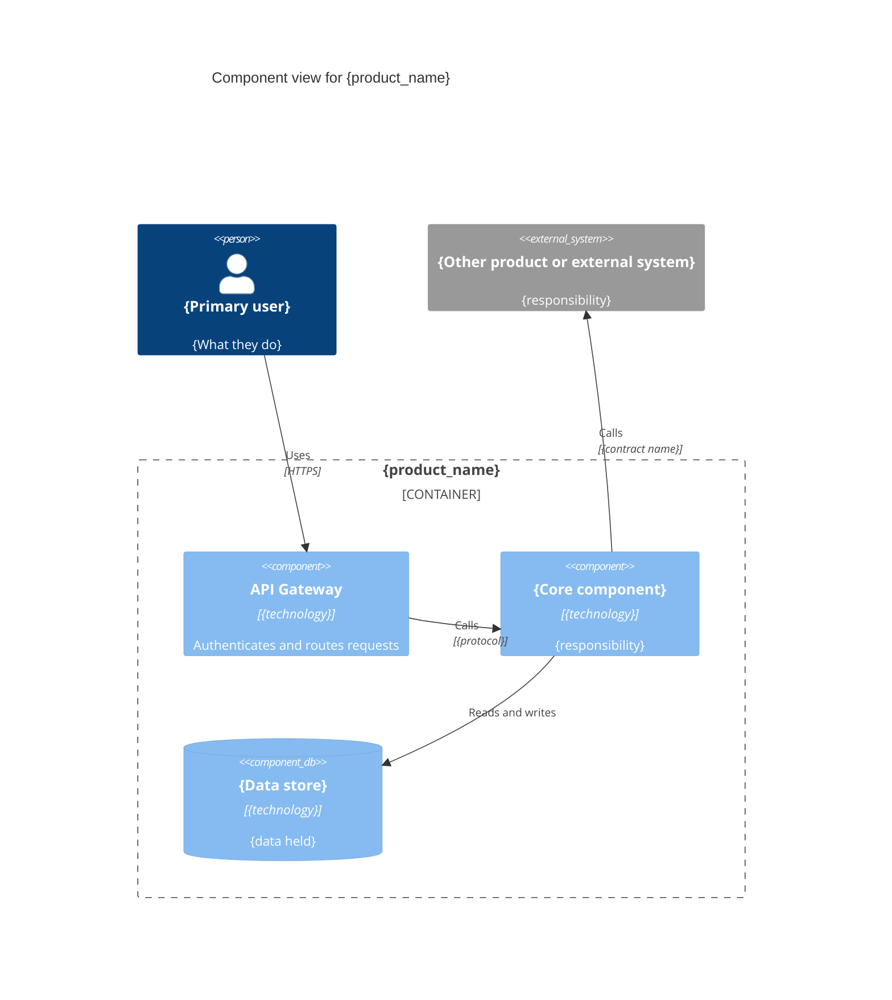

<!-- arckit-overlay-template: agile-governance-template.md -->

# Agile Governance Cadence Template

> Replaces the centralised Architecture Review Board with a small
> cross-functional sprint review panel drawn from the product team, and
> distributes continuous governance duties across its members. Governance is
> embedded in sprint rhythm, not a periodic gate.

## Document Control

<!-- DOC-CONTROL-HEADER -->
<!-- Resolved at command-execution time per _partials/RENDERING.md. -->

### Revision History

| Version     | Date           | Author    | Description      | Reviewer          | Approver          |
| ----------- | -------------- | --------- | ---------------- | ----------------- | ----------------- |
| `[VERSION]` | `[YYYY-MM-DD]` | ArcKit AI | Initial creation | `[REVIEWER_NAME]` | `[APPROVER_NAME]` |

---

| Field                | Value                                                                                              |
| -------------------- | -------------------------------------------------------------------------------------------------- |
| **Parent**           | `${user_config.references_dir}` — parent engagement reference, if any                              |
| **Organisation**     | `${user_config.organisation_name}`                                                                 |
| **Governance owner** | Sprint review panel (section 1), with continuous duties distributed across its members (section 7) |
| **Replaces**         | Centralised Architecture Review Board (where applicable)                                           |

## Why This Replaces the ARB

A centralised Architecture Review Board introduces a 2-3 day synchronous gate
per engagement. In agile delivery that rhythm doesn't fit. This template moves
decisions to a 3-5 person sprint review panel drawn from the product team, and
spreads governance across four continuous cadences so that governance becomes
part of how we work, not something we stop to do.

| Centralised ARB                         | Agile Governance Cadence                                                                              |
| --------------------------------------- | ----------------------------------------------------------------------------------------------------- |
| Central board outside the delivery team | 3-5 person sprint review panel drawn from the product team; each member also owns a governance domain |
| Synchronous gate before delivery        | Pre-, mid- and post-sprint checks embedded in sprint rhythm                                           |
| 2-3 day review cycle                    | Change requests decided within the sprint + quarterly deep review                                     |
| Checklist-driven                        | Metric-driven with architecture health score                                                          |
| Manual sign-off per engagement          | Automated compliance pipeline with exception escalation                                               |

**Conditions for reverting to a board:** regulation mandates board-level
architecture approval, decisions repeatedly exceed the panel's authority, or
delivery moves to a phase-gate model (see section 9).

## Cadence Overview

```text
Sprint (2 weeks)      → Sprint review panel: pre-, mid- and post-sprint checks; change requests decided
Month                 → Architecture Debt Backlog Review
Quarter (3 months)    → Architecture Health Assessment
Continuous            → Compliance Monitoring + Automated Reporting
```

| Cadence event               | Input                              | Output artefact                                              | Owner                                           |
| --------------------------- | ---------------------------------- | ------------------------------------------------------------ | ----------------------------------------------- |
| Pre-sprint check            | Sprint backlog                     | Flagged items for async architecture review                  | Lead Architect                                  |
| Mid-sprint check            | Work in progress, pipeline results | Health check note; blockers raised                           | Lead Architect                                  |
| Post-sprint check           | Deployed changes, pipeline results | Updated `governance-report.yaml`, `compliance-evidence.yaml` | Sprint review panel                             |
| Change request decision     | `change-request.yaml`              | Decision recorded in the change log                          | Sprint review panel                             |
| Monthly debt review         | Debt register                      | Updated debt register                                        | Lead Architect                                  |
| Quarterly health assessment | Governance reports, debt register  | `quarterly-health-assessment.yaml`                           | Sprint review panel + Compliance Representative |
| Continuous monitoring       | Deployments, configuration         | `governance-report.yaml` updates and alerts                  | DevOps Lead                                     |

---

## 1. Sprint Review Panel

A lightweight, cross-functional panel replaces the board. Its members belong to
the product team; decision authority, responsibility and accountability sit with
them (O-AA Axiom 7, Authority, Responsibility, and Accountability Distribution).

| Member                    | Perspective                      | Decides                                           |
| ------------------------- | -------------------------------- | ------------------------------------------------- |
| Product Owner             | Value and priority               | Trade-offs between architecture work and features |
| Lead Architect            | Architecture integrity           | Changes within the product's guardrails           |
| AI Safety Engineer        | Model safety and data governance | Safety and model-lifecycle changes                |
| DevOps Lead               | Operability                      | Infrastructure and deployment changes             |
| Compliance Representative | Regulatory obligations           | Whether a change needs regulatory review          |

### Decision Authority Matrix

| Decision                                        | Panel decides | Escalate to                      |
| ----------------------------------------------- | ------------- | -------------------------------- |
| Change within existing guardrails               | Yes           | —                                |
| New technology inside approved building blocks  | Yes           | —                                |
| Change to a guardrail or cross-product contract | No            | Cross-product architecture forum |
| Accepting a Critical or High risk               | No            | Executive sponsor                |
| Change affecting a client SLA or budget         | No            | Executive sponsor                |

---

## 2. Sprint Architecture Review Checklist

Runs at sprint planning, mid-sprint and sprint review. Lightweight — 15 minutes
max per check.

### Pre-Sprint (Sprint Planning)

- [ ] **Architecture constraint check:** Any new features require architecture
      changes beyond current sprint scope?

- [ ] **Compliance impact scan:** Does the sprint backlog contain items that
      touch PII, cross-border data, or regulated workflows?

- [ ] **Model change review:** Any model updates (version, quantization,
      parameters) planned this sprint?

- [ ] **Architecture debt items:** Any debt reduction tasks included in sprint
      capacity?

**If any answer is yes → flag for Lead Architect async review before sprint
starts.**

### Mid-Sprint (Health Check)

- [ ] **Pipeline health:** Security and compliance checks passing on the main
      branch?

- [ ] **Emerging decisions:** Any architecturally significant decision taken in
      flight that needs a change request or ADR?

- [ ] **Blockers:** Any architecture or compliance blocker that needs a panel
      decision before sprint review?

**If any answer needs a decision → raise it with the panel now, not at sprint
end.**

### Post-Sprint (Sprint Review)

- [ ] **Architecture drift check:** Deployed changes match architecture
      documentation? (Auto-check: diff against `technology-architecture.yaml`)

- [ ] **Compliance verification:** Compliance pipeline passed for all deployed
      changes? (Auto-check: `governance-report.yaml` status)

- [ ] **Compliance evidence current:** `compliance-evidence.yaml` updated for
      this sprint's deliverables?

- [ ] **Architecture debt logged:** Any shortcuts taken documented as
      architecture debt items?

- [ ] **Observability validated:** New components have latency, error rate, and
      GPU utilization metrics?

### Gate Criteria

| Check       | Pass                                               | Fail → remediation                               |
| ----------- | -------------------------------------------------- | ------------------------------------------------ |
| Pre-sprint  | No unflagged architecture or compliance impact     | Item held until the Lead Architect reviews it    |
| Mid-sprint  | Pipelines green; no undecided significant decision | Panel decides within 2 working days              |
| Post-sprint | No unapproved drift; compliance evidence current   | Debt item or exception raised (sections 4 and 7) |

### Automation

Example automation (illustrative — wire your own CI tooling into this shape):

- **Pre-sprint compliance scan** — scan the sprint backlog against the
  compliance rule set for the target jurisdiction (AU, EU, etc.)

- **Post-sprint architecture drift check** — diff deployed configuration against
  the `technology-architecture.yaml` baseline

---

## 3. Change Management at Sprint Velocity

Architecture change requests are evaluated and decided within the sprint, not
held for a quarterly board.

```yaml
# change-request.yaml — one per change request
change_request:
  id: "CR-[NNN]"
  raised_sprint: "[N]"
  raised_by: "[role]"
  title: "Replace vector store with managed service"
  type: "technology" # technology | data | integration | security | process
  impact:
    components: ["vector_store", "retriever"]
    compliance: "Data residency must be re-verified for the managed service"
    effort_story_points: 13
  options_considered: ["Keep self-hosted", "Managed service in the same region"]
  decision: "approved" # approved | rejected | deferred | escalated
  decided_by: "Sprint review panel"
  decided_sprint: "[N]"
  adr: "ARC-[PROJECT_ID]-ADR-[NNN]"
```

| Step                                               | Target                                          |
| -------------------------------------------------- | ----------------------------------------------- |
| Change request raised                              | Any team member, any time                       |
| Impact assessed (architecture, compliance, effort) | Within 2 working days                           |
| Decision                                           | At the next panel check, within the same sprint |
| Change log updated                                 | At sprint review, linked to the ADR             |

---

## 4. Architecture Debt Tracking

Architecture debt is anything that compromises the target architecture for
short-term delivery speed. Different from technical debt — it affects the
system's long-term compliance, scalability, or security posture.

### Debt Categories

| Category               | Definition                            | Example                                               |
| ---------------------- | ------------------------------------- | ----------------------------------------------------- |
| **Compliance debt**    | Control not fully implemented         | Temporary API endpoint without authentication         |
| **Scalability debt**   | Design won't scale to target load     | Single-model serving without load balancing           |
| **Security debt**      | Security control deferred             | No encryption on interim data store                   |
| **Observability debt** | Monitoring gap for critical component | New microservice without health endpoint              |
| **Documentation debt** | Architecture docs behind reality      | Technology architecture YAML not updated after deploy |

### Debt Register (YAML)

```yaml
# architecture-debt-register.yaml
debt_items:
  - id: "AD-001"
    category: "compliance_debt"
    severity: "high" # critical | high | medium | low
    description: "API endpoint /internal/metrics lacks authentication"
    introduced_sprint: 12
    introduced_issue: "${user_config.project_issue_prefix}-[NNN]"
    risk_if_unresolved: "Unauthorized metric access violates APP 11.1"
    target_resolution_sprint: 14
    owner: "Lead Engineer"
    status: "open" # open | in_progress | resolved | accepted_risk
    resolution_notes: ""
```

### Debt Review Rules

- **Critical severity:** Must be resolved within 2 sprints or escalated to the
  executive sponsor

- **High severity:** Must have resolution sprint assigned within 1 sprint

- **Medium/Low severity:** Track in architecture debt backlog; review monthly

- **Accepted risk:** Requires documented justification + sign-off from the AI
  Safety Engineer (safety or compliance debt) or the Lead Architect (other debt)

### Monthly Debt Backlog Review

At the end of each calendar month, the Lead Architect reviews the debt register:

1. Export current debt register
2. Remove resolved items, update in-progress items
3. Flag any critical/high items exceeding resolution deadline
4. Report top 5 debt items in architecture health assessment

---

## 5. Quarterly Architecture Health Assessment

Comprehensive evaluation of the architecture's health. Replaces the ARB's ad-hoc
review with a predictable quarterly cadence.

### Health Assessment Structure

```yaml
# quarterly-health-assessment.yaml
assessment:
  date: "[YYYY-MM-DD]"
  quarter: "[QN YYYY]"
  engagement: "[Client Name / Internal Project]"
  assessors:
    - role: "Lead Architect"
      name: "[Name]"

    - role: "Technical Review"
      name: "[Lead Engineer]"

    - role: "Safety Review"
      name: "[AI Safety Engineer]"

scores:
  architecture_alignment: 8 # 1-10: How close is deployed state to target architecture?
  compliance_maturity: 9 # 1-10: Are all required controls implemented and verified?
  observability_coverage: 7 # 1-10: Are critical components monitored with adequate metrics?
  documentation_currency: 6 # 1-10: Are architecture docs current with deployed state?
  security_posture: 9 # 1-10: Security controls adequate for threat model?
  debt_burden: 4 # 1-10: Lower is better — how much architecture debt is outstanding?

overall_health: "Good" # Critical | Poor | Fair | Good | Excellent

findings:
  - category: "documentation_currency"
    severity: "medium"
    description: "Technology architecture YAML hasn't been updated since Sprint 10"
    recommendation: "Schedule documentation sync in Sprint 14"

improvements_quarter:
  - "Implemented GPU utilization alerting pipeline"

  - "Reduced architecture debt from 12 to 7 items"

risks_next_quarter:
  - "Planned model upgrade requires architecture review — potential compliance impact"
```

### Scoring Rubric

| Score | Architecture Alignment                       | Compliance Maturity                                     |
| ----- | -------------------------------------------- | ------------------------------------------------------- |
| 9-10  | Deployed state matches target architecture   | All controls implemented, verified, automated           |
| 7-8   | Minor deviations documented as accepted risk | Controls implemented, verification pending on 1-2 items |
| 5-6   | Significant deviation in 1-2 areas           | 3+ controls not fully implemented                       |
| 3-4   | Major deviation across multiple areas        | Critical controls missing or unverified                 |
| 1-2   | No alignment with target architecture        | No governance process in place                          |

### Assessment Output

Each quarterly assessment produces:

1. `quarterly-health-assessment.yaml` — structured assessment data
2. Updated `governance-report.yaml` — merged assessment findings
3. Architecture debt register update
4. Improvement plan for next quarter (3-5 items max)

---

## 6. Continuous Compliance Monitoring and Evidence

Automated compliance checks that run on every deployment and produce structured
reports. Compliance evidence is produced every sprint, so the programme is
always audit-ready.

### Monitoring Pipeline

```text
Code/Config Change → Compliance Scan → Governance Report Update → Alert (if threshold breach)
```

### Automated Checks

| Check              | Frequency    | Tool                                       | Alert Threshold                           |
| ------------------ | ------------ | ------------------------------------------ | ----------------------------------------- |
| Encryption at rest | Every deploy | Compliance rule engine (your tooling)      | Any unencrypted data store                |
| Network egress     | Continuous   | Network policy monitor                     | Any public egress from data tier          |
| Model provenance   | Model deploy | Checksum verification                      | Checksum mismatch                         |
| API authentication | Every deploy | Architecture drift check (your CI tooling) | Unauthenticated endpoint                  |
| Data residency     | Continuous   | Infrastructure config scan                 | Data stored outside required jurisdiction |
| Audit log coverage | Weekly       | Log analysis script                        | Component without audit logging           |

### Compliance Evidence Framework

Evidence categories: regulatory compliance, security controls, architecture
standards and quality gates. The `compliance-evidence.yaml` structure is shared
with `/arckit:agile-security`, which produces the security-control evidence:

```yaml
# compliance-evidence.yaml (sprint 4)
sprint: 4
owner: "[Compliance Representative]"
evidence:
  - control: "APP-11.1 encryption_at_rest"
    category: "security_control" # regulatory | security_control | architecture_standard | quality_gate
    requirement: "NFR-SEC-003"
    artefact: "CI job storage-encryption-audit, run [RUN_ID]"
    result: "pass"
    collected: "[YYYY-MM-DD]"

  - control: "Architecture standard: no cross-product database access"
    category: "architecture_standard"
    requirement: "GR-003"
    artefact: "Drift check, sprint 4"
    result: "pass"
    collected: "[YYYY-MM-DD]"
```

### Governance Report Integration

Compliance monitoring output feeds directly into the `governance-report.yaml`
structure:

```yaml
# governance-report.yaml (updated by compliance monitoring)
verification:
  checklist: "${user_config.safety_checklist_id}"
  score: 94
  critical_pass: true
  important_pass_rate: 0.95
  blocked_items: []

compliance_monitoring:
  last_check: "[YYYY-MM-DDThh:mm:ssZ]"
  checks_passed: 18
  checks_failed: 0
  checks_pending: 2
  details:
    - control: "encryption_at_rest_aes256"
      status: "pass"
      last_verified: "[YYYY-MM-DDThh:mm:ssZ]"

    - control: "network_egress_isolation"
      status: "pass"
      last_verified: "[YYYY-MM-DDThh:mm:ssZ]"

    - control: "model_provenance"
      status: "pending"
      reason: "Model upgrade pending — verification after deployment"

architecture_health:
  overall: "Good"
  scores:
    architecture_alignment: 8
    compliance_maturity: 9
    observability_coverage: 7
    documentation_currency: 6
    security_posture: 9
    debt_burden: 4
  debt_summary:
    open_items: 7
    critical: 0
    high: 1
    medium: 3
    low: 3
```

### Automated Reporting

Weekly automated report (scheduled via your CI/CD or agent runtime cron):

1. Run compliance scan across all active engagements
2. Update `governance-report.yaml` for each engagement
3. Generate executive summary (markdown) for the Lead Architect
4. Alert on any score drop below threshold or critical control failure

### Governance Metrics

| Metric            | Definition                                                  | Target                                      |
| ----------------- | ----------------------------------------------------------- | ------------------------------------------- |
| Decision velocity | Average time from change request to decision                | Within the sprint it was raised             |
| Compliance rate   | Percentage of sprint deliverables passing governance checks | ≥ 95%                                       |
| Architecture debt | Open debt items, and items past their resolution sprint     | Decreasing trend; 0 critical past deadline  |
| Risk exposure     | Open accepted-risk exceptions and their age                 | 0 exceptions past their resolution deadline |

---

## 7. Distributed Governance Duties

Panel members, and every engineer, carry continuous governance duties between
panel checks:

| Role                          | Governance Responsibility                                                | Cadence                  |
| ----------------------------- | ------------------------------------------------------------------------ | ------------------------ |
| **Lead Architect**            | Sprint review checklist, quarterly health assessment, debt register      | Every sprint + quarterly |
| **Lead Engineer**             | Architecture drift detection, debt resolution, documentation updates     | Continuous + sprint      |
| **AI Safety Engineer**        | Safety control verification, model lifecycle governance, risk assessment | Every deploy + monthly   |
| **DevOps Lead**               | Continuous compliance monitoring, automated reporting                    | Continuous + weekly      |
| **Compliance Representative** | Regulatory alignment review, compliance evidence currency                | Every sprint + quarterly |
| **Every engineer**            | Log architecture debt when taking shortcuts, flag compliance concerns    | Continuous               |

### Escalation Path

```text
Architecture concern → Lead Architect (async, 24h) → Sprint review panel (decides within the sprint) → Executive sponsor (if scope or risk exceeds panel authority)
```

| Tier                | Decision it can take                                            |
| ------------------- | --------------------------------------------------------------- |
| Lead Architect      | Clarify guardrails; approve changes clearly inside them         |
| Sprint review panel | Decisions in the authority matrix (section 1)                   |
| Executive sponsor   | Accept Critical/High risk; approve scope, SLA or budget changes |

### Exception Handling

When a governance check fails but delivery timeline is critical:

1. Document exception in architecture debt register as `accepted_risk`, with its
   type (architecture, compliance or security)
2. AI Safety Engineer sign-off required for security/compliance exceptions
3. Executive sponsor sign-off required if exception affects client SLA
4. Resolution sprint assigned — exception auto-escalates if not resolved within
   deadline
5. Open exceptions are reviewed at every post-sprint check

---

## 8. Integration with TOGAF ADM

This cadence maps to TOGAF ADM phases G and H (continuous):

| TOGAF ADM Phase                        | Agile Cadence Mapping                                                                          |
| -------------------------------------- | ---------------------------------------------------------------------------------------------- |
| **G — Implementation Governance**      | Sprint review checklist + compliance monitoring                                                |
| **H — Architecture Change Management** | Change requests decided by the panel, architecture debt register + quarterly health assessment |
| **ADM cycle repeat**                   | Quarterly health assessment triggers re-evaluation of target architecture                      |

---

## 9. Trigger Guidance

**Use this template when:**

- Client engagement follows agile delivery (sprints, iterations)

- Architecture needs continuous validation rather than periodic gates

- Team is distributed and synchronous ARB meetings are impractical

- Compliance requires ongoing monitoring, not one-time certification

**Use a traditional architecture board (for example `/arckit:architecture-board`
from the TOGAF ADM overlay) when:**

- Client requires formal governance board with documented sign-off per phase

- Regulatory environment mandates board-level architecture approval

- Engagement is waterfall/phase-gate delivery model

---

## References

- ${user_config.references_dir} — organisation reference documents (e.g. TOGAF
  ADM workflow, AI governance framework, compliance validation pipeline);
  include only documents that exist in the configured directory

- `governance-report.yaml`: Governance report structure (Phase G governance)

- `${user_config.safety_checklist_id}`: Safety checklist integrated into
  compliance monitoring

---

## External References

### Document Register

| Doc ID          | Filename | Type | Source Location | Description |
| --------------- | -------- | ---- | --------------- | ----------- |
| _None provided_ | —        | —    | —               | —           |

### Citations

| Citation ID | Doc ID | Page/Section | Category | Quoted Passage |
| ----------- | ------ | ------------ | -------- | -------------- |
| —           | —      | —            | —        | —              |

### Unreferenced Documents

| Filename | Source Location | Reason |
| -------- | --------------- | ------ |
| —        | —               | —      |

---

**Generated by**: ArcKit `/arckit:agile-governance` command **Generated on**:
`[DATE] [TIME] GMT` **ArcKit Version**: `{ARCKIT_VERSION}` **Project**:
`[PROJECT_NAME]` (Project `[PROJECT_ID]`) **Model**: `[AI_MODEL]`

<!-- arckit-overlay-template: agile-security-template.md -->

# Agile Security Architecture Template

> Security embedded in every sprint/iteration. Risk-based testing automation,
> compliance-as-code integration, continuous validation replacing phase-gate
> checkpoints. Aligned with O-AA Security Playbook (G216).

## Document Control

<!-- DOC-CONTROL-HEADER -->
<!-- Resolved at command-execution time per _partials/RENDERING.md. -->

### Revision History

| Version     | Date           | Author    | Description      | Reviewer          | Approver          |
| ----------- | -------------- | --------- | ---------------- | ----------------- | ----------------- |
| `[VERSION]` | `[YYYY-MM-DD]` | ArcKit AI | Initial creation | `[REVIEWER_NAME]` | `[APPROVER_NAME]` |

---

| Field               | Value                                                                                                                                                                           |
| ------------------- | ------------------------------------------------------------------------------------------------------------------------------------------------------------------------------- |
| **Template**        | Agile Security Architecture                                                                                                                                                     |
| **Framework**       | O-AA Security Playbook (G216) + TOGAF ADM                                                                                                                                       |
| **Parent**          | `${user_config.references_dir}` — parent engagement reference, if any                                                                                                           |
| **Organisation**    | `${user_config.organisation_name}`                                                                                                                                              |
| **Prerequisites**   | Product architecture (`ARC-[PROJECT_ID]-OAPR`), requirements (`ARC-[PROJECT_ID]-REQ`) and organisation reference documents in `${user_config.references_dir}`, where they exist |
| **Integrates with** | `governance-report.yaml` and `compliance-evidence.yaml` (shared with `/arckit:agile-governance`)                                                                                |

---

## Trigger Guidance

Use this template when **any** of the following conditions are met:

- Client operates in a **regulated environment** (APRA, GDPR, HIPAA, EU AI Act)
  and delivery follows agile sprints

- Security cannot wait for end-of-project gates — **continuous validation** is
  required

- Team needs to embed security activities into **sprint ceremonies** (planning,
  review, retrospective)

- Compliance evidence must be generated **automatically** alongside code
  delivery

**Do NOT use** when:

- Security assessment is a standalone, one-off engagement (use a dedicated
  security assessment instead)

- Client requires traditional waterfall security reviews with formal sign-off
  gates at each phase

- No CI/CD pipeline exists to host automated security checks

---

## Core Thesis (G216)

The O-AA Security Playbook (G216) frames the problem this way: security in an
agile architecture must let the business move rapidly in a world of defined and
managed risk.

Traditional security architectures insert phase-gate checkpoints that slow
delivery. This template replaces those gates with **four continuous security
pillars** that operate alongside the sprint rhythm:

1. **Embedded security** — security tasks in every sprint backlog, not a
   separate track
2. **Risk-based automation** — test depth proportional to risk classification,
   not uniform coverage
3. **Compliance-as-code** — regulatory controls expressed as executable
   validation rules
4. **Continuous validation** — real-time compliance evidence, not periodic audit
   snapshots

---

## Security Pillars

### Pillar 1: Embedded Security Per Sprint

Security is not a phase — it is woven into every sprint ceremony.

| Sprint Phase         | Security Activity                                       | Owner                          | Duration   |
| -------------------- | ------------------------------------------------------- | ------------------------------ | ---------- |
| Sprint Planning      | Security story estimation + risk classification         | Team Architect + Security Lead | 15 min     |
| Daily Standup        | Security blocker check (automated scan failures)        | Team Lead                      | Continuous |
| Sprint Execution     | Automated security scans run alongside feature tests    | CI/CD Pipeline                 | Automated  |
| Sprint Review        | Security validation report review + compliance evidence | Security Lead                  | 30 min     |
| Sprint Retrospective | Security debt review + control improvement items        | Team                           | 15 min     |

### Sprint Planning: Security Story Estimation

Every sprint backlog includes security stories alongside feature stories:

```yaml
# sprint-backlog example with security items
sprint: "Sprint 4"
stories:
  - id: "FE-012"
    type: feature
    title: "Implement RAG pipeline for document retrieval"
    security_impact: high
    security_stories: ["SEC-045", "SEC-046"]

  - id: "SEC-045"
    type: security
    title: "Implement input sanitization for RAG query endpoint"
    risk_category: data_exfiltration
    control: "input_validation"
    auto_test: "security/test_input_sanitization.py"

  - id: "SEC-046"
    type: security
    title: "Add rate limiting to prevent RAG abuse"
    risk_category: availability
    control: "rate_limiting"
    auto_test: "security/test_rate_limiting.py"
```

**Security story criteria:**

- Each security story has a **risk category** (data_exfiltration,
  model_poisoning, prompt_injection, unauthorized_access, availability)

- Each security story references a **compliance control** from the compliance
  mapping

- Each security story has an **automated test** that runs in CI/CD

---

### Pillar 2: Risk-Based Security Testing Automation

Not all code paths need equal security scrutiny. Test depth is proportional to
risk classification.

```text
Risk Level ──→  │  Critical       │  High          │  Medium        │  Low
────────────────────────────────────────────────────────────────────────
Scan Frequency │  Every commit    │  Every PR       │  Sprint gate   │  Weekly
Test Depth     │  SAST + DAST +   │  SAST + config  │  SAST only     │  License check
               │  secrets + deps  │  audit          │                │
Approval      │  Security lead    │  Team lead      │  Auto-merge    │  None
               │  sign-off        │  review         │                │
Block Merge   │  Always           │  On failure     │  Warning only  │  Warning only
```

**Risk classification rules:**

- **Critical:** Model serving endpoints, data egress paths,
  authentication/authorization logic

- **High:** API gateways, data processing pipelines, configuration management

- **Medium:** Internal utilities, logging/monitoring components, documentation

- **Low:** Frontend assets, static content, build scripts

**Risk-based scan pipeline (illustrative — wire your own tooling into this
shape):**

- **Critical paths** — every commit; block on failure

- **High paths** — every PR; require security review

- **Medium paths** — sprint gate; warn only

- **Low paths** — weekly scan; report only

**Security test categories:**

| Category                   | Tool/Method                                      | Frequency         | Block Merge   |
| -------------------------- | ------------------------------------------------ | ----------------- | ------------- |
| SAST (Static Analysis)     | Bandit (Python), ESLint security (JS)            | Every commit      | Critical/High |
| Secret Detection           | Gitleaks, TruffleHog                             | Every commit      | Critical      |
| Dependency Vulnerabilities | Safety (Python), npm audit (JS)                  | Every PR          | Critical/High |
| DAST (Dynamic Analysis)    | OWASP ZAP, custom endpoint tests                 | Sprint gate       | Critical      |
| Infrastructure as Code     | Checkov (Terraform), Hadolint (Docker)           | Every PR          | Critical/High |
| Container Scanning         | Trivy, Grype                                     | Every image build | Critical      |
| Model Safety               | Prompt injection test suite, output filter tests | Model update      | Critical      |
| Compliance Validation      | Compliance rule engine (your tooling)            | Sprint gate       | Critical      |

---

### Pillar 3: Compliance-as-Code Integration Points

Regulatory controls are expressed as executable validation rules, not
documentation.

```yaml
# compliance-as-code.yaml
controls:
  - id: "APP-11.1"
    description: "Data security measures"
    jurisdiction: AU
    validation:
      - rule: "encryption_at_rest"
        check: "storage encryption audit (all storage tiers)"
        expected: "AES-256"

      - rule: "encryption_in_transit"
        check: "TLS version enforcement check (all endpoints)"
        expected: "TLS 1.3+"

      - rule: "network_isolation"
        check: "network egress audit (data tier)"
        expected: "no_public_egress"
    auto_verify: true
    sprint_gate: true
```

**Integration with governance-report.yaml:**

The compliance-as-code pipeline feeds directly into `governance-report.yaml`:

```yaml
# governance-report.yaml — security validation section
security_validation:
  timestamp: "[YYYY-MM-DDThh:mm:ssZ]"
  sprint: 4
  scan_results:
    sast:
      status: passed
      critical_findings: 0
      high_findings: 2
      tool: bandit
    secrets:
      status: passed
      findings: 0
      tool: gitleaks
    dependencies:
      status: warning
      critical_findings: 0
      high_findings: 0
      medium_findings: 3
      tool: safety
    compliance:
      status: partial
      controls_checked: 23
      controls_passed: 18
      controls_gapped: 5
      tool: "compliance rule engine"
  compliance_as_code:
    - control: "APP-11.1"
      status: passed
      verification: "encryption audit + network egress test"

    - control: "APRA-CPS230"
      status: gap
      pending_items: ["network_segmentation", "threat_monitoring"]

    - control: "GDPR-32"
      status: gap
      pending_items: ["backup_and_recovery", "security_testing_annual"]
  next_sprint_security_goals:
    - "Close network_segmentation gap (SEC-050)"

    - "Deploy threat monitoring stack (SEC-051)"

    - "Resolve 3 medium dependency vulnerabilities"
```

---

### Pillar 4: Continuous Security Validation (Replacing Phase Gates)

Traditional TOGAF ADM Phase G (Implementation Governance) runs at the end. This
template distributes governance validation across the sprint cycle.

| Phase Gate (Traditional)          | Continuous Replacement                              | Evidence                            |
| --------------------------------- | --------------------------------------------------- | ----------------------------------- |
| Security review before deployment | Automated security scans on every PR                | CI/CD pipeline results              |
| Compliance audit before go-live   | Compliance-as-code checks every sprint              | `governance-report.yaml` updates    |
| Penetration test at project end   | DAST on staging every sprint + annual external test | Scan reports + test logs            |
| Security sign-off from board      | Security validation report at sprint review         | Sprint review notes                 |
| Architecture compliance check     | Architecture drift detection (auto-diff)            | `technology-architecture.yaml` diff |

**Continuous validation pipeline (runs automatically at sprint gate, end of
sprint):**

1. Aggregate the sprint's security scan results into `security-report.yaml`

2. Run compliance validation against the control set → `compliance-results.yaml`

3. Merge both into `governance-report.yaml`

4. Architecture drift check: diff deployed configuration against the
   `technology-architecture.yaml` baseline

---

## Sprint Security Backlog Template

Every sprint includes security items derived from the compliance gap analysis:

```yaml
# security-backlog.yaml (sprint 4 snapshot)
sprint: 4
risk_classification:
  - component: "model_serving"
    risk_level: critical
    threats: ["prompt_injection", "data_exfiltration", "model_poisoning"]

  - component: "api_gateway"
    risk_level: high
    threats: ["unauthorized_access", "rate_abuse"]

  - component: "vector_store"
    risk_level: high
    threats: ["data_exfiltration", "injection"]
security_stories:
  - id: "SEC-045"
    title: "Input sanitization for RAG endpoint"
    risk: critical
    category: data_exfiltration
    control: "input_validation"
    acceptance: "Pass prompt injection test suite (50+ test cases)"

  - id: "SEC-050"
    title: "Network segmentation for model serving VPC"
    risk: high
    category: network_security
    control: "network_segmentation"
    compliance: ["APRA-CPS230", "GDPR-32"]
    acceptance: "VPC has no public subnets, egress filtered through approved destinations"

  - id: "SEC-051"
    title: "Deploy threat monitoring stack"
    risk: high
    category: monitoring
    control: "threat_monitoring"
    compliance: ["APRA-CPS230", "DORA"]
    acceptance: "Prometheus + Grafana alerts for anomalous inference patterns"
security_debt:
  - item: "Outdated container base images in 2 services"
    risk: medium
    target_sprint: 5

  - item: "Missing MFA on CI/CD deployment pipeline"
    risk: high
    target_sprint: 4
```

---

## Threat Model Per Sprint (STRIDE)

The threat model is a backlog item every sprint, not a one-off document. Sprint
0 models the product architecture; each later sprint updates the model for the
features it delivers, new findings from SAST/DAST tools, and changes in the
environment. Each threat is classified by STRIDE category (or an equivalent
method named here) and linked to the security story that mitigates it.

| STRIDE category            | Question for each component and data flow              |
| -------------------------- | ------------------------------------------------------ |
| **S**poofing               | Can someone pretend to be a user, service or model?    |
| **T**ampering              | Can data, prompts, models or configuration be altered? |
| **R**epudiation            | Can an action be denied because it was not logged?     |
| **I**nformation disclosure | Can data, embeddings or model outputs leak?            |
| **D**enial of service      | Can the component be exhausted or made unavailable?    |
| **E**levation of privilege | Can a caller gain rights it should not have?           |

```yaml
# threat-model.yaml (sprint 4 update)
sprint: 4
method: "STRIDE"
scope:
  components: ["api_gateway", "model_serving", "vector_store"]
  new_since_last_sprint: ["vector_store"]
threats:
  - id: "TM-012"
    component: "model_serving"
    stride: "tampering"
    threat: "Prompt injection alters the model's instructions"
    likelihood: high
    impact: high
    mitigation_story: "SEC-045"
    status: "mitigation_in_progress"

  - id: "TM-013"
    component: "vector_store"
    stride: "information_disclosure"
    threat: "Retrieval returns documents above the caller's clearance"
    likelihood: medium
    impact: high
    mitigation_story: "SEC-052"
    status: "open"
residual_risks:
  - threat: "TM-012"
    residual: "Novel injection patterns not covered by the test suite"
    accepted_by: "[Security Lead]"
    review_sprint: 6
```

---

## Compliance Evidence Per Sprint

Evidence is produced alongside each sprint's deliverables, so it is always
current and never gathered for an audit. The same `compliance-evidence.yaml`
structure is used by `/arckit:agile-governance`.

```yaml
# compliance-evidence.yaml (sprint 4)
sprint: 4
owner: "[Security Lead]"
evidence:
  - control: "APP-11.1 encryption_at_rest"
    category: "security_control" # regulatory | security_control | architecture_standard | quality_gate
    requirement: "NFR-SEC-003"
    artefact: "CI job storage-encryption-audit, run [RUN_ID]"
    result: "pass"
    collected: "[YYYY-MM-DD]"

  - control: "GDPR-32 security_testing"
    category: "regulatory"
    requirement: "NFR-SEC-007"
    artefact: "DAST report, staging, sprint 4"
    result: "gap"
    follow_up_story: "SEC-053"
    collected: "[YYYY-MM-DD]"
```

---

## Security Architecture Guardrails

| Type                      | Guardrail                                                                                      | Example                                                  |
| ------------------------- | ---------------------------------------------------------------------------------------------- | -------------------------------------------------------- |
| Non-negotiable constraint | Encryption at rest and in transit, authentication on every endpoint, security logging standard | AES-256 at rest; TLS 1.3 in transit                      |
| Approved building block   | Security libraries and services the team must use                                              | Organisation identity provider; approved secrets manager |
| Anti-pattern              | Forbidden security approaches                                                                  | Rolling your own cryptography; hard-coded credentials    |
| Review gate               | Lightweight sprint-level security review                                                       | Security validation report at sprint review              |

---

## AI/ML Security Considerations

| Concern                  | Per-sprint activity                                                         | Evidence                                                   |
| ------------------------ | --------------------------------------------------------------------------- | ---------------------------------------------------------- |
| Algorithmic transparency | Update the transparency record for AI/ML features changed this sprint       | Transparency record (for UK public sector, an ATRS record) |
| Bias and fairness        | Automated bias tests in the CI/CD pipeline for model changes                | Bias test report per model version                         |
| Model security           | Tests for model poisoning, data leakage and adversarial inputs              | Model safety suite results                                 |
| Privacy preservation     | Apply differential privacy or federated learning where the data warrants it | Design decision recorded as an ADR                         |

---

## Security Exception Path

When a security check fails and the delivery date cannot move:

1. The team raises the exception in the security backlog, with the failing
   check, the risk and a proposed resolution sprint
2. Sign-off depends on severity: Critical and High need the Security Lead and
   the product owner; Medium needs the Team Architect; Low is logged only
3. The exception is recorded as accepted risk with a severity and a resolution
   deadline, and is reviewed at each sprint boundary
4. An exception that passes its deadline unresolved escalates through the agile
   governance escalation path

---

## Requirements Traceability (NFR-SEC)

Every security story traces to a security requirement in the requirements
artefact (`ARC-[PROJECT_ID]-REQ`) where one exists. A requirement with no story
is a gap.

| Requirement   | Security stories | Threats mitigated | Status        |
| ------------- | ---------------- | ----------------- | ------------- |
| {NFR-SEC-xxx} | {SEC-xxx}        | {TM-xxx}          | Covered / Gap |

---

## Security Metrics Dashboard

Continuous validation produces measurable security posture indicators:

| Metric                   | Source                                  | Threshold                   | Alert                              |
| ------------------------ | --------------------------------------- | --------------------------- | ---------------------------------- |
| Security scan pass rate  | CI/CD pipeline                          | ≥ 95%                       | Sprint blocked if < 80%            |
| Compliance gap count     | `governance-report.yaml`                | Decreasing trend            | Alert if increasing for 2+ sprints |
| Critical vulnerabilities | Dependency scanner                      | 0                           | Block merge immediately            |
| Security story velocity  | Sprint backlog                          | ≥ 20% of total story points | Review if consistently < 15%       |
| Security debt aging      | Security debt backlog                   | 0 items > 2 sprints old     | Escalate to Team Architect         |
| Architecture drift       | Automated drift check (your CI tooling) | 0 unapproved changes        | Alert on detection                 |

---

## TOGAF ADM Phase Mapping

| TOGAF Phase                 | Agile Security Activity                                    | Template Reference                                       |
| --------------------------- | ---------------------------------------------------------- | -------------------------------------------------------- |
| ADM-P (Preliminary)         | Define security risk tolerance, regulatory scope           | This template                                            |
| ADM-A (Architecture Vision) | Security requirements + threat model                       | `vision.yaml`                                            |
| ADM-B (Business)            | Security business objectives, risk appetite                | Embedded in sprint planning                              |
| ADM-C (Information Systems) | Security architecture design, data classification          | `technology-architecture.yaml`, `data-architecture.yaml` |
| ADM-D (Technology)          | Security controls implementation, infrastructure hardening | Security stories in sprint backlog                       |
| ADM-E (Opportunities)       | Security backlog prioritization, risk-based sequencing     | `security-backlog.yaml`                                  |
| ADM-F (Migration)           | Security testing automation, compliance validation         | CI/CD pipeline compliance stage                          |
| **ADM-G (Governance)**      | **Continuous security validation**                         | **`governance-report.yaml`**                             |
| ADM-H (Change Management)   | Security impact assessment for all changes                 | `change-request.yaml` security section                   |

---

## Integration Points

### With TOGAF ADM Phase G

This template replaces the static Phase G governance gate with continuous
validation. The `governance-report.yaml` output format remains the same, but it
is updated every sprint instead of at project end.

### With Organisation Reference Documents

Where `${user_config.references_dir}` holds the organisation's own ADRs or
frameworks (for example an AI governance framework or a compliance validation
pipeline), map the security stories and compliance-as-code rules to the controls
they define, and list each document in the External References register. Omit
this subsection when no such documents exist.

### With the Agile Governance Template

The sprint-level security validation report is reviewed during the Sprint
Architecture Review Checklist (`agile-governance-template.md`, section 2), and
the shared `compliance-evidence.yaml` feeds its compliance evidence framework
(section 6). Security metrics feed into the quarterly Architecture Health
Assessment.

---

## Example CI Checks (Illustrative)

The checks below describe the pipeline shape — ArcKit does not ship these tools.
Wire your own SAST/DAST/compliance tooling into the same stages:

- **Security scanning** — risk-level-driven scan orchestration, with per-sprint
  result aggregation

- **Model safety** — prompt-injection suite, output-filtering suite,
  input-sanitization suite, and rate-limiting checks

- **Infrastructure validation** — encryption at rest/in transit, TLS version
  enforcement, network isolation, and model safety gates

---

## Risk Assessment

| Risk                                           | Likelihood | Impact | Mitigation                                                                     |
| ---------------------------------------------- | ---------- | ------ | ------------------------------------------------------------------------------ |
| Security story debt accumulates across sprints | Medium     | Medium | Velocity threshold alert (≥ 20% story points). Escalate if consistently < 15%. |
| Compliance-as-code rules become stale          | Low        | High   | Quarterly review of compliance rules against current regulations               |
| Over-instrumentation slows sprint velocity     | Medium     | Low    | Risk-based scan depth — low-risk paths only get license checks                 |
| Team treats security as checklist items        | Medium     | Medium | Security stories tie to real risk scenarios, not generic controls              |
| Continuous validation misses edge cases        | Low        | High   | Annual external penetration test supplements automated checks                  |

---

## Acceptance Criteria

- [ ] Security activities sit inside each sprint, each with its trigger stated

- [ ] Threat model structured by STRIDE (or a named equivalent) and updated at a
      named sprint event

- [ ] Compliance evidence is a per-sprint output with a named owner

- [ ] Continuous validation replaces named phase-gate checkpoints; the gates
      that remain are named

- [ ] Exception path defined, with sign-off by severity and a resolution
      deadline

- [ ] Security stories trace to NFR-SEC requirements; untraced requirements
      listed as gaps

- [ ] Findings carry a severity and a resolution deadline

- [ ] Security metrics dashboard with alert thresholds

## Sources

- O-AA Security Playbook (G216) — The Open Group. Guidelines for addressing
  security in Agile Architecture.
  https://publications.opengroup.org/guides/agile-architecture-guides/g216

- Agile Governance Template (`agile-governance-template.md`)

- ${user_config.references_dir} — organisation reference documents (e.g. ADRs,
  AI governance framework, compliance validation pipeline, implementation plan);
  include only documents that exist in the configured directory

---

## External References

### Document Register

| Doc ID          | Filename | Type | Source Location | Description |
| --------------- | -------- | ---- | --------------- | ----------- |
| _None provided_ | —        | —    | —               | —           |

### Citations

| Citation ID | Doc ID | Page/Section | Category | Quoted Passage |
| ----------- | ------ | ------------ | -------- | -------------- |
| —           | —      | —            | —        | —              |

### Unreferenced Documents

| Filename | Source Location | Reason |
| -------- | --------------- | ------ |
| —        | —               | —      |

---

**Generated by**: ArcKit `/arckit:agile-security` command **Generated on**:
`[DATE] [TIME] GMT` **ArcKit Version**: `{ARCKIT_VERSION}` **Project**:
`[PROJECT_NAME]` (Project `[PROJECT_ID]`) **Model**: `[AI_MODEL]`

<!-- arckit-overlay-template: agile-strategy-template.md -->

# Agile Strategy Canvas

> **Template:** Agile Strategy Canvas (O-AA Dual Transformation Planning)
> **Command:** `/arckit:agile-strategy` **Structure:** inlined below (YAML
> example in the YAML Structure section) **O-AA Reference:** Agile Strategy
> (C208 Ch. 11)

## Document Control

<!-- DOC-CONTROL-HEADER -->
<!-- Resolved at command-execution time per _partials/RENDERING.md. -->

### Revision History

| Version     | Date           | Author    | Description      | Reviewer          | Approver          |
| ----------- | -------------- | --------- | ---------------- | ----------------- | ----------------- |
| `[VERSION]` | `[YYYY-MM-DD]` | ArcKit AI | Initial creation | `[REVIEWER_NAME]` | `[APPROVER_NAME]` |

---

## Trigger Guidance

Use this canvas when:

- Planning an enterprise transformation that involves both digital technology
  adoption AND organizational agility changes

- You need to map how technology changes interact with cultural and
  organizational changes

- The client requires axiom-based design principles traceable to O-AA standard

- Business continuity and resilience are strategic-level concerns (not just
  operational)

Do NOT use when:

- Single product feature scoping — use `product-architecture-template.md`
  instead

- Pure security architecture — use `agile-security-template.md` instead

- Traditional TOGAF documentation for regulated clients — use the
  `/arckit:adm-preliminary` command with its Stakeholder Drivers section

---

## Canvas Overview

The Agile Strategy Canvas captures the **dual transformation** agenda. C208 is
written to cover the Digital Transformation of the enterprise together with its
Agile Transformation, so the canvas plans both dimensions together:

| Dimension                  | Focus Areas                                            |
| -------------------------- | ------------------------------------------------------ |
| **Digital Transformation** | Technology, Product, Operating Model                   |
| **Agile Transformation**   | Organizational Agility, Cultural Agility, Team Agility |

These two dimensions intersect to form a 2x3 matrix of transformation
activities. The canvas also defines the design principles (derived from O-AA
axioms) and resilience targets that govern the target architecture.

---

## Section 1: Digital Transformation Dimension

### 1.1 Technology Transformation

Describe the technology shifts required to enable the target architecture.

| Field                   | Description                                                                      |
| ----------------------- | -------------------------------------------------------------------------------- |
| `current_state`         | Existing technology stack, infrastructure, and platform limitations              |
| `target_state`          | Target technology architecture (cloud-native, AI platforms, data platforms)      |
| `migration_approach`    | Incremental migration strategy (strangler pattern, dual-run, big-bang)           |
| `technology_risks`      | Technical debt, integration complexity, vendor lock-in concerns                  |
| `enabling_technologies` | Key technologies that unlock the transformation (AI/ML, event-driven, API-first) |

**Example:**

```yaml
technology:
  current_state: "Monolithic on-premises ERP with batch ETL pipelines"
  target_state: "Cloud-native microservices with real-time event streaming and AI-driven analytics"
  migration_approach: "Strangler pattern — extract services incrementally over 4 waves"
  technology_risks:
    - "Legacy ERP vendor lock-in with 3rd-party integrations"

    - "Data migration complexity across 40+ database schemas"
  enabling_technologies:
    - "Event-driven architecture (Kafka/Pulsar)"

    - "Self-hosted LLM inference for internal decision support"

    - "Real-time feature store for ML pipelines"
```

### 1.2 Product Transformation

Describe how products evolve from project-centric delivery to permanent product
organizations.

| Field                   | Description                                                                |
| ----------------------- | -------------------------------------------------------------------------- |
| `current_product_model` | Current product portfolio, delivery model (project-based vs product-based) |
| `target_product_model`  | Target product organization (cross-functional teams, product ownership)    |
| `product_outcomes`      | Measurable outcomes each product team owns (not deliverables)              |
| `value_streams`         | Key value streams mapped to product teams                                  |

**Example:**

```yaml
product:
  current_product_model: "Project-based delivery with temporary teams dissolved after release"
  target_product_model: "Permanent product teams with dedicated product owners and embedded architects"
  product_outcomes:
    - "Reduce customer onboarding time from 14 days to 2 hours"

    - "Increase cross-sell conversion rate by 15% through AI-driven recommendations"
  value_streams:
    - "Customer acquisition and onboarding"

    - "Claims processing and resolution"

    - "Regulatory reporting and compliance"
```

### 1.3 Operating Model Transformation

Describe the operating model changes to support agile, product-centric delivery.

| Field                     | Description                                                                           |
| ------------------------- | ------------------------------------------------------------------------------------- |
| `current_operating_model` | Current operating model (functional silos, matrix, program management office)         |
| `target_operating_model`  | Target operating model (platform teams, stream-aligned teams, enabling teams)         |
| `capability_gaps`         | Organizational capabilities needed but currently missing                              |
| `platform_strategy`       | Internal platform strategy (build vs buy, shared services, API marketplace)           |
| `funding_model`           | Current and target funding model (project budgets vs product or value-stream funding) |

**Example:**

```yaml
operating_model:
  current_operating_model: "Functional silos with centralized PMO and waterfall delivery"
  target_operating_model: "Platform-aligned teams with stream-aligned squads and lightweight architecture guild"
  capability_gaps:
    - "Data engineering capacity for real-time feature pipelines"

    - "MLOps proficiency for continuous model monitoring"

    - "Product management maturity (outcome ownership vs feature delivery)"
  platform_strategy: "Build internal developer platform with self-service CI/CD, observability, and AI model registry"
  funding_model:
    current: "Annual project budgets approved per business case"
    target: "Persistent funding per value stream, reviewed quarterly against outcome measures"
```

---

## Section 2: Agile Transformation Dimension

### 2.1 Organizational Agility

Describe the structural changes to enable faster decision-making and response to
change.

| Field                | Description                                                                                   |
| -------------------- | --------------------------------------------------------------------------------------------- |
| `current_state`      | Current organizational structure, decision-making hierarchy, approval chains                  |
| `target_state`       | Target structure (decentralized decision-making, empowered teams)                             |
| `decision_framework` | Decision rights framework (which decisions are team-level vs architecture-level vs executive) |
| `governance_model`   | Distributed governance model (architecture guild, community of practice)                      |

**Example:**

```yaml
organizational_agility:
  current_state: "4-level approval chain for any architectural change. Central Architecture Board meets quarterly."
  target_state: "Team-level architectural decisions with architecture guild as a consultative body"
  decision_framework:
    team_level: "Technology choices within approved platform boundaries"
    guild_level: "Cross-team integration patterns, shared service evolution"
    executive_level: "Strategic platform investments, vendor commitments >$500K"
  governance_model: "Architecture guild meets bi-weekly. Async RFC process for cross-cutting decisions."
```

### 2.2 Cultural Agility

Describe the cultural shifts required for an agile, learning-oriented
organization.

| Field                | Description                                                                    |
| -------------------- | ------------------------------------------------------------------------------ |
| `current_culture`    | Current organizational culture (risk-averse, blame-oriented, siloed)           |
| `target_culture`     | Target culture (learning-oriented, blameless postmortem, psychological safety) |
| `change_initiatives` | Specific initiatives to drive cultural change                                  |
| `success_indicators` | Cultural metrics that indicate progress (DORA metrics, team health scores)     |

**Example:**

```yaml
cultural_agility:
  current_culture: "Risk-averse with blame culture for production incidents. Siloed teams with limited cross-team collaboration."
  target_culture: "Blameless postmortem culture with learning-focused retrospectives. Cross-team knowledge sharing."
  change_initiatives:
    - "Blameless incident review process within 48 hours of any production event"

    - "Cross-team tech talks bi-weekly"

    - "Architecture office hours for async knowledge sharing"
  success_indicators:
    - "Mean time to recovery (MTTR) < 1 hour"

    - "Deployment frequency >= daily per team"

    - "Team health score >= 8/10 (quarterly survey)"
```

### 2.3 Team Agility

Describe how individual teams become more agile, self-organizing, and
outcome-focused.

| Field                | Description                                                                 |
| -------------------- | --------------------------------------------------------------------------- |
| `current_team_model` | Current team structure (component teams, layered teams, project teams)      |
| `target_team_model`  | Target team structure (feature teams, stream-aligned teams, platform teams) |
| `team_composition`   | Ideal team composition and size (cross-functional, embedded architect)      |
| `agile_practices`    | Agile practices adopted (scrum, kanban, SAFe, LeSS)                         |
| `flow_metrics`       | Team flow metrics (cycle time, lead time, WIP limits)                       |

**Example:**

```yaml
team_agility:
  current_team_model: "Component teams (frontend, backend, data) with handoffs between layers"
  target_team_model: "Stream-aligned feature teams owning vertical slices from UI to data pipeline"
  team_composition: "8-10 people: product owner, embedded architect, 4-5 engineers, QA, data engineer, UX"
  agile_practices: "Kanban with WIP limits, weekly demos, async decision documentation"
  flow_metrics:
    cycle_time_target: "< 5 business days from commit to production"
    lead_time_target: "< 2 weeks from requirement to delivery"
    wip_limit: "Max 3 items in progress per team"
```

---

## Section 3: Axiom-Based Design Principles

Design principles derived from O-AA guiding axioms. Each principle must be
traceable to an O-AA axiom.

| Field          | Description                                                                       |
| -------------- | --------------------------------------------------------------------------------- |
| `principle`    | Declarative statement of the design principle                                     |
| `axiom`        | Published O-AA axiom (C208) this principle derives from, cited by number and name |
| `rationale`    | Why this principle matters for this transformation                                |
| `implications` | Architectural and organizational implications of following this principle         |
| `exceptions`   | Known exceptions or trade-offs                                                    |

**Example:**

```yaml
design_principles:
  - principle: "Outcome over output"
    axiom: "Axiom 1 — Customer Experience Focus"
    rationale: "Teams measure success by business impact, not by artifacts delivered"
    implications:
      - "Architecture review gates evaluate outcome contribution, not document completeness"

      - "Team OKRs tied to business outcomes, not feature counts"
    exceptions: "Regulatory submissions require documented evidence — exception documented in compliance register"

  - principle: "Permanent product over temporary project"
    axiom: "Axiom 15 — Project to Product Shift"
    rationale: "Product teams maintain continuity and deep domain knowledge across iterations"
    implications:
      - "No project dissolution after release — teams evolve the product continuously"

      - "Architect embedded in product team, not in separate architecture group"
    exceptions: "Time-bound regulatory compliance projects may use temporary teams with knowledge handoff"

  - principle: "Platform before feature"
    axiom: "Axiom 6 — Autonomous Cross-Functional Teams"
    rationale: "Teams need shared platform capabilities before building domain-specific features"
    implications:
      - "Platform team velocity prioritized over feature team velocity in early waves"

      - "Internal developer platform with self-service capabilities"
    exceptions: "Urgent customer-facing features may bypass platform dependencies with architectural debt tracking"
```

---

## Section 4: Resilience Mapping

Map resilience targets across the dual transformation dimensions.

| Field                      | Description                                                               |
| -------------------------- | ------------------------------------------------------------------------- |
| `resilience_domain`        | Domain of resilience (technical, organizational, operational, regulatory) |
| `threat`                   | Specific threat or disruption scenario                                    |
| `impact`                   | Business impact if the threat materializes                                |
| `mitigation`               | Resilience mechanism (redundancy, fallback, automation, training)         |
| `recovery_target`          | Recovery time objective (RTO) and recovery point objective (RPO)          |
| `transformation_dimension` | Which transformation dimension this resilience target belongs to          |

**Example:**

```yaml
resilience_mapping:
  - resilience_domain: "technical"
    threat: "Primary AI inference cluster failure during peak demand"
    impact: "Customer-facing recommendation engine unavailable for 30+ minutes"
    mitigation: "Multi-zone GPU cluster with automatic failover and degraded-mode serving"
    recovery_target:
      rto: "5 minutes"
      rpo: "0 (synchronous replica)"
    transformation_dimension: "digital_technology"

  - resilience_domain: "organizational"
    threat: "Key product architect departure during critical migration wave"
    impact: "Wave delivery delayed 2+ weeks, knowledge silo created"
    mitigation: "Pair architecting model with shared design documentation and architecture guild coverage"
    recovery_target:
      rto: "1 week (guild coverage activation)"
    transformation_dimension: "agile_organizational"

  - resilience_domain: "regulatory"
    threat: "New data privacy regulation introduced during transformation"
    impact: "Data architecture requires rework; compliance gap during transition"
    mitigation: "Privacy-by-design principles embedded in platform. Quarterly regulatory scan with automated compliance checks."
    recovery_target:
      rto: "30 days for compliance remediation"
    transformation_dimension: "digital_operating_model"
```

---

## Section 5: Transformation Wave Plan

Map the dual transformation activities across delivery waves.

| Field                   | Description                                     |
| ----------------------- | ----------------------------------------------- |
| `wave`                  | Wave number and name                            |
| `duration`              | Duration in weeks/sprints                       |
| `outcome`               | The outcome the wave buys                       |
| `success_measures`      | The measures that would show the wave worked    |
| `digital_activities`    | Digital transformation activities in this wave  |
| `agile_activities`      | Agile transformation activities in this wave    |
| `resilience_milestones` | Resilience targets achieved by end of this wave |
| `governance_gates`      | Architecture review checkpoints                 |

**Example:**

```yaml
transformation_waves:
  - wave: "Wave 0 — Foundation"
    duration: "4 weeks"
    outcome: "Teams and platform ready to deliver the first value stream"
    success_measures:
      - "First stream-aligned team formed with an embedded architect"

      - "Self-service deployment pipeline used by the first team"
    digital_activities:
      - "Platform infrastructure provisioning (Kubernetes, observability stack)"

      - "Data pipeline foundation (feature store, event bus)"
    agile_activities:
      - "Team formation and structure definition"

      - "Decision framework and governance model establishment"
    resilience_milestones:
      - "Multi-zone platform redundancy operational"
    governance_gates:
      - "Architecture vision sign-off (ADM Phase A)"

  - wave: "Wave 1 — First Value Stream"
    duration: "8 weeks"
    outcome: "Customer onboarding runs on the target architecture"
    success_measures:
      - "Onboarding time reduced from 14 days to under 2 days"

      - "Deployment frequency at least weekly for the onboarding team"
    digital_activities:
      - "Migrate first value stream to cloud-native architecture"

      - "Deploy AI model serving for first product team"
    agile_activities:
      - "First stream-aligned team delivery cycle"

      - "Agile practices adoption (Kanban, demos, retrospectives)"
    resilience_milestones:
      - "Automated canary deployment for value stream"

      - "Blameless postmortem process operational"
    governance_gates:
      - "Implementation governance review (ADM Phase G)"
```

---

## Section 6: Strategy-to-Backlog Mapping

Strategy enters the product backlog as epics, so the canvas drives delivery
instead of sitting on a shelf. Each epic traces to a stakeholder goal
(`ARC-[PROJECT_ID]-STKE`) or business requirement (`ARC-[PROJECT_ID]-REQ`) where
those artefacts exist.

| Field        | Description                                                     |
| ------------ | --------------------------------------------------------------- |
| `epic`       | Strategy epic ID and title                                      |
| `wave`       | Transformation wave that delivers it                            |
| `traces_to`  | Stakeholder goal or business requirement IDs                    |
| `features`   | Features that realise the epic                                  |
| `guardrails` | Architecture guardrails the epic must respect                   |
| `axiom`      | Published O-AA axiom the epic applies, cited by number and name |

**Example:**

```yaml
strategy_backlog:
  - epic: "EP-001 — Self-service customer onboarding"
    wave: "Wave 1 — First Value Stream"
    traces_to: ["G-1", "BR-003"]
    features:
      - "Digital identity verification"

      - "Real-time eligibility check"
    guardrails:
      - "Personal data stays in the approved region"
    axiom: "Axiom 5 — Value Stream Alignment"
```

---

## YAML Structure

The structured version of this canvas is the `strategy-canvas.yaml` artefact,
defined by the YAML examples above. Validate your canvas by self-checking it
against that structure, and run `/arckit:health` after the build to catch stale
or orphaned artefacts.

---

## O-AA Axiom Reference

| Axiom                                       | Application in the Canvas                                                                   |
| ------------------------------------------- | ------------------------------------------------------------------------------------------- |
| Axiom 1 (Customer Experience Focus)         | Design principles prioritise customer outcomes over document artefacts                      |
| Axiom 5 (Value Stream Alignment)            | Transformation waves align to value streams, not calendar quarters                          |
| Axiom 6 (Autonomous Cross-Functional Teams) | Governance distributed to teams; architect embedded in delivery teams                       |
| Axiom 14 (Bias for Change)                  | The canvas is living: waves and principles are revised each sprint as outcomes are measured |
| Axiom 15 (Project to Product Shift)         | Operating model shifts from temporary project structures to permanent product organizations |

---

## Cross-References

| Related Template                   | When to Use Together                                                             |
| ---------------------------------- | -------------------------------------------------------------------------------- |
| `oaa-adm-lite-template.md`         | Use ADM Lite to structure waves; use Strategy Canvas for transformation planning |
| `product-architecture-template.md` | Strategy Canvas defines the why; Product Architecture defines the what           |
| `agile-governance-template.md`     | Strategy Canvas sets direction; Governance maintains it                          |
| `adm-preliminary-template.md`      | Use ADM-P for formal TOGAF engagements; Strategy Canvas for agile planning       |

---

## External References

### Document Register

| Doc ID          | Filename | Type | Source Location | Description |
| --------------- | -------- | ---- | --------------- | ----------- |
| _None provided_ | —        | —    | —               | —           |

### Citations

| Citation ID | Doc ID | Page/Section | Category | Quoted Passage |
| ----------- | ------ | ------------ | -------- | -------------- |
| —           | —      | —            | —        | —              |

### Unreferenced Documents

| Filename | Source Location | Reason |
| -------- | --------------- | ------ |
| —        | —               | —      |

---

**Generated by**: ArcKit `/arckit:agile-strategy` command **Generated on**:
`[DATE] [TIME] GMT` **ArcKit Version**: `{ARCKIT_VERSION}` **Project**:
`[PROJECT_NAME]` (Project `[PROJECT_ID]`) **Model**: `[AI_MODEL]`

<!-- arckit-overlay-template: oaa-adm-lite-template.md -->

# O-AA ADM Lite Template

> Maps the TOGAF ADM cycle to agile sprints. Use when delivering AI
> architectures in 4-8 week engagement windows (Sprint 0 to Sprint 3 take 7
> weeks at the default sprint lengths). Sprint artefact structures are inlined
> in each sprint section below.

## Document Control

<!-- DOC-CONTROL-HEADER -->
<!-- Resolved at command-execution time per _partials/RENDERING.md. -->

### Revision History

| Version     | Date           | Author    | Description      | Reviewer          | Approver          |
| ----------- | -------------- | --------- | ---------------- | ----------------- | ----------------- |
| `[VERSION]` | `[YYYY-MM-DD]` | ArcKit AI | Initial creation | `[REVIEWER_NAME]` | `[APPROVER_NAME]` |

---

| Field                 | Value                                                                                  |
| --------------------- | -------------------------------------------------------------------------------------- |
| **Template**          | O-AA ADM Lite                                                                          |
| **Framework**         | Open Agile Architecture (O-AA) + TOGAF ADM                                             |
| **Sprint length**     | 2 weeks (configurable)                                                                 |
| **Engagement window** | 4-8 weeks                                                                              |
| **Prerequisites**     | `${user_config.references_dir}` — organisation-specific prerequisite documents, if any |
| **Owner**             | Enterprise Architecture Lead                                                           |
| **Replaces**          | N/A — standalone sprint-mapped ADM delivery                                            |

---

## Trigger Guidance

Use this template when **any** of the following conditions are met:

- Client engagement has a **hard timeline under 8 weeks** for architecture +
  initial delivery

- Client operates in **agile/sprint-driven** development culture

- First engagement with a client — rapid architecture vision needed before
  scoping sprints

- Client requires TOGAF alignment but cannot sustain traditional ADM cadence
  (quarterly architecture boards, 200-page deliverables)

**Do NOT use** when:

- Full regulatory audit trail is required (use `/arckit:adm-preliminary` with
  full ADM workflow instead)

- Multi-year enterprise transformation with 50+ stakeholder review gates

- Architecture baseline phase requires extensive current-state assessment (> 4
  weeks)

---

## Sprint Map

| Sprint    | TOGAF Phases     | Focus                        | Duration | Key Output                                             |
| --------- | ---------------- | ---------------------------- | -------- | ------------------------------------------------------ |
| Sprint 0  | ADM-P + A        | Vision + Stakeholders        | 1 week   | `vision.yaml`                                          |
| Sprint 1  | ADM-B + C (part) | Business + Data Architecture | 2 weeks  | `business-architecture.yaml`, `data-architecture.yaml` |
| Sprint 2  | ADM-C (part) + D | Technology Architecture      | 2 weeks  | `technology-architecture.yaml`                         |
| Sprint 3  | ADM-E + F        | Implementation Wave          | 2 weeks  | `implementation-strategy.yaml`                         |
| Sprint 4+ | ADM-G + H        | Governance + Change          | Ongoing  | `governance-report.yaml`, `change-request.yaml`        |

---

## Sprint 0: Vision + Stakeholders (ADM-P + A)

**Duration:** 1 week

**Goal:** Agreement on scope, constraints, and success criteria. Stakeholder map
finalized.

### O-AA Axiom Alignment

- **Axiom 1 (Customer Experience Focus)** — every decision traces to a business
  outcome

- **Axiom 10 (Simple Common Operating Principles)** — no gold-plating; scope
  constrained to the client's immediate delivery horizon

- **Axiom 15 (Project to Product Shift)** — the vision organizes delivery around
  a product the team owns, not a one-off project

### Activities

1. **Preliminary (ADM-P):** Determine strategic drivers, constraints, and
   existing assets
2. **Stakeholder analysis:** Map roles to concerns to compliance requirements
   (from the stakeholder analysis, `ARC-[PROJECT_ID]-STKE`, where it exists)
3. **Vision definition (ADM-A):** Scope AI workload type, data classification,
   jurisdiction, and the high-level business capabilities in scope
4. **Success criteria:** Define measurable targets (latency, accuracy,
   availability), traced to requirement IDs (`ARC-[PROJECT_ID]-REQ`) where they
   exist
5. **Architecture contract:** Agree on deliverable format and handoff process

### Deliverables

| Artifact             | Structure      | Validation                                                             |
| -------------------- | -------------- | ---------------------------------------------------------------------- |
| `vision.yaml`        | Inlined below  | Self-check against the inlined structure; `/arckit:health` after build |
| `stakeholder-map.md` | N/A (markdown) | Manual review against vision.yaml stakeholders array                   |

### Vision.yaml Structure

```yaml
vision:
  scope:
    ai_workload_type: "RAG pipeline" | "Agent orchestration" | "LLM serving" | "RAG pipeline + agent orchestration" | "Agent orchestration + RAG + model serving"
    use_cases: ["query_answer", "document_analysis"]
    data_classification: "public" | "internal" | "confidential" | "regulated"
    user_count: 500
    latency_requirement_ms: 2000
  constraints:
    budget_aud: 150000
    timeline_weeks: 12
    infrastructure: "on_premise" | "private_cloud" | "hybrid" | "multi-region"
    jurisdiction: "AU" | "EU" | "APAC" | "US" | "multi"
  stakeholders:

    - role: "CIO"
      concern: "data sovereignty"
      success_metric: "zero data exfiltration"

    - role: "CISO"
      concern: "network isolation"
      success_metric: "no external API calls from GPU cluster"
  success_criteria:

    - metric: "inference_latency_p95"
      target_ms: 1500

    - metric: "model_accuracy"
      target_percent: 92.5
  regulatory_controls: ["APP-11.1", "APRA-CPS230"]
  risk_profile:

    - risk: "GPU procurement delay"
      mitigation: "Pre-order hardware at sprint 0"
  deployment:
    topology: "air-gapped" | "network-isolated" | "network-isolated-per-region" | "cloud_vpc"
```

### Sprint 0 Gate (Go/No-Go)

- [ ] `vision.yaml` matches the inlined structure

- [ ] All stakeholders have signed off on scope

- [ ] Budget and timeline confirmed with CEO

- [ ] Regulatory baseline identified (jurisdiction → controls mapping)

- [ ] Handoff criteria to Sprint 1 documented

**Trigger to Sprint 1:** Vision gate passes → create Sprint 1 issue, attach
`vision.yaml`.

---

## Sprint 1: Business + Data Architecture (ADM-B + C partial)

**Duration:** 2 weeks

**Goal:** Capabilities mapped, data flows defined, compliance requirements
embedded in every data asset.

### O-AA Axiom Alignment

- **Axiom 5 (Value Stream Alignment)** — capabilities measured by business value
  delivered along the value stream, not diagram count

- **Axiom 1 (Customer Experience Focus)** — data classification and compliance
  controls trace to specific stakeholder concerns from Sprint 0

- **Axiom 6 (Autonomous Cross-Functional Teams)** — the sprint team owns the
  business and data architecture decisions end-to-end, without a central
  architecture board

### Activities

1. **Business capability mapping (ADM-B):** Baseline and target business
   capability map with gap analysis, refining the high-level capabilities scoped
   in the Sprint 0 vision (ADM-A)
2. **Process mapping:** Value streams with SLA targets
3. **Data asset inventory (ADM-C):** Classification, volume, retention,
   encryption
4. **Data flow definition:** Source → destination with transformation and
   compliance controls
5. **Application component mapping:** RAG pipeline / agent workflow components
   with SLAs

### Deliverables

| Artifact                     | Structure                           | Validation                                        |
| ---------------------------- | ----------------------------------- | ------------------------------------------------- |
| `business-architecture.yaml` | Inlined below (capabilities + data) | Self-check against the inlined structure          |
| `data-architecture.yaml`     | Inlined below                       | Self-check against the inlined structure          |
| `capability-gap-analysis.md` | N/A (markdown)                      | Cross-reference with vision.yaml success criteria |

### Business Architecture Structure

```yaml
capabilities:
  - id: "CAP-001"
    name: "Document Question Answering"
    level: 1
    baseline_maturity: 1 # 0-5
    target_maturity: 3 # 0-5
    gap: "No retrieval over internal documents; answers are manual"
    effort_estimate_weeks: 4
    value_streams: ["VS-001"]
value_streams:
  - id: "VS-001"
    name: "Client query to answer"
    stages: [
      "Query received",
      "Context retrieved",
      "Answer generated",
      "Answer reviewed",
    ]
    sla_target: "p95 answer < 2s"
```

### Data Architecture Structure

```yaml
data_assets:
  - id: "DA-001"
    name: "Client Document Store"
    classification: "confidential"
    format: "PDF, DOCX, CSV"
    volume_gb: 50
    retention_days: 365
    encryption: "AES-256"
data_flows:
  - id: "DF-001"
    source: "DA-001"
    destination: "DA-002"
    transformation: "ingest_pipeline"
    frequency: "on_demand"
    encryption_in_transit: true
    compliance_controls: ["APP-11.1", "GDPR-32"]
applications:
  - id: "APP-001"
    name: "RAG Pipeline"
    type: "langgraph_workflow"
    components: [
      "embedder",
      "vector_store",
      "retriever",
      "llm_client",
      "response_filter",
    ]
    sla_ms: 2000
```

### Sprint 1 Gate (Go/No-Go)

- [ ] All data assets classified and encrypted

- [ ] Every data flow has compliance controls mapped

- [ ] Capability gaps quantified with effort estimates

- [ ] Application components and SLAs defined

- [ ] AI Safety Architect reviewed data architecture (safety sign-off)

**Trigger to Sprint 2:** Sprint 1 gate passes → Founding Engineer receives data
architecture for technology design.

---

## Sprint 2: Technology Architecture (ADM-C continuation + D)

**Duration:** 2 weeks

**Goal:** Technology standards locked, infrastructure topology defined,
monitoring stack specified.

### O-AA Axiom Alignment

- **Axiom 5 (Value Stream Alignment)** — technology choices directly enable the
  AI workload type declared in Sprint 0

- **Axiom 7 (Authority, Responsibility, and Accountability Distribution)** — the
  operational model (who monitors, who responds, who is accountable) is defined
  alongside the technical stack

### Activities

1. **Technology standards:** Model serving, vector store, database, runtime
2. **Infrastructure design:** GPU cluster sizing, network topology,
   ingress/egress
3. **Monitoring stack:** Metrics, alerting, retention
4. **Compliance validation:** Technology choices against jurisdictional
   requirements
5. **Architecture freeze:** Lock technology selections; no scope creep without
   change request

### Deliverables

| Artifact                       | Structure      | Validation                                           |
| ------------------------------ | -------------- | ---------------------------------------------------- |
| `technology-architecture.yaml` | Inlined below  | Self-check against the inlined structure             |
| `data-flow-diagram.mmd`        | Mermaid.js     | Visual review                                        |
| `tech-stack-compliance.md`     | N/A (markdown) | Cross-reference with vision.yaml regulatory controls |

### Technology Architecture Structure

```yaml
technology_standards:
  model_serving:
    primary: "SGLang"
    fallback: "vLLM"
    models:
      - name: "Qwen2.5-32B-Instruct"
        quantization: "AWQ"
        context_length: 32768
  vector_store:
    primary: "Qdrant"
    deployment: "docker_compose"
  database:
    primary: "PostgreSQL"
    version: "16"
    extensions: ["pgvector"]
infrastructure:
  compute:
    gpu: "NVIDIA A100 80GB"
    count: 1
    runtime: "Docker"
  network:
    topology: "isolated"
    ingress: "Traefik"
    egress: "whitelist_only"
  monitoring:
    stack: "Prometheus + Grafana + DCGM"
    retention_days: 90
```

### Sprint 2 Gate (Go/No-Go)

- [ ] Technology stack validates against compliance requirements

- [ ] Infrastructure sizing supports success criteria from Sprint 0

- [ ] Monitoring stack covers all SLA metrics

- [ ] Network topology satisfies isolation requirements

- [ ] Architecture freeze documented; change process established

**Trigger to Sprint 3:** Sprint 2 gate passes → architecture complete, proceed
to implementation planning.

---

## Sprint 3: Implementation Wave (ADM-E + F)

**Duration:** 2 weeks

**Goal:** Work packages defined, migration strategy selected, risk register
populated. Ready for Founding Engineer to execute.

### O-AA Axiom Alignment

- **Axiom 14 (Bias for Change)** — the implementation plan enables rapid
  delivery with governance built in

- **Axiom 3 (Rapid Feedback Loops)** — each wave ships and feeds back; pragmatic
  trade-offs over theoretical perfection

### Activities

1. **Work package definition (ADM-E):** Build vs buy, effort estimates, assignee
   roles
2. **Migration wave planning:** Duration, dependencies, sequencing
3. **Risk register:** Likelihood, impact, mitigation, owner
4. **Migration strategy:** Big bang vs incremental vs parallel run
5. **Architecture handoff:** Blueprint package delivered to Founding Engineer

### Deliverables

| Artifact                       | Structure      | Validation                               |
| ------------------------------ | -------------- | ---------------------------------------- |
| `implementation-strategy.yaml` | Inlined below  | Self-check against the inlined structure |
| `migration-plan.md`            | N/A (markdown) | Cross-reference with wave definitions    |
| `risk-register.md`             | N/A (markdown) | All Sprint 0 risks have mitigation plans |

### Implementation Strategy Structure

```yaml
waves:

  - id: "WAVE-001"
    name: "Foundation Infrastructure"
    duration_weeks: 3
    dependencies: []
    work_packages:

      - id: "WP-001"
        name: "GPU Cluster Setup"
        type: "infrastructure"
        effort_person_weeks: 1
        assignee_role: "Founding Engineer"

      - id: "WP-002"
        name: "Model Serving Deployment"
        type: "infrastructure"
        effort_person_weeks: 1
        assignee_role: "Founding Engineer"

  - id: "WAVE-002"
    name: "Data Pipeline"
    duration_weeks: 2
    dependencies: ["WAVE-001"]
    work_packages:

      - id: "WP-003"
        name: "Document Ingestion Pipeline"
        type: "application"
        effort_person_weeks: 1.5
        assignee_role: "Founding Engineer"
migration:
  strategy: "big_bang" | "incremental" | "parallel_run"
  cutover_window: "weekend"
  rollback_trigger: "p95_latency > 5s for 10 minutes"
```

### Sprint 3 Gate (Go/No-Go)

- [ ] All work packages have clear owners and effort estimates

- [ ] Wave dependencies resolved (no circular dependencies)

- [ ] Migration strategy selected with rollback criteria

- [ ] Risk register complete — all risks have owners and mitigations

- [ ] Blueprint package attached to Paperclip, assigned to Founding Engineer

**Trigger to Sprint 4:** Blueprint package delivered → Founding Engineer begins
Wave-001 execution.

---

## Sprint 4+: Continuous Governance (ADM-G + H)

**Duration:** Ongoing (bi-weekly reviews during implementation, then monthly
post-deployment)

**Goal:** Compliance verification, performance baseline, change management
cadence.

### O-AA Axiom Alignment

- **Axiom 7 (Authority, Responsibility, and Accountability Distribution)** —
  governance distributes decision authority instead of centralising it in a
  quarterly board

- **Axiom 3 (Rapid Feedback Loops)** — continuous monitoring and adaptation, not
  a one-time document

### Activities

1. **Compliance verification (ADM-G):** Automated checklist validation against
   deployed system
2. **Performance baseline:** Latency, throughput, GPU utilization measurements
3. **Change management (ADM-H):** Impact analysis for model upgrades,
   infrastructure scale, compliance updates
4. **Architecture debt tracking:** Drift detection between designed and deployed
   architecture
5. **Quarterly health assessment:** Architecture fitness review with
   stakeholders

### Deliverables

| Artifact                   | Structure                | Validation                                                      |
| -------------------------- | ------------------------ | --------------------------------------------------------------- |
| `governance-report.yaml`   | Inlined below            | Self-check against the inlined structure                        |
| `change-request.yaml`      | N/A (per change request) | Impact analysis per `/arckit:architecture-change` gate criteria |
| `performance-baseline.csv` | N/A (CSV)                | Automated collection from monitoring stack                      |
| `architecture-health.md`   | N/A (markdown)           | Quarterly manual review                                         |

### Governance Report Structure

```yaml
verification:
  checklist: "${user_config.safety_checklist_id}"
  score: 94
  critical_pass: true
  important_pass_rate: 0.95
  blocked_items: []
performance_baseline:
  inference_latency_p50_ms: 800
  inference_latency_p95_ms: 1500
  gpu_utilization_percent: 65
  queries_per_second: 12
compliance_artifacts:
  - document: "Network Architecture Diagram"
    status: "delivered"

  - document: "Data Processing Agreement"
    status: "signed"
```

### Governance Cadence

| Frequency | Activity                                          | Owner                                              |
| --------- | ------------------------------------------------- | -------------------------------------------------- |
| Bi-weekly | Compliance checklist review during implementation | Enterprise Architecture Lead                       |
| Weekly    | Performance metrics review                        | Founding Engineer                                  |
| Monthly   | Architecture fitness assessment                   | Enterprise Architecture Lead + AI Safety Architect |
| Quarterly | Stakeholder architecture review                   | CEO + all stakeholders                             |
| Ad-hoc    | Change request processing                         | Enterprise Architecture Lead                       |

### Governance Gate (Continuous)

- [ ] All Critical safety controls pass every review cycle

- [ ] Performance metrics within success criteria thresholds

- [ ] Architecture debt items tracked and prioritized

- [ ] Change requests validated before implementation

- [ ] Compliance artifacts up to date

---

## Sprint Artefact Traceability

| Sprint | Phase            | Primary Artefact               | Secondary Artefact         |
| ------ | ---------------- | ------------------------------ | -------------------------- |
| 0      | ADM-P + A        | `vision.yaml`                  | `stakeholder-map.md`       |
| 1      | ADM-B + C (data) | `business-architecture.yaml`   | `data-architecture.yaml`   |
| 2      | ADM-C (part) + D | `technology-architecture.yaml` | `tech-stack-compliance.md` |
| 3      | ADM-E + F        | `implementation-strategy.yaml` | `migration-plan.md`        |
| 4+     | ADM-G + H        | `governance-report.yaml`       | `change-request.yaml`      |

---

## Paperclip Integration

Each sprint produces Paperclip issues for traceability:

1. **Sprint N issue** — architecture artifacts attached as comments
2. **Work package issues** — auto-created from `implementation-strategy.yaml`
   waves, assigned to Founding Engineer
3. **Compliance issues** — auto-assigned to AI Safety Architect
4. **Phase gate issues** — block downstream work until the sprint gate criteria
   pass

### Issue Naming Convention

```text
[Sprint N] ADM-<Phase>: <artifact-name>
Example: [Sprint 0] ADM-A: vision.yaml
Example: [Sprint 3] ADM-E: WAVE-001 Foundation Infrastructure
```

---

## Comparison: Full ADM vs ADM Lite

| Dimension              | Full ADM workflow                          | O-AA ADM Lite                                |
| ---------------------- | ------------------------------------------ | -------------------------------------------- |
| Duration               | 3-6 months                                 | 4-8 weeks                                    |
| Artifacts              | 12+ YAML documents                         | 6 core artifacts                             |
| Review gates           | Quarterly architecture board               | Sprint reviews (bi-weekly)                   |
| Stakeholder engagement | Formal steering committee                  | Sprint demos + stakeholder map               |
| Governance             | Monthly architecture reviews               | Continuous monitoring                        |
| Best for               | Regulated enterprises, multi-year programs | AI delivery engagements, time-bound projects |
| Compliance depth       | Full audit trail                           | Embedded compliance in artifacts             |
| TOGAF alignment        | Complete ADM P-H                           | Sprint-mapped ADM P-H                        |

**Note:** ADM Lite does not replace the full ADM. Use full ADM when regulatory
audit depth justifies the cadence. ADM Lite is the default for time-bound AI
delivery engagements.

---

## References

- ${user_config.references_dir} — organisation reference documents (ADR-001:
  Executable TOGAF ADM Workflow, ADR-002: Architecture Handoff Process, ADR-003:
  AI Governance Framework, O-AA Study Notes); include only documents that exist
  in the configured directory

- Sprint artefact structures: inlined in this template (see each sprint's
  structure section)

- The Open Group: Open Agile Architecture (O-AA) Standard —
  https://publications.opengroup.org/c208

- The Agile Enterprise Architect Playbook (G226) — TOGAF + Agile integration

---

## External References

### Document Register

| Doc ID          | Filename | Type | Source Location | Description |
| --------------- | -------- | ---- | --------------- | ----------- |
| _None provided_ | —        | —    | —               | —           |

### Citations

| Citation ID | Doc ID | Page/Section | Category | Quoted Passage |
| ----------- | ------ | ------------ | -------- | -------------- |
| —           | —      | —            | —        | —              |

### Unreferenced Documents

| Filename | Source Location | Reason |
| -------- | --------------- | ------ |
| —        | —               | —      |

---

**Generated by**: ArcKit `/arckit:oaa-adm-lite` command **Generated on**:
`[DATE] [TIME] GMT` **ArcKit Version**: `{ARCKIT_VERSION}` **Project**:
`[PROJECT_NAME]` (Project `[PROJECT_ID]`) **Model**: `[AI_MODEL]`

<!-- arckit-overlay-template: product-architecture-template.md -->

# Product Architecture Template (O-AA)

> **Standard:** Open Agile Architecture™ (O-AA, C208) — Ch. 14: Product
> Architecture **Organisation:** ${user_config.organisation_name} **Parent
> reference:** ${user_config.references_dir} — parent engagement reference, if
> any **TOGAF Mapping:** ADM Phase B (Business) + Phase C (Information
> Systems) + Phase E (Opportunities) **Trigger:** Use when architecture work
> targets a specific product (not enterprise-wide). Product-centric,
> outcome-driven, team-led.

## Document Control

<!-- DOC-CONTROL-HEADER -->
<!-- Resolved at command-execution time per _partials/RENDERING.md. -->

### Revision History

| Version     | Date           | Author    | Description      | Reviewer          | Approver          |
| ----------- | -------------- | --------- | ---------------- | ----------------- | ----------------- |
| `[VERSION]` | `[YYYY-MM-DD]` | ArcKit AI | Initial creation | `[REVIEWER_NAME]` | `[APPROVER_NAME]` |

---

## 1. Product Mission and Outcome

### 1.1 Product Mission Statement

```text
{product_name}: {one-sentence mission that captures the product's purpose and target value}
```

**Example:**
`Paperclip: AI-driven project orchestration platform that connects architecture decisions to engineering execution through traceable, automated workflows.`

### 1.2 Product Outcome

| Dimension      | Target                           | Measurement                        |
| -------------- | -------------------------------- | ---------------------------------- |
| **Value**      | Primary business value delivered | KPI metric and baseline            |
| **Outcome**    | Measurable business outcome      | Quantitative target                |
| **Experience** | User/customer experience goal    | NPS / satisfaction metric          |
| **Adoption**   | Target adoption rate             | % of target users within timeframe |

### 1.3 Product Principles

1. **Principle 1:** {guiding design principle derived from O-AA axioms}
2. **Principle 2:** {guiding design principle}
3. **Principle 3:** {guiding design principle}

> O-AA axioms applied: Axiom 15 (Project to Product Shift) — the product, not
> the project, is the organizing principle for the team, backlog, and
> architecture; Axiom 6 (Autonomous Cross-Functional Teams) — the owning team
> holds the architecture, not a central group.

### 1.4 Product Boundary

Define what the product is and is not before describing its internal structure.

| In the product                                   | Outside the product (owner)                                        |
| ------------------------------------------------ | ------------------------------------------------------------------ |
| {capability, journey or component the team owns} | {adjacent product, platform or service, and the team that owns it} |

### 1.5 Outcome Traceability

| Outcome (1.2) | Stakeholder goal (STKE)                           | Measure          |
| ------------- | ------------------------------------------------- | ---------------- |
| {outcome}     | {STKE goal ID and summary, or "No STKE artefact"} | {KPI and target} |

---

## 2. Cross-Functional Team Composition

### 2.1 Team Structure

O-AA mandates permanent, cross-functional teams (not temporary project teams).
Each team owns a product end-to-end.

```yaml
# team.yaml — team composition
product:
  name: "{product_name}"
  owner: "{product_owner_name}"
  mission: "{mission_statement}"

team:
  roles:
    - role: "Product Owner"
      name: "{name}"
      responsibility: "Value prioritization, backlog ownership"

    - role: "Architect"
      name: "{name}"
      responsibility: "Architecture guardrails, technical decisions, compliance"

    - role: "Lead Engineer"
      name: "{name}"
      responsibility: "Implementation, code quality, CI/CD"

    - role: "AI Safety Engineer"
      name: "{name}"
      responsibility: "Model safety, data governance, regulatory compliance"

    - role: "DevOps Engineer"
      name: "{name}"
      responsibility: "Infrastructure, deployment, monitoring"

    - role: "QA Engineer"
      name: "{name}"
      responsibility: "E2E testing, acceptance criteria validation"

  cadence:
    sprint_weeks: 2
    architecture_review: "Each sprint planning + retrospective"
    compliance_review: "Monthly automated scan + quarterly audit"
    demo: "End of each sprint"
```

### 2.2 Architect Role in the Team

The architect is **embedded in the delivery team**, not a centralized governance
function.

| Responsibility                 | Mode                      | Artifact                      |
| ------------------------------ | ------------------------- | ----------------------------- |
| Define architecture guardrails | Upfront + continuous      | Architecture decision records |
| Review technical decisions     | Sprint-by-sprint          | Sprint architecture checklist |
| Maintain compliance mapping    | Automated + manual review | Compliance matrix per feature |
| Architecture evolution         | Release planning          | Release architecture roadmap  |
| Cross-product alignment        | Architecture forum        | Quarterly cross-product sync  |

---

## 3. Product Backlog with Architecture Items

### 3.1 Backlog Structure

Architecture items are first-class backlog items, not afterthoughts. Each
backlog item carries architecture metadata.

```yaml
# backlog.yaml — product backlog
product: "{product_name}"
sprint: "{current_sprint}"

architecture_items:
  - id: "ARCH-001"
    title: "Vector store selection and deployment"
    type: "capability"
    priority: "high"
    sprint: 1
    description: "Evaluate and deploy Qdrant vs Milvus for production vector storage"
    acceptance_criteria:
      - "Supports 10M+ vectors with <10ms retrieval latency"

      - "Docker Compose deployment with health checks"

      - "Compliance: data encryption at rest (AES-256)"
    compliance:
      - regulation: "APP-11.1"
        control: "encryption_at_rest"
        status: "required"

      - regulation: "APRA-CPS230"
        control: "access_control"
        status: "required"
    estimation:
      story_points: 8
      risk: "medium"
    decisions:
      - adr: "ADR-006"
        choice: "Qdrant"
        rationale: "Superior performance for our workload profile"

  - id: "ARCH-002"
    title: "Model serving infrastructure"
    type: "infrastructure"
    priority: "critical"
    sprint: 1
    description: "Deploy SGLang model serving with GPU optimization"
    acceptance_criteria:
      - "P95 latency < 2s for 8K context window"

      - "Auto-scaling based on queue depth"

      - "GPU utilization monitoring with DCGM"
    compliance:
      - regulation: "APP-11.1"
        control: "data_isolation"
        status: "required"
    estimation:
      story_points: 13
      risk: "high"
    decisions: []

  - id: "ARCH-003"
    title: "Observability pipeline setup"
    type: "cross_cutting"
    priority: "high"
    sprint: 2
    description: "Implement Prometheus + Grafana monitoring stack"
    acceptance_criteria:
      - "All service health endpoints instrumented"

      - "Alerting rules for latency, error rate, GPU metrics"

      - "Dashboard templates for ops team"
    compliance: []
    estimation:
      story_points: 5
      risk: "low"
    decisions: []

functional_items:
  - id: "FEAT-001"
    title: "Document ingestion pipeline"
    type: "feature"
    priority: "high"
    sprint: 2
    architecture_dependency: ["ARCH-001", "ARCH-002"]
    compliance:
      - regulation: "GDPR-17"
        control: "transparency"
        status: "required"
        notes: "Privacy notice required for document processing"
```

### 3.2 Architecture Item Types

| Type               | Description                               | Example                          |
| ------------------ | ----------------------------------------- | -------------------------------- |
| **capability**     | New capability or capability evolution    | Vector store, RAG pipeline       |
| **infrastructure** | Foundation infrastructure decisions       | GPU cluster, network topology    |
| **cross_cutting**  | Concerns spanning multiple features       | Observability, authentication    |
| **refactoring**    | Architecture debt, structural improvement | Schema migration, API versioning |
| **compliance**     | Regulatory compliance implementation      | Audit logging, data retention    |

### 3.3 Requirements Coverage

Every functional and non-functional requirement from the requirements artefact
(`ARC-[PROJECT_ID]-REQ`) lands in a backlog item or is recorded as outside the
product boundary.

| Requirement        | Backlog item(s)      | Status                                    |
| ------------------ | -------------------- | ----------------------------------------- |
| {FR-xxx / NFR-xxx} | {ARCH-xxx, FEAT-xxx} | In scope                                  |
| {FR-xxx / NFR-xxx} | —                    | Out of scope: {reason and owning product} |

---

## 4. Architecture Guardrails

Guardrails are the non-negotiable constraints the team designs within. The
embedded architect owns them; changing one is an architecture decision recorded
as an ADR.

### 4.1 Non-Negotiable Constraints

| ID     | Constraint                                                 | Category     | Source                            | Verified by                 |
| ------ | ---------------------------------------------------------- | ------------ | --------------------------------- | --------------------------- |
| GR-001 | {e.g. All personal data encrypted at rest (AES-256)}       | Compliance   | {regulation, principle or NFR ID} | {automated check or review} |
| GR-002 | {e.g. p95 response time < 2s}                              | Performance  | {NFR ID}                          | {load test in CI}           |
| GR-003 | {e.g. No direct database access across product boundaries} | Architecture | {principle ID}                    | {architecture review}       |

### 4.2 Technology Standards and Approved Building Blocks

| Concern             | Approved option           | Status                 | Notes                |
| ------------------- | ------------------------- | ---------------------- | -------------------- |
| {e.g. Vector store} | {approved building block} | Adopted / Trial / Hold | {constraints on use} |

### 4.3 Anti-Patterns and Forbidden Approaches

| Anti-pattern                  | Why it is forbidden | Use instead            |
| ----------------------------- | ------------------- | ---------------------- |
| {e.g. Hard-coded credentials} | {risk}              | {approved alternative} |

---

## 5. Product Architecture Diagram

### 5.1 C4 Component View

Show the product's components, its integration points with other products and
external systems, data flows and API boundaries. Use Mermaid C4 syntax.



### 5.2 Interfaces and Dependencies

Interfaces to other products are contracts with an owner. Dependencies record
their coupling type so the team can see which ones constrain its release
cadence.

| Interface or dependency  | Direction | Contract                   | Owner         | Coupling type                                                |
| ------------------------ | --------- | -------------------------- | ------------- | ------------------------------------------------------------ |
| {e.g. Identity platform} | Consumes  | {API spec or event schema} | {owning team} | Runtime synchronous / Asynchronous event / Build-time / Data |

---

## 6. Release Architecture Roadmap

### 6.1 Release Planning

```yaml
# roadmap.yaml — release architecture roadmap
product: "{product_name}"
versioning: "semantic" # semver or calendar

releases:
  - version: "0.1.0"
    name: "Foundation"
    target_date: "[YYYY-MM-DD]"
    outcome: "Core AI pipeline operational with compliance baseline"
    architecture_scope:
      - "Model serving infrastructure"

      - "Vector store deployment"

      - "Basic observability"

      - "Compliance: encryption + access control"
    features:
      - "Document ingestion"

      - "Query interface"
    compliance_milestones:
      - milestone: "encryption_at_rest"
        regulation: "APP-11.1"
        status: "implemented"

      - milestone: "access_logging"
        regulation: "APRA-CPS230"
        status: "implemented"

  - version: "0.2.0"
    name: "Agent Orchestration"
    target_date: "[YYYY-MM-DD]"
    outcome: "Multi-agent workflows with guardrails"
    architecture_scope:
      - "LangGraph workflow engine"

      - "Agent communication protocols"

      - "Inter-agent observability"
    features:
      - "Multi-agent task decomposition"

      - "Human-in-the-loop approval"
    compliance_milestones:
      - milestone: "audit_trail"
        regulation: "APP-11.1"
        status: "planned"

      - milestone: "model_output_filtering"
        regulation: "GDPR-22"
        status: "planned"

  - version: "1.0.0"
    name: "Production Readiness"
    target_date: "[YYYY-MM-DD]"
    outcome: "GA release with full compliance coverage"
    architecture_scope:
      - "Production-grade resilience"

      - "Disaster recovery"

      - "Performance baseline validation"
    compliance_milestones:
      - milestone: "full_compliance_audit"
        regulation: "All applicable"
        status: "planned"

architecture_evolution:
  - phase: "Foundation"
    focus: "Infrastructure and core capabilities"
    principle: "Right-sized, not over-engineered"

  - phase: "Scale"
    focus: "Multi-tenant, multi-region, high availability"
    principle: "Automate before you scale"

  - phase: "Mature"
    focus: "Self-healing, predictive operations"
    principle: "Observability drives architecture"
```

### 6.2 Release Gate Criteria

| Gate                  | Criteria                                                    | Validator                     |
| --------------------- | ----------------------------------------------------------- | ----------------------------- |
| **Sprint Review**     | Architecture items completed, compliance items green        | Sprint architecture checklist |
| **Release Candidate** | All critical architecture items done, no P1 compliance gaps | Release compliance scan       |
| **GA Release**        | Full compliance audit, performance baseline met             | Governance report             |

---

## 7. Value Stream Mapping

### 7.1 Value Stream Definition

```yaml
# value_streams.yaml — value stream mapping
product: "{product_name}"

value_streams:
  - id: "VS-001"
    name: "Requirement to deployment"
    description: "End-to-end flow from backlog item to production deployment"
    steps:
      - name: "Backlog item created"
        owner: "Product Owner"
        duration_hours: 0
        type: "event"

      - name: "Architecture review"
        owner: "Architect"
        duration_hours: 4
        type: "analysis"
        output: "Architecture decision or guardrail confirmation"

      - name: "Implementation"
        owner: "Engineering team"
        duration_hours: 40
        type: "work"
        output: "Code, tests, documentation"

      - name: "Architecture validation"
        owner: "Architect + QA"
        duration_hours: 2
        type: "verification"
        output: "Architecture sign-off"

      - name: "Compliance scan"
        owner: "Automated pipeline"
        duration_hours: 0.5
        type: "verification"
        output: "Compliance report"

      - name: "Deployment"
        owner: "DevOps"
        duration_hours: 1
        type: "execution"
        output: "Production deployment"
    total_touch_time_hours: 13.5
    total_wait_time_hours: 12
    total_lead_time_hours: 25.5
    efficiency_percent: 52.9

  - id: "VS-002"
    name: "User query to answer"
    description: "Runtime value stream — user request through AI response delivery"
    steps:
      - name: "Request received"
        duration_ms: 0
        system: "API Gateway"

      - name: "Authentication"
        duration_ms: 50
        system: "Auth service"

      - name: "Query parsing"
        duration_ms: 100
        system: "NLP pipeline"

      - name: "Vector retrieval"
        duration_ms: 200
        system: "Vector store"

      - name: "Model inference"
        duration_ms: 1500
        system: "Model serving (SGLang)"

      - name: "Response filtering"
        duration_ms: 50
        system: "Safety filter"

      - name: "Response delivery"
        duration_ms: 50
        system: "API Gateway"
    target_latency_ms: 2000
    measured_latency_ms: 1950
    compliance_controls:
      - control: "input_validation"
        step: "Query parsing"
        regulation: "APP-11.1"

      - control: "output_filtering"
        step: "Response filtering"
        regulation: "GDPR-22"
```

### 7.2 Value Stream Metrics

| Metric                           | Target        | Current       | Gap         |
| -------------------------------- | ------------- | ------------- | ----------- |
| Lead time (requirement → deploy) | < 2 sprints   | 3 sprints     | -1 sprint   |
| Deployment frequency             | 2x per sprint | 1x per sprint | +1x         |
| Architecture review cycle        | < 4 hours     | 6 hours       | -2 hours    |
| Compliance scan time             | < 30 minutes  | 45 minutes    | -15 minutes |
| Value stream efficiency          | > 60%         | 52.9%         | +7.1%       |

---

## 8. Embedded Compliance Per Feature

### 8.1 Compliance Integration Approach

O-AA principle: Compliance is embedded in every feature, not bolted on at the
end. Each backlog item carries its compliance requirements.

```yaml
# compliance.yaml — embedded compliance per feature
product: "{product_name}"
jurisdiction: "AU" # AU | EU | APAC | US | multi

regulations:
  - id: "APP-11.1"
    name: "Australian Privacy Principle 11.1 — Protection of personal information"
    scope: "All data processing features"
    controls:
      - id: "encryption_at_rest"
        description: "AES-256 encryption for stored personal data"
        features: ["ARCH-001", "FEAT-001"]
        status: "implemented"

      - id: "encryption_in_transit"
        description: "TLS 1.3 for all data in transit"
        features: ["ARCH-002"]
        status: "implemented"

      - id: "access_control"
        description: "Role-based access control with audit logging"
        features: ["ARCH-003"]
        status: "planned"

  - id: "APRA-CPS230"
    name: "APRA CPS 230 — Information security"
    scope: "Information security management"
    controls:
      - id: "information_security_governance"
        description: "Information security governance framework"
        features: ["ARCH-001"]
        status: "planned"

      - id: "incident_response"
        description: "Incident response plan with 1-hour notification"
        features: []
        status: "planned"

feature_compliance_matrix:
  - feature: "FEAT-001"
    name: "Document ingestion pipeline"
    compliance:
      - regulation: "APP-11.1"
        control: "encryption_at_rest"
        status: "implemented"
        evidence: "AES-256 encryption verified in storage layer"

      - regulation: "GDPR-17"
        control: "transparency"
        status: "implemented"
        evidence: "Privacy notice displayed before document upload"

      - regulation: "GDPR-17"
        control: "right_to_withdraw"
        status: "planned"
        evidence: ""
        notes: "Delete button needed in next sprint"

compliance_gaps:
  - gap: "Audit logging not yet implemented"
    impact: "Cannot demonstrate APP-11.1 compliance for access control"
    remediation: "ARCH-003 — Observability pipeline includes audit logging"
    target_sprint: 3
    risk: "medium"
```

### 8.2 Compliance-as-Code Integration

| Integration Point | Tool                              | Frequency     |
| ----------------- | --------------------------------- | ------------- |
| Pre-commit hooks  | `pre-commit` + compliance scanner | Every commit  |
| CI pipeline       | Automated compliance validation   | Every PR      |
| Sprint review     | Compliance matrix review          | Every sprint  |
| Release gate      | Full compliance audit             | Every release |
| Quarterly audit   | External compliance review        | Quarterly     |

---

## 9. Template Usage Guide

### When to Use This Template

- **Product-focused architecture:** The work targets a specific product, not
  enterprise-wide architecture

- **Agile team delivery:** The team works in sprints with continuous
  architecture evolution

- **Embedded compliance:** Regulatory requirements are part of the feature
  backlog, not a separate process

- **Outcome-driven:** Architecture decisions measured by product outcomes, not
  document production

### When NOT to Use This Template

- **Enterprise-wide transformation:** Use the TOGAF ADM workflow
  (`/arckit:adm-preliminary`) for enterprise scope

- **Regulatory compliance project:** Use a dedicated compliance assessment as
  the primary artefact

- **Infrastructure-only work:** Use a technology architecture (TOGAF Phase D)
  instead

### Integration with TOGAF ADM

| Product Architecture Element | TOGAF ADM Phase                             | Relationship                                   |
| ---------------------------- | ------------------------------------------- | ---------------------------------------------- |
| Product mission              | Phase A (Vision)                            | Refines enterprise vision for the product      |
| Team composition             | Phase B (Business)                          | Product-centric team vs capability-centric org |
| Backlog architecture items   | Phase C (Information Systems)               | Incremental architecture evolution             |
| Architecture guardrails      | Phase D (Technology) + Phase G (Governance) | Constraints the team designs within            |
| Release roadmap              | Phase E+F (Opportunities + Migration)       | Time-boxed delivery of architecture            |
| Value streams                | Phase B (Business)                          | Product value delivery focus                   |
| Embedded compliance          | Phase G (Governance)                        | Continuous vs phase-gate compliance            |

---

## 10. Worked Sample: Combined `product-architecture.yaml`

```yaml
# product-architecture.yaml — worked sample (Paperclip, an agent orchestration product)
product:
  name: "Paperclip"
  version: "0.1.0"
  mission: "AI-driven project orchestration connecting architecture decisions to engineering execution"
  outcome:
    value: "Reduce architecture-to-implementation handoff from weeks to hours"
    adoption: "100% of ${user_config.organisation_name} client engagements use Paperclip within 6 months"

guardrails:
  - id: "GR-001"
    constraint: "No agent writes to another product's data store directly"
    category: "architecture"

  - id: "GR-002"
    constraint: "All issue payloads encrypted in transit (TLS 1.3)"
    category: "compliance"

team:
  roles:
    - role: "Product Owner"
      name: "CEO Agent"

    - role: "Architect"
      name: "Enterprise Architecture Lead"

    - role: "Lead Engineer"
      name: "Founding Engineer"

    - role: "AI Safety Engineer"
      name: "AI Safety Architect"
  cadence:
    sprint_weeks: 1
    architecture_review: "Each sprint planning"
    compliance_review: "Monthly"

release_roadmap:
  - version: "0.1.0"
    target_date: "[YYYY-MM-DD]"
    outcome: "Core agent orchestration with Paperclip API"
    architecture_items:
      - "Agent heartbeat management"

      - "Issue assignment and checkout"

      - "Wake payload delivery"

  - version: "0.2.0"
    target_date: "[YYYY-MM-DD]"
    outcome: "Multi-company support with compliance pipeline"
    architecture_items:
      - "Multi-tenancy isolation"

      - "Compliance validation integration"

      - "Cross-agent communication"

compliance:
  jurisdiction: "AU"
  regulations:
    - id: "APP-11.1"
      controls:
        - "encryption_at_rest"

        - "access_logging"

    - id: "APRA-CPS230"
      controls:
        - "information_security_governance"

        - "incident_response"
```

---

## References

- O-AA Standard (C208): The Open Group Agile Architecture —
  https://publications.opengroup.org/c208 (Ch. 14: Product Architecture)

- ${user_config.references_dir} — organisation reference documents (e.g.
  Executable TOGAF ADM Workflow, OAA Study Notes, Compliance Validation
  Pipeline, Cross-Border Regulatory Mapping Tool); list only documents that
  exist in the configured directory, using relative paths

---

## External References

### Document Register

| Doc ID          | Filename | Type | Source Location | Description |
| --------------- | -------- | ---- | --------------- | ----------- |
| _None provided_ | —        | —    | —               | —           |

### Citations

| Citation ID | Doc ID | Page/Section | Category | Quoted Passage |
| ----------- | ------ | ------------ | -------- | -------------- |
| —           | —      | —            | —        | —              |

### Unreferenced Documents

| Filename | Source Location | Reason |
| -------- | --------------- | ------ |
| —        | —               | —      |

---

**Generated by**: ArcKit `/arckit:product-architecture` command **Generated
on**: `[DATE] [TIME] GMT` **ArcKit Version**: `{ARCKIT_VERSION}` **Project**:
`[PROJECT_NAME]` (Project `[PROJECT_ID]`) **Model**: `[AI_MODEL]`
