<!-- arckit-overlay-template: adm-preliminary-template.md -->

---
title: "Architecture Vision — Preliminary ADM"
docType: ADMP
templateVersion: "1.0"
---

# Architecture Vision

## Document Control

<!-- DOC-CONTROL-HEADER -->
<!-- Resolved at command-execution time per _partials/RENDERING.md. -->

### Revision History

| Version     | Date           | Author    | Description      | Reviewer          | Approver          |
| ----------- | -------------- | --------- | ---------------- | ----------------- | ----------------- |
| `[VERSION]` | `[YYYY-MM-DD]` | ArcKit AI | Initial creation | `[REVIEWER_NAME]` | `[APPROVER_NAME]` |

---

## 1. Architecture Vision

[2-3 paragraph narrative articulating the transformation vision]

## 2. Scope

### 2.1 In Scope

- [Capabilities, systems, business areas in scope]

### 2.2 Out of Scope

- [Explicitly excluded areas]

## 3. Drivers

### 3.1 Strategic Drivers

[From stakeholder analysis]

### 3.2 Operational Drivers

[Operational needs]

### 3.3 Compliance Drivers

[Regulatory requirements]

### 3.4 Technology Drivers

[Technology landscape changes]

## 4. Constraints

- **Budget**: [Constraint]
- **Timeline**: [Constraint]
- **Regulatory**: [Constraint]
- **Technical**: [Constraint]

## 5. Resources

- **Team**: [Key roles and people]
- **Budget**: [Budget envelope]
- **Tools**: [Key tools and platforms]

## 6. Success Criteria

| # | Criterion   | Measure  | Target   |
| - | ----------- | -------- | -------- |
| 1 | [Criterion] | [Metric] | [Target] |

## 7. Architecture Landscape

```mermaid
C4Context
  title Architecture Vision — High-Level Context
  Person(stakeholder, "Stakeholder", "Description")
  System_Boundary(boundary, "Target Architecture")
    System(app1, "System 1", "Description")
    System(app2, "System 2", "Description")
  Rel(stakeholder, app1, "Uses")
  Rel(app1, app2, "Integrates")
```

## 8. Stakeholder Map

| Stakeholder | Role   | Interest   | Influence | Engagement Strategy |
| ----------- | ------ | ---------- | --------- | ------------------- |
| [Name]      | [Role] | [Interest] | [Level]   | [Strategy]          |

## 9. ADM Scope

| ADM Phase   | In Scope? | Notes         |
| ----------- | --------- | ------------- |
| Preliminary | ✅        | This document |
| Phase A     | [✅/❌]   | [Notes]       |
| Phase B     | [✅/❌]   | [Notes]       |
| Phase C     | [✅/❌]   | [Notes]       |
| Phase D     | [✅/❌]   | [Notes]       |
| Phase E     | [✅/❌]   | [Notes]       |
| Phase F     | [✅/❌]   | [Notes]       |
| Phase G     | [✅/❌]   | [Notes]       |
| Phase H     | [✅/❌]   | [Notes]       |

## 10. Traceability

| Source       | Artifact               | Link               |
| ------------ | ---------------------- | ------------------ |
| Principles   | `ARC-000-PRIN-v[N].md` | [Direct reference] |
| Stakeholders | `ARC-[P]-STKE-v[N].md` | [Direct reference] |

## 11. Assumptions

1. [Assumption]

## 12. Risks

| # | Risk   | Impact   | Mitigation   |
| - | ------ | -------- | ------------ |
| 1 | [Risk] | [Impact] | [Mitigation] |

## 13. External References

> This section provides traceability from generated content back to source
> documents. Follow citation instructions in the project's citation reference
> guide.

### Document Register

| Doc ID          | Filename | Type | Source Location | Description |
| --------------- | -------- | ---- | --------------- | ----------- |
| _None provided_ | —        | —    | —               | —           |

### Citations

| Citation ID | Doc ID | Page/Section | Category | Quoted Passage |
| ----------- | ------ | ------------ | -------- | -------------- |
| —           | —      | —            | —        | —              |

### Unreferenced Documents

| Filename | Source Location | Reason |
| -------- | --------------- | ------ |
| —        | —               | —      |

---

**Generated by**: ArcKit `/arckit:adm-preliminary` command **Generated on**:
`[DATE] [TIME] GMT` **ArcKit Version**: `{ARCKIT_VERSION}` **Project**:
`[PROJECT_NAME]` (Project `[PROJECT_ID]`)

<!-- arckit-overlay-template: application-inventory-template.md -->

---
title: "Application Inventory"
docType: APP
templateVersion: "1.0"
---

# Application Inventory

## Document Control

<!-- DOC-CONTROL-HEADER -->
<!-- Resolved at command-execution time per _partials/RENDERING.md. -->

### Revision History

| Version     | Date           | Author    | Description      | Reviewer          | Approver          |
| ----------- | -------------- | --------- | ---------------- | ----------------- | ----------------- |
| `[VERSION]` | `[YYYY-MM-DD]` | ArcKit AI | Initial creation | `[REVIEWER_NAME]` | `[APPROVER_NAME]` |

---

## 1. Application Register

| App ID  | Name                 | Category     | Owner              | Technology           | Lifecycle           | Status                        | Strategic Fit                          |
| ------- | -------------------- | ------------ | ------------------ | -------------------- | ------------------- | ----------------------------- | -------------------------------------- |
| APP-001 | `[Application Name]` | `[Category]` | `[Business Owner]` | `[Technology Stack]` | `[Lifecycle Phase]` | `[Active/Deprecated/Planned]` | `[Strategic/Critical/Support/Replace]` |
| APP-002 | `[Application Name]` | `[Category]` | `[Business Owner]` | `[Technology Stack]` | `[Lifecycle Phase]` | `[Active/Deprecated/Planned]` | `[Strategic/Critical/Support/Replace]` |
| APP-003 | `[Application Name]` | `[Category]` | `[Business Owner]` | `[Technology Stack]` | `[Lifecycle Phase]` | `[Active/Deprecated/Planned]` | `[Strategic/Critical/Support/Replace]` |

> **Categories**: Line-of-Business, Shared Service, Platform, Customer-Facing,
> Internal Tool, Analytics, Integration, Data Store
>
> **Lifecycle Phases**: Concept, Discovery, Development, Operational, Mature,
> Declining, Retired
>
> **Strategic Fit**:
>
> - **Strategic** = Core to business strategy, competitive differentiator →
>   _Invest & Grow_
> - **Critical** = Essential for operations, commodity functionality → _Maintain
>   & Optimise_
> - **Support** = Supplementary, low value relative to cost → _Rationalise_
> - **Replace** = High technical debt, misaligned with strategy → _Plan
>   Replacement_

## 2. Strategic Fit Matrix

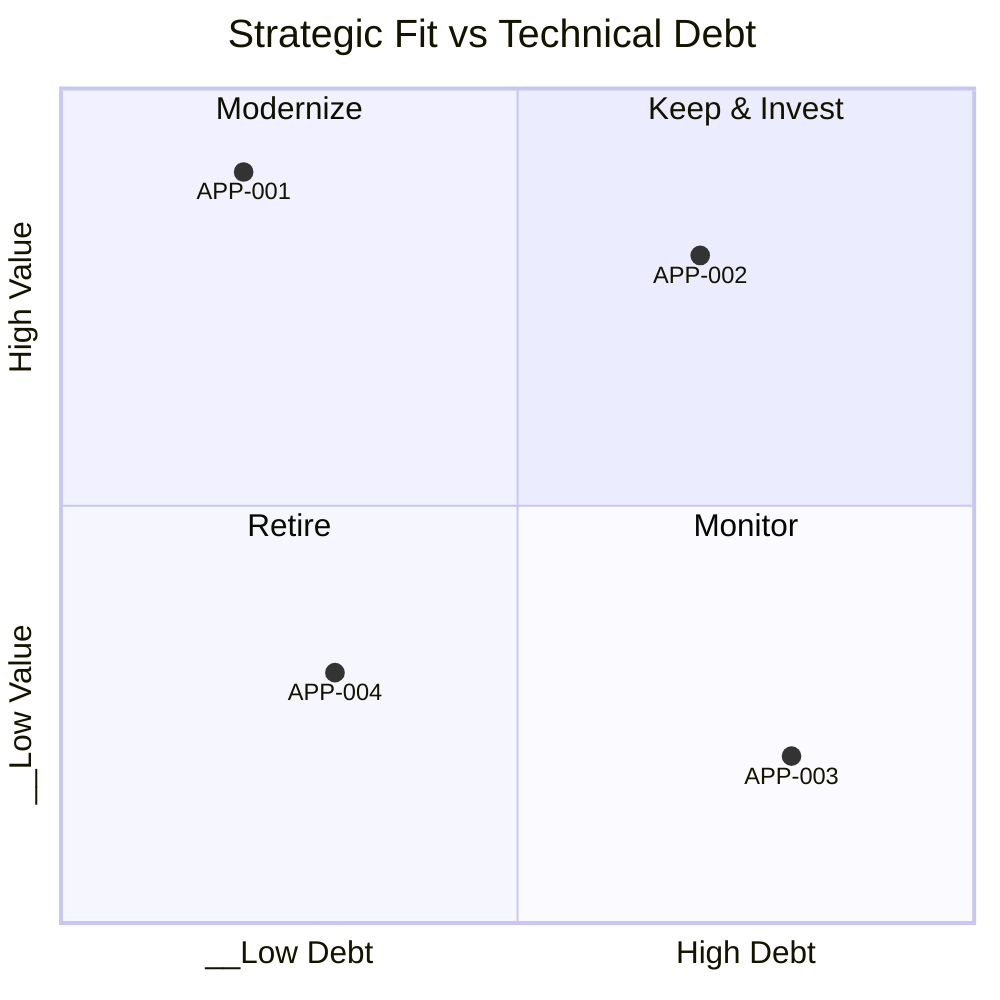

### Fit Score Rationale

| App ID  | Business Value (1-5) | Technical Debt (1-5) | Quadrant   | Recommended Action |
| ------- | -------------------- | -------------------- | ---------- | ------------------ |
| APP-001 | [Score]              | [Score]              | [Quadrant] | [Action]           |

## 3. Technology Landscape

### Technology Distribution

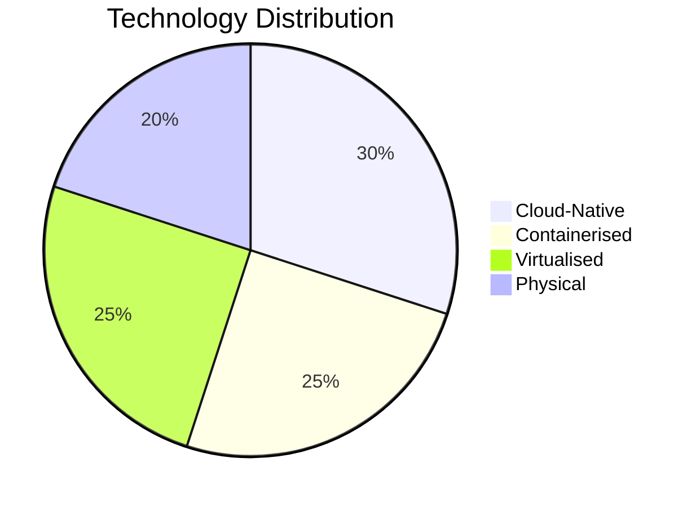

### Technology Diversity

| Technology Dimension | Count | Target   | Status                 |
| -------------------- | ----- | -------- | ---------------------- |
| Unique Runtimes      | [N]   | [Target] | [On-track/Over-target] |
| Unique Platforms     | [N]   | [Target] | [On-track/Over-target] |
| Unique Databases     | [N]   | [Target] | [On-track/Over-target] |
| Unique Vendors       | [N]   | [Target] | [On-track/Over-target] |

### Vendor Lock-in Risk

| App ID  | Vendor     | Lock-in Risk        | Exit Strategy |
| ------- | ---------- | ------------------- | ------------- |
| APP-001 | `[Vendor]` | `[High/Medium/Low]` | `[Exit plan]` |

## 4. Application Dependencies

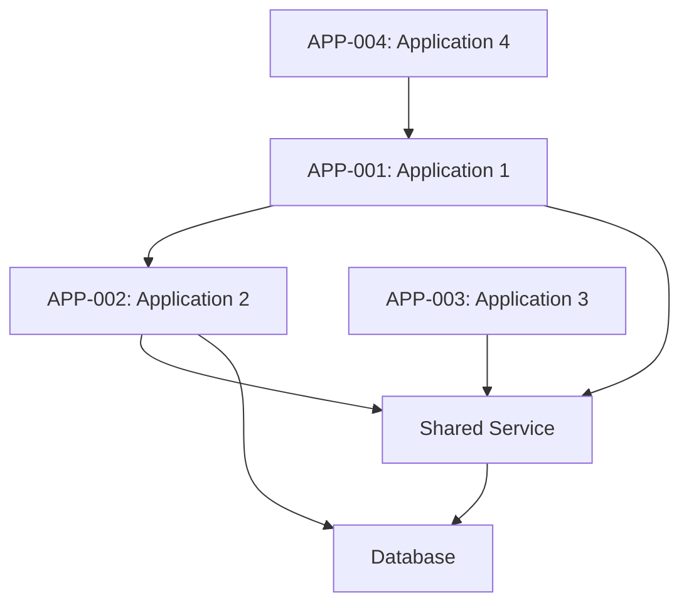

### Dependency Analysis

| Dependency          | Source         | Target         | Type                              | Criticality                  |
| ------------------- | -------------- | -------------- | --------------------------------- | ---------------------------- |
| `[Dependency Name]` | `[Source App]` | `[Target App]` | `[API/Database/File Share/Other]` | `[Critical/High/Medium/Low]` |

### Shared Services

| Service          | Consumers         | Technology     | SLA           |
| ---------------- | ----------------- | -------------- | ------------- |
| `[Service Name]` | `[Consumer Apps]` | `[Technology]` | `[SLA Level]` |

## 5. Application-to-Capability Mapping

| App ID  | Capability ID | Capability Name     | Coverage |
| ------- | ------------- | ------------------- | -------- |
| APP-001 | C1.1.1        | `[Capability Name]` | Full     |
| APP-002 | C1.2.1        | `[Capability Name]` | Partial  |
| APP-003 | C2.1.1        | `[Capability Name]` | Full     |

> **Coverage levels**:
>
> - **Full**: Application is the primary/sole system for this capability
> - **Partial**: Application handles some aspects; other systems also contribute
> - **Overlap**: Multiple applications cover the same capability
>   (rationalisation candidate)
>
> **Gaps** (capabilities with no system coverage):
>
> | Capability ID | Capability Name | Gap Impact |
> | ------------- | --------------- | ---------- |
> | `[C-X.X.X]`   | `[Capability]`  | `[Impact]` |

## 6. Application Lifecycle

| App ID  | Name     | Age       | EOL Date       | Next Major Version | End of Life Plan |
| ------- | -------- | --------- | -------------- | ------------------ | ---------------- |
| APP-001 | `[Name]` | `[Years]` | `[Date / N/A]` | `[Version]`        | `[Plan / None]`  |
| APP-002 | `[Name]` | `[Years]` | `[Date / N/A]` | `[Version]`        | `[Plan / None]`  |
| APP-003 | `[Name]` | `[Years]` | `[Date / N/A]` | `[Version]`        | `[Plan / None]`  |

### Lifecycle Timeline

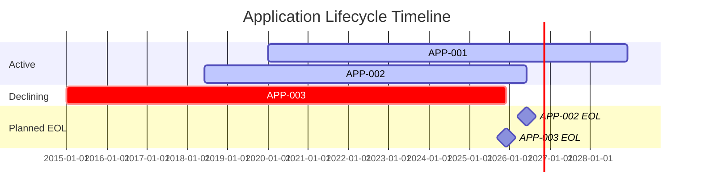

## 7. Risk Register

| Risk ID  | App ID  | Risk                 | Category                                       | Impact              | Likelihood          | Mitigation     |
| -------- | ------- | -------------------- | ---------------------------------------------- | ------------------- | ------------------- | -------------- |
| RISK-001 | APP-001 | `[Risk description]` | `[Technical/Operational/Compliance/Strategic]` | `[High/Medium/Low]` | `[High/Medium/Low]` | `[Mitigation]` |
| RISK-002 | APP-002 | `[Risk description]` | `[Technical/Operational/Compliance/Strategic]` | `[High/Medium/Low]` | `[High/Medium/Low]` | `[Mitigation]` |

### Risk Categories

- **Technical**: Unsupported technology, security vulnerabilities, scalability
  limits, performance degradation
- **Operational**: Single point of failure, lack of skilled staff, poor
  documentation, vendor dependency
- **Compliance**: Data residency, audit requirements, certification expiry,
  regulatory changes
- **Strategic**: Misalignment with business direction, market obsolescence,
  vendor consolidation risk

## 8. Traceability

### Architecture Vision Alignment

| ADMP Element       | Application | Alignment                 | Notes     |
| ------------------ | ----------- | ------------------------- | --------- |
| `[Scope boundary]` | `[App IDs]` | `[In-scope/Out-of-scope]` | `[Notes]` |

### Capability Coverage Trace

| Source | Reference                    | Application Link                             |
| ------ | ---------------------------- | -------------------------------------------- |
| BPCM   | `ARC-[P]-BPCM-v[VERSION].md` | `[Capability → App mapping summary]`         |
| REQ    | `ARC-[P]-REQ-v[VERSION].md`  | `[Requirement → App mapping summary]`        |
| PRIN   | `ARC-000-PRIN-v[VERSION].md` | `[Principle → Technology alignment summary]` |

## 9. Assumptions

1. `[Assumption about inventory completeness]`
2. `[Assumption about data sources]`
3. `[Assumption about strategic fit ratings]`

## 10. Recommendations

| Priority            | Recommendation     | Affected Apps | Effort              | Impact              |
| ------------------- | ------------------ | ------------- | ------------------- | ------------------- |
| `[High/Medium/Low]` | `[Recommendation]` | `[App IDs]`   | `[High/Medium/Low]` | `[High/Medium/Low]` |

## 11. External References

> This section provides traceability from generated content back to source
> documents. Follow citation instructions in the project's citation reference
> guide.

### Document Register

| Doc ID          | Filename | Type | Source Location | Description |
| --------------- | -------- | ---- | --------------- | ----------- |
| _None provided_ | —        | —    | —               | —           |

### Citations

| Citation ID | Doc ID | Page/Section | Category | Quoted Passage |
| ----------- | ------ | ------------ | -------- | -------------- |
| —           | —      | —            | —        | —              |

### Unreferenced Documents

| Filename | Source Location | Reason |
| -------- | --------------- | ------ |
| —        | —               | —      |

---

**Generated by**: ArcKit `/arckit:application-inventory` command **Generated
on**: `[DATE] [TIME] GMT` **ArcKit Version**: `{ARCKIT_VERSION}` **Project**:
`[PROJECT_NAME]` (Project `[PROJECT_ID]`)

<!-- arckit-overlay-template: architecture-board-template.md -->

---
title: "Architecture Board Charter"
docType: BORD
templateVersion: "1.0"
---

# Architecture Board Charter

## Document Control

<!-- DOC-CONTROL-HEADER -->
<!-- Resolved at command-execution time per _partials/RENDERING.md. -->

### Revision History

| Version     | Date           | Author    | Description      | Reviewer          | Approver          |
| ----------- | -------------- | --------- | ---------------- | ----------------- | ----------------- |
| `[VERSION]` | `[YYYY-MM-DD]` | ArcKit AI | Initial creation | `[REVIEWER_NAME]` | `[APPROVER_NAME]` |

---

## 1. Board Charter

### 1.1 Purpose

[Purpose statement — why the Architecture Board exists, its mandate, and the
governance objectives it serves. Reference TOGAF Phase G — Implementation
Governance.]

### 1.2 Scope

**In scope:**

- [Capabilities, domains, projects under the Board's governance]
- [Architecture decisions requiring formal review]
- [Compliance areas the Board oversees]

**Out of scope:**

- [Areas excluded from Board authority]
- [Decisions reserved for other forums]

### 1.3 Authority

| Authority Level | Decision Type                                   | Examples                                                       |
| --------------- | ----------------------------------------------- | -------------------------------------------------------------- |
| Advisory        | [Advisory decisions — recommendations only]     | [Technology selection guidance, best practice recommendations] |
| Mandatory       | [Mandatory decisions — binding on all projects] | [Architecture principle exceptions, security design approval]  |
| Exception       | [Exception process — formal deviation requests] | [Principle waiver requests, standard deviations]               |

---

## 2. Membership

### 2.1 Board Members

| Role               | Name                | Organisation       | Vote Type |
| ------------------ | ------------------- | ------------------ | --------- |
| Chair              | `[CHAIR_NAME]`      | `[CHAIR_ORG]`      | Voting    |
| CISO               | `[CISO_NAME]`       | `[CISO_ORG]`       | Voting    |
| Chief Architect    | `[ARCHITECT_NAME]`  | `[ARCH_ORG]`       | Voting    |
| CTO                | `[CTO_NAME]`        | `[CTO_ORG]`        | Voting    |
| Programme Sponsor  | `[SPONSOR_NAME]`    | `[SPONSOR_ORG]`    | Observer  |
| Compliance Officer | `[COMPLIANCE_NAME]` | `[COMPLIANCE_ORG]` | Observer  |

### 2.2 Quorum

[Minimum attendance requirements for valid decisions — e.g., "Minimum 4 voting
members present, including the Chair, for decisions to be valid. Decisions made
below quorum require retrospective approval at the next meeting."]

---

## 3. Decision Framework

### 3.1 Voting Model

| Model          | When Used                                                      | Quorum Required                              |
| -------------- | -------------------------------------------------------------- | -------------------------------------------- |
| Consensus      | Standard decisions — principle alignment, architecture reviews | `[e.g., 75% of voting members]`              |
| Majority Vote  | Time-sensitive decisions — project gating, resource allocation | `[50% + 1 of voting members]`                |
| Chair Decision | Deadlock resolution — when consensus and majority fail         | `[Chair decides, documented with rationale]` |

### 3.2 Escalation Path

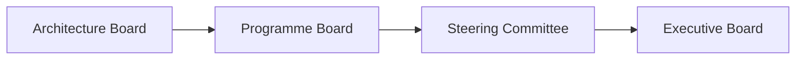

### 3.3 Decision Recording

All decisions must be recorded in the Decision Register with:

- **Decision ID**: Unique identifier (DEC-BORD-NNN)
- **Topic**: Subject of the decision
- **Decision**: What was decided
- **Rationale**: Why the decision was made
- **Owner**: Who is responsible for implementation
- **Status**: Active / Implemented / Superseded / Under Review

---

## 4. Compliance Scorecard

### 4.1 Current State Assessment

| Domain                | Standard/Framework  | Current State | Target State | Gap Description     | Priority   |
| --------------------- | ------------------- | ------------- | ------------ | ------------------- | ---------- |
| Security              | NCSC CAF            | `[e.g., L3]`  | `[e.g., L4]` | `[Gap description]` | `[High]`   |
| Data Architecture     | DCAM                | `[e.g., L2]`  | `[e.g., L3]` | `[Gap description]` | `[Medium]` |
| Application Portfolio | TOGAF Standards     | `[e.g., L2]`  | `[e.g., L3]` | `[Gap description]` | `[Medium]` |
| Technology Standards  | `[TCoP / Internal]` | `[e.g., L3]`  | `[e.g., L4]` | `[Gap description]` | `[High]`   |
| Governance            | COBIT 2019          | `[e.g., L2]`  | `[e.g., L3]` | `[Gap description]` | `[Low]`    |
| Business Alignment    | BSM                 | `[e.g., L3]`  | `[e.g., L4]` | `[Gap description]` | `[Medium]` |

### 4.2 Compliance Scoring Methodology

- **Maturity model**: 1 (Initial) → 5 (Optimised)
- **Gap severity**: Delta between current and target maturity
- **Priority scoring**: Gap Size × Business Criticality
- **Review cycle**: Quarterly reassessment

---

## 5. Exception Process

### 5.1 Process Steps

| Step | Action                        | Owner              | Timeline      | Approval        |
| ---- | ----------------------------- | ------------------ | ------------- | --------------- |
| 1    | Exception request submitted   | Requester          | `[T+0]`       | Self            |
| 2    | Impact assessment completed   | Lead Architect     | `[T+3 days]`  | Architect       |
| 3    | Board review and deliberation | Architecture Board | `[T+7 days]`  | Board           |
| 4    | Formal decision issued        | Board Chair        | `[T+14 days]` | Chair           |
| 5    | Appeal (if decision denied)   | Original Requester | `[T+21 days]` | Programme Board |

### 5.2 Exception Criteria

**Valid exception must include:**

- **Justification**: Business case for the deviation
- **Impact assessment**: Risk, cost, schedule, security impact
- **Duration**: Time-bound or permanent
- **Compensating controls**: Alternative safeguards if principle is waived
- **Review date**: When the exception expires or is reassessed

### 5.3 Exception Register Template

| Exception ID | Project     | Principle     | Request     | Decision            | Duration     | Review Date | Status             |
| ------------ | ----------- | ------------- | ----------- | ------------------- | ------------ | ----------- | ------------------ |
| EXC-BORD-001 | `[Project]` | `[Principle]` | `[Request]` | `[Approved/Denied]` | `[Duration]` | `[Date]`    | `[Active/Expired]` |

---

## 6. Review Cadence

| Forum              | Frequency     | Participants             | Agenda Items                                                     |
| ------------------ | ------------- | ------------------------ | ---------------------------------------------------------------- |
| Architecture Board | Monthly       | Board members, observers | Compliance review, exception decisions, new governance requests  |
| Programme Board    | Monthly       | Sponsor, PM, Board Chair | Architecture progress, risks, resource allocation                |
| Steering Committee | Quarterly     | Executive sponsors       | Strategic alignment, investment decisions, escalation resolution |
| Executive Board    | Semi-annually | C-suite, Board Chair     | Architecture programme status, strategic decisions               |

---

## 7. Decision Register

| Date           | Decision ID    | Topic     | Decision     | Rationale     | Owner     | Status                                         |
| -------------- | -------------- | --------- | ------------ | ------------- | --------- | ---------------------------------------------- |
| `[YYYY-MM-DD]` | `DEC-BORD-001` | `[Topic]` | `[Decision]` | `[Rationale]` | `[Owner]` | `[Active/Implemented/Superseded/Under Review]` |

---

## 8. Traceability

| Source Document              | Document ID                          | Relationship                         |
| ---------------------------- | ------------------------------------ | ------------------------------------ |
| Architecture Principles      | `ARC-000-PRIN-v[N].md`               | Board enforces principles compliance |
| ADM Plan                     | `ARC-[P]-ADMP-v[N].md`               | Board governs Phase G implementation |
| Gap Analysis                 | `ARC-[P]-GAPA-v[N].md`               | Board prioritises gap closure        |
| Architecture Change Requests | `changes/ARC-[P]-ACHG-[NNN]-v[N].md` | Board approves/denies changes        |

## 9. External References

> This section provides traceability from generated content back to source
> documents. Follow citation instructions in the project's citation reference
> guide.

### Document Register

| Doc ID          | Filename | Type | Source Location | Description |
| --------------- | -------- | ---- | --------------- | ----------- |
| _None provided_ | —        | —    | —               | —           |

### Citations

| Citation ID | Doc ID | Page/Section | Category | Quoted Passage |
| ----------- | ------ | ------------ | -------- | -------------- |
| —           | —      | —            | —        | —              |

### Unreferenced Documents

| Filename | Source Location | Reason |
| -------- | --------------- | ------ |
| —        | —               | —      |

---

**Generated by**: ArcKit `/arckit:architecture-board` command **Generated on**:
`[DATE] [TIME] GMT` **ArcKit Version**: `{ARCKIT_VERSION}` **Project**:
`[PROJECT_NAME]` (Project `[PROJECT_ID]`)

<!-- arckit-overlay-template: architecture-change-template.md -->

---
title: "Architecture Change Request"
docType: ACHG
templateVersion: "1.0"
---

# Architecture Change Request

## Document Control

<!-- DOC-CONTROL-HEADER -->
<!-- Resolved at command-execution time per _partials/RENDERING.md. -->

<!-- Domain-specific fields, retained after the resolved header per the Document Control Standard. -->

| Field           | Value                                              |
| --------------- | -------------------------------------------------- |
| **Change ID**   | `ACHG-[ACHG_NUM]`                                  |
| **Change Type** | `[SIMPLIFICATION / INCREMENTAL / RE-ARCHITECTING]` |
| **Priority**    | `[CRITICAL / HIGH / MEDIUM / LOW]`                 |

### Revision History

| Version     | Date           | Author    | Description                                                 | Reviewer          | Approver          |
| ----------- | -------------- | --------- | ----------------------------------------------------------- | ----------------- | ----------------- |
| `[VERSION]` | `[YYYY-MM-DD]` | ArcKit AI | Initial creation from `/arckit:architecture-change` command | `[REVIEWER_NAME]` | `[APPROVER_NAME]` |

---

## 1. Change Request

| Field        | Value                                              |
| ------------ | -------------------------------------------------- |
| Change ID    | `ACHG-[ACHG_NUM]`                                  |
| Change Type  | `[SIMPLIFICATION / INCREMENTAL / RE-ARCHITECTING]` |
| Submitted By | `[NAME]`                                           |
| Date         | `[YYYY-MM-DD]`                                     |
| Priority     | `[CRITICAL / HIGH / MEDIUM / LOW]`                 |

---

## 2. Rationale

### 2.1 Business Driver

[Why this change is needed from a business perspective. What objective or
problem is being addressed?]

### 2.2 Technical Driver

[Architectural reason for the change — performance, security, scalability,
maintainability, or compliance]

### 2.3 Trigger

[What initiated this change request: audit finding, strategic shift, technology
obsolescence, stakeholder request, incident response]

### 2.4 Change Description

[Detailed description of the proposed change, including scope boundaries and
exclusions]

---

## 3. Impact Assessment

### 3.1 Capability Impact

| Capability                 | Impact                          | Detail                  |
| -------------------------- | ------------------------------- | ----------------------- |
| [C-X.X.X: Capability Name] | [Enhanced/Modified/New/Retired] | [Description of impact] |
| [C-X.X.X: Capability Name] | [Enhanced/Modified/New/Retired] | [Description of impact] |

### 3.2 Application Impact

| Application        | Impact                               | Detail                  |
| ------------------ | ------------------------------------ | ----------------------- |
| [Application Name] | [Enhanced/Modified/Replaced/Retired] | [Description of impact] |
| [Application Name] | [Enhanced/Modified/Replaced/Retired] | [Description of impact] |

### 3.3 Technology Impact

| Technology            | Impact                               | Detail                  |
| --------------------- | ------------------------------------ | ----------------------- |
| [Technology/Platform] | [Enhanced/Modified/Replaced/Retired] | [Description of impact] |
| [Technology/Platform] | [Enhanced/Modified/Replaced/Retired] | [Description of impact] |

### 3.4 Governance Impact

| Governance Area               | Impact                  | Detail                  |
| ----------------------------- | ----------------------- | ----------------------- |
| [Standards/Policy/Compliance] | [Changed/Unchanged/New] | [Description of impact] |
| [Standards/Policy/Compliance] | [Changed/Unchanged/New] | [Description of impact] |

---

## 4. Affected Artefacts

| Artefact                               | Impact Level          | Action Required                    |
| -------------------------------------- | --------------------- | ---------------------------------- |
| `ARC-[PROJECT_ID]-BPCM-v[VERSION].md`  | [HIGH / MEDIUM / LOW] | [Update / No change / New section] |
| `ARC-[PROJECT_ID]-STRAT-v[VERSION].md` | [HIGH / MEDIUM / LOW] | [Update / No change / New section] |
| `ARC-[PROJECT_ID]-APP-v[VERSION].md`   | [HIGH / MEDIUM / LOW] | [Update / No change / New section] |
| `ARC-[PROJECT_ID]-TRANS-v[VERSION].md` | [HIGH / MEDIUM / LOW] | [Update / No change / New section] |
| `ARC-[PROJECT_ID]-ADMP-v[VERSION].md`  | [HIGH / MEDIUM / LOW] | [Update / No change / New section] |

---

## 5. ADM Re-Entry Point

| ADM Phase                                   | Re-Entry   | Scope               |
| ------------------------------------------- | ---------- | ------------------- |
| Phase A (Architecture Vision)               | [YES / NO] | [Scope of re-entry] |
| Phase B (Business Architecture)             | [YES / NO] | [Scope of re-entry] |
| Phase C (Information Systems Architectures) | [YES / NO] | [Scope of re-entry] |
| Phase D (Technology Architecture)           | [YES / NO] | [Scope of re-entry] |
| Phase E (Opportunities & Solutions)         | [YES / NO] | [Scope of re-entry] |
| Phase F (Migration Planning)                | [YES / NO] | [Scope of re-entry] |
| Phase G (Implementation Governance)         | [YES / NO] | [Scope of re-entry] |
| Phase H (Architecture Change Management)    | [YES / NO] | [Scope of re-entry] |

---

## 6. Cost/Benefit

| Item                        | Amount       |
| --------------------------- | ------------ |
| Implementation Cost (CAPEX) | `[£X]`       |
| Ongoing Cost (OPEX/year)    | `[£X/year]`  |
| Expected Benefit (year 1)   | `[£Y]`       |
| Expected Benefit (annual)   | `[£Y/year]`  |
| Payback Period              | `[Z months]` |
| 3-Year TCO                  | `[£X]`       |

### UK Government Financial Considerations

| Item                   | Detail                                         |
| ---------------------- | ---------------------------------------------- |
| Spending Review Period | `[FY 2024/25 / FY 2025/26]`                    |
| G-Cloud Frame          | `[Frame reference if applicable]`              |
| TCoP Alignment         | [Technology Code of Practice points addressed] |
| Reuse Opportunity      | [Cross-government service reuse assessment]    |

---

## 7. Risk Assessment

| Risk                                    | Likelihood        | Impact            | Mitigation            |
| --------------------------------------- | ----------------- | ----------------- | --------------------- |
| [Risk 1: Technical implementation risk] | [High/Medium/Low] | [High/Medium/Low] | [Mitigation strategy] |
| [Risk 2: Operational disruption risk]   | [High/Medium/Low] | [High/Medium/Low] | [Mitigation strategy] |
| [Risk 3: Compliance/regulatory risk]    | [High/Medium/Low] | [High/Medium/Low] | [Mitigation strategy] |
| [Risk 4: Financial risk]                | [High/Medium/Low] | [High/Medium/Low] | [Mitigation strategy] |

---

## 8. Approval Workflow

| Stage          | Owner           | Decision                                | Date           |
| -------------- | --------------- | --------------------------------------- | -------------- |
| Submission     | `[REQUESTER]`   | Submitted                               | `[YYYY-MM-DD]` |
| Assessment     | `[ARCHITECT]`   | [Pending/Approved/Rejected/Conditional] | `[YYYY-MM-DD]` |
| Board Review   | `[BOARD]`       | [Pending/Approved/Rejected/Conditional] | `[YYYY-MM-DD]` |
| Approval       | `[BOARD_CHAIR]` | [Pending/Approved/Rejected/Conditional] | `[YYYY-MM-DD]` |
| Implementation | `[TEAM]`        | [Pending/Started/Complete]              | `[YYYY-MM-DD]` |

---

## 9. Traceability

### Change-to-Artefact Traceability

| Source                                | Link | Target                       |
| ------------------------------------- | ---- | ---------------------------- |
| `ARC-[PROJECT_ID]-BORD-v[VERSION].md` | →    | `ACHG-[ACHG_NUM]`            |
| `ACHG-[ACHG_NUM]`                     | →    | [List of affected artefacts] |
| [ADR-XXX / STRAT / REQ]               | →    | `ACHG-[ACHG_NUM]`            |

### Cross-References

| Reference  | Type           | Detail                                    |
| ---------- | -------------- | ----------------------------------------- |
| [ADR-XXX]  | ADR            | Related architecture decisions            |
| [REQ-XXX]  | Requirement    | Requirements addressed by this change     |
| [RISK-XXX] | Risk           | Risks mitigated or created by this change |
| [ACHG-XXX] | Change Request | Related change requests                   |

## 10. External References

> This section provides traceability from generated content back to source
> documents. Follow citation instructions in the project's citation reference
> guide.

### Document Register

| Doc ID          | Filename | Type | Source Location | Description |
| --------------- | -------- | ---- | --------------- | ----------- |
| _None provided_ | —        | —    | —               | —           |

### Citations

| Citation ID | Doc ID | Page/Section | Category | Quoted Passage |
| ----------- | ------ | ------------ | -------- | -------------- |
| —           | —      | —            | —        | —              |

### Unreferenced Documents

| Filename | Source Location | Reason |
| -------- | --------------- | ------ |
| —        | —               | —      |

---

**Generated by**: ArcKit `/arckit:architecture-change` command **Generated on**:
`[DATE] [TIME] GMT` **ArcKit Version**: `{ARCKIT_VERSION}` **Project**:
`[PROJECT_NAME]` (Project `[PROJECT_ID]`) **AI Model**: `[MODEL_NAME]`
**Generation Context**: [Brief note about source documents used]

<!-- arckit-overlay-template: architecture-repository-template.md -->

---
title: "Architecture Repository"
docType: REPO
templateVersion: "1.0"
---

# Architecture Repository

## Document Control

<!-- DOC-CONTROL-HEADER -->
<!-- Resolved at command-execution time per _partials/RENDERING.md. -->

### Revision History

| Version     | Date           | Author    | Description      | Reviewer          | Approver          |
| ----------- | -------------- | --------- | ---------------- | ----------------- | ----------------- |
| `[VERSION]` | `[YYYY-MM-DD]` | ArcKit AI | Initial creation | `[REVIEWER_NAME]` | `[APPROVER_NAME]` |

---

## 1. Standards Register

| Standard ID | Name     | Domain                         | Status                | Last Review | Source       |
| ----------- | -------- | ------------------------------ | --------------------- | ----------- | ------------ |
| STD-001     | `[Name]` | `[Security/Architecture/Data]` | `[Active/Deprecated]` | `[Date]`    | `[PRIN/ADR]` |

---

## 2. Patterns Library

### Pattern: `[Name]`

- **Context**: `[When to apply this pattern]`
- **Problem**: `[Problem statement this pattern addresses]`
- **Solution**: `[Solution description]`
- **Consequences**: `[Trade-offs, benefits, and risks]`
- **Related**: `[Related patterns or standards]`
- **Source Project**: `[ARC-XXX-ADR-vX.md]`

[Repeat for each pattern]

---

## 3. Reference Architectures

| Reference ID | Name     | Domain     | Diagram                   | Last Used      |
| ------------ | -------- | ---------- | ------------------------- | -------------- |
| REF-001      | `[Name]` | `[Domain]` | `[Link to DIAG artefact]` | `[Project ID]` |

---

## 4. Lessons Learned

| Lesson ID | Project     | Lesson                 | Category                     | Impact              |
| --------- | ----------- | ---------------------- | ---------------------------- | ------------------- |
| LL-001    | `[Project]` | `[Lesson description]` | `[Technical/Process/People]` | `[High/Medium/Low]` |

---

## 5. Reusable Building Blocks

| Block ID | Name     | Type                      | Maturity                      | Documentation               |
| -------- | -------- | ------------------------- | ----------------------------- | --------------------------- |
| BB-001   | `[Name]` | `[Component/Pattern/API]` | `[Prototype/Proven/Standard]` | `[Link to source artefact]` |

---

## 6. Search Index

| Keyword     | Artefacts                               |
| ----------- | --------------------------------------- |
| `[Keyword]` | `[List of matching artefacts with IDs]` |

---

## 7. Traceability

| Source Type | Source Artefact         | Repository Entry      | Relationship                       |
| ----------- | ----------------------- | --------------------- | ---------------------------------- |
| PRIN        | `ARC-000-PRIN-v[N].md`  | STD-001, STD-002      | Principles → Standards             |
| ADR         | `ARC-XXX-ADR-v[N].md`   | Pattern Name, REF-001 | Decisions → Patterns/References    |
| DIAG        | `ARC-XXX-DIAG-v[N].md`  | REF-001               | Diagrams → Reference Architectures |
| STORY       | `ARC-XXX-STORY-v[N].md` | LL-001                | Stories → Lessons Learned          |
| ANAL        | `ARC-XXX-ANAL-v[N].md`  | LL-002, BB-001        | Analysis → Lessons/Building Blocks |

## 8. External References

> This section provides traceability from generated content back to source
> documents. Follow citation instructions in the project's citation reference
> guide.

### Document Register

| Doc ID          | Filename | Type | Source Location | Description |
| --------------- | -------- | ---- | --------------- | ----------- |
| _None provided_ | —        | —    | —               | —           |

### Citations

| Citation ID | Doc ID | Page/Section | Category | Quoted Passage |
| ----------- | ------ | ------------ | -------- | -------------- |
| —           | —      | —            | —        | —              |

### Unreferenced Documents

| Filename | Source Location | Reason |
| -------- | --------------- | ------ |
| —        | —               | —      |

---

**Generated by**: ArcKit `/arckit:architecture-repository` command **Generated
on**: `[DATE] [TIME] GMT` **ArcKit Version**: `{ARCKIT_VERSION}` **Project**:
Global Repository (Project 000) **AI Model**:
`[Use actual model name, e.g., "Claude Sonnet 5 (session default)"]`
**Generation Context**:
`[Brief note about source documents and projects synthesised]`

<!-- arckit-overlay-template: capability-map-template.md -->

---
title: "Business Capability Map"
docType: BPCM
templateVersion: "1.0"
---

# Business Capability Map

## Document Control

<!-- DOC-CONTROL-HEADER -->
<!-- Resolved at command-execution time per _partials/RENDERING.md. -->

### Revision History

| Version     | Date           | Author    | Description      | Reviewer          | Approver          |
| ----------- | -------------- | --------- | ---------------- | ----------------- | ----------------- |
| `[VERSION]` | `[YYYY-MM-DD]` | ArcKit AI | Initial creation | `[REVIEWER_NAME]` | `[APPROVER_NAME]` |

---

## 1. Capability Hierarchy

### Level 1: Capability Domains

| Domain ID | Domain   | Description   |
| --------- | -------- | ------------- |
| C1.0      | [Domain] | [Description] |

### Level 2: Sub-Capabilities

[For each domain, list sub-capabilities]

### Level 3: Detailed Capabilities

[For each sub-capability, list detailed capabilities]

### Capability Map (Mermaid mindmap)

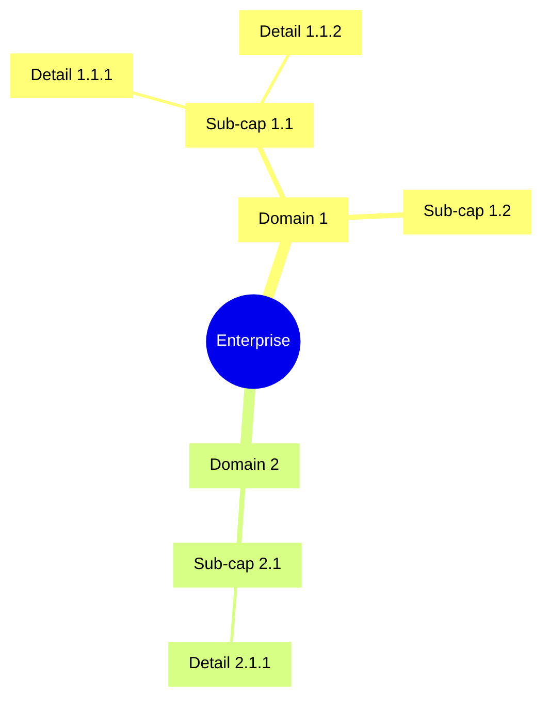

## 2. Value Streams

### Value Stream Matrix

| Value Stream | Capabilities       | Trigger   | Outcome   |
| ------------ | ------------------ | --------- | --------- |
| [VS-001]     | [C1.1, C2.3, C3.1] | [Trigger] | [Outcome] |

### Value Stream Flow

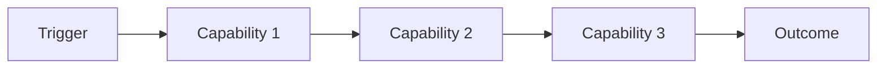

## 3. Capability Maturity Assessment

| Capability | Current (L1-L5) | Target (L1-L5) | Gap   | Priority       |
| ---------- | --------------- | -------------- | ----- | -------------- |
| [C1.1.1]   | [L2]            | [L4]           | [Gap] | [High/Med/Low] |

## 4. Capability Heatmap

```mermaid
quadrantChart
    title Strategic Importance vs Maturity
    x-axis__Low --> High
    y-axis__Low --> High
    quadrant-1 Invest
    quadrant-2 Maintain
    quadrant-3 Monitor
    quadrant-4 Transform
    "C1.1.1": 0.8, 0.3
    "C2.1.1": 0.3, 0.8
```

## 5. Capability-Requirement Traceability

| Requirement | Capability | Coverage           |
| ----------- | ---------- | ------------------ |
| BR-001      | [C1.1.1]   | [Full/Partial/Gap] |

## 6. Capability-Principle Alignment

| Principle | Related Capabilities | Alignment         |
| --------- | -------------------- | ----------------- |
| [PRIN-01] | [C1.1.1, C1.2.1]     | [Aligned/Partial] |

## 7. Traceability

| Source          | Artifact               | Link     |
| --------------- | ---------------------- | -------- |
| ADM Preliminary | `ARC-[P]-ADMP-v[N].md` | [Direct] |
| Requirements    | `ARC-[P]-REQ-v[N].md`  | [Direct] |
| Stakeholders    | `ARC-[P]-STKE-v[N].md` | [Direct] |
| Principles      | `ARC-000-PRIN-v[N].md` | [Direct] |

## 8. External References

> This section provides traceability from generated content back to source
> documents. Follow citation instructions in the project's citation reference
> guide.

### Document Register

| Doc ID          | Filename | Type | Source Location | Description |
| --------------- | -------- | ---- | --------------- | ----------- |
| _None provided_ | —        | —    | —               | —           |

### Citations

| Citation ID | Doc ID | Page/Section | Category | Quoted Passage |
| ----------- | ------ | ------------ | -------- | -------------- |
| —           | —      | —            | —        | —              |

### Unreferenced Documents

| Filename | Source Location | Reason |
| -------- | --------------- | ------ |
| —        | —               | —      |

---

**Generated by**: ArcKit `/arckit:business-capability-map` command **Generated
on**: `[DATE] [TIME] GMT` **ArcKit Version**: `{ARCKIT_VERSION}` **Project**:
`[PROJECT_NAME]` (Project `[PROJECT_ID]`)

<!-- arckit-overlay-template: gap-analysis-template.md -->

---
title: "Gap Analysis"
docType: GAPA
templateVersion: "1.0"
---

# Gap Analysis

## Document Control

<!-- DOC-CONTROL-HEADER -->
<!-- Resolved at command-execution time per _partials/RENDERING.md. -->

<!-- Domain-specific fields, retained after the resolved header per the Document Control Standard. -->

| Field                  | Value                                       |
| ---------------------- | ------------------------------------------- |
| **Severity Weighting** | `[BALANCED / STRATEGIC-RISK / OPERATIONAL]` |

### Revision History

| Version     | Date           | Author    | Description                                          | Reviewer          | Approver          |
| ----------- | -------------- | --------- | ---------------------------------------------------- | ----------------- | ----------------- |
| `[VERSION]` | `[YYYY-MM-DD]` | ArcKit AI | Initial creation from `/arckit:gap-analysis` command | `[REVIEWER_NAME]` | `[APPROVER_NAME]` |

---

## 1. Capability Gap Matrix

| Capability                | Current | Target | Gap Size | Urgency | Severity (Size×Urgency) | Workstream |
| ------------------------- | ------- | ------ | -------- | ------- | ----------------------- | ---------- |
| C1.1.1: [Capability Name] | L2      | L4     | Medium   | High    | High                    | WS-001     |
| C1.1.2: [Capability Name] | L3      | L4     | Small    | Medium  | Medium                  | WS-001     |
| C2.1.1: [Capability Name] | L1      | L4     | Large    | High    | Critical                | WS-002     |
| C2.1.2: [Capability Name] | L2      | L3     | Small    | Low     | Low                     | WS-003     |
| C3.1.1: [Capability Name] | L3      | L5     | Large    | Medium  | High                    | WS-002     |
| C3.2.1: [Capability Name] | L4      | L5     | Small    | High    | Medium                  | WS-003     |
| C4.1.1: [Capability Name] | L1      | L3     | Medium   | High    | High                    | WS-001     |
| C4.2.1: [Capability Name] | L2      | L2     | None     | Low     | Informational           | —          |
| C5.1.1: [Capability Name] | L3      | L5     | Medium   | Low     | Medium                  | WS-004     |

### Gap Size Classification

| Gap Size | Maturity Delta | Description                         |
| -------- | -------------- | ----------------------------------- |
| Small    | Δ = 1 level    | Incremental improvement             |
| Medium   | Δ = 2 levels   | Significant enhancement required    |
| Large    | Δ ≥ 3 levels   | Fundamental transformation required |

### Urgency Classification

| Urgency | Description                                | Timeframe    |
| ------- | ------------------------------------------ | ------------ |
| High    | Must address in immediate planning horizon | 0–3 months   |
| Medium  | Address in next delivery cycle             | 3–12 months  |
| Low     | Plan for future cycles                     | 12–24 months |

### Severity Matrix

|                      | Urgency: Low  | Urgency: Medium | Urgency: High |
| -------------------- | ------------- | --------------- | ------------- |
| **Gap Size: Small**  | Informational | Medium          | Medium        |
| **Gap Size: Medium** | Low           | Medium          | High          |
| **Gap Size: Large**  | Plan          | High            | Critical      |

---

## 2. Gap Heatmap

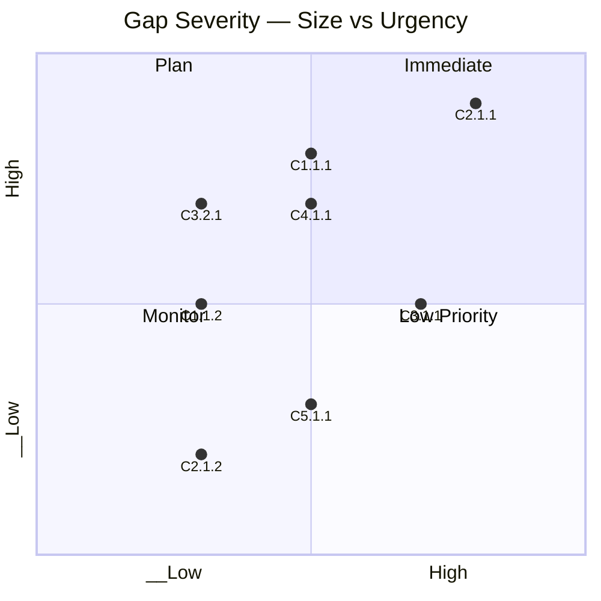

### Heatmap Interpretation

| Quadrant                               | Count | Action                       |
| -------------------------------------- | ----- | ---------------------------- |
| **Immediate** (Large + High urgency)   | [N]   | Assign to next work package  |
| **Plan** (Large + Low urgency)         | [N]   | Include in 12-month planning |
| **Monitor** (Small + High urgency)     | [N]   | Quick wins — address early   |
| **Low Priority** (Small + Low urgency) | [N]   | Maintain in backlog          |

---

## 3. Workstream Mapping

| Workstream ID | Name              | Gaps             | Dependencies | Duration   | Resources |
| ------------- | ----------------- | ---------------- | ------------ | ---------- | --------- |
| WS-001        | [Workstream Name] | [C1.1.1, C4.1.1] | [—]          | [6 months] | [5 FTE]   |
| WS-002        | [Workstream Name] | [C2.1.1, C3.1.1] | [WS-001]     | [9 months] | [8 FTE]   |
| WS-003        | [Workstream Name] | [C2.1.2, C3.2.1] | [WS-002]     | [4 months] | [3 FTE]   |
| WS-004        | [Workstream Name] | [C5.1.1]         | [WS-002]     | [3 months] | [2 FTE]   |

### Workstream Dependencies

```mermaid
flowchart TD
    WS1[WS-001: [Workstream 1 Name]] --> WS2[WS-002: [Workstream 2 Name]]
    WS2 --> WS3[WS-003: [Workstream 3 Name]]
    WS1 --> WS3
    WS2 --> WS4[WS-004: [Workstream 4 Name]]
```

### Workstream Details

#### WS-001: [Workstream Name]

- **Objective**: [Brief description of what this workstream delivers]
- **Gaps addressed**: [List capabilities]
- **Key activities**:
  1. [Activity 1]
  2. [Activity 2]
  3. [Activity 3]
- **Success criteria**: [Measurable outcomes]

#### WS-002: [Workstream Name]

- **Objective**: [Brief description of what this workstream delivers]
- **Gaps addressed**: [List capabilities]
- **Key activities**:
  1. [Activity 1]
  2. [Activity 2]
  3. [Activity 3]
- **Success criteria**: [Measurable outcomes]

---

## 4. Gap-to-Risk Mapping

| Gap   | Capability | Associated Risk    | Risk Category                      | Impact            | Mitigation   |
| ----- | ---------- | ------------------ | ---------------------------------- | ----------------- | ------------ |
| G-001 | C1.1.1     | [Risk description] | [Operational/Strategic/Compliance] | [High/Medium/Low] | [Mitigation] |
| G-002 | C2.1.1     | [Risk description] | [Operational/Strategic/Compliance] | [High/Medium/Low] | [Mitigation] |
| G-003 | C3.1.1     | [Risk description] | [Operational/Strategic/Compliance] | [High/Medium/Low] | [Mitigation] |
| G-004 | C4.1.1     | [Risk description] | [Operational/Strategic/Compliance] | [High/Medium/Low] | [Mitigation] |
| G-005 | C5.1.1     | [Risk description] | [Operational/Strategic/Compliance] | [High/Medium/Low] | [Mitigation] |

---

## 5. Assumptions & Constraints

### Assumptions

1. [Assumption about current state assessment accuracy]
2. [Assumption about target state feasibility]
3. [Assumption about resource availability]
4. [Assumption about technology stability]

### Constraints

1. **Budget**: [Budget constraints affecting gap closure]
2. **Timeline**: [Time-based constraints on delivery]
3. **Skills**: [Skills gaps that affect workstream execution]
4. **Technology**: [Technology constraints and dependencies]
5. **Compliance**: [Regulatory constraints on approach]

---

## 6. Traceability

| Gap   | Source Capability (BPCM) | Target State (STRAT) | Principle Alignment (PRIN) | Workstream |
| ----- | ------------------------ | -------------------- | -------------------------- | ---------- |
| G-001 | C1.1.1 (L2 → L4)         | STRAT Section 3.2    | PRIN-005                   | WS-001     |
| G-002 | C2.1.1 (L1 → L4)         | STRAT Section 4.1    | PRIN-003                   | WS-002     |
| G-003 | C3.1.1 (L3 → L5)         | STRAT Section 2.5    | PRIN-007                   | WS-002     |
| G-004 | C4.1.1 (L1 → L3)         | STRAT Section 5.3    | PRIN-002                   | WS-001     |
| G-005 | C5.1.1 (L3 → L5)         | STRAT Section 3.8    | PRIN-009                   | WS-004     |

## 7. External References

> This section provides traceability from generated content back to source
> documents. Follow citation instructions in the project's citation reference
> guide.

### Document Register

| Doc ID          | Filename | Type | Source Location | Description |
| --------------- | -------- | ---- | --------------- | ----------- |
| _None provided_ | —        | —    | —               | —           |

### Citations

| Citation ID | Doc ID | Page/Section | Category | Quoted Passage |
| ----------- | ------ | ------------ | -------- | -------------- |
| —           | —      | —            | —        | —              |

### Unreferenced Documents

| Filename | Source Location | Reason |
| -------- | --------------- | ------ |
| —        | —               | —      |

---

**Generated by**: ArcKit `/arckit:gap-analysis` command **Generated on**:
`[DATE] [TIME] GMT` **ArcKit Version**: `{ARCKIT_VERSION}` **Project**:
`[PROJECT_NAME]` (Project `[PROJECT_ID]`) **Severity Weighting Profile**:
`[BALANCED / STRATEGIC-RISK / OPERATIONAL]`

<!-- arckit-overlay-template: rationalization-template.md -->

---
title: "Application Rationalisation"
docType: APPR
templateVersion: "1.0"
---

# Application Rationalisation

## Document Control

<!-- DOC-CONTROL-HEADER -->
<!-- Resolved at command-execution time per _partials/RENDERING.md. -->

### Revision History

| Version     | Date           | Author    | Description                                                         | Reviewer          | Approver          |
| ----------- | -------------- | --------- | ------------------------------------------------------------------- | ----------------- | ----------------- |
| `[VERSION]` | `[YYYY-MM-DD]` | ArcKit AI | Initial creation from `/arckit:application-rationalization` command | `[REVIEWER_NAME]` | `[APPROVER_NAME]` |

---

## 1. Rationalisation Summary

| Decision | Count | Applications                   |
| -------- | ----- | ------------------------------ |
| Keep     | [N]   | [App-1, App-2, ...]            |
| Merge    | [N]   | [App-3, App-4 (→ target), ...] |
| Replace  | [N]   | [App-5, App-6, ...]            |
| Retire   | [N]   | [App-7, App-8, ...]            |

**Overall Portfolio**: [N] applications assessed → [N] decisions rendered
**Target reduction**: [X]% fewer applications post-rationalisation

## 2. Per-Application Decisions

### APP-001: [Application Name] — [KEEP / MERGE / REPLACE / RETIRE]

- **Capability**: [Primary capability served]
- **Strategic Fit**: [Strategic / Critical / Support]
- **Technical Condition**: [Modern / Aging / Legacy]
- **Business Value**: [High / Medium / Low]
- **Current Cost**: [£X/year — license, maintenance, infrastructure, FTE]
- **Rationale**: [Why this decision — reference principles, strategy, BPCM
  alignment]
- **Migration Approach**: [Lift-shift / Replatform / Refactor / Retire /
  Consolidate]
- **Target Platform** (if Replace/Merge): [Platform name]
- **Timeline**: [Q1 2026 / Wave 1, etc.]
- **Estimated Cost**: [£X]
- **Risk Level**: [Low / Medium / High]
- **Dependencies**: [Upstream/downstream applications affected]
- **Owner**: [Application owner / business sponsor]

### APP-002: [Application Name] — [KEEP / MERGE / REPLACE / RETIRE]

- **Capability**: [Primary capability served]
- **Strategic Fit**: [Strategic / Critical / Support]
- **Technical Condition**: [Modern / Aging / Legacy]
- **Business Value**: [High / Medium / Low]
- **Current Cost**: [£X/year — license, maintenance, infrastructure, FTE]
- **Rationale**: [Why this decision]
- **Migration Approach**: [Lift-shift / Replatform / Refactor / Retire /
  Consolidate]
- **Target Platform** (if Replace/Merge): [Platform name]
- **Timeline**: [Q1 2026 / Wave 1, etc.]
- **Estimated Cost**: [£X]
- **Risk Level**: [Low / Medium / High]
- **Dependencies**: [Upstream/downstream applications affected]
- **Owner**: [Application owner / business sponsor]

### APP-003: [Application Name] — [KEEP / MERGE / REPLACE / RETIRE]

- **Capability**: [Primary capability served]
- **Strategic Fit**: [Strategic / Critical / Support]
- **Technical Condition**: [Modern / Aging / Legacy]
- **Business Value**: [High / Medium / Low]
- **Current Cost**: [£X/year — license, maintenance, infrastructure, FTE]
- **Rationale**: [Why this decision]
- **Migration Approach**: [Lift-shift / Replatform / Refactor / Retire /
  Consolidate]
- **Target Platform** (if Replace/Merge): [Platform name]
- **Timeline**: [Q1 2026 / Wave 1, etc.]
- **Estimated Cost**: [£X]
- **Risk Level**: [Low / Medium / High]
- **Dependencies**: [Upstream/downstream applications affected]
- **Owner**: [Application owner / business sponsor]

[Continue for each application in inventory...]

## 3. Portfolio Target State

### Target Distribution

| Decision Category | Count   | Percentage |
| ----------------- | ------- | ---------- |
| Keep              | [N]     | [X]%       |
| Merge             | [N]     | [X]%       |
| Replace           | [N]     | [X]%       |
| Retire            | [N]     | [X]%       |
| **Total**         | **[N]** | **100%**   |

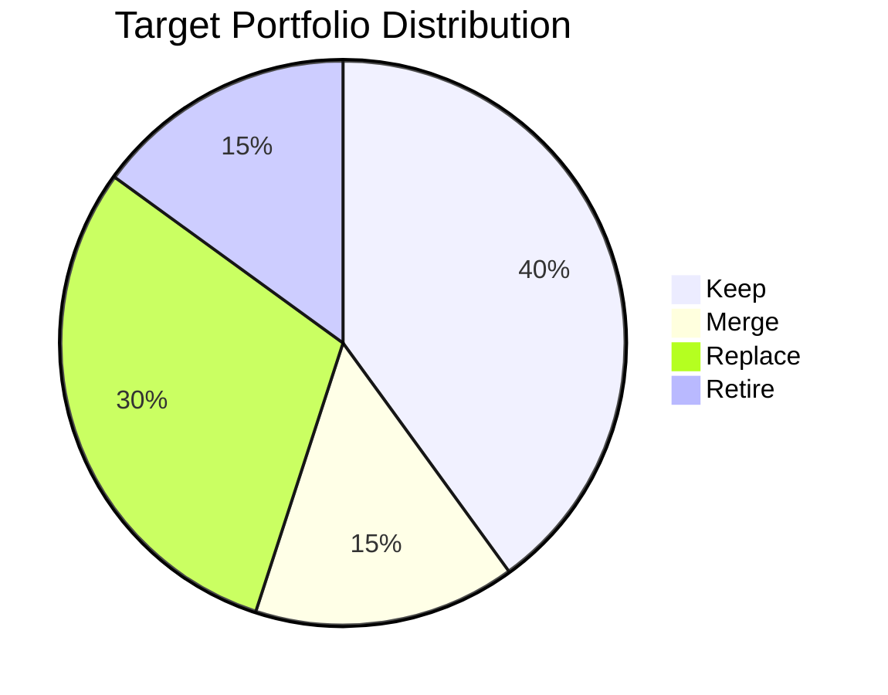

### Capability Coverage

| Capability     | Current Apps | Target Apps | Decision                 |
| -------------- | ------------ | ----------- | ------------------------ |
| [Capability A] | [N]          | [N]         | [Consolidated]           |
| [Capability B] | [N]          | [N]         | [Unchanged]              |
| [Capability C] | [N]          | [N]         | [New replacement needed] |

## 4. Consolidation Benefits

| Benefit Area                       | Estimated Value | Confidence     | Notes    |
| ---------------------------------- | --------------- | -------------- | -------- |
| License reduction                  | £[X]/year       | [High/Med/Low] | [Detail] |
| Maintenance savings                | £[X]/year       | [High/Med/Low] | [Detail] |
| Operational efficiency             | [X]% reduction  | [High/Med/Low] | [Detail] |
| Infrastructure consolidation       | £[X]/year       | [High/Med/Low] | [Detail] |
| Security posture improvement       | [Qualitative]   | [High/Med/Low] | [Detail] |
| **Total estimated annual benefit** | **£[X]/year**   | —              | —        |

**Return on Investment**: [X] months to realise savings vs. total
rationalisation investment of £[X]

## 5. Risk Register

| # | Risk                                             | Affected App(s) | Likelihood     | Impact         | Mitigation        |
| - | ------------------------------------------------ | --------------- | -------------- | -------------- | ----------------- |
| 1 | [Business disruption during migration]           | [APP-XXX]       | [Low/Med/High] | [Low/Med/High] | [Mitigation plan] |
| 2 | [Data loss during consolidation]                 | [APP-XXX]       | [Low/Med/High] | [Low/Med/High] | [Mitigation plan] |
| 3 | [Integration dependency breakdown]               | [APP-XXX]       | [Low/Med/High] | [Low/Med/High] | [Mitigation plan] |
| 4 | [Vendor non-cooperation on contract termination] | [APP-XXX]       | [Low/Med/High] | [Low/Med/High] | [Mitigation plan] |
| 5 | [Staff skills gap for new platform]              | [APP-XXX]       | [Low/Med/High] | [Low/Med/High] | [Mitigation plan] |

## 6. Implementation Sequencing

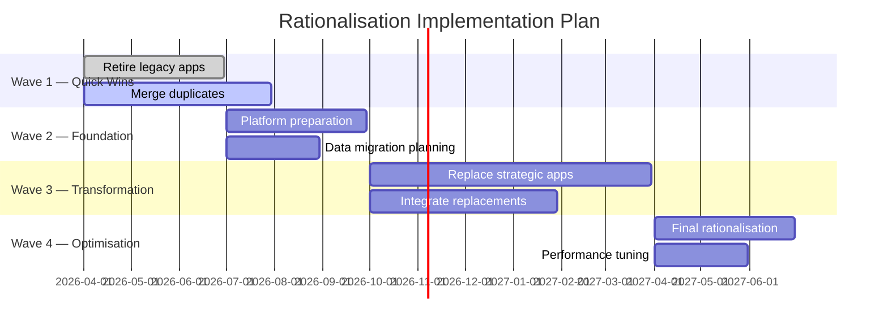

### Wave Details

| Wave               | Focus                                 | Duration   | Apps     | Key Milestone |
| ------------------ | ------------------------------------- | ---------- | -------- | ------------- |
| 1 — Quick Wins     | Low-risk retirements and clear merges | [N] months | [N] apps | [Milestone]   |
| 2 — Foundation     | Platform readiness and data prep      | [N] months | [N] apps | [Milestone]   |
| 3 — Transformation | Major replacements and migrations     | [N] months | [N] apps | [Milestone]   |
| 4 — Optimisation   | Final rationalisation and tuning      | [N] months | [N] apps | [Milestone]   |

## 7. Traceability

| Source Artifact           | Document               | Link/Reference         |
| ------------------------- | ---------------------- | ---------------------- |
| Application Portfolio     | `ARC-[P]-APP-v[N].md`  | [Direct reference]     |
| Business Capability Model | `ARC-[P]-BPCM-v[N].md` | [Capability alignment] |
| Architecture Principles   | `ARC-000-PRIN-v[N].md` | [Principle references] |
| Architecture Decisions    | `ARC-[P]-ADR-*.md`     | [Decision references]  |

## 8. Assumptions

1. [Application inventory is complete and up to date]
2. [Business sponsors will approve decisions within 30 days]
3. [Budget envelope of £[X] available for rationalisation programme]

## 9. Decisions Pending Approval

| Decision           | App       | Status                    | Required By  |
| ------------------ | --------- | ------------------------- | ------------ |
| [Pending decision] | [APP-XXX] | Awaiting sponsor approval | [YYYY-MM-DD] |

## 10. External References

> This section provides traceability from generated content back to source
> documents. Follow citation instructions in the project's citation reference
> guide.

### Document Register

| Doc ID          | Filename | Type | Source Location | Description |
| --------------- | -------- | ---- | --------------- | ----------- |
| _None provided_ | —        | —    | —               | —           |

### Citations

| Citation ID | Doc ID | Page/Section | Category | Quoted Passage |
| ----------- | ------ | ------------ | -------- | -------------- |
| —           | —      | —            | —        | —              |

### Unreferenced Documents

| Filename | Source Location | Reason |
| -------- | --------------- | ------ |
| —        | —               | —      |

---

**Generated by**: ArcKit `/arckit:application-rationalization` command
**Generated on**: `[DATE] [TIME] GMT` **ArcKit Version**: `{ARCKIT_VERSION}`
**Project**: `[PROJECT_NAME]` (Project `[PROJECT_ID]`) **AI Model**:
`[MODEL_NAME]` **Generation Context**: [Brief note about source documents used]

<!-- arckit-overlay-template: transition-architecture-template.md -->

---
title: "Transition Architecture"
docType: TRANS
templateVersion: "1.0"
---

# Transition Architecture

## Document Control

<!-- DOC-CONTROL-HEADER -->
<!-- Resolved at command-execution time per _partials/RENDERING.md. -->

### Revision History

| Version     | Date           | Author    | Description                                                     | Reviewer          | Approver          |
| ----------- | -------------- | --------- | --------------------------------------------------------------- | ----------------- | ----------------- |
| `[VERSION]` | `[YYYY-MM-DD]` | ArcKit AI | Initial creation from `/arckit:transition-architecture` command | `[REVIEWER_NAME]` | `[APPROVER_NAME]` |

---

## 1. Transition Overview

| Architecture              | Scope                                      | Duration   | Investment |
| ------------------------- | ------------------------------------------ | ---------- | ---------- |
| Architecture 1 (Baseline) | Current state — [brief description]        | —          | —          |
| Architecture 2            | [Wave 1 scope — key capabilities achieved] | [6 months] | [£X]       |
| Architecture 3            | [Wave 2 scope — key capabilities achieved] | [6 months] | [£X]       |
| Target Architecture       | Final state — [brief description]          | —          | —          |

### Transition Waves

**Wave 1 — [Wave Name]** (Architecture 2)

- **Objective**: [Brief objective of the wave]
- **Duration**: [Start] to [End] ([N] months)
- **Key Deliverables**:
  - [Deliverable 1]
  - [Deliverable 2]
  - [Deliverable 3]
- **Governance Gate**: [Gate name — e.g., "Wave 1 Complete — ARB review"]

**Wave 2 — [Wave Name]** (Architecture 3)

- **Objective**: [Brief objective of the wave]
- **Duration**: [Start] to [End] ([N] months)
- **Key Deliverables**:
  - [Deliverable 1]
  - [Deliverable 2]
  - [Deliverable 3]
- **Governance Gate**: [Gate name — e.g., "Wave 2 Complete — Steering Committee
  review"]

---

## 2. Work Packages

### WP-001: [Work Package Name]

- **Wave**: [Wave 1 / Architecture 2]
- **Scope**: [What this work package delivers — 2-3 sentence description]
- **Deliverables**:
  - [Deliverable 1 — concrete, artefact-level output]
  - [Deliverable 2]
  - [Deliverable 3]
- **Dependencies**: [WP-002 (must complete), ADR-001 (technology decision)]
- **Resources**: [X FTE across roles, £Y budget]
- **Timeline**: [Start date] → [End date] ([N] months)
- **GAPA Gaps addressed**: [G-001, G-003, G-005]
- **Acceptance Criteria**:
  - [Criterion 1 — measurable and testable, e.g., "API platform handles >=
    10,000 concurrent requests with < 200ms latency at 95th percentile"]
  - [Criterion 2 — e.g., "All critical data migrated with < 0.01% loss rate
    verified by reconciliation"]
  - [Criterion 3 — e.g., "Security baseline meets NCSC CAF Level 3
    requirements"]
  - [Criterion 4 — e.g., "UAT pass rate > 95% across all test cases"]

### WP-002: [Work Package Name]

- **Wave**: [Wave 1 / Architecture 2]
- **Scope**: [What this work package delivers]
- **Deliverables**:
  - [Deliverable 1]
  - [Deliverable 2]
- **Dependencies**: [WP-001, ADR-002]
- **Resources**: [X FTE across roles, £Y budget]
- **Timeline**: [Start date] → [End date] ([N] months)
- **GAPA Gaps addressed**: [G-002, G-004]
- **Acceptance Criteria**:
  - [Criterion 1]
  - [Criterion 2]
  - [Criterion 3]

### WP-003: [Work Package Name]

- **Wave**: [Wave 2 / Architecture 3]
- **Scope**: [What this work package delivers]
- **Deliverables**:
  - [Deliverable 1]
  - [Deliverable 2]
  - [Deliverable 3]
- **Dependencies**: [WP-001, WP-002]
- **Resources**: [X FTE across roles, £Y budget]
- **Timeline**: [Start date] → [End date] ([N] months)
- **GAPA Gaps addressed**: [G-006, G-007]
- **Acceptance Criteria**:
  - [Criterion 1]
  - [Criterion 2]
  - [Criterion 3]

### WP-004: [Work Package Name]

- **Wave**: [Wave 2 / Architecture 3]
- **Scope**: [What this work package delivers]
- **Deliverables**:
  - [Deliverable 1]
  - [Deliverable 2]
- **Dependencies**: [WP-002, WP-003]
- **Resources**: [X FTE across roles, £Y budget]
- **Timeline**: [Start date] → [End date] ([N] months)
- **GAPA Gaps addressed**: [G-008]
- **Acceptance Criteria**:
  - [Criterion 1]
  - [Criterion 2]

[Continue for additional work packages as needed — add WP-005, WP-006, etc.]

---

## 3. Work Package Dependencies

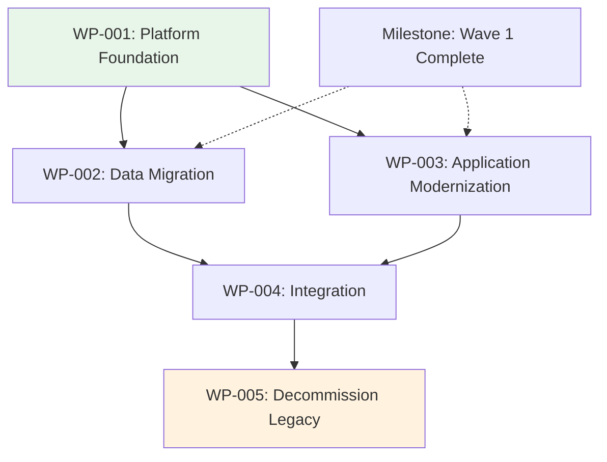

### Dependency Legend

- **Solid arrow** (`→`): Hard dependency — predecessor must complete before
  successor can begin
- **Dashed arrow** (`-.→`): Soft dependency — information flow or soft milestone
  alignment
- **Coloured nodes**: Wave assignment (green = Wave 1, orange = Wave 2, red =
  final)

---

## 4. Resource Plan

| Resource         | WP-001  | WP-002  | WP-003  | WP-004  | WP-005  |
| ---------------- | ------- | ------- | ------- | ------- | ------- |
| Architecture     | [X FTE] | [X FTE] | [X FTE] | [X FTE] | [X FTE] |
| Development      | [X FTE] | [X FTE] | [X FTE] | [X FTE] | [X FTE] |
| Data Engineering | [X FTE] | [X FTE] | [X FTE] | [X FTE] | —       |
| Security         | [X FTE] | [X FTE] | [X FTE] | [X FTE] | [X FTE] |
| Operations       | [X FTE] | [X FTE] | [X FTE] | [X FTE] | [X FTE] |
| Business Analyst | [X FTE] | [X FTE] | [X FTE] | [X FTE] | —       |
| QA/Testing       | —       | [X FTE] | [X FTE] | [X FTE] | [X FTE] |
| PMO              | [X FTE] | [X FTE] | [X FTE] | [X FTE] | [X FTE] |
| **Total FTE**    | **[X]** | **[X]** | **[X]** | **[X]** | **[X]** |

### Peak Resource Requirements

| Period          | Total FTE | Peak Resource Type               | Contention Risk   |
| --------------- | --------- | -------------------------------- | ----------------- |
| [Wave 1 period] | [X]       | [e.g., Development — 8 FTE]      | [Low/Medium/High] |
| [Wave 2 period] | [X]       | [e.g., Data Engineering — 5 FTE] | [Low/Medium/High] |

---

## 5. Risk & Contingency

| Risk ID | Risk                                                                | Likelihood | Impact   | WP Affected    | Contingency Plan                                                              | Trigger Conditions                               | Risk Owner                |
| ------- | ------------------------------------------------------------------- | ---------- | -------- | -------------- | ----------------------------------------------------------------------------- | ------------------------------------------------ | ------------------------- |
| R-001   | [Data migration timeline overrun due to legacy data quality issues] | Medium     | High     | WP-002         | [Extend WP-002 by 4 weeks; activate data cleansing sprint]                    | [Data quality scan reveals > 5% corruption rate] | [Lead Data Engineer]      |
| R-002   | [Key vendor delivery delay affecting platform readiness]            | Medium     | High     | WP-001         | [Engage secondary vendor; switch to open-source alternative]                  | [Vendor misses first milestone by > 2 weeks]     | [Technical Architect]     |
| R-003   | [Skills gap — insufficient cloud engineering capacity]              | High       | Medium   | WP-001, WP-003 | [Contract external cloud experts; fast-track internal training]               | [FTE gap > 30% of requirement]                   | [PMO Lead]                |
| R-004   | [Stakeholder resistance to application retirement]                  | Low        | Critical | WP-005         | [Escalate to steering committee; document risk of continued legacy operation] | [Sponsor blocks retirement decision]             | [Business Change Manager] |
| R-005   | [Security compliance deadline moved forward]                        | Low        | High     | WP-001, WP-004 | [Re-prioritise security work packages; parallelise Wave 1 activities]         | [Regulatory deadline accelerated > 3 months]     | [Security Architect]      |

---

## 6. Acceptance Criteria Summary

| Work Package | Criteria Count | Status  | Target Completion |
| ------------ | -------------- | ------- | ----------------- |
| WP-001       | [N]            | Pending | [Wave 1 end date] |
| WP-002       | [N]            | Pending | [Wave 1 end date] |
| WP-003       | [N]            | Pending | [Wave 2 end date] |
| WP-004       | [N]            | Pending | [Wave 2 end date] |
| WP-005       | [N]            | Pending | [Wave 2 end date] |

### Acceptance Gate Process

1. **Work Package Review**: Each work package lead confirms acceptance criteria
   readiness 2 weeks before target
2. **Architecture Review**: Architecture Board validates technical criteria at
   governance gate
3. **Independent Verification**: QA/Security teams independently verify
   measurable criteria
4. **Sign-off**: Documented sign-off from work package lead, architecture owner,
   and business sponsor
5. **Wave Gate**: All work package criteria for a wave must pass before
   proceeding to next wave

---

## 7. Traceability

### GAPA → TRANS Mapping

| GAPA Gap | Capability   | GAPA Workstream | TRANS Work Package | Transition Architecture |
| -------- | ------------ | --------------- | ------------------ | ----------------------- |
| G-001    | [Capability] | WS-001          | WP-001             | Architecture 2          |
| G-002    | [Capability] | WS-002          | WP-002             | Architecture 2          |
| G-003    | [Capability] | WS-001          | WP-001             | Architecture 2          |
| G-004    | [Capability] | WS-002          | WP-002             | Architecture 2          |
| G-005    | [Capability] | WS-003          | WP-003             | Architecture 3          |
| G-006    | [Capability] | WS-003          | WP-003             | Architecture 3          |
| G-007    | [Capability] | WS-004          | WP-004             | Architecture 3          |
| G-008    | [Capability] | WS-004          | WP-004             | Architecture 3          |

### ROAD → TRANS Alignment

| ROAD Theme | Roadmap Phase | TRANS Wave | Work Packages  |
| ---------- | ------------- | ---------- | -------------- |
| [Theme 1]  | [Phase X]     | Wave 1     | WP-001, WP-002 |
| [Theme 2]  | [Phase Y]     | Wave 2     | WP-003, WP-004 |
| [Theme 3]  | [Phase Z]     | Wave 1 → 2 | WP-005         |

### APPR → TRANS Integration

| APPR Decision | Application | TRANS Work Package | Migration Approach |
| ------------- | ----------- | ------------------ | ------------------ |
| Retire        | [App name]  | WP-005             | Decommission       |
| Replace       | [App name]  | WP-003             | Refactor           |
| Merge         | [App name]  | WP-004             | Consolidate        |

### Source Artefact Traceability

| Source Artifact             | Document               | Key Information Used                                     |
| --------------------------- | ---------------------- | -------------------------------------------------------- |
| Gap Analysis                | `ARC-[P]-GAPA-v[N].md` | Gaps, workstreams, severity scores, gap-to-risk mappings |
| Strategic Roadmap           | `ARC-[P]-ROAD-v[N].md` | Timeline, themes, investment envelopes, governance gates |
| Application Rationalisation | `ARC-[P]-APPR-v[N].md` | Application decisions, migration approaches, sequencing  |
| Architecture Decisions      | `ARC-[P]-ADR-*.md`     | Technology choices, platform decisions, constraints      |

---

## 8. Assumptions

1. [Gap analysis (GAPA) accurately reflects current state capabilities]
2. [Budget envelope of £[X] is confirmed for the transition programme]
3. [Key stakeholders will be available for governance gate reviews]
4. [No major regulatory changes affecting migration timeline during programme]
5. [Vendor commitments for platform delivery hold per contract terms]

## 9. Constraints

1. **Budget**: [Total programme budget cap of £[X]]
2. **Timeline**: [Must achieve target architecture by [date] due to [driver]]
3. **Skills**: [Limited cloud engineering capacity — max [X] FTE available
   internally]
4. **Technology**: [Legacy system end-of-support date: [date] — must migrate
   before]
5. **Compliance**: [Must achieve [standard] certification by [date]]

## 10. External References

> This section provides traceability from generated content back to source
> documents. Follow citation instructions in the project's citation reference
> guide.

### Document Register

| Doc ID          | Filename | Type | Source Location | Description |
| --------------- | -------- | ---- | --------------- | ----------- |
| _None provided_ | —        | —    | —               | —           |

### Citations

| Citation ID | Doc ID | Page/Section | Category | Quoted Passage |
| ----------- | ------ | ------------ | -------- | -------------- |
| —           | —      | —            | —        | —              |

### Unreferenced Documents

| Filename | Source Location | Reason |
| -------- | --------------- | ------ |
| —        | —               | —      |

---

**Generated by**: ArcKit `/arckit:transition-architecture` command **Generated
on**: `[DATE] [TIME] GMT` **ArcKit Version**: `{ARCKIT_VERSION}` **Project**:
`[PROJECT_NAME]` (Project `[PROJECT_ID]`) **AI Model**: `[MODEL_NAME]`
**Generation Context**: [Brief note about source documents used]
