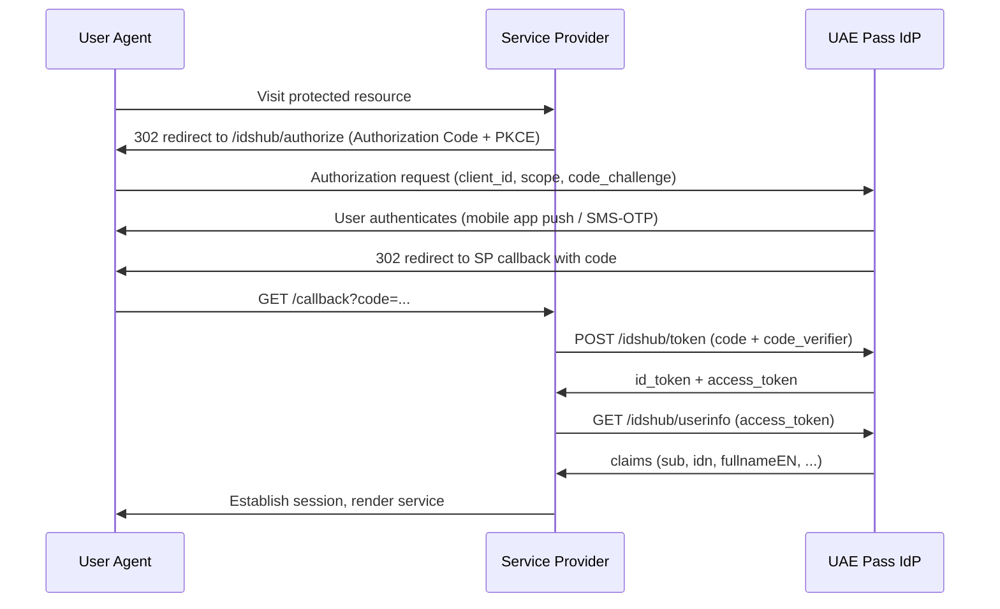

<!-- arckit-overlay-template: uae-ai-autonomy-tier-template.md -->

# UAE AI Autonomy Tier Posture

> **Template Origin**: Community | **ArcKit Version**: [VERSION] | **Command**:
> `/arckit:uae-ai-autonomy-tier`

## Document Control

<!-- DOC-CONTROL-HEADER -->
<!-- Resolved at command-execution time per _partials/RENDERING.md. -->

## Revision History

| Version   | Date         | Author    | Changes                                              | Approved By | Approval Date |
| --------- | ------------ | --------- | ---------------------------------------------------- | ----------- | ------------- |
| [VERSION] | [YYYY-MM-DD] | ArcKit AI | Initial creation from `/arckit:uae-ai-autonomy-tier` | [PENDING]   | [PENDING]     |

## Executive Summary

[Two to three paragraphs describing the AI use-cases in scope, the headline tier
mix, and any tier-promotion proposals.]

## AI Use-Case Inventory

| AI use-case ID | Use case   | Blast radius                      | Assigned tier              | Rationale   |
| -------------- | ---------- | --------------------------------- | -------------------------- | ----------- |
| [AI-001]       | [use case] | [internal / external / regulated] | [Tier 1 / Tier 2 / Tier 3] | [rationale] |

> Tier 1 = internal productivity; Tier 2 = investor-facing or external content
> with mandatory human approval before release; Tier 3 = regulated or financial
> decisions.

## Per-Tier Guard-Rail Matrix

| Guard-rail                | Tier 1 (internal-productivity) | Tier 2 (investor-facing-with-approval) | Tier 3 (regulated / financial) |
| ------------------------- | ------------------------------ | -------------------------------------- | ------------------------------ |
| Input filtering           | [policy]                       | [policy]                               | [policy]                       |
| Output filtering          | [policy]                       | [policy]                               | [policy]                       |
| Retrieval grounding       | [policy]                       | [policy]                               | [policy]                       |
| Hallucination controls    | [policy]                       | [policy]                               | [policy]                       |
| Refusal policy            | [policy]                       | [policy]                               | [policy]                       |
| Prompt-injection defences | [policy]                       | [policy]                               | [policy]                       |
| PII handling              | [policy]                       | [policy]                               | [policy]                       |

## Approval Gates per Tier

| Gate                              | Tier 1 | Tier 2                                     | Tier 3                                            |
| --------------------------------- | ------ | ------------------------------------------ | ------------------------------------------------- |
| Pre-deployment approval           | [role] | [role + risk committee]                    | [role + risk committee + regulator engagement]    |
| Pre-release approval (per change) | [role] | [role — mandatory human review of outputs] | [role + audit officer]                            |
| Material-model-change approval    | [role] | [role + risk committee]                    | [role + regulator notification, where applicable] |
| Decommissioning approval          | [role] | [role]                                     | [role + records retention sign-off]               |

## Audit Obligations per Tier

| Audit obligation              | Tier 1               | Tier 2                  | Tier 3                                               |
| ----------------------------- | -------------------- | ----------------------- | ---------------------------------------------------- |
| Log prompt + response         | [Y/N]                | [Y/N]                   | [Y/N — full transcript]                              |
| Log model version             | [Y/N]                | [Y/N]                   | [Y/N]                                                |
| Log retrieval context         | [Y/N]                | [Y/N]                   | [Y/N]                                                |
| Log human reviewer + decision | [N/A]                | [Y/N]                   | [Y/N — required]                                     |
| Retention period              | [period]             | [period]                | [period — typically longest]                         |
| Audit cadence                 | [Annual / Quarterly] | [Quarterly]             | [Monthly + on-incident]                              |
| Reporting line                | [role]               | [role + risk committee] | [role + audit officer + regulator, where applicable] |

## Tier-Promotion Criteria

Use-cases may NOT skip tiers. Promotion from Tier 1 to Tier 2, or Tier 2 to Tier
3, requires evidenced operation at the prior tier.

| Promotion path  | Criteria   | Evidence required |
| --------------- | ---------- | ----------------- |
| Tier 1 → Tier 2 | [criteria] | [evidence]        |
| Tier 2 → Tier 3 | [criteria] | [evidence]        |

## External References

### Document Register

| Doc ID              | Title                                                                | URL                                                                                                                      | Verified date |
| ------------------- | -------------------------------------------------------------------- | ------------------------------------------------------------------------------------------------------------------------ | ------------- |
| UAE-AI-CHARTER      | UAE Charter for the Development and Use of Artificial Intelligence   | <https://uaelegislation.gov.ae/en/policy/details/the-uae-charter-for-the-development-and-use-of-artificial-intelligence> | [YYYY-MM-DD]  |
| UAE-PDPL-FDL45-2021 | Federal Decree-Law No. 45 of 2021 on the Protection of Personal Data | <https://uaelegislation.gov.ae/en/legislations/1972/download>                                                            | [YYYY-MM-DD]  |

### Citations

| Citation | Doc ID              | Section                                     | Used in                                   |
| -------- | ------------------- | ------------------------------------------- | ----------------------------------------- |
| [AUTI-1] | UAE-AI-CHARTER      | Principle 6 (Human Oversight)               | Approval Gates per Tier                   |
| [AUTI-2] | UAE-AI-CHARTER      | Principle 7 (Governance and Accountability) | Audit Obligations per Tier                |
| [AUTI-3] | UAE-PDPL-FDL45-2021 | Article 7 (sensitive categories)            | Per-Tier Guard-Rail Matrix (PII handling) |

### Unreferenced Documents

[List any documents read during generation but not cited, or "None".]

---

**Generated by**: ArcKit `/arckit:uae-ai-autonomy-tier` command **Generated
on**: [DATE] **ArcKit Version**: [VERSION] **Project**: [PROJECT_NAME]
**Model**: [AI_MODEL]

<!-- arckit-overlay-template: uae-ai-charter-template.md -->

# UAE AI Charter Compliance Assessment

> **Template Origin**: Community | **ArcKit Version**: [VERSION] | **Command**:
> `/arckit:uae-ai-charter`

## Document Control

<!-- DOC-CONTROL-HEADER -->
<!-- Resolved at command-execution time per _partials/RENDERING.md. -->

## Revision History

| Version   | Date         | Author    | Changes                                        | Approved By | Approval Date |
| --------- | ------------ | --------- | ---------------------------------------------- | ----------- | ------------- |
| [VERSION] | [YYYY-MM-DD] | ArcKit AI | Initial creation from `/arckit:uae-ai-charter` | [PENDING]   | [PENDING]     |

## Executive Summary

[Two to three paragraphs describing the AI capabilities in scope, the headline
compliance posture against the 12 Charter principles, and any principle judged
non-compliant.]

## AI System Inventory

| AI system ID | Use case   | Model family | Vendor / source | Deployment mode                          | User population |
| ------------ | ---------- | ------------ | --------------- | ---------------------------------------- | --------------- |
| [AI-001]     | [use case] | [model]      | [vendor]        | [on-prem / sovereign-cloud / hosted-API] | [population]    |

## 12-Principle Assessment

| #  | Principle                     | Applies? | Evidence of compliance | Gap   | Mitigation   |
| -- | ----------------------------- | -------- | ---------------------- | ----- | ------------ |
| 1  | Human-Machine Ties            | [Y/N]    | [evidence]             | [gap] | [mitigation] |
| 2  | Safety                        | [Y/N]    | [evidence]             | [gap] | [mitigation] |
| 3  | Bias Mitigation               | [Y/N]    | [evidence]             | [gap] | [mitigation] |
| 4  | Data Privacy                  | [Y/N]    | [evidence]             | [gap] | [mitigation] |
| 5  | Transparency                  | [Y/N]    | [evidence]             | [gap] | [mitigation] |
| 6  | Human Oversight               | [Y/N]    | [evidence]             | [gap] | [mitigation] |
| 7  | Governance and Accountability | [Y/N]    | [evidence]             | [gap] | [mitigation] |
| 8  | Technological Excellence      | [Y/N]    | [evidence]             | [gap] | [mitigation] |
| 9  | Human Commitment              | [Y/N]    | [evidence]             | [gap] | [mitigation] |
| 10 | Peaceful Coexistence          | [Y/N]    | [evidence]             | [gap] | [mitigation] |
| 11 | Inclusive Access              | [Y/N]    | [evidence]             | [gap] | [mitigation] |
| 12 | Lawful Compliance             | [Y/N]    | [evidence]             | [gap] | [mitigation] |

## Bias & Fairness Assessment

| AI system ID | Protected attributes considered    | Fairness metric(s) measured                    | Dataset provenance | Mitigation taken | Residual risk |
| ------------ | ---------------------------------- | ---------------------------------------------- | ------------------ | ---------------- | ------------- |
| [AI-001]     | [age / gender / nationality / ...] | [demographic parity / equal opportunity / ...] | [provenance]       | [mitigation]     | [risk]        |

## Human-in-the-Loop Design

| AI system ID | Decision class | Reviewer role | Trigger for human review                         | Override mechanism | Audit trail of human decisions   |
| ------------ | -------------- | ------------- | ------------------------------------------------ | ------------------ | -------------------------------- |
| [AI-001]     | [class]        | [role]        | [confidence threshold / sensitive context / ...] | [override flow]    | [audit-log location + retention] |

## External References

### Document Register

| Doc ID         | Title                                                              | URL                                                                                                                      | Verified date |
| -------------- | ------------------------------------------------------------------ | ------------------------------------------------------------------------------------------------------------------------ | ------------- |
| UAE-AI-CHARTER | UAE Charter for the Development and Use of Artificial Intelligence | <https://uaelegislation.gov.ae/en/policy/details/the-uae-charter-for-the-development-and-use-of-artificial-intelligence> | [YYYY-MM-DD]  |

### Citations

| Citation | Doc ID         | Section                       | Used in                    |
| -------- | -------------- | ----------------------------- | -------------------------- |
| [AICH-1] | UAE-AI-CHARTER | Principle 3 (Bias Mitigation) | Bias & Fairness Assessment |
| [AICH-2] | UAE-AI-CHARTER | Principle 6 (Human Oversight) | Human-in-the-Loop Design   |
| [AICH-3] | UAE-AI-CHARTER | All 12 principles             | 12-Principle Assessment    |

### Unreferenced Documents

[List any documents read during generation but not cited, or "None".]

---

**Generated by**: ArcKit `/arckit:uae-ai-charter` command **Generated on**:
[DATE] **ArcKit Version**: [VERSION] **Project**: [PROJECT_NAME] **Model**:
[AI_MODEL]

<!-- arckit-overlay-template: uae-classification-template.md -->

# UAE Smart Data Classification Register

> **Template Origin**: Community | **ArcKit Version**: [VERSION] | **Command**:
> `/arckit:uae-classification`

## Document Control

<!-- DOC-CONTROL-HEADER -->
<!-- Resolved at command-execution time per _partials/RENDERING.md. -->

## Revision History

| Version   | Date         | Author    | Changes                                            | Approved By | Approval Date |
| --------- | ------------ | --------- | -------------------------------------------------- | ----------- | ------------- |
| [VERSION] | [YYYY-MM-DD] | ArcKit AI | Initial creation from `/arckit:uae-classification` | [PENDING]   | [PENDING]     |

## Executive Summary

[Two to three paragraphs describing the project's data estate, the proposed
classification posture across the four UAE Smart Data Framework classes (Open /
Confidential / Sensitive / Secret), and the residency implications that flow
from it.]

## Classification Levels Used

For each Smart Data Framework class (Open, Confidential, Sensitive, Secret),
state whether the project holds data at that level and the count of datasets per
level.

| Level        | Holds data? | Count | Notes   |
| ------------ | ----------- | ----- | ------- |
| Open         | [Y/N]       | [n]   | [notes] |
| Confidential | [Y/N]       | [n]   | [notes] |
| Sensitive    | [Y/N]       | [n]   | [notes] |
| Secret       | [Y/N]       | [n]   | [notes] |

## Dataset Register

| Dataset ID | Description   | Source system | Classification                             | Handling rules | Storage location | Declassification schedule |
| ---------- | ------------- | ------------- | ------------------------------------------ | -------------- | ---------------- | ------------------------- |
| [DS-001]   | [description] | [source]      | [Open / Confidential / Sensitive / Secret] | [rules]        | [location]       | [schedule]                |

## Handling Rules per Level

For each level the project uses, state the handling rules:

- Encryption at rest
- Encryption in transit
- Network controls (private endpoint, VPN, air-gap)
- Access controls (role, MFA, just-in-time)
- Audit-log retention
- Residency obligations (UAE-resident infrastructure required from Confidential
  upwards under National Cloud Security Policy v2)

## Cross-Reference Index

Map each Dataset ID to:

- Upstream BR / DR requirements that drove its capture
- Downstream INT requirements that consume it
- The applicable PDPL lawful basis (if personal data is in scope)

| Dataset ID | Upstream BR/DR   | Downstream INT | PDPL lawful basis (if applicable) |
| ---------- | ---------------- | -------------- | --------------------------------- |
| [DS-001]   | [BR-xxx, DR-xxx] | [INT-xxx]      | [Article 5(x) / N/A]              |

## External References

### Document Register

| Doc ID        | Title                                                                                                                                                      | URL                                                               | Verified date |
| ------------- | ---------------------------------------------------------------------------------------------------------------------------------------------------------- | ----------------------------------------------------------------- | ------------- |
| UAE-SMARTDATA | UAE Smart Data Framework, Part 1: Smart Data Principles and Standards (v2.0, February 2019) and Part 2: Smart Data Implementation Guide (v2.0, March 2019) | <https://u.ae/en/about-the-uae/digital-uae/data/data-operability> | [YYYY-MM-DD]  |

### Citations

| Citation | Doc ID        | Section                                                             | Used in                    |
| -------- | ------------- | ------------------------------------------------------------------- | -------------------------- |
| [SDC-1]  | UAE-SMARTDATA | Part 1, Data Classification Standard DC1; Part 2, Guidance Note 5.1 | Classification Levels Used |
| [SDC-2]  | UAE-SMARTDATA | Part 1, DC2 Rules for Opening and Sharing Classified Data           | Handling Rules per Level   |

### Unreferenced Documents

[List any documents read during generation but not cited, or "None".]

---

**Generated by**: ArcKit `/arckit:uae-classification` command **Generated on**:
[DATE] **ArcKit Version**: [VERSION] **Project**: [PROJECT_NAME] **Model**:
[AI_MODEL]

<!-- arckit-overlay-template: uae-cloud-residency-template.md -->

# UAE Sovereign Cloud Residency Assessment

> **Template Origin**: Community | **ArcKit Version**: [VERSION] | **Command**:
> `/arckit:uae-cloud-residency`

## Document Control

<!-- DOC-CONTROL-HEADER -->
<!-- Resolved at command-execution time per _partials/RENDERING.md. -->

## Revision History

| Version   | Date         | Author    | Changes                                             | Approved By | Approval Date |
| --------- | ------------ | --------- | --------------------------------------------------- | ----------- | ------------- |
| [VERSION] | [YYYY-MM-DD] | ArcKit AI | Initial creation from `/arckit:uae-cloud-residency` | [PENDING]   | [PENDING]     |

## Executive Summary

[Two to three paragraphs describing the residency posture, the chosen sovereign
cloud combination, residual non-compliance (if any), and the exit / portability
stance under the UAE National Cloud Security Policy v2.]

## Scope

| Item                          | Value                                                |
| ----------------------------- | ---------------------------------------------------- |
| Services in scope             | [list]                                               |
| Upstream dependencies         | [services / platforms]                               |
| Downstream dependencies       | [services / platforms]                               |
| Shared platform components    | [identity / observability / backup / secrets / etc.] |
| Out-of-scope (with rationale) | [list]                                               |

## Per-Dataset Residency Assessment

For each Dataset ID from the project's Smart Data Classification Register
(`ARC-<project-id>-CLAS-v*.md`), assess required and actual residency.

| Dataset ID | Classification                             | Required residency             | Chosen CSP                                                                                  | Region   | Compliance check                        |
| ---------- | ------------------------------------------ | ------------------------------ | ------------------------------------------------------------------------------------------- | -------- | --------------------------------------- |
| [DS-001]   | [Open / Confidential / Sensitive / Secret] | [UAE-resident / no constraint] | [Core42 / G42 / Microsoft UAE North / UAE Central / FedNet / e& Sovereign Launchpad / etc.] | [region] | [Compliant / Non-compliant — rationale] |

> Confidential, Sensitive, and Secret datasets MUST resolve to UAE-resident
> sovereign infrastructure under the National Cloud Security Policy v2. Any
> non-compliant row is a critical gap.

## CSP Due-Diligence Pack

For each candidate CSP, record the diligence posture.

### Core42 / G42 sovereign cloud

| Item                   | Value                       |
| ---------------------- | --------------------------- |
| Sovereign-data scope   | [in scope / out of scope]   |
| Regional footprint     | [Abu Dhabi / Dubai / other] |
| DESC accreditation     | [Y/N — date]                |
| CSC accreditation      | [Y/N — date]                |
| Documented limitations | [notes]                     |

### Microsoft UAE North (Dubai) and UAE Central (Abu Dhabi)

| Item                   | Value                            |
| ---------------------- | -------------------------------- |
| Sovereign-data scope   | [in scope / out of scope]        |
| Regional footprint     | [UAE North / UAE Central / both] |
| DESC accreditation     | [Y/N — date]                     |
| CSC accreditation      | [Y/N — date]                     |
| Documented limitations | [notes]                          |

### TDRA FedNet

| Item                   | Value                     |
| ---------------------- | ------------------------- |
| Sovereign-data scope   | [in scope / out of scope] |
| Regional footprint     | [federal data centre]     |
| Accreditation          | [TDRA — date]             |
| Documented limitations | [notes]                   |

### e& Sovereign Launchpad on AWS

| Item                   | Value                     |
| ---------------------- | ------------------------- |
| Sovereign-data scope   | [in scope / out of scope] |
| Regional footprint     | [me-central-1 / other]    |
| DESC accreditation     | [Y/N — date]              |
| CSC accreditation      | [Y/N — date]              |
| Documented limitations | [notes]                   |

> Add additional candidate CSPs (e.g. Oracle UAE, Google Cloud) using the same
> pattern.

## Shared-Responsibility Matrix

For the chosen CSP combination, record the division of security
responsibilities.

| Layer                                        | CSP responsibility | Customer responsibility | Notes                                    |
| -------------------------------------------- | ------------------ | ----------------------- | ---------------------------------------- |
| Physical and environmental                   | [scope]            | [scope]                 | [notes]                                  |
| Infrastructure (compute / storage / network) | [scope]            | [scope]                 | [notes]                                  |
| Platform (managed services)                  | [scope]            | [scope]                 | [notes]                                  |
| Application                                  | [scope]            | [scope]                 | [notes]                                  |
| Data and encryption keys                     | [scope]            | [scope]                 | [notes — BYOK / HYOK / customer-managed] |
| Identity and access                          | [scope]            | [scope]                 | [notes — UAE PASS / federation]          |
| Operations and monitoring                    | [scope]            | [scope]                 | [notes]                                  |

## Exit and Portability Plan

| Item                                       | Plan                                     |
| ------------------------------------------ | ---------------------------------------- |
| Data egress strategy                       | [export format, mechanism, owner]        |
| Format portability                         | [open formats / proprietary mitigations] |
| Identity migration                         | [plan]                                   |
| Encryption key custody on exit             | [HSM transfer / re-wrap / re-key]        |
| Contingency residency on regulatory change | [target alt CSP, migration runbook ref]  |
| Estimated exit time-to-restore             | [hours / days]                           |

## External References

### Document Register

| Doc ID      | Title                                                         | URL                                                                                 | Verified date |
| ----------- | ------------------------------------------------------------- | ----------------------------------------------------------------------------------- | ------------- |
| UAE-NCSP-V2 | UAE National Cloud Security Policy v2 (Cybersecurity Council) | <https://csc.gov.ae/documents/38662/489552/National+Cloud+Security+Policy_V2.0.pdf> | [YYYY-MM-DD]  |

### Citations

| Citation | Doc ID      | Section                                  | Used in                          |
| -------- | ----------- | ---------------------------------------- | -------------------------------- |
| [CRES-1] | UAE-NCSP-V2 | Per-classification residency obligations | Per-Dataset Residency Assessment |
| [CRES-2] | UAE-NCSP-V2 | Approved CSP scope                       | CSP Due-Diligence Pack           |
| [CRES-3] | UAE-NCSP-V2 | Shared responsibility expectations       | Shared-Responsibility Matrix     |

### Unreferenced Documents

[List any documents read during generation but not cited, or "None".]

---

**Generated by**: ArcKit `/arckit:uae-cloud-residency` command **Generated on**:
[DATE] **ArcKit Version**: [VERSION] **Project**: [PROJECT_NAME] **Model**:
[AI_MODEL]

<!-- arckit-overlay-template: uae-data-sharing-template.md -->

# UAE Data Sharing Agreement

> **Template Origin**: Community | **ArcKit Version**: [VERSION] | **Command**:
> `/arckit:uae-data-sharing`

## Document Control

<!-- DOC-CONTROL-HEADER -->
<!-- Resolved at command-execution time per _partials/RENDERING.md. -->

## Revision History

| Version   | Date         | Author    | Changes                                          | Approved By | Approval Date |
| --------- | ------------ | --------- | ------------------------------------------------ | ----------- | ------------- |
| [VERSION] | [YYYY-MM-DD] | ArcKit AI | Initial creation from `/arckit:uae-data-sharing` | [PENDING]   | [PENDING]     |

## Executive Summary

[Two to three paragraphs describing the data shares this agreement covers, the
parties involved, and how the agreement honours the "collect once, use securely"
principle.]

## Sharing Parties

| Role     | Entity           | Joint controller? | Operational owner | Contact   |
| -------- | ---------------- | ----------------- | ----------------- | --------- |
| Provider | [federal entity] | [Y/N]             | [role]            | [contact] |
| Consumer | [federal entity] | [Y/N]             | [role]            | [contact] |

| Service-level commitment   | Value    |
| -------------------------- | -------- |
| Availability               | [%]      |
| Latency (P95)              | [ms]     |
| Support hours              | [window] |
| Change notification window | [days]   |

## Datasets Shared

| Share ID  | Dataset ID (CLAS ref) | Classification (CLAS)                      | Direction                             | Volume           | Frequency                    | Personal data? |
| --------- | --------------------- | ------------------------------------------ | ------------------------------------- | ---------------- | ---------------------------- | -------------- |
| [SHR-001] | [DS-001]              | [Open / Confidential / Sensitive / Secret] | [provider → consumer / bidirectional] | [n records / GB] | [real-time / hourly / daily] | [Y/N]          |

> Cross-reference every Dataset ID to the CLAS register. If a dataset is not yet
> in CLAS, flag this as a prerequisite.

## Lawful Basis per Share

For every share involving personal data, cite the PDPL Article 5 lawful basis
(or Article 6 consent) and the PDPL artefact entry.

| Share ID  | PDPL lawful basis (Article)        | Justification   | PDPL artefact ref         |
| --------- | ---------------------------------- | --------------- | ------------------------- |
| [SHR-001] | [Article 5(x) / Article 6 consent] | [justification] | [PDPL artefact + section] |

## Federation / API Mechanism

| Share ID  | Mechanism                                               | Authentication               | Integrity           | Rate limiting | Schema reference                  |
| --------- | ------------------------------------------------------- | ---------------------------- | ------------------- | ------------- | --------------------------------- |
| [SHR-001] | [REST API / event stream / file drop / federated query] | [mTLS / OAuth2 / signed JWT] | [signing / hashing] | [limits]      | [OpenAPI / AsyncAPI / schema URL] |

## Information-Security Safeguards

| Safeguard             | Provider obligation    | Consumer obligation    | Joint obligation         |
| --------------------- | ---------------------- | ---------------------- | ------------------------ |
| Encryption in transit | [TLS 1.3 / mTLS]       | [TLS 1.3 / mTLS]       | [shared trust store]     |
| Encryption at rest    | [AES-256]              | [AES-256]              | —                        |
| Key management        | [KMS — provider-owned] | [KMS — consumer-owned] | [rotation cadence]       |
| Access controls       | [RBAC]                 | [RBAC]                 | —                        |
| Audit logging         | [retention + format]   | [retention + format]   | [reconciliation cadence] |
| Incident response     | [obligations]          | [obligations]          | [joint runbook]          |

## Data-Subject Rights Implications

| Right         | Party owning the obligation | Cross-party flow           | SLA   |
| ------------- | --------------------------- | -------------------------- | ----- |
| Access        | [provider / consumer]       | [downstream notification?] | [SLA] |
| Rectification | [provider / consumer]       | [propagation?]             | [SLA] |
| Erasure       | [provider / consumer]       | [propagation + audit?]     | [SLA] |
| Restriction   | [provider / consumer]       | [flag propagation?]        | [SLA] |
| Portability   | [provider / consumer]       | [export format]            | [SLA] |
| Object        | [provider / consumer]       | [stop propagation?]        | [SLA] |

## External References

### Document Register

| Doc ID              | Title                                                                | URL                                                                                              | Verified date |
| ------------------- | -------------------------------------------------------------------- | ------------------------------------------------------------------------------------------------ | ------------- |
| UAE-CAB-2026-04-23  | UAE Cabinet meeting — Government Services Data Sharing Policy        | <https://mediaoffice.ae/en/news/2026/april/23-04/mohammed-bin-rashid-chairs-uae-cabinet-meeting> | [YYYY-MM-DD]  |
| UAE-PDPL-FDL45-2021 | Federal Decree-Law No. 45 of 2021 on the Protection of Personal Data | <https://uaelegislation.gov.ae/en/legislations/1972/download>                                    | [YYYY-MM-DD]  |

### Citations

| Citation | Doc ID              | Section                                | Used in                         |
| -------- | ------------------- | -------------------------------------- | ------------------------------- |
| [DSHR-1] | UAE-CAB-2026-04-23  | "Collect once, use securely" principle | Sharing Parties                 |
| [DSHR-2] | UAE-CAB-2026-04-23  | Data Sharing Policy obligations        | Information-Security Safeguards |
| [DSHR-3] | UAE-PDPL-FDL45-2021 | Article 5 (lawful processing)          | Lawful Basis per Share          |

### Unreferenced Documents

[List any documents read during generation but not cited, or "None".]

---

**Generated by**: ArcKit `/arckit:uae-data-sharing` command **Generated on**:
[DATE] **ArcKit Version**: [VERSION] **Project**: [PROJECT_NAME] **Model**:
[AI_MODEL]

<!-- arckit-overlay-template: uae-digital-records-template.md -->

# UAE Digital Records Plan

> **Template Origin**: Community | **ArcKit Version**: [VERSION] | **Command**:
> `/arckit:uae-digital-records`

## Document Control

<!-- DOC-CONTROL-HEADER -->
<!-- Resolved at command-execution time per _partials/RENDERING.md. -->

## Revision History

| Version   | Date         | Author    | Changes                                             | Approved By | Approval Date |
| --------- | ------------ | --------- | --------------------------------------------------- | ----------- | ------------- |
| [VERSION] | [YYYY-MM-DD] | ArcKit AI | Initial creation from `/arckit:uae-digital-records` | [PENDING]   | [PENDING]     |

## Executive Summary

[Two to three paragraphs describing the records that the service creates or
consumes, the source-of-truth posture, and the records-as-official-source
designation under the UAE Digital Records Policy.]

## Source-of-Truth Register

| Record type   | Authoritative system | Custodian entity                 | Record ID scheme | Notes   |
| ------------- | -------------------- | -------------------------------- | ---------------- | ------- |
| [record type] | [system]             | [federal entity / business unit] | [ID scheme]      | [notes] |

## Retention Schedule

| Record type   | Retention period | Authority (law / regulation / policy) | Disposal trigger | Disposal method                      |
| ------------- | ---------------- | ------------------------------------- | ---------------- | ------------------------------------ |
| [record type] | [duration]       | [citation]                            | [trigger]        | [secure deletion / archive transfer] |

## Records-as-Official-Source Designation

| Record type   | Designated official source? | Integrity control                                | Evidence of compliance |
| ------------- | --------------------------- | ------------------------------------------------ | ---------------------- |
| [record type] | [Y/N]                       | [hash / WORM / signed audit trail / e-signature] | [evidence ref]         |

> Where a record type is _not_ designated the official source, state the
> rationale and the legacy paper or alternative system that retains the
> designation.

## Records Lifecycle

| Lifecycle stage | Where implemented           | CLAS classification (cross-ref)            | Notes                                                              |
| --------------- | --------------------------- | ------------------------------------------ | ------------------------------------------------------------------ |
| Capture         | [system / journey]          | [Open / Confidential / Sensitive / Secret] | [notes]                                                            |
| Classification  | [system]                    | [classification]                           | [cross-ref to CLAS Dataset ID]                                     |
| Storage         | [system / region]           | [classification]                           | [residency note — see the CRES residency assessment if applicable] |
| Access          | [system / IAM model]        | [classification]                           | [notes]                                                            |
| Retention       | [retention store / archive] | [classification]                           | [retention period]                                                 |
| Disposal        | [process]                   | [classification]                           | [disposal evidence]                                                |

## Audit & Disposal Procedures

### Periodic Audit

| Aspect            | Detail                                                        |
| ----------------- | ------------------------------------------------------------- |
| Cadence           | [Monthly / Quarterly / Annual]                                |
| Sampling approach | [random / risk-based]                                         |
| Integrity checks  | [hash verification / signature verification / WORM read-back] |
| Owner             | [role]                                                        |
| Evidence storage  | [where audit reports live]                                    |

### Controlled Disposal

| Aspect                      | Detail                                   |
| --------------------------- | ---------------------------------------- |
| Approver                    | [role]                                   |
| Disposal evidence captured  | [certificate / log / signed attestation] |
| Disposal evidence retention | [period]                                 |
| Reversibility window        | [if applicable]                          |

## External References

### Document Register

| Doc ID             | Title                                                                                    | URL                                                                                                                                                                                                                            | Verified date |
| ------------------ | ---------------------------------------------------------------------------------------- | ------------------------------------------------------------------------------------------------------------------------------------------------------------------------------------------------------------------------------ | ------------- |
| UAE-CAB-2026-04-23 | UAE Cabinet meeting, 23 April 2026 — Government Services Digital Records Policy approved | <https://uaecabinet.ae/en/news/under-directives-of-uae-president-and-in-world-first-mohammed-bin-rashid-reveals-new-uae-government-framework-to-deploy-agentic-ai-across-50-of-government-sectors-operations-within-two-years> | [YYYY-MM-DD]  |

### Citations

| Citation | Doc ID             | Section                       | Used in                                |
| -------- | ------------------ | ----------------------------- | -------------------------------------- |
| [DREC-1] | UAE-CAB-2026-04-23 | Digital Records Policy        | Records-as-Official-Source Designation |
| [DREC-2] | UAE-CAB-2026-04-23 | Records lifecycle obligations | Records Lifecycle                      |

### Unreferenced Documents

[List any documents read during generation but not cited, or "None".]

---

**Generated by**: ArcKit `/arckit:uae-digital-records` command **Generated on**:
[DATE] **ArcKit Version**: [VERSION] **Project**: [PROJECT_NAME] **Model**:
[AI_MODEL]

<!-- arckit-overlay-template: uae-ias-template.md -->

# UAE IAS Statement of Applicability

> **Template Origin**: Community | **ArcKit Version**: [VERSION] | **Command**:
> `/arckit:uae-ias`

## Document Control

<!-- DOC-CONTROL-HEADER -->
<!-- Resolved at command-execution time per _partials/RENDERING.md. -->

## Revision History

| Version   | Date         | Author    | Changes                                 | Approved By | Approval Date |
| --------- | ------------ | --------- | --------------------------------------- | ----------- | ------------- |
| [VERSION] | [YYYY-MM-DD] | ArcKit AI | Initial creation from `/arckit:uae-ias` | [PENDING]   | [PENDING]     |

## Executive Summary

[Two to three paragraphs describing the system in scope, the IAS applicability
assessment, and the headline implementation posture across the 188 controls.]

## Scope

| Item                          | Value                                                                                                                     |
| ----------------------------- | ------------------------------------------------------------------------------------------------------------------------- |
| Federal entity                | [name]                                                                                                                    |
| CII sector (if applicable)    | [energy / water / telecoms / finance / transport / government / health / food and agriculture / emergency services / N/A] |
| In-scope information systems  | [list]                                                                                                                    |
| In-scope information assets   | [list]                                                                                                                    |
| Out-of-scope (with rationale) | [list]                                                                                                                    |
| Assessment basis              | [self-assessment / internal audit / external audit]                                                                       |

## Statement of Applicability

### Management controls (M1–M6, 60 controls)

| Control ID | Description                                  | Priority (P1–P4) | Applicable (Y/N) | Implementation status                           | Owner   | Evidence ref   |
| ---------- | -------------------------------------------- | ---------------- | ---------------- | ----------------------------------------------- | ------- | -------------- |
| M1.1       | [strategy and planning control description]  | [P1–P4]          | [Y/N]            | [Implemented / Partial / Not Implemented / N/A] | [owner] | [evidence ref] |
| M2.1       | [risk management control description]        | [P1–P4]          | [Y/N]            | [status]                                        | [owner] | [evidence ref] |
| M3.1       | [awareness and training control description] | [P1–P4]          | [Y/N]            | [status]                                        | [owner] | [evidence ref] |
| M4.1       | [HR security control description]            | [P1–P4]          | [Y/N]            | [status]                                        | [owner] | [evidence ref] |
| M5.1       | [compliance control description]             | [P1–P4]          | [Y/N]            | [status]                                        | [owner] | [evidence ref] |
| M6.1       | [performance evaluation control description] | [P1–P4]          | [Y/N]            | [status]                                        | [owner] | [evidence ref] |

### Technical controls (T1–T9, 128 controls)

| Control ID | Description                                             | Priority (P1–P4) | Applicable (Y/N) | Implementation status | Owner   | Evidence ref   |
| ---------- | ------------------------------------------------------- | ---------------- | ---------------- | --------------------- | ------- | -------------- |
| T1.1       | [asset management control description]                  | [P1–P4]          | [Y/N]            | [status]              | [owner] | [evidence ref] |
| T2.1       | [physical and environmental control description]        | [P1–P4]          | [Y/N]            | [status]              | [owner] | [evidence ref] |
| T3.1       | [operations management control description]             | [P1–P4]          | [Y/N]            | [status]              | [owner] | [evidence ref] |
| T4.1       | [communications control description]                    | [P1–P4]          | [Y/N]            | [status]              | [owner] | [evidence ref] |
| T5.1       | [access control description]                            | [P1–P4]          | [Y/N]            | [status]              | [owner] | [evidence ref] |
| T6.1       | [third party security control description]              | [P1–P4]          | [Y/N]            | [status]              | [owner] | [evidence ref] |
| T7.1       | [systems acquisition / development control description] | [P1–P4]          | [Y/N]            | [status]              | [owner] | [evidence ref] |
| T8.1       | [incident management control description]               | [P1–P4]          | [Y/N]            | [status]              | [owner] | [evidence ref] |
| T9.1       | [systems continuity control description]                | [P1–P4]          | [Y/N]            | [status]              | [owner] | [evidence ref] |

> Expand the table rows so every applicable IAS control across M1–M6 and T1–T9
> is enumerated. Priority tiers are cumulative — a P1 commitment must be met
> before P2.

## Risk Treatment Plan

For every control with status "Partial" or "Not Implemented", record the gap,
the residual risk, the remediation plan, the owner, and the target date.

| Gap ref       | Control ID | Residual risk | Remediation plan | Owner   | Target date  |
| ------------- | ---------- | ------------- | ---------------- | ------- | ------------ |
| [GAP-IAS-001] | [control]  | [risk]        | [plan]           | [owner] | [YYYY-MM-DD] |

## CII Registration

If the in-scope system is designated Critical Information Infrastructure under
the UAE Cybersecurity Council framework, record:

| Item                 | Value          |
| -------------------- | -------------- |
| CII designation      | [Y/N]          |
| Sector               | [sector]       |
| CSC registration ID  | [id / PENDING] |
| Sector regulator     | [name]         |
| Latest audit date    | [YYYY-MM-DD]   |
| Next mandatory audit | [YYYY-MM-DD]   |

If not designated CII, state "Not designated CII as of [date]" and record the
rationale.

## External References

### Document Register

| Doc ID  | Title                                                      | URL                                                          | Verified date |
| ------- | ---------------------------------------------------------- | ------------------------------------------------------------ | ------------- |
| UAE-IAS | UAE Information Assurance Standard (Cybersecurity Council) | <https://csc.gov.ae/en/w/uae-information-assurance-standard> | [YYYY-MM-DD]  |

### Citations

| Citation | Doc ID  | Section                   | Used in                                          |
| -------- | ------- | ------------------------- | ------------------------------------------------ |
| [IAS-1]  | UAE-IAS | Management controls M1–M6 | Statement of Applicability — Management controls |
| [IAS-2]  | UAE-IAS | Technical controls T1–T9  | Statement of Applicability — Technical controls  |
| [IAS-3]  | UAE-IAS | Priority tiering P1–P4    | Statement of Applicability                       |

### Unreferenced Documents

[List any documents read during generation but not cited, or "None".]

---

**Generated by**: ArcKit `/arckit:uae-ias` command **Generated on**: [DATE]
**ArcKit Version**: [VERSION] **Project**: [PROJECT_NAME] **Model**: [AI_MODEL]

<!-- arckit-overlay-template: uae-pdpl-template.md -->

# UAE PDPL Compliance Assessment

> **Template Origin**: Community | **ArcKit Version**: [VERSION] | **Command**:
> `/arckit:uae-pdpl`

## Document Control

<!-- DOC-CONTROL-HEADER -->
<!-- Resolved at command-execution time per _partials/RENDERING.md. -->

## Revision History

| Version   | Date         | Author    | Changes                                  | Approved By | Approval Date |
| --------- | ------------ | --------- | ---------------------------------------- | ----------- | ------------- |
| [VERSION] | [YYYY-MM-DD] | ArcKit AI | Initial creation from `/arckit:uae-pdpl` | [PENDING]   | [PENDING]     |

## Executive Summary

[Two to three paragraphs describing the personal-data processing, the PDPL
applicability assessment, and the headline compliance posture.]

## Scope

| Item                        | Value                                                            |
| --------------------------- | ---------------------------------------------------------------- |
| Controller                  | [name]                                                           |
| Processor(s)                | [names]                                                          |
| Joint controllers           | [names if applicable]                                            |
| Categories of data subjects | [employees / citizens / customers / etc.]                        |
| Categories of personal data | [identifiers / sensitive (Article 7) / financial / etc.]         |
| Out-of-scope (free zones)   | DIFC DPL: [Y/N], ADGM DPR: [Y/N], healthcare under ADHICS: [Y/N] |

## Lawful Basis Register

| Processing activity | Lawful basis (Article)             | Justification   | Notes   |
| ------------------- | ---------------------------------- | --------------- | ------- |
| [activity]          | [Article 5(x) / Article 6 consent] | [justification] | [notes] |

## Data Subject Rights Procedure

For each right state the channel, the response SLA, and the operational owner.

| Right                  | Channel   | Response SLA | Owner   |
| ---------------------- | --------- | ------------ | ------- |
| Access                 | [channel] | [SLA]        | [owner] |
| Rectification          | [channel] | [SLA]        | [owner] |
| Erasure                | [channel] | [SLA]        | [owner] |
| Restriction            | [channel] | [SLA]        | [owner] |
| Portability            | [channel] | [SLA]        | [owner] |
| Object                 | [channel] | [SLA]        | [owner] |
| Withdraw consent       | [channel] | [SLA]        | [owner] |
| Complain (Data Office) | [channel] | [SLA]        | [owner] |

## DPIA

| DPIA trigger (Article 21)        | Applies? | Mitigation   |
| -------------------------------- | -------- | ------------ |
| New technology                   | [Y/N]    | [mitigation] |
| Large-scale processing           | [Y/N]    | [mitigation] |
| Profiling / automated decisions  | [Y/N]    | [mitigation] |
| Systematic monitoring            | [Y/N]    | [mitigation] |
| Sensitive categories (Article 7) | [Y/N]    | [mitigation] |

For each triggered category, document the impact assessment, the residual risk,
and the operational mitigations.

## Cross-Border Transfers

| Destination | Mechanism (Article 22 / 23)                 | Review date  | Owner   |
| ----------- | ------------------------------------------- | ------------ | ------- |
| [country]   | [adequate / written agreement / derogation] | [YYYY-MM-DD] | [owner] |

## Breach Notification Playbook

State the trigger criteria, the Data Office notification SLA, the data-subject
notification trigger, and the operational owner for PDPL Article 9 obligations.

## Penalties (informational only)

Reference the current administrative fines per the applicable Cabinet
Resolution. This section is informational and is not used for compliance
scoring.

## External References

### Document Register

| Doc ID              | Title                                                                | URL                                                           | Verified date |
| ------------------- | -------------------------------------------------------------------- | ------------------------------------------------------------- | ------------- |
| UAE-PDPL-FDL45-2021 | Federal Decree-Law No. 45 of 2021 on the Protection of Personal Data | <https://uaelegislation.gov.ae/en/legislations/1972/download> | [YYYY-MM-DD]  |

**PDPL Executive Regulations**: [Cabinet resolution number and date / none
located] — verified as of [YYYY-MM-DD] against the UAE Legislation portal.

### Citations

| Citation | Doc ID              | Section    | Used in                      |
| -------- | ------------------- | ---------- | ---------------------------- |
| [PDPL-1] | UAE-PDPL-FDL45-2021 | Article 5  | Lawful Basis Register        |
| [PDPL-2] | UAE-PDPL-FDL45-2021 | Article 21 | DPIA                         |
| [PDPL-3] | UAE-PDPL-FDL45-2021 | Article 22 | Cross-Border Transfers       |
| [PDPL-4] | UAE-PDPL-FDL45-2021 | Article 9  | Breach Notification Playbook |

### Unreferenced Documents

[List any documents read during generation but not cited, or "None".]

---

**Generated by**: ArcKit `/arckit:uae-pdpl` command **Generated on**: [DATE]
**ArcKit Version**: [VERSION] **Project**: [PROJECT_NAME] **Model**: [AI_MODEL]

<!-- arckit-overlay-template: uae-priorities-alignment-template.md -->

# UAE National Priorities Alignment Statement

> **Template Origin**: Community | **ArcKit Version**: [VERSION] | **Command**:
> `/arckit:uae-priorities-alignment`

## Document Control

<!-- DOC-CONTROL-HEADER -->
<!-- Resolved at command-execution time per _partials/RENDERING.md. -->

## Revision History

| Version   | Date         | Author    | Changes                                                  | Approved By | Approval Date |
| --------- | ------------ | --------- | -------------------------------------------------------- | ----------- | ------------- |
| [VERSION] | [YYYY-MM-DD] | ArcKit AI | Initial creation from `/arckit:uae-priorities-alignment` | [PENDING]   | [PENDING]     |

## Executive Summary

[Two to three paragraphs describing how the project aligns with the four federal
strategies, the headline reuse-vs-build posture, and the resource-efficiency
outcome.]

## Strategic Alignment Matrix

| Federal strategy                              | Relevant pillar / programme | Project contribution | KPI / metric |
| --------------------------------------------- | --------------------------- | -------------------- | ------------ |
| We the UAE 2031                               | [pillar]                    | [contribution]       | [KPI]        |
| National Investment Strategy 2031 (NIS 2031)  | [pillar]                    | [contribution]       | [KPI]        |
| UAE Strategy for Artificial Intelligence 2031 | [pillar]                    | [contribution]       | [KPI]        |
| UAE Digital Economy Strategy                  | [pillar]                    | [contribution]       | [KPI]        |

## Reuse-vs-Build Justification

For every major capability the project requires, evaluate whether a
federally-provided shared service exists and either adopt it or justify the
build decision.

| Capability                      | Federal shared service available?                        | Decision (Reuse / Build) | Justification   | Risk if rejected |
| ------------------------------- | -------------------------------------------------------- | ------------------------ | --------------- | ---------------- |
| Identity (citizens / residents) | UAE Pass                                                 | [Reuse / Build]          | [justification] | [risk]           |
| Inter-entity connectivity       | FedNet                                                   | [Reuse / Build]          | [justification] | [risk]           |
| Hosting                         | UAE government cloud (per the CRES residency assessment) | [Reuse / Build]          | [justification] | [risk]           |
| Notifications (SMS / email)     | [federal provider]                                       | [Reuse / Build]          | [justification] | [risk]           |
| Payments                        | [federal payment gateway]                                | [Reuse / Build]          | [justification] | [risk]           |
| Data exchange                   | Government Services Data Sharing capability              | [Reuse / Build]          | [justification] | [risk]           |

> Build decisions must explicitly defend the rejection of the federal shared
> service. Where the shared service is incomplete or unsuitable, document the
> gap and the proposed reuse trajectory.

## Capability Reuse Register

| Capability   | Federal provider | Integration mode                     | Onboarding status              | Cost saving evidence |
| ------------ | ---------------- | ------------------------------------ | ------------------------------ | -------------------- |
| [capability] | [provider]       | [API / federation / managed service] | [PENDING / IN PROGRESS / LIVE] | [reference]          |

## Resource-Efficiency Calculation

| Capability   | Reuse baseline cost | Build alternative cost | Lifecycle (years) | Net saving |
| ------------ | ------------------- | ---------------------- | ----------------- | ---------- |
| [capability] | [AED]               | [AED]                  | [n]               | [AED]      |

| Total programme reuse saving | [AED] |
| ---------------------------- | ----- |

> Costs include capex, opex, and decommissioning. State the discount rate and
> the assumptions under each calculation.

## Feasibility & Pilot Plan

| Capability   | Feasibility assessment            | Pilot scope | Pilot success criteria | Phased rollout sequence |
| ------------ | --------------------------------- | ----------- | ---------------------- | ----------------------- |
| [capability] | [Green / Amber / Red — rationale] | [scope]     | [criteria]             | [phase 1 → 2 → 3]       |

## External References

### Document Register

| Doc ID             | Title                                                                                                           | URL                                                                                                                                       | Verified date |
| ------------------ | --------------------------------------------------------------------------------------------------------------- | ----------------------------------------------------------------------------------------------------------------------------------------- | ------------- |
| UAE-CAB-2026-04-23 | UAE Cabinet meeting — Federal Government Guide to Aligning Digital Government Projects with National Priorities | <https://mediaoffice.ae/en/news/2026/april/23-04/mohammed-bin-rashid-chairs-uae-cabinet-meeting>                                          | [YYYY-MM-DD]  |
| UAE-WTU-2031       | We the UAE 2031 vision                                                                                          | <https://u.ae/en/about-the-uae/strategies-initiatives-and-awards/strategies-plans-and-visions/finance-and-economy/we-the-uae-2031-vision> | [YYYY-MM-DD]  |
| UAE-AI-2031        | UAE Strategy for Artificial Intelligence 2031                                                                   | [URL]                                                                                                                                     | [YYYY-MM-DD]  |
| UAE-NIS-2031       | UAE National Investment Strategy 2031                                                                           | [URL]                                                                                                                                     | [YYYY-MM-DD]  |
| UAE-DES            | UAE Digital Economy Strategy                                                                                    | [URL]                                                                                                                                     | [YYYY-MM-DD]  |

### Citations

| Citation | Doc ID             | Section                  | Used in                      |
| -------- | ------------------ | ------------------------ | ---------------------------- |
| [NPRA-1] | UAE-CAB-2026-04-23 | Federal Government Guide | Reuse-vs-Build Justification |
| [NPRA-2] | UAE-WTU-2031       | [pillar]                 | Strategic Alignment Matrix   |
| [NPRA-3] | UAE-AI-2031        | [pillar]                 | Strategic Alignment Matrix   |
| [NPRA-4] | UAE-NIS-2031       | [pillar]                 | Strategic Alignment Matrix   |
| [NPRA-5] | UAE-DES            | [pillar]                 | Strategic Alignment Matrix   |

### Unreferenced Documents

[List any documents read during generation but not cited, or "None".]

---

**Generated by**: ArcKit `/arckit:uae-priorities-alignment` command **Generated
on**: [DATE] **ArcKit Version**: [VERSION] **Project**: [PROJECT_NAME]
**Model**: [AI_MODEL]

<!-- arckit-overlay-template: uae-procurement-template.md -->

# UAE Federal Procurement Strategy

> **Template Origin**: Community | **ArcKit Version**: [VERSION] | **Command**:
> `/arckit:uae-procurement`

## Document Control

<!-- DOC-CONTROL-HEADER -->
<!-- Resolved at command-execution time per _partials/RENDERING.md. -->

## Revision History

| Version   | Date         | Author    | Changes                                         | Approved By | Approval Date |
| --------- | ------------ | --------- | ----------------------------------------------- | ----------- | ------------- |
| [VERSION] | [YYYY-MM-DD] | ArcKit AI | Initial creation from `/arckit:uae-procurement` | [PENDING]   | [PENDING]     |

## Executive Summary

[Two to three paragraphs describing the procurement scope, value bracket, route
to market, and ICV target.]

## Procurement Strategy

| Item                           | Value                                                   |
| ------------------------------ | ------------------------------------------------------- |
| Procuring entity               | [federal entity]                                        |
| Scope                          | [scope of works / goods / services]                     |
| Estimated value (AED)          | [value bracket]                                         |
| Route to market                | [Open / Restricted / Direct award / Framework call-off] |
| Justification under Decree-Law | [reference to relevant article]                         |
| Procurement platform           | UAE Digital Procurement Platform (DPP)                  |
| Off-platform derogation?       | [N / Y — derogation reference]                          |
| Indicative timeline            | [milestones — issue, Q&A, response, evaluation, award]  |
| Headline risks                 | [risks]                                                 |

## ITT / RFP Pack Outline (DPP-aligned)

| Section                         | Content                                                                                  |
| ------------------------------- | ---------------------------------------------------------------------------------------- |
| Cover page                      | Procuring entity, procurement reference, issue date, response deadline                   |
| Instructions to bidders         | Submission channel (DPP), format, language, validity period, clarifications process      |
| Scope of work                   | Detailed description of works / goods / services                                         |
| Technical specification         | Functional and non-functional requirements (cross-reference REQ artefact)                |
| Mandatory requirements          | Pass/fail items (compliance, certifications, references)                                 |
| Desirable requirements          | Scored items                                                                             |
| ICV obligations                 | Target score, evidence requirements, post-award reporting                                |
| Evaluation criteria and weights | Technical / commercial / ICV weights and sub-weights                                     |
| Contract terms                  | Standard federal terms, SLAs, change-control, exit, IP, data protection                  |
| Response forms                  | Form A — bidder details; Form B — pricing; Form C — ICV declaration; Form D — references |

## ICV Plan

| Item                                   | Value                                                          |
| -------------------------------------- | -------------------------------------------------------------- |
| ICV scoring framework                  | [reference to MoF ICV methodology version]                     |
| Target ICV score for this procurement  | [percentage]                                                   |
| Bidder evidence required at submission | [audited ICV certificate / declarations / supporting evidence] |
| Verification                           | [pre-award verification process]                               |
| Post-award reporting                   | [cadence and format]                                           |
| Penalties for under-performance        | [contractual remedies]                                         |

## Evaluation Methodology

| Item                              | Value                                                                                 |
| --------------------------------- | ------------------------------------------------------------------------------------- |
| Score model                       | Technical [%] / Commercial [%] / ICV [%]                                              |
| Pass/fail thresholds              | [thresholds for mandatory criteria]                                                   |
| Panel composition                 | [roles — chair, technical lead, finance lead, ICV lead]                               |
| Independence                      | [independence from bidding pool — declarations]                                       |
| Conflict-of-interest declarations | [process]                                                                             |
| Evaluation report structure       | Executive summary, methodology, individual bidder scores, recommendation, dissent log |
| Approver                          | [role — typically procurement committee]                                              |

## Contract Register Schema

The federal entity will maintain the following columns in the contract register
for each award arising from this procurement:

| Column                        | Description                                       |
| ----------------------------- | ------------------------------------------------- |
| Contract ID                   | Stable identifier                                 |
| Supplier                      | Awarded supplier name + commercial registration   |
| Value                         | Contract value (AED)                              |
| Term                          | Start date, end date, extension options           |
| ICV target                    | Target score per contract                         |
| ICV actual (latest reporting) | Current measured ICV score                        |
| Performance KPIs              | KPI list with thresholds                          |
| Renewal trigger date          | Date by which renewal/exit decision must be taken |
| Owner                         | Federal entity contract owner                     |

## External References

### Document Register

| Doc ID              | Title                                                                           | URL                                                                                                                      | Verified date |
| ------------------- | ------------------------------------------------------------------------------- | ------------------------------------------------------------------------------------------------------------------------ | ------------- |
| UAE-FPRO-FDL11-2023 | UAE Federal Decree-Law No. 11 of 2023 on Procurements in the Federal Government | <https://mof.gov.ae/wp-content/uploads/2024/01/Federal-Law-No.-11-of-2023-on-Procurements-in-the-Federal-Government.pdf> | [YYYY-MM-DD]  |

### Citations

| Citation | Doc ID              | Section                                 | Used in                |
| -------- | ------------------- | --------------------------------------- | ---------------------- |
| [FPRO-1] | UAE-FPRO-FDL11-2023 | Routes to market                        | Procurement Strategy   |
| [FPRO-2] | UAE-FPRO-FDL11-2023 | Digital Procurement Platform obligation | Procurement Strategy   |
| [FPRO-3] | UAE-FPRO-FDL11-2023 | Evaluation and award                    | Evaluation Methodology |
| [FPRO-4] | UAE-FPRO-FDL11-2023 | In-Country Value                        | ICV Plan               |

### Unreferenced Documents

[List any documents read during generation but not cited, or "None".]

---

**Generated by**: ArcKit `/arckit:uae-procurement` command **Generated on**:
[DATE] **ArcKit Version**: [VERSION] **Project**: [PROJECT_NAME] **Model**:
[AI_MODEL]

<!-- arckit-overlay-template: uae-uaepass-template.md -->

# UAE Pass Integration Design

> **Template Origin**: Community | **ArcKit Version**: [VERSION] | **Command**:
> `/arckit:uae-uaepass`

## Document Control

<!-- DOC-CONTROL-HEADER -->
<!-- Resolved at command-execution time per _partials/RENDERING.md. -->

## Revision History

| Version   | Date         | Author    | Changes                                     | Approved By | Approval Date |
| --------- | ------------ | --------- | ------------------------------------------- | ----------- | ------------- |
| [VERSION] | [YYYY-MM-DD] | ArcKit AI | Initial creation from `/arckit:uae-uaepass` | [PENDING]   | [PENDING]     |

## Executive Summary

[Two to three paragraphs describing the service's UAE Pass integration posture:
which user journeys authenticate with UAE Pass, the chosen profile mix (Basic vs
Verified), and any e-signature obligations.]

## Scope

| Item                                              | Value                                         |
| ------------------------------------------------- | --------------------------------------------- |
| Federal entity (Service Provider)                 | [name]                                        |
| In-scope user journeys                            | [list]                                        |
| User populations                                  | [citizens / residents / visitors / employees] |
| Out-of-scope journeys (with rationale)            | [list]                                        |
| Service Provider category (TDRA / ICP onboarding) | [Public / Private / Government]               |

## Authentication Flow Diagram

## Profile Selection (Basic vs Verified)

| User journey | Profile required   | Rationale   | Upgrade path if user arrives Basic-only      |
| ------------ | ------------------ | ----------- | -------------------------------------------- |
| [journey]    | [Basic / Verified] | [rationale] | [redirect to UAE Pass kiosk / video-KYC URL] |

> Verified profile requires prior Emirates ID verification. Basic profile is
> sufficient for read-only and low-assurance journeys; Verified is required for
> KYC-bound transactions and for any flow that uses UAE Pass e-signature.

## Claim Mapping

| UAE Pass claim      | SP user-record field   | Required? | Consent / privacy note                               |
| ------------------- | ---------------------- | --------- | ---------------------------------------------------- |
| `sub`               | `external_subject_id`  | Y         | Stable subject identifier — primary join key         |
| `idn` (Emirates ID) | `emirates_id`          | [Y/N]     | Personal data — PDPL Article 5 lawful basis required |
| `fullnameEN`        | `name_en`              | [Y/N]     | [note]                                               |
| `fullnameAR`        | `name_ar`              | [Y/N]     | [note]                                               |
| `mobile`            | `mobile`               | [Y/N]     | [note]                                               |
| `email`             | `email`                | [Y/N]     | [note]                                               |
| `nationalityEN`     | `nationality_en`       | [Y/N]     | [note]                                               |
| `nationalityAR`     | `nationality_ar`       | [Y/N]     | [note]                                               |
| `gender`            | `gender`               | [Y/N]     | [note]                                               |
| `dob`               | `date_of_birth`        | [Y/N]     | Sensitive — minimise retention                       |
| `profileType`       | `uaepass_profile_type` | Y         | Discriminates Basic vs Verified                      |

## Service Provider Onboarding Checklist

| Onboarding artefact                                     | Status           | Owner   | Notes   |
| ------------------------------------------------------- | ---------------- | ------- | ------- |
| Sandbox client credentials issued                       | [PENDING / DONE] | [owner] | [notes] |
| Production credentials request submitted                | [PENDING / DONE] | [owner] | [notes] |
| Callback URL allow-list registered                      | [PENDING / DONE] | [owner] | [notes] |
| Branding pack supplied (logo, service name AR/EN)       | [PENDING / DONE] | [owner] | [notes] |
| Security review completed (TDRA / ICP)                  | [PENDING / DONE] | [owner] | [notes] |
| Privacy notice updated to disclose UAE Pass claim usage | [PENDING / DONE] | [owner] | [notes] |
| Go-live readiness review                                | [PENDING / DONE] | [owner] | [notes] |

## E-signature Audit Trail Design

For every journey that invokes the UAE Pass e-signature endpoint, record:

| Field                             | Source                                       | Storage                       | Retention |
| --------------------------------- | -------------------------------------------- | ----------------------------- | --------- |
| Signed document hash              | SP-computed (SHA-256) before signing request | [WORM store / records system] | [period]  |
| Signed document (PDF/A)           | UAE Pass signing response                    | [WORM store]                  | [period]  |
| Signer subject identifier (`sub`) | UAE Pass `id_token`                          | [audit log]                   | [period]  |
| Emirates ID (`idn`)               | UAE Pass `id_token` (Verified only)          | [audit log — encrypted]       | [period]  |
| Signature timestamp               | UAE Pass response                            | [audit log]                   | [period]  |
| Certificate chain                 | UAE Pass response                            | [audit log]                   | [period]  |
| User consent artefact             | SP-captured before signing                   | [audit log]                   | [period]  |

State the legal-effect citation supporting non-repudiation of the signed
artefact under UAE law.

## External References

### Document Register

| Doc ID       | Title                            | URL                        | Verified date |
| ------------ | -------------------------------- | -------------------------- | ------------- |
| UAE-PASS-DEV | UAE Pass Developer Documentation | <https://docs.uaepass.ae/> | [YYYY-MM-DD]  |

### Citations

| Citation  | Doc ID       | Section                 | Used in                               |
| --------- | ------------ | ----------------------- | ------------------------------------- |
| [UPASS-1] | UAE-PASS-DEV | Authorization Code flow | Authentication Flow Diagram           |
| [UPASS-2] | UAE-PASS-DEV | Profile types           | Profile Selection (Basic vs Verified) |
| [UPASS-3] | UAE-PASS-DEV | UserInfo claims         | Claim Mapping                         |
| [UPASS-4] | UAE-PASS-DEV | E-signature endpoint    | E-signature Audit Trail Design        |

### Unreferenced Documents

[List any documents read during generation but not cited, or "None".]

---

**Generated by**: ArcKit `/arckit:uae-uaepass` command **Generated on**: [DATE]
**ArcKit Version**: [VERSION] **Project**: [PROJECT_NAME] **Model**: [AI_MODEL]

<!-- arckit-overlay-template: uae-zero-bureaucracy-template.md -->

# UAE Zero Bureaucracy Service Catalogue Review

> **Template Origin**: Community | **ArcKit Version**: [VERSION] | **Command**:
> `/arckit:uae-zero-bureaucracy`

## Document Control

<!-- DOC-CONTROL-HEADER -->
<!-- Resolved at command-execution time per _partials/RENDERING.md. -->

## Revision History

| Version   | Date         | Author    | Changes                                              | Approved By | Approval Date |
| --------- | ------------ | --------- | ---------------------------------------------------- | ----------- | ------------- |
| [VERSION] | [YYYY-MM-DD] | ArcKit AI | Initial creation from `/arckit:uae-zero-bureaucracy` | [PENDING]   | [PENDING]     |

## Executive Summary

[Two to three paragraphs describing the federal entity's service portfolio in
scope, the headline reduction commitments under Zero Bureaucracy, and the
alignment with the UAE Code for Government Services principles.]

## Service Catalogue Mapping

| Service ID | Service name | Customer journey | Federal catalogue ID | Channel(s)                               | Zero Bureaucracy status                 |
| ---------- | ------------ | ---------------- | -------------------- | ---------------------------------------- | --------------------------------------- |
| [SVC-001]  | [name]       | [journey]        | [catalogue ID]       | [digital / branch / kiosk / call-centre] | [Not Started / In Progress / Compliant] |

## Bureaucracy Elimination Baseline

For each service, capture the current state and the committed target across the
four bureaucracy dimensions.

| Service ID | Steps (current → target) | Fields (current → target) | Time to outcome (current → target) | Customer cost (current → target) | Target date  |
| ---------- | ------------------------ | ------------------------- | ---------------------------------- | -------------------------------- | ------------ |
| [SVC-001]  | [n → n]                  | [n → n]                   | [duration → duration]              | [AED → AED]                      | [YYYY-MM-DD] |

> Baseline metrics must be evidenced — record the data source (ticket system,
> journey analytics, customer surveys) and the measurement window.

| Service ID | Baseline data source | Measurement window |
| ---------- | -------------------- | ------------------ |
| [SVC-001]  | [source]             | [from – to]        |

## Customer Experience KPIs

| KPI              | Definition                                   | Baseline | Target | Reporting cadence | Owner   |
| ---------------- | -------------------------------------------- | -------- | ------ | ----------------- | ------- |
| CSAT             | Customer satisfaction (1–5) post-transaction | [n]      | [n]    | Monthly           | [owner] |
| NPS              | Net Promoter Score                           | [n]      | [n]    | Monthly           | [owner] |
| First-Time Right | % transactions completed without rework      | [n %]    | [n %]  | Monthly           | [owner] |
| Digital Adoption | % transactions completed via digital channel | [n %]    | [n %]  | Monthly           | [owner] |
| Failure Demand   | % contacts caused by service failure         | [n %]    | [n %]  | Monthly           | [owner] |

## Code Compliance Statement

| Code principle                             | Evidence of compliance | Gap / remediation |
| ------------------------------------------ | ---------------------- | ----------------- |
| Proactive (anticipates customer need)      | [evidence]             | [gap]             |
| Omni-channel (consistent across channels)  | [evidence]             | [gap]             |
| Personalised (uses known customer context) | [evidence]             | [gap]             |
| Simple (minimum effort, plain language)    | [evidence]             | [gap]             |
| Fast (delivered without delay)             | [evidence]             | [gap]             |

## External References

### Document Register

| Doc ID             | Title                                                                   | URL                                                                                              | Verified date |
| ------------------ | ----------------------------------------------------------------------- | ------------------------------------------------------------------------------------------------ | ------------- |
| UAE-CAB-2026-04-23 | UAE Cabinet meeting — Code for Government Services and Zero Bureaucracy | <https://mediaoffice.ae/en/news/2026/april/23-04/mohammed-bin-rashid-chairs-uae-cabinet-meeting> | [YYYY-MM-DD]  |

### Citations

| Citation | Doc ID             | Section                                 | Used in                          |
| -------- | ------------------ | --------------------------------------- | -------------------------------- |
| [ZBUR-1] | UAE-CAB-2026-04-23 | Code for Government Services principles | Code Compliance Statement        |
| [ZBUR-2] | UAE-CAB-2026-04-23 | Zero Bureaucracy programme              | Bureaucracy Elimination Baseline |

### Unreferenced Documents

[List any documents read during generation but not cited, or "None".]

---

**Generated by**: ArcKit `/arckit:uae-zero-bureaucracy` command **Generated
on**: [DATE] **ArcKit Version**: [VERSION] **Project**: [PROJECT_NAME]
**Model**: [AI_MODEL]
