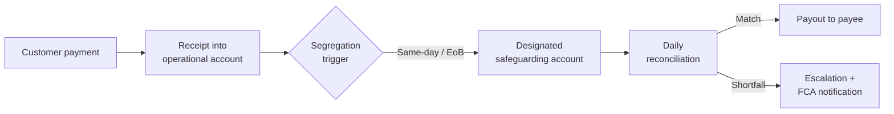

<!-- arckit-overlay-template: uk-fs-consumer-duty-board-report-template.md -->

## FCA Consumer Duty Annual Board Report — {{REPORTING_YEAR}}

**Firm**: {{FIRM_NAME}} **FRN**: {{FRN}} **Board meeting date**:
{{BOARD_MEETING_DATE}} **Reporting period**: {{REPORTING_PERIOD_START}} to
{{REPORTING_PERIOD_END}}

### Board Attestation

The Board has reviewed the Consumer Duty assessment and confirms that the firm:

- [ ] Has identified the retail products and services in scope of the Duty
- [ ] Has assessed outcomes against the four outcomes (Products & Services,
      Price & Value, Consumer Understanding, Consumer Support)
- [ ] Has acted to address harm and improve outcomes where identified
- [ ] Has met its obligations under Principle 12 and PRIN 2A

**Attested by**: {{SMF3_CEO_NAME}}, {{SMF7_GROUP_ENTITY_SM_NAME}},
{{OTHER_SMF_NAMES}} **Date**: {{ATTESTATION_DATE}}

<!-- These placeholders pull from §§2-5 of the master template — keep values consistent. -->

### Outcome Summary Table

| Outcome                | Status (Green / Amber / Red) | Key evidence            | Material change since prior year | Forward action        |
| ---------------------- | ---------------------------- | ----------------------- | -------------------------------- | --------------------- |
| Products & Services    | {{PS_OUTCOME_STATUS}}        | {{PS_OUTCOME_EVIDENCE}} | {{PS_OUTCOME_CHANGE}}            | {{PS_OUTCOME_ACTION}} |
| Price & Value          | {{PV_OUTCOME_STATUS}}        | {{PV_OUTCOME_EVIDENCE}} | {{PV_OUTCOME_CHANGE}}            | {{PV_OUTCOME_ACTION}} |
| Consumer Understanding | {{CU_OUTCOME_STATUS}}        | {{CU_OUTCOME_EVIDENCE}} | {{CU_OUTCOME_CHANGE}}            | {{CU_OUTCOME_ACTION}} |
| Consumer Support       | {{CS_OUTCOME_STATUS}}        | {{CS_OUTCOME_EVIDENCE}} | {{CS_OUTCOME_CHANGE}}            | {{CS_OUTCOME_ACTION}} |

### Foreseeable Harms Status

| Harm ID       | Description            | Severity            | Mitigation            | Residual            | Owner            |
| ------------- | ---------------------- | ------------------- | --------------------- | ------------------- | ---------------- |
| {{HARM_1_ID}} | {{HARM_1_DESCRIPTION}} | {{HARM_1_SEVERITY}} | {{HARM_1_MITIGATION}} | {{HARM_1_RESIDUAL}} | {{HARM_1_OWNER}} |

<!-- Add additional harm rows as needed -->

### Vulnerable Customer Cohort Summary

{{VULNERABLE_CUSTOMER_SUMMARY}}

### Forward Plan ({{NEXT_REPORTING_YEAR}})

1. {{BOARD_FORWARD_ACTION_1}}
2. {{BOARD_FORWARD_ACTION_2}}
3. {{BOARD_FORWARD_ACTION_3}}

<!-- Add additional forward actions as needed -->

<!-- arckit-overlay-template: uk-fs-consumer-duty-template.md -->

# FCA Consumer Duty Annual Board Report

> **Template Origin**: Community | **ArcKit Version**: [VERSION] | **Command**:
> `/arckit:uk-fs-consumer-duty`

## Document Control

<!-- DOC-CONTROL-HEADER -->
<!-- Resolved at command-execution time per _partials/RENDERING.md. -->

<!-- Domain-specific fields, retained after the resolved header per the Document Control Standard. -->

| Field                                         | Value                                                  |
| --------------------------------------------- | ------------------------------------------------------ |
| **Reporting Period**                          | {{REPORTING_PERIOD_START}} to {{REPORTING_PERIOD_END}} |
| **Firm Legal Name**                           | {{FIRM_LEGAL_NAME}}                                    |
| **FCA Firm Reference Number**                 | {{FCA_FRN}}                                            |
| **Consumer Duty in-force date for this firm** | {{CONSUMER_DUTY_IN_FORCE_DATE}}                        |

## Revision History

| Version | Date             | Author    | Changes                                                     | Approved By | Approval Date |
| ------- | ---------------- | --------- | ----------------------------------------------------------- | ----------- | ------------- |
| 1.0     | {{CREATED_DATE}} | ArcKit AI | Initial creation from `/arckit:uk-fs-consumer-duty` command | PENDING     | PENDING       |

<!-- Add additional rows as needed -->

---

## Executive Summary

{{EXECUTIVE_SUMMARY_PARAGRAPH_1}}

{{EXECUTIVE_SUMMARY_PARAGRAPH_2}}

{{EXECUTIVE_SUMMARY_PARAGRAPH_3}}

> ⚠️ This document is a **working artefact** — not a final regulatory
> submission. All Consumer Duty assessments must be reviewed and signed off by
> qualified UK FS regulatory counsel, the firm's Compliance Officer, the firm's
> MLRO (where the vulnerable-customer identification methodology or
> price-personalisation logic intersects with AML risk profiling or
> customer-onboarding flows), and the SMF holders who will attest the report
> before Board presentation. Regulatory citations reflect the position as at the
> document creation date; verify against current FCA publications — including
> any updated FG22/5 guidance or board-report observations — before reliance.

---

## 1. Firm and Product Context

### 1.1 Firm Authorisation Details

| Field                                 | Value                                                 |
| ------------------------------------- | ----------------------------------------------------- |
| **Legal entity name**                 | {{FIRM_LEGAL_NAME}}                                   |
| **FCA Firm Reference Number**         | {{FCA_FRN}}                                           |
| **Authorisation / registration type** | {{FIRM_AUTHORISATION_TYPE}}                           |
| **Consumer Duty in-force date**       | {{CONSUMER_DUTY_IN_FORCE_DATE}}                       |
| **SMF holder (Compliance Oversight)** | {{SMF_COMPLIANCE_NAME}} — {{SMF_COMPLIANCE_FUNCTION}} |
| **SMF holder (CEO / most senior)**    | {{SMF_CEO_NAME}} — {{SMF_CEO_FUNCTION}}               |

### 1.2 In-Scope Retail Products

{{IN_SCOPE_RETAIL_PRODUCTS_NARRATIVE}}

| Product / Service  | Channel               | Retail customers (approx.)   | Consumer Duty in-force date | Notes               |
| ------------------ | --------------------- | ---------------------------- | --------------------------- | ------------------- |
| {{PRODUCT_1_NAME}} | {{PRODUCT_1_CHANNEL}} | {{PRODUCT_1_CUSTOMER_COUNT}} | {{PRODUCT_1_IN_FORCE_DATE}} | {{PRODUCT_1_NOTES}} |
| {{PRODUCT_2_NAME}} | {{PRODUCT_2_CHANNEL}} | {{PRODUCT_2_CUSTOMER_COUNT}} | {{PRODUCT_2_IN_FORCE_DATE}} | {{PRODUCT_2_NOTES}} |
| {{PRODUCT_3_NAME}} | {{PRODUCT_3_CHANNEL}} | {{PRODUCT_3_CUSTOMER_COUNT}} | {{PRODUCT_3_IN_FORCE_DATE}} | {{PRODUCT_3_NOTES}} |

<!-- Add additional rows as needed -->

### 1.3 Out-of-Scope Services

The following products or channels are **out of scope** for this Board Report
and the reason:

{{OUT_OF_SCOPE_NARRATIVE}}

### 1.4 Customer Population Overview

| Customer segment   | Approximate size   | Primary use case       | Vulnerability indicator (if known) |
| ------------------ | ------------------ | ---------------------- | ---------------------------------- |
| {{SEGMENT_1_NAME}} | {{SEGMENT_1_SIZE}} | {{SEGMENT_1_USE_CASE}} | {{SEGMENT_1_VULNERABILITY}}        |
| {{SEGMENT_2_NAME}} | {{SEGMENT_2_SIZE}} | {{SEGMENT_2_USE_CASE}} | {{SEGMENT_2_VULNERABILITY}}        |
| {{SEGMENT_3_NAME}} | {{SEGMENT_3_SIZE}} | {{SEGMENT_3_USE_CASE}} | {{SEGMENT_3_VULNERABILITY}}        |

<!-- Add additional rows as needed -->

---

## 2. Outcome 1: Products and Services

### 2.1 Target Market Assessment

**Target market definition**: {{TARGET_MARKET_DEFINITION}}

| Criterion                                                    | Assessment                          | Evidence                                |
| ------------------------------------------------------------ | ----------------------------------- | --------------------------------------- |
| Who the product is designed for                              | {{TARGET_MARKET_DESIGNED_FOR}}      | {{TARGET_MARKET_DESIGNED_FOR_EVIDENCE}} |
| Who the product is NOT suitable for (negative target market) | {{NEGATIVE_TARGET_MARKET}}          | {{NEGATIVE_TARGET_MARKET_EVIDENCE}}     |
| Distribution strategy alignment                              | {{DISTRIBUTION_STRATEGY_ALIGNMENT}} | {{DISTRIBUTION_STRATEGY_EVIDENCE}}      |
| Product review cycle                                         | {{PRODUCT_REVIEW_CYCLE}}            | {{PRODUCT_REVIEW_EVIDENCE}}             |

### 2.2 Distribution Strategy

{{DISTRIBUTION_STRATEGY_NARRATIVE}}

### 2.3 Foreseeable Harms — Products and Services

The following foreseeable harms were identified at the Products and Services
design level. Full harm entries are in §7.

| Harm ID          | Brief description         | Severity               | Status               |
| ---------------- | ------------------------- | ---------------------- | -------------------- |
| {{PS_HARM_1_ID}} | {{PS_HARM_1_DESCRIPTION}} | {{PS_HARM_1_SEVERITY}} | {{PS_HARM_1_STATUS}} |
| {{PS_HARM_2_ID}} | {{PS_HARM_2_DESCRIPTION}} | {{PS_HARM_2_SEVERITY}} | {{PS_HARM_2_STATUS}} |

<!-- Add additional rows as needed -->

### 2.4 Products and Services Outcome Assessment

**Overall status**: {{PS_OUTCOME_STATUS}} (Green / Amber / Red)

{{PS_OUTCOME_NARRATIVE}}

---

## 3. Outcome 2: Price and Value

### 3.1 Fair-Value Assessment Methodology

{{FAIR_VALUE_METHODOLOGY_NARRATIVE}}

The firm's fair-value framework operates as follows:

| Element                            | Detail                             |
| ---------------------------------- | ---------------------------------- |
| **Fair-value review cadence**      | {{FAIR_VALUE_REVIEW_CADENCE}}      |
| **Fair-value committee / owner**   | {{FAIR_VALUE_COMMITTEE}}           |
| **Benchmarking approach**          | {{BENCHMARKING_APPROACH}}          |
| **Comparator firms used**          | {{COMPARATOR_FIRMS}}               |
| **Cross-subsidisation assessment** | {{CROSS_SUBSIDISATION_ASSESSMENT}} |

### 3.2 Total Cost to Consumer

| Fee type                      | Amount / rate       | Frequency                     | Consumer impact (annual estimate) | Notes                     |
| ----------------------------- | ------------------- | ----------------------------- | --------------------------------- | ------------------------- |
| Transaction fee               | {{TRANSACTION_FEE}} | {{TRANSACTION_FEE_FREQUENCY}} | {{TRANSACTION_FEE_ANNUAL_IMPACT}} | {{TRANSACTION_FEE_NOTES}} |
| FX spread mark-up             | {{FX_SPREAD}}       | Per FX transaction            | {{FX_SPREAD_ANNUAL_IMPACT}}       | {{FX_SPREAD_NOTES}}       |
| Account maintenance fee       | {{ACCOUNT_FEE}}     | {{ACCOUNT_FEE_FREQUENCY}}     | {{ACCOUNT_FEE_ANNUAL_IMPACT}}     | {{ACCOUNT_FEE_NOTES}}     |
| Inactivity / dormancy fee     | {{INACTIVITY_FEE}}  | {{INACTIVITY_FEE_FREQUENCY}}  | {{INACTIVITY_FEE_ANNUAL_IMPACT}}  | {{INACTIVITY_FEE_NOTES}}  |
| Ancillary charges (list each) | {{ANCILLARY_FEE}}   | {{ANCILLARY_FEE_FREQUENCY}}   | {{ANCILLARY_FEE_ANNUAL_IMPACT}}   | {{ANCILLARY_FEE_NOTES}}   |

<!-- Add additional rows as needed -->

**Total average annual cost per retail customer**: {{TOTAL_AVERAGE_ANNUAL_COST}}

### 3.3 Benchmarking Results

{{BENCHMARKING_RESULTS_NARRATIVE}}

### 3.4 Fair-Value Statement

{{FAIR_VALUE_STATEMENT}}

> The Board is asked to confirm that it is satisfied this fair-value statement
> is supported by the evidence in §3.2 and §3.3 before attesting to Outcome 2.

### 3.5 Price and Value Outcome Assessment

**Overall status**: {{PV_OUTCOME_STATUS}} (Green / Amber / Red)

{{PV_OUTCOME_NARRATIVE}}

---

## 4. Outcome 3: Consumer Understanding

### 4.1 Communications Testing

{{COMMUNICATIONS_TESTING_NARRATIVE}}

| Communication   | Testing method    | Sample size       | Comprehension rate       | Pass / fail       | Remediation action |
| --------------- | ----------------- | ----------------- | ------------------------ | ----------------- | ------------------ |
| {{COMM_1_NAME}} | {{COMM_1_METHOD}} | {{COMM_1_SAMPLE}} | {{COMM_1_COMPREHENSION}} | {{COMM_1_RESULT}} | {{COMM_1_ACTION}}  |
| {{COMM_2_NAME}} | {{COMM_2_METHOD}} | {{COMM_2_SAMPLE}} | {{COMM_2_COMPREHENSION}} | {{COMM_2_RESULT}} | {{COMM_2_ACTION}}  |
| {{COMM_3_NAME}} | {{COMM_3_METHOD}} | {{COMM_3_SAMPLE}} | {{COMM_3_COMPREHENSION}} | {{COMM_3_RESULT}} | {{COMM_3_ACTION}}  |

<!-- Add additional rows as needed -->

### 4.2 Disclosure Design Review

{{DISCLOSURE_DESIGN_NARRATIVE}}

### 4.3 Pre-Contract Information

{{PRE_CONTRACT_INFO_NARRATIVE}}

### 4.4 Consumer Understanding Outcome Assessment

**Overall status**: {{CU_OUTCOME_STATUS}} (Green / Amber / Red)

{{CU_OUTCOME_NARRATIVE}}

---

## 5. Outcome 4: Consumer Support

### 5.1 Service-Level Evidence

| Channel             | Average response time   | SLA target           | SLA met?          | Volume (year)    | Notes           |
| ------------------- | ----------------------- | -------------------- | ----------------- | ---------------- | --------------- |
| Phone               | {{PHONE_RESPONSE_TIME}} | {{PHONE_SLA_TARGET}} | {{PHONE_SLA_MET}} | {{PHONE_VOLUME}} | {{PHONE_NOTES}} |
| Live chat           | {{CHAT_RESPONSE_TIME}}  | {{CHAT_SLA_TARGET}}  | {{CHAT_SLA_MET}}  | {{CHAT_VOLUME}}  | {{CHAT_NOTES}}  |
| Email               | {{EMAIL_RESPONSE_TIME}} | {{EMAIL_SLA_TARGET}} | {{EMAIL_SLA_MET}} | {{EMAIL_VOLUME}} | {{EMAIL_NOTES}} |
| In-app / self-serve | {{APP_RESPONSE_TIME}}   | {{APP_SLA_TARGET}}   | {{APP_SLA_MET}}   | {{APP_VOLUME}}   | {{APP_NOTES}}   |

<!-- Add additional rows as needed -->

### 5.2 Customer Journey Analysis

{{CUSTOMER_JOURNEY_NARRATIVE}}

### 5.3 Complaint Trends

| Metric                              | Current year                      | Prior year                      | Change (%)                       | Notes                           |
| ----------------------------------- | --------------------------------- | ------------------------------- | -------------------------------- | ------------------------------- |
| Total complaints received           | {{COMPLAINTS_CURRENT}}            | {{COMPLAINTS_PRIOR}}            | {{COMPLAINTS_CHANGE}}            | {{COMPLAINTS_NOTES}}            |
| Upheld complaints                   | {{UPHELD_CURRENT}}                | {{UPHELD_PRIOR}}                | {{UPHELD_CHANGE}}                | {{UPHELD_NOTES}}                |
| FOS referrals                       | {{FOS_CURRENT}}                   | {{FOS_PRIOR}}                   | {{FOS_CHANGE}}                   | {{FOS_NOTES}}                   |
| Avg. resolution time (days)         | {{RESOLUTION_TIME_CURRENT}}       | {{RESOLUTION_TIME_PRIOR}}       | {{RESOLUTION_TIME_CHANGE}}       | {{RESOLUTION_TIME_NOTES}}       |
| Complaints re: vulnerable customers | {{VULNERABLE_COMPLAINTS_CURRENT}} | {{VULNERABLE_COMPLAINTS_PRIOR}} | {{VULNERABLE_COMPLAINTS_CHANGE}} | {{VULNERABLE_COMPLAINTS_NOTES}} |

<!-- Add additional rows as needed -->

### 5.4 Consumer Support Outcome Assessment

**Overall status**: {{CS_OUTCOME_STATUS}} (Green / Amber / Red)

{{CS_OUTCOME_NARRATIVE}}

---

## 6. Vulnerable Customers

### 6.1 Vulnerability Framework

The firm applies the four vulnerability drivers from FG22/5 §2.2:

| Driver      | Definition used              | Identification method                 |
| ----------- | ---------------------------- | ------------------------------------- |
| Health      | {{HEALTH_DRIVER_DEFINITION}} | {{HEALTH_IDENTIFICATION_METHOD}}      |
| Life events | {{LIFE_EVENTS_DEFINITION}}   | {{LIFE_EVENTS_IDENTIFICATION_METHOD}} |
| Resilience  | {{RESILIENCE_DEFINITION}}    | {{RESILIENCE_IDENTIFICATION_METHOD}}  |
| Capability  | {{CAPABILITY_DEFINITION}}    | {{CAPABILITY_IDENTIFICATION_METHOD}}  |

### 6.2 Vulnerable Customer Cohort Identification

| Cohort            | Identification basis | Estimated proportion of customer base | Additional support provided | Evidence of effectiveness |
| ----------------- | -------------------- | ------------------------------------- | --------------------------- | ------------------------- |
| {{COHORT_1_NAME}} | {{COHORT_1_BASIS}}   | {{COHORT_1_PROPORTION}}               | {{COHORT_1_SUPPORT}}        | {{COHORT_1_EVIDENCE}}     |
| {{COHORT_2_NAME}} | {{COHORT_2_BASIS}}   | {{COHORT_2_PROPORTION}}               | {{COHORT_2_SUPPORT}}        | {{COHORT_2_EVIDENCE}}     |
| {{COHORT_3_NAME}} | {{COHORT_3_BASIS}}   | {{COHORT_3_PROPORTION}}               | {{COHORT_3_SUPPORT}}        | {{COHORT_3_EVIDENCE}}     |

<!-- Add additional rows as needed -->

### 6.3 Gap Analysis

**Proportion of customers with characteristics of vulnerability (estimated)**:
{{VULNERABILITY_PROPORTION_ESTIMATE}}

**Proportion accessing additional-support pathways**:
{{ADDITIONAL_SUPPORT_ACCESS_RATE}}

**Gap**: {{VULNERABILITY_GAP}}

{{VULNERABILITY_GAP_NARRATIVE}}

> ⚠️ A material gap between the estimated vulnerability proportion and the
> additional-support access rate is a red flag. Document the gap explicitly and
> include a forward action in §8.

---

## 7. Foreseeable Harms Register

This register captures all foreseeable harms identified across the four
outcomes. "Foreseeable" is a forward-looking standard — the firm must assess
harms that could arise from product design, distribution, target market, and
operational capability, even where those harms have not yet materialised.

| Harm ID  | Outcome              | Description              | Likelihood              | Impact              | Severity              | Mitigations              | Residual severity     | RISK artefact ref     | Owner              |
| -------- | -------------------- | ------------------------ | ----------------------- | ------------------- | --------------------- | ------------------------ | --------------------- | --------------------- | ------------------ |
| HARM-001 | {{HARM_001_OUTCOME}} | {{HARM_001_DESCRIPTION}} | {{HARM_001_LIKELIHOOD}} | {{HARM_001_IMPACT}} | {{HARM_001_SEVERITY}} | {{HARM_001_MITIGATIONS}} | {{HARM_001_RESIDUAL}} | {{HARM_001_RISK_REF}} | {{HARM_001_OWNER}} |
| HARM-002 | {{HARM_002_OUTCOME}} | {{HARM_002_DESCRIPTION}} | {{HARM_002_LIKELIHOOD}} | {{HARM_002_IMPACT}} | {{HARM_002_SEVERITY}} | {{HARM_002_MITIGATIONS}} | {{HARM_002_RESIDUAL}} | {{HARM_002_RISK_REF}} | {{HARM_002_OWNER}} |
| HARM-003 | {{HARM_003_OUTCOME}} | {{HARM_003_DESCRIPTION}} | {{HARM_003_LIKELIHOOD}} | {{HARM_003_IMPACT}} | {{HARM_003_SEVERITY}} | {{HARM_003_MITIGATIONS}} | {{HARM_003_RESIDUAL}} | {{HARM_003_RISK_REF}} | {{HARM_003_OWNER}} |

<!-- Add additional harm rows as needed -->

---

## 8. Year-on-Year Improvements and Forward Plan

### 8.1 Improvements Since Last Reporting Period

{{YEAR_ON_YEAR_IMPROVEMENTS_NARRATIVE}}

| Improvement                   | Outcome affected          | Evidence of impact         | Date implemented       |
| ----------------------------- | ------------------------- | -------------------------- | ---------------------- |
| {{IMPROVEMENT_1_DESCRIPTION}} | {{IMPROVEMENT_1_OUTCOME}} | {{IMPROVEMENT_1_EVIDENCE}} | {{IMPROVEMENT_1_DATE}} |
| {{IMPROVEMENT_2_DESCRIPTION}} | {{IMPROVEMENT_2_OUTCOME}} | {{IMPROVEMENT_2_EVIDENCE}} | {{IMPROVEMENT_2_DATE}} |
| {{IMPROVEMENT_3_DESCRIPTION}} | {{IMPROVEMENT_3_OUTCOME}} | {{IMPROVEMENT_3_EVIDENCE}} | {{IMPROVEMENT_3_DATE}} |

<!-- Add additional rows as needed -->

### 8.2 Forward Plan

| Action               | Outcome addressed            | Owner                      | Target completion           | Success metric              |
| -------------------- | ---------------------------- | -------------------------- | --------------------------- | --------------------------- |
| {{FORWARD_ACTION_1}} | {{FORWARD_ACTION_1_OUTCOME}} | {{FORWARD_ACTION_1_OWNER}} | {{FORWARD_ACTION_1_TARGET}} | {{FORWARD_ACTION_1_METRIC}} |
| {{FORWARD_ACTION_2}} | {{FORWARD_ACTION_2_OUTCOME}} | {{FORWARD_ACTION_2_OWNER}} | {{FORWARD_ACTION_2_TARGET}} | {{FORWARD_ACTION_2_METRIC}} |
| {{FORWARD_ACTION_3}} | {{FORWARD_ACTION_3_OUTCOME}} | {{FORWARD_ACTION_3_OWNER}} | {{FORWARD_ACTION_3_TARGET}} | {{FORWARD_ACTION_3_METRIC}} |

<!-- Add additional rows as needed -->

---

## 9. Board Attestation

{{INSERT_BOARD_REPORT_BLOCK_HERE}}

---

## 10. References

| Reference                     | Citation                                                                                                           | URL                                                                                                                      |
| ----------------------------- | ------------------------------------------------------------------------------------------------------------------ | ------------------------------------------------------------------------------------------------------------------------ |
| FCA PS22/9                    | A new Consumer Duty — Policy Statement (July 2022)                                                                 | <https://www.fca.org.uk/publications/policy-statements/ps22-9-new-consumer-duty>                                         |
| FCA FG22/5                    | Guidance for firms on the Consumer Duty (PDF, August 2022)                                                         | <https://www.fca.org.uk/publication/finalised-guidance/fg22-5.pdf>                                                       |
| FCA PS22/9 PDF                | A new Consumer Duty — Policy Statement PDF                                                                         | <https://www.fca.org.uk/publication/policy/ps22-9.pdf>                                                                   |
| FCA Board Report Observations | Consumer Duty board reports: good practice and areas for improvement (11 December 2024, last updated 9 March 2026) | <https://www.fca.org.uk/publications/good-and-poor-practice/consumer-duty-board-reports-good-practice-areas-improvement> |
| FCA Year 2 Board Reports blog | Year 2 Consumer Duty Board Reports: progress and what comes next (16 April 2026)                                   | <https://www.fca.org.uk/news/blogs/year-2-consumer-duty-board-reports-progress-and-what-comes-next>                      |
| FCA Consumer Duty — Firms     | Consumer Duty information for firms                                                                                | <https://www.fca.org.uk/firms/consumer-duty/information-firms>                                                           |
| FCA Handbook                  | FCA Handbook homepage (navigate to PRIN 2A for Consumer Duty rules)                                                | <https://www.handbook.fca.org.uk>                                                                                        |
| FCA 2022/31                   | Consumer Duty instrument — introduces Principle 12 and PRIN 2A                                                     | <https://www.fca.org.uk/publication/policy/fca-2022-31.pdf>                                                              |

## 11. External References

> This section provides traceability from generated content back to source
> documents. Follow citation instructions in the project's citation reference
> guide.

### Document Register

| Doc ID          | Filename | Type | Source Location | Description |
| --------------- | -------- | ---- | --------------- | ----------- |
| _None provided_ | —        | —    | —               | —           |

### Citations

| Citation ID | Doc ID | Page/Section | Category | Quoted Passage |
| ----------- | ------ | ------------ | -------- | -------------- |
| —           | —      | —            | —        | —              |

### Unreferenced Documents

| Filename | Source Location | Reason |
| -------- | --------------- | ------ |
| —        | —               | —      |

---

**Generated by**: ArcKit `/arckit:uk-fs-consumer-duty` command **Generated on**:
[DATE] **ArcKit Version**: [VERSION] **Project**: [PROJECT_NAME] **Model**:
[AI_MODEL]

<!-- arckit-overlay-template: uk-fs-ctp-dependency-register-template.md -->

### CTP / Material Third Party: {{PROVIDER_NAME}}

<!-- PROVIDER_DESIGNATION_STATUS must be one of: "Designated CTP" / "Material non-CTP" / "Non-material" -->

| Field                                 | Value                                 |
| ------------------------------------- | ------------------------------------- |
| Status                                | {{PROVIDER_DESIGNATION_STATUS}}       |
| Designation date (if applicable)      | {{DESIGNATION_DATE}}                  |
| Services consumed                     | {{SERVICES_CONSUMED_LIST}}            |
| Important Business Services dependent | {{DEPENDENT_IBS_REFERENCES}}          |
| Materiality score                     | {{MATERIALITY_SCORE}}                 |
| Substitution time estimate            | {{SUBSTITUTION_TIME_ESTIMATE}}        |
| Substitution complexity               | {{SUBSTITUTION_COMPLEXITY}}           |
| Contractual exit clause               | {{CONTRACTUAL_EXIT_CLAUSE_REFERENCE}} |
| Data residency                        | {{DATA_RESIDENCY_LOCATIONS}}          |
| Sub-contractors (Nth party)           | {{KEY_NTH_PARTIES}}                   |
| Last resilience test date             | {{LAST_RESILIENCE_TEST_DATE}}         |
| Test outcome                          | {{TEST_OUTCOME_NARRATIVE}}            |
| Concentration risk note               | {{CONCENTRATION_RISK_NOTE}}           |
| Owning team                           | {{OWNING_TEAM}}                       |
| Review cadence                        | {{REVIEW_CADENCE}}                    |
| Next review date                      | {{NEXT_REVIEW_DATE}}                  |

<!-- Repeat this block for each CTP / material third party in scope. -->

<!-- arckit-overlay-template: uk-fs-ctp-dependency-template.md -->

# UK FS Critical Third Parties (CTP) Dependency Assessment

> **Template Origin**: Community | **ArcKit Version**: [VERSION] | **Command**:
> `/arckit:uk-fs-ctp-dependency`

## Document Control

<!-- DOC-CONTROL-HEADER -->
<!-- Resolved at command-execution time per _partials/RENDERING.md. -->

<!-- Domain-specific fields, retained after the resolved header per the Document Control Standard. -->

| Field                                      | Value                                         |
| ------------------------------------------ | --------------------------------------------- |
| **Firm Authorisation / Registration Type** | {{FIRM_AUTHORISATION_TYPE}}                   |
| **FCA Firm Reference Number**              | {{FCA_FRN}}                                   |
| **SMF Holder (Operational Resilience)**    | {{SMF_HOLDER_NAME}} — {{SMF_HOLDER_FUNCTION}} |

## Revision History

| Version | Date             | Author    | Changes                                                      | Approved By | Approval Date |
| ------- | ---------------- | --------- | ------------------------------------------------------------ | ----------- | ------------- |
| 1.0     | {{CREATED_DATE}} | ArcKit AI | Initial creation from `/arckit:uk-fs-ctp-dependency` command | PENDING     | PENDING       |

<!-- Add additional rows as needed -->

---

## Executive Summary

{{EXECUTIVE_SUMMARY_PARAGRAPH_1}}

{{EXECUTIVE_SUMMARY_PARAGRAPH_2}}

{{EXECUTIVE_SUMMARY_PARAGRAPH_3}}

> ⚠️ This document is a **working assessment** — not a regulatory submission.
> All CTP dependency assessments must be reviewed and signed off by qualified UK
> FS regulatory counsel, the firm's SMF holder for operational resilience
> (typically SMF24 — Chief Operations Function — at larger firms; SMF1 — CEO —
> at smaller firms), and the firm's Compliance Officer before presentation to
> the Board or submission to regulators. MLRO review is required only where a
> CTP relationship directly affects AML or sanctions screening capability.
> Regulatory citations reflect the position as at the document creation date;
> verify against current BoE, PRA, and FCA publications — in particular the HMT
> designation list — before reliance.

---

## 1. Regulatory Context

### 1.1 The CTP Regime

The Critical Third Parties (CTP) regime was introduced by the **Financial
Services and Markets Act 2023 (FSMA 2023)**, which granted the Bank of England,
PRA, and FCA powers in relation to CTPs. The joint policy statement
**BoE/PRA/FCA PS24/16** (published 12 November 2024) set out the final rules and
became effective **1 January 2025**.

The regime addresses systemic risk from third-party service providers:
disruption to or failure of a CTP — such as a cyber-attack, power outage, or
technology failure — could affect many consumers and firms simultaneously if
multiple financial sector participants rely on the same provider.

### 1.2 Statutory Basis

| Instrument                                          | Role                                                                                           |
| --------------------------------------------------- | ---------------------------------------------------------------------------------------------- |
| Financial Services and Markets Act 2023 (FSMA 2023) | Primary legislation granting HMT, BoE, PRA, and FCA powers over CTPs                           |
| BoE/PRA/FCA PS24/16 (effective 1 Jan 2025)          | Final rules establishing CTP oversight framework                                               |
| FCA 2024/41 — CTP Sourcebook instrument             | FCA Sourcebook rules implementing PS24/16                                                      |
| HMT Designation Regulations                         | Secondary legislation by which HMT formally designates CTPs following regulator recommendation |

### 1.3 Designation Process

The Bank of England, PRA, and FCA may recommend a third-party provider to HMT
for designation as a CTP. HMT takes the formal designation decision following
engagement with the third-party supplier, regulators, and stakeholders.
Designation confers regulatory obligations directly on the CTP, as well as
heightened oversight obligations on firms that rely on designated CTPs.

**The designation list is still maturing.** The firm must verify the current HMT
designation status of each provider in this assessment before relying on it.

### 1.4 Firm Context

{{FIRM_CONTEXT_AND_IN_SCOPE_SERVICES_NARRATIVE}}

---

## 2. Firm's Reliance on Designated CTPs

_List each designated CTP the firm consumes services from. If the firm does not
rely on any currently-designated CTP, state "None currently designated — see §3
for material non-CTP providers" with explicit justification._

{{DESIGNATED_CTP_RELIANCE_NARRATIVE}}

| Provider                       | Designation status | Services consumed                  | Important Business Services affected |
| ------------------------------ | ------------------ | ---------------------------------- | ------------------------------------ |
| {{DESIGNATED_PROVIDER_1_NAME}} | Designated CTP     | {{DESIGNATED_PROVIDER_1_SERVICES}} | {{DESIGNATED_PROVIDER_1_IBS}}        |
| {{DESIGNATED_PROVIDER_2_NAME}} | Designated CTP     | {{DESIGNATED_PROVIDER_2_SERVICES}} | {{DESIGNATED_PROVIDER_2_IBS}}        |

<!-- Add additional rows as needed -->

---

## 3. Non-Designated Material Third Parties

Providers that are not formally designated CTPs but that materially affect the
firm's operational resilience — because a failure would breach an Important
Business Service (IBS) impact tolerance — are still in scope for this
assessment. They may become formally designated CTPs as HMT extends designation
over time.

{{NON_DESIGNATED_MATERIAL_THIRD_PARTIES_NARRATIVE}}

| Provider                    | Capability category             | Why material                        | IBS affected               |
| --------------------------- | ------------------------------- | ----------------------------------- | -------------------------- |
| {{MATERIAL_NON_CTP_1_NAME}} | {{MATERIAL_NON_CTP_1_CATEGORY}} | {{MATERIAL_NON_CTP_1_WHY_MATERIAL}} | {{MATERIAL_NON_CTP_1_IBS}} |
| {{MATERIAL_NON_CTP_2_NAME}} | {{MATERIAL_NON_CTP_2_CATEGORY}} | {{MATERIAL_NON_CTP_2_WHY_MATERIAL}} | {{MATERIAL_NON_CTP_2_IBS}} |
| {{MATERIAL_NON_CTP_3_NAME}} | {{MATERIAL_NON_CTP_3_CATEGORY}} | {{MATERIAL_NON_CTP_3_WHY_MATERIAL}} | {{MATERIAL_NON_CTP_3_IBS}} |

<!-- Add additional rows as needed -->

---

## 4. Materiality Assessment Methodology

The firm scores the materiality of each third-party dependency across four
dimensions. Providers scoring 11 or above are treated as material regardless of
formal CTP designation status.

| Dimension                       | Description                                                                                            | Score range                                                               |
| ------------------------------- | ------------------------------------------------------------------------------------------------------ | ------------------------------------------------------------------------- |
| IBS dependency                  | Proportion of the firm's Important Business Services that would fail if this provider were unavailable | 1 (none) to 5 (all IBS)                                                   |
| Substitution difficulty         | How hard it is to substitute this provider in the short term                                           | 1 (commodity, easy) to 5 (proprietary, long lead time)                    |
| Recovery time impact            | How long the firm would operate below its IBS tolerance if the provider failed                         | 1 (<1 hour) to 5 (>72 hours)                                              |
| Concentration risk contribution | Does this provider increase geographic, vendor, or functional concentration?                           | 1 (no contribution) to 5 (sole provider for this capability or geography) |

**Overall materiality score** = sum of four dimensions (range 4–20).

| Score band | Materiality tier | Treatment                                                                    |
| ---------- | ---------------- | ---------------------------------------------------------------------------- |
| 16–20      | Critical         | Treat as designated CTP equivalent regardless of formal designation          |
| 11–15      | High             | Material non-CTP: enhanced monitoring and annual substitution drill required |
| 6–10       | Medium           | Monitor: document Nth-party risks; biennial substitution drill               |
| 4–5        | Low              | Maintain basic continuity plan                                               |

### Materiality Score Summary

| Provider                    | IBS dependency             | Substitution difficulty     | Recovery time impact      | Concentration contribution  | Total score                  | Tier                        |
| --------------------------- | -------------------------- | --------------------------- | ------------------------- | --------------------------- | ---------------------------- | --------------------------- |
| {{SCORING_PROVIDER_1_NAME}} | {{SCORING_PROVIDER_1_IBS}} | {{SCORING_PROVIDER_1_SUBS}} | {{SCORING_PROVIDER_1_RT}} | {{SCORING_PROVIDER_1_CONC}} | {{SCORING_PROVIDER_1_TOTAL}} | {{SCORING_PROVIDER_1_TIER}} |
| {{SCORING_PROVIDER_2_NAME}} | {{SCORING_PROVIDER_2_IBS}} | {{SCORING_PROVIDER_2_SUBS}} | {{SCORING_PROVIDER_2_RT}} | {{SCORING_PROVIDER_2_CONC}} | {{SCORING_PROVIDER_2_TOTAL}} | {{SCORING_PROVIDER_2_TIER}} |
| {{SCORING_PROVIDER_3_NAME}} | {{SCORING_PROVIDER_3_IBS}} | {{SCORING_PROVIDER_3_SUBS}} | {{SCORING_PROVIDER_3_RT}} | {{SCORING_PROVIDER_3_CONC}} | {{SCORING_PROVIDER_3_TOTAL}} | {{SCORING_PROVIDER_3_TIER}} |

<!-- Add additional rows as needed -->

---

## 5. Dependency Register

_The per-provider register blocks below are instantiated from the
`uk-fs-ctp-dependency-register-template.md` partial. One block per provider in
scope._

{{INSERT_DEPENDENCY_REGISTER_HERE}}

---

## 6. Resilience Testing Plan

### 6.1 Exit Drills

Exit drills test whether the firm can substitute a provider within the firm's
IBS impact tolerance without relying on the provider's own cooperation.

| Provider                  | Drill type           | Planned frequency | Last conducted                      | Next planned date                   | Accountable SMF               |
| ------------------------- | -------------------- | ----------------- | ----------------------------------- | ----------------------------------- | ----------------------------- |
| {{EXIT_DRILL_PROVIDER_1}} | Full exit simulation | Annual            | {{EXIT_DRILL_PROVIDER_1_LAST_DATE}} | {{EXIT_DRILL_PROVIDER_1_NEXT_DATE}} | {{EXIT_DRILL_PROVIDER_1_SMF}} |
| {{EXIT_DRILL_PROVIDER_2}} | Tabletop exercise    | Annual            | {{EXIT_DRILL_PROVIDER_2_LAST_DATE}} | {{EXIT_DRILL_PROVIDER_2_NEXT_DATE}} | {{EXIT_DRILL_PROVIDER_2_SMF}} |

<!-- Add additional rows as needed -->

### 6.2 Substitution Drills

Substitution drills validate that the firm can invoke a secondary provider and
restore IBS within the agreed recovery time objective.

| Provider                  | Secondary provider         | Last substitution drill date | Drill outcome            | Recovery time achieved        | Gap to IBS tolerance |
| ------------------------- | -------------------------- | ---------------------------- | ------------------------ | ----------------------------- | -------------------- |
| {{SUBS_DRILL_PROVIDER_1}} | {{SUBS_DRILL_SECONDARY_1}} | {{SUBS_DRILL_DATE_1}}        | {{SUBS_DRILL_OUTCOME_1}} | {{SUBS_DRILL_RTO_ACHIEVED_1}} | {{SUBS_DRILL_GAP_1}} |
| {{SUBS_DRILL_PROVIDER_2}} | {{SUBS_DRILL_SECONDARY_2}} | {{SUBS_DRILL_DATE_2}}        | {{SUBS_DRILL_OUTCOME_2}} | {{SUBS_DRILL_RTO_ACHIEVED_2}} | {{SUBS_DRILL_GAP_2}} |

<!-- Add additional rows as needed -->

### 6.3 Scenario Tests

| Scenario            | Providers affected       | Last test date      | Outcome                | Remediation actions    |
| ------------------- | ------------------------ | ------------------- | ---------------------- | ---------------------- |
| {{SCENARIO_1_NAME}} | {{SCENARIO_1_PROVIDERS}} | {{SCENARIO_1_DATE}} | {{SCENARIO_1_OUTCOME}} | {{SCENARIO_1_ACTIONS}} |
| {{SCENARIO_2_NAME}} | {{SCENARIO_2_PROVIDERS}} | {{SCENARIO_2_DATE}} | {{SCENARIO_2_OUTCOME}} | {{SCENARIO_2_ACTIONS}} |

<!-- Add additional rows as needed -->

### 6.4 Testing Cadence and Evidence Retention

| Tier                   | Drill type                      | Minimum frequency | Evidence retained                    | Retention period                    |
| ---------------------- | ------------------------------- | ----------------- | ------------------------------------ | ----------------------------------- |
| Critical (score 16–20) | Full exit drill + scenario test | Annual            | Test plan, outcomes, remediation log | {{DRILL_EVIDENCE_RETENTION_PERIOD}} |
| High (score 11–15)     | Substitution drill              | Annual            | Outcomes and gap analysis            | {{DRILL_EVIDENCE_RETENTION_PERIOD}} |
| Medium (score 6–10)    | Tabletop exercise               | Biennial          | Exercise notes                       | {{DRILL_EVIDENCE_RETENTION_PERIOD}} |
| Low (score 4–5)        | Continuity plan review          | Biennial          | Review sign-off                      | {{DRILL_EVIDENCE_RETENTION_PERIOD}} |

---

## 7. Concentration Risk Analysis

### 7.1 Geographic Concentration

{{GEOGRAPHIC_CONCENTRATION_NARRATIVE}}

| Risk                       | Providers affected       | Maximum correlated failure scenario | Mitigation                |
| -------------------------- | ------------------------ | ----------------------------------- | ------------------------- |
| {{GEO_RISK_1_DESCRIPTION}} | {{GEO_RISK_1_PROVIDERS}} | {{GEO_RISK_1_FAILURE_SCENARIO}}     | {{GEO_RISK_1_MITIGATION}} |
| {{GEO_RISK_2_DESCRIPTION}} | {{GEO_RISK_2_PROVIDERS}} | {{GEO_RISK_2_FAILURE_SCENARIO}}     | {{GEO_RISK_2_MITIGATION}} |

<!-- Add additional rows as needed -->

### 7.2 Vendor Concentration

{{VENDOR_CONCENTRATION_NARRATIVE}}

| Risk                          | Vendor / parent entity   | Capabilities affected          | Mitigation                   |
| ----------------------------- | ------------------------ | ------------------------------ | ---------------------------- |
| {{VENDOR_RISK_1_DESCRIPTION}} | {{VENDOR_RISK_1_ENTITY}} | {{VENDOR_RISK_1_CAPABILITIES}} | {{VENDOR_RISK_1_MITIGATION}} |
| {{VENDOR_RISK_2_DESCRIPTION}} | {{VENDOR_RISK_2_ENTITY}} | {{VENDOR_RISK_2_CAPABILITIES}} | {{VENDOR_RISK_2_MITIGATION}} |

<!-- Add additional rows as needed -->

### 7.3 Functional Concentration

{{FUNCTIONAL_CONCENTRATION_NARRATIVE}}

| Function                          | Sole provider?                | Secondary provider                 | Accepted risk or active mitigation  |
| --------------------------------- | ----------------------------- | ---------------------------------- | ----------------------------------- |
| {{FUNC_CONCENTRATION_1_FUNCTION}} | {{FUNC_CONCENTRATION_1_SOLE}} | {{FUNC_CONCENTRATION_1_SECONDARY}} | {{FUNC_CONCENTRATION_1_MITIGATION}} |
| {{FUNC_CONCENTRATION_2_FUNCTION}} | {{FUNC_CONCENTRATION_2_SOLE}} | {{FUNC_CONCENTRATION_2_SECONDARY}} | {{FUNC_CONCENTRATION_2_MITIGATION}} |

<!-- Add additional rows as needed -->

---

## 8. Reporting Obligations

### 8.1 When the Firm Must Notify Regulators

| Event                                                              | Notification recipient                   | Timing                                | Basis                                |
| ------------------------------------------------------------------ | ---------------------------------------- | ------------------------------------- | ------------------------------------ |
| Material service disruption from a designated CTP                  | FCA and PRA / BoE as applicable          | As soon as practicable                | PS24/16 CTP oversight framework      |
| Change in reliance on a designated CTP that materially affects IBS | FCA                                      | Within agreed notification window     | PS24/16                              |
| Discovery of a previously unidentified designated CTP dependency   | FCA                                      | At next scheduled review or sooner    | PS24/16                              |
| {{FIRM_SPECIFIC_NOTIFICATION_TRIGGER}}                             | {{FIRM_SPECIFIC_NOTIFICATION_RECIPIENT}} | {{FIRM_SPECIFIC_NOTIFICATION_TIMING}} | {{FIRM_SPECIFIC_NOTIFICATION_BASIS}} |

<!-- Add additional rows as needed -->

### 8.2 Internal Reporting

| Report                                   | Recipient                           | Frequency                         | Owner                       |
| ---------------------------------------- | ----------------------------------- | --------------------------------- | --------------------------- |
| CTP dependency register review           | Board / Risk Committee              | Annual (minimum)                  | {{INTERNAL_REPORT_1_OWNER}} |
| Resilience test outcomes                 | SMF holder (Operational Resilience) | After each drill                  | {{INTERNAL_REPORT_2_OWNER}} |
| Concentration risk dashboard             | Board Risk Committee                | Quarterly                         | {{INTERNAL_REPORT_3_OWNER}} |
| New HMT designations — impact assessment | Compliance / SMF holder             | Within 30 days of new designation | {{INTERNAL_REPORT_4_OWNER}} |

<!-- Add additional rows as needed -->

---

## 9. Control Library References — FINOS Common Cloud Controls

For CTPs that are cloud service providers, the **FINOS Common Cloud Controls
(FINOS CCC)** project provides an open standard describing consistent,
technology-neutral controls for compliant public cloud deployments in the
financial services sector. FINOS CCC is a useful control-library reference when
mapping which cloud controls apply to each CTP relationship. It is not an FCA or
PRA regulatory mandate — cite it but do not treat it as a binding regulatory
requirement.

> **FINOS CCC reference**: <https://www.finos.org/common-cloud-controls-project>

| Provider                | FINOS CCC control categories applicable | Alignment assessment         |
| ----------------------- | --------------------------------------- | ---------------------------- |
| {{CCC_PROVIDER_1_NAME}} | {{CCC_PROVIDER_1_CATEGORIES}}           | {{CCC_PROVIDER_1_ALIGNMENT}} |
| {{CCC_PROVIDER_2_NAME}} | {{CCC_PROVIDER_2_CATEGORIES}}           | {{CCC_PROVIDER_2_ALIGNMENT}} |

<!-- Add additional rows as needed -->

---

## 10. References

| Reference       | Citation                                                                                                                                      | URL                                                                                                                               |
| --------------- | --------------------------------------------------------------------------------------------------------------------------------------------- | --------------------------------------------------------------------------------------------------------------------------------- |
| PS24/16         | BoE/PRA/FCA PS24/16 — Operational resilience: Critical third parties to the UK financial sector (published 12 Nov 2024, effective 1 Jan 2025) | <https://www.fca.org.uk/publications/policy-statements/ps24-16-operational-resilience-critical-third-parties-uk-financial-sector> |
| FSMA 2023       | Financial Services and Markets Act 2023 — statutory basis for CTP powers                                                                      | <https://www.legislation.gov.uk/ukpga/2023/29>                                                                                    |
| HMT Designation | HM Treasury — Critical Third Parties: HMT's approach to designation (March 2024)                                                              | <https://www.gov.uk/government/publications/critical-third-parties-hm-treasurys-approach-to-designation>                          |
| FCA 2024/41     | FCA CTP Sourcebook instrument implementing PS24/16                                                                                            | <https://www.handbook.fca.org.uk/instrument/2024/FCA_2024_41.pdf>                                                                 |
| FINOS CCC       | FINOS Common Cloud Controls — open cloud control library for financial services                                                               | <https://www.finos.org/common-cloud-controls-project>                                                                             |
| FCA Op Res      | FCA Operational Resilience — firms guidance                                                                                                   | <https://www.fca.org.uk/firms/operational-resilience>                                                                             |

## 11. External References

> This section provides traceability from generated content back to source
> documents. Follow citation instructions in the project's citation reference
> guide.

### Document Register

| Doc ID          | Filename | Type | Source Location | Description |
| --------------- | -------- | ---- | --------------- | ----------- |
| _None provided_ | —        | —    | —               | —           |

### Citations

| Citation ID | Doc ID | Page/Section | Category | Quoted Passage |
| ----------- | ------ | ------------ | -------- | -------------- |
| —           | —      | —            | —        | —              |

### Unreferenced Documents

| Filename | Source Location | Reason |
| -------- | --------------- | ------ |
| —        | —               | —      |

---

**Generated by**: ArcKit `/arckit:uk-fs-ctp-dependency` command **Generated
on**: [DATE] **ArcKit Version**: [VERSION] **Project**: [PROJECT_NAME]
**Model**: [AI_MODEL]

<!-- arckit-overlay-template: uk-fs-safeguarding-reconciliation-template.md -->

## Reconciliation Cadence and Sign-Off Chain

**Reconciliation frequency**: {{RECONCILIATION_FREQUENCY}} (minimum: internal
and external safeguarding reconciliations as frequently as necessary and no less
than once each reconciliation day — CASS 15.8.19R and CASS 15.8.42R, from 7
May 2026)

### Position Reconciliation Steps

Position reconciliation compares the **safeguarded balance** (designated bank
account balance) to the **client-money obligation** (sum of customer ledger
balances).

1. {{RECON_STEP_1_DESCRIPTION}} — owner: {{RECON_STEP_1_ROLE}}
2. {{RECON_STEP_2_DESCRIPTION}} — owner: {{RECON_STEP_2_ROLE}}
3. {{RECON_STEP_3_DESCRIPTION}} — owner: {{RECON_STEP_3_ROLE}}

<!-- Add additional reconciliation steps as needed -->

### Break Analysis Cadence and Ownership

Break analysis investigates the individual transactions or postings that explain
any reconciliation variance. The FCA expects firms to perform break analysis
distinct from (and in addition to) the position reconciliation itself.

| Field                                | Value                                |
| ------------------------------------ | ------------------------------------ |
| **Break analysis cadence**           | {{BREAK_ANALYSIS_CADENCE}}           |
| **Break analysis owner**             | {{BREAK_ANALYSIS_OWNER_ROLE}}        |
| **Break aging escalation threshold** | {{BREAK_AGING_ESCALATION_THRESHOLD}} |
| **Break analysis evidence format**   | {{BREAK_ANALYSIS_EVIDENCE_FORMAT}}   |

### Intraday Reconciliation — OPTIONAL

_Complete this section if the firm has decided to reconcile more than once each
reconciliation day. There is no regulatory volume threshold for intraday
reconciliation; record the firm's own trigger (for example a daily
relevant-funds volume) and the reason for it. Mark N/A otherwise._

| Field                                      | Value                                      |
| ------------------------------------------ | ------------------------------------------ |
| **Intraday reconciliation applicable?**    | {{INTRADAY_APPLICABLE}}                    |
| **Firm's intraday trigger**                | {{INTRADAY_TRIGGER}}                       |
| **Intraday reconciliation frequency**      | {{INTRADAY_FREQUENCY}}                     |
| **Intraday cut-off windows**               | {{INTRADAY_CUTOFF_WINDOWS}}                |
| **Intraday sign-off owner**                | {{INTRADAY_SIGNOFF_OWNER_ROLE}}            |
| **Intraday variance escalation threshold** | {{INTRADAY_VARIANCE_ESCALATION_THRESHOLD}} |

### Sign-Off Chain

| Tier | Role                  | Trigger                                                      | SLA            |
| ---- | --------------------- | ------------------------------------------------------------ | -------------- |
| 1    | {{TIER_1_ROLE}}       | Daily close                                                  | {{TIER_1_SLA}} |
| 2    | {{TIER_2_ROLE}}       | Variance > {{TIER_2_VARIANCE_THRESHOLD}}                     | {{TIER_2_SLA}} |
| 3    | {{TIER_3_ROLE}}       | Variance > {{TIER_3_ESCALATION_THRESHOLD}} or repeat pattern | {{TIER_3_SLA}} |
| 4    | {{TIER_4_SMF_HOLDER}} | Material shortfall (FCA notification triggered)              | {{TIER_4_SLA}} |

**Evidence retention**: 5 years (CASS 15.8.8R(3): records made under CASS 15 are
kept for 5 years unless a CASS 15 rule states otherwise).

### Variance Handling Protocol

- Surplus: {{SURPLUS_PROCEDURE}}
- Shortfall: {{SHORTFALL_PROCEDURE_INCLUDING_FCA_NOTIFICATION_TRIGGER}} (CASS
  15.8.60R: inform the FCA in writing without delay where the firm will be
  unable to, or materially fails to, pay a shortfall into a relevant funds
  account or conduct its reconciliations)
- Unreconciled position older than {{UNRECONCILED_AGE_DAYS}} days:
  {{UNRECONCILED_ESCALATION_PROCEDURE}}

### Monthly Safeguarding Return (SUP 16 Annex 29BR) Field Mapping

Map each FCA monthly safeguarding return field to the firm's source-of-truth
data field, so the return can be produced directly from the reconciliation data
without manual transcription. The return (REP027) is required by SUP 16.14A, due
within 15 business days of each month end, and its content is set by SUP 16
Annex 29BR. There is one return for authorised PIs, authorised and small EMIs,
credit unions issuing e-money and SPIs that opt in.

<!-- The rows below follow the content list in the FCA Approach Document (May 2026), Chapter 13
(REP027). Check the current form in SUP 16 Annex 29BR at https://handbook.fca.org.uk/handbook/sup16
and in RegData before go-live. -->

| Safeguarding return item                                                                      | Firm source-of-truth field           | Source system                        | Calculation / aggregation          |
| --------------------------------------------------------------------------------------------- | ------------------------------------ | ------------------------------------ | ---------------------------------- |
| Amounts of relevant funds safeguarded                                                         | {{RETURN_RELEVANT_FUNDS_SOURCE}}     | {{RETURN_RELEVANT_FUNDS_SYSTEM}}     | {{RETURN_RELEVANT_FUNDS_CALC}}     |
| Number of clients for which relevant funds were safeguarded                                   | {{RETURN_CLIENT_COUNT_SOURCE}}       | {{RETURN_CLIENT_COUNT_SYSTEM}}       | {{RETURN_CLIENT_COUNT_CALC}}       |
| Relevant funds bank accounts and relevant assets accounts (and the institutions holding them) | {{RETURN_ACCOUNTS_SOURCE}}           | {{RETURN_ACCOUNTS_SYSTEM}}           | {{RETURN_ACCOUNTS_CALC}}           |
| Any excess or shortfall identified, and adjustments made                                      | {{RETURN_EXCESS_SHORTFALL_SOURCE}}   | {{RETURN_EXCESS_SHORTFALL_SYSTEM}}   | {{RETURN_EXCESS_SHORTFALL_CALC}}   |
| Whether internal and external reconciliations were carried out every reconciliation day       | {{RETURN_RECON_COMPLETENESS_SOURCE}} | {{RETURN_RECON_COMPLETENESS_SYSTEM}} | {{RETURN_RECON_COMPLETENESS_CALC}} |
| Notifiable breaches                                                                           | {{RETURN_BREACHES_SOURCE}}           | {{RETURN_BREACHES_SYSTEM}}           | {{RETURN_BREACHES_CALC}}           |

<!-- Add additional Annex field-mapping rows as the firm's submission template requires -->

<!-- arckit-overlay-template: uk-fs-safeguarding-template.md -->

# UK EMI / PI Safeguarding Assessment

> **Template Origin**: Community | **ArcKit Version**: [VERSION] | **Command**:
> `/arckit:uk-fs-safeguarding`

## Document Control

<!-- DOC-CONTROL-HEADER -->
<!-- Resolved at command-execution time per _partials/RENDERING.md. -->

<!-- Domain-specific fields, retained after the resolved header per the Document Control Standard. -->

| Field                                      | Value                                                                                |
| ------------------------------------------ | ------------------------------------------------------------------------------------ |
| **Firm Authorisation / Registration Type** | {{FIRM_AUTHORISATION_TYPE}} (EMI — authorised / API — authorised / SPI — registered) |
| **FCA Firm Reference Number**              | {{FCA_FRN}}                                                                          |
| **SMF Holder (Safeguarding)**              | {{SMF_HOLDER_NAME}} — {{SMF_HOLDER_FUNCTION}}                                        |

## Revision History

| Version | Date             | Author    | Changes                                                    | Approved By | Approval Date |
| ------- | ---------------- | --------- | ---------------------------------------------------------- | ----------- | ------------- |
| 1.0     | {{CREATED_DATE}} | ArcKit AI | Initial creation from `/arckit:uk-fs-safeguarding` command | PENDING     | PENDING       |

<!-- Add additional rows as needed -->

---

## Executive Summary

{{EXECUTIVE_SUMMARY_PARAGRAPH_1}}

{{EXECUTIVE_SUMMARY_PARAGRAPH_2}}

{{EXECUTIVE_SUMMARY_PARAGRAPH_3}}

> ⚠️ This document is a **working assessment** — not a regulatory submission.
> All safeguarding arrangements must be reviewed and signed off by qualified UK
> FS regulatory counsel, the firm's SMF holder for safeguarding (primary
> accountability — typically SMF1/SMF24 in larger firms), the firm's MLRO (for
> AML-angle review of the client-money position, not primary safeguarding
> accountability), and the firm's Compliance Officer before implementation.
> Regulatory citations reflect the position as at the document creation date;
> verify against current FCA publications — including the FCA Approach Document
> (May 2026 edition), PS25/12 and CASS 15 — before reliance.

---

## 1. Firm Authorisation / Registration Context

### 1.1 Authorisation or Registration Details

| Field                                 | Value                                                                               |
| ------------------------------------- | ----------------------------------------------------------------------------------- |
| **Legal entity name**                 | {{FIRM_NAME}}                                                                       |
| **FCA Firm Reference Number**         | {{FCA_FRN}}                                                                         |
| **Authorisation / registration type** | {{FIRM_AUTHORISATION_TYPE}} (EMIs and APIs are _authorised_; SPIs are _registered_) |
| **Authorisation / registration date** | {{AUTHORISATION_DATE}}                                                              |
| **Applicable regulation**             | {{APPLICABLE_REGULATION}}                                                           |
| **Passporting arrangements**          | {{PASSPORTING_ARRANGEMENTS}}                                                        |
| **SMF holder(s) for safeguarding**    | {{SMF_HOLDER_LIST}}                                                                 |

### 1.2 In-Scope Payment Services and E-Money Products

{{IN_SCOPE_SERVICES_NARRATIVE}}

| Service / Product  | Regulatory category    | Relevant funds arise?        | Notes               |
| ------------------ | ---------------------- | ---------------------------- | ------------------- |
| {{SERVICE_1_NAME}} | {{SERVICE_1_CATEGORY}} | {{SERVICE_1_RELEVANT_FUNDS}} | {{SERVICE_1_NOTES}} |
| {{SERVICE_2_NAME}} | {{SERVICE_2_CATEGORY}} | {{SERVICE_2_RELEVANT_FUNDS}} | {{SERVICE_2_NOTES}} |
| {{SERVICE_3_NAME}} | {{SERVICE_3_CATEGORY}} | {{SERVICE_3_RELEVANT_FUNDS}} | {{SERVICE_3_NOTES}} |

<!-- Add additional rows as needed -->

### 1.3 Out-of-Scope Services

{{OUT_OF_SCOPE_SERVICES_NARRATIVE}}

---

## 2. Safeguarding Obligation Scope

### 2.1 Definition of Relevant Funds

"Relevant funds" for this firm are defined as: {{RELEVANT_FUNDS_DEFINITION}}

The safeguarding obligation arises at the moment of receipt of funds, not at the
point of payment initiation (EMR 2011 Reg 20; PSRs 2017 Reg 23).

### 2.2 Client Populations in Scope

| Client segment     | Approximate funds volume (monthly) | Safeguarding obligation  | Notes               |
| ------------------ | ---------------------------------- | ------------------------ | ------------------- |
| {{SEGMENT_1_NAME}} | {{SEGMENT_1_VOLUME}}               | {{SEGMENT_1_OBLIGATION}} | {{SEGMENT_1_NOTES}} |
| {{SEGMENT_2_NAME}} | {{SEGMENT_2_VOLUME}}               | {{SEGMENT_2_OBLIGATION}} | {{SEGMENT_2_NOTES}} |
| {{SEGMENT_3_NAME}} | {{SEGMENT_3_VOLUME}}               | {{SEGMENT_3_OBLIGATION}} | {{SEGMENT_3_NOTES}} |

<!-- Add additional rows as needed -->

### 2.3 Exclusions

The following funds are **not** relevant funds and are therefore excluded from
safeguarding scope:

{{EXCLUSIONS_NARRATIVE}}

---

## 3. Safeguarding Method Statement

### 3.1 Selected Method

**Safeguarding method**: {{SAFEGUARDING_METHOD}}

| Method                                         | Applicable to this firm?   | Regulatory basis                                  | Notes              |
| ---------------------------------------------- | -------------------------- | ------------------------------------------------- | ------------------ |
| Segregation in designated safeguarding account | {{SEGREGATION_APPLICABLE}} | EMR 2011 Reg 20, Reg 21; PSRs 2017 Reg 23(5)–(11) | Primary method     |
| Comparable guarantee                           | {{GUARANTEE_APPLICABLE}}   | EMR 2011 Reg 22; PSRs 2017 Reg 23(12)–(13)        | Alternative method |
| Insurance policy                               | {{INSURANCE_APPLICABLE}}   | EMR 2011 Reg 22; PSRs 2017 Reg 23(12)–(13)        | Alternative method |

### 3.2 Method Justification

{{METHOD_JUSTIFICATION_NARRATIVE}}

The firm has selected **{{SAFEGUARDING_METHOD}}** because:
{{METHOD_SELECTION_RATIONALE}}

### 3.3 Commingling Controls

The following controls prevent commingling of relevant funds with the firm's own
operational funds. The commingling prohibition is set out in **EMR 2011 Reg
21(3)(b)** (the designated account "must be used only for holding those funds or
assets") and **PSRs 2017 Reg 23(5) and 23(7)(b)**.

1. {{COMMINGLING_CONTROL_1}}
2. {{COMMINGLING_CONTROL_2}}
3. {{COMMINGLING_CONTROL_3}}

<!-- Add additional controls as needed -->

### 3.4 Segregation Trigger and Timing

| Event                                              | Segregation deadline                                                                                                                                                                | Regulatory basis        |
| -------------------------------------------------- | ----------------------------------------------------------------------------------------------------------------------------------------------------------------------------------- | ----------------------- |
| Receipt of relevant funds (payment institution)    | Segregated from receipt; if still held at the end of the business day following the day of receipt, placed in a designated account or invested in relevant assets                   | PSRs 2017 Reg 23(5)–(6) |
| Receipt of funds in exchange for e-money (EMI)     | Segregated from receipt; if still held at the end of the business day following the day of receipt, placed in a designated account or invested in relevant assets                   | EMR 2011 Reg 21(1)–(2)  |
| E-money funds received by payment instrument (EMI) | Need not be safeguarded until credited or made available to the EMI, but "by the end of five business days after the date on which the electronic money has been issued" (verbatim) | EMR 2011 Reg 20(4)      |
| {{FIRM_SPECIFIC_TRIGGER}}                          | {{FIRM_SPECIFIC_DEADLINE}}                                                                                                                                                          | {{FIRM_SPECIFIC_BASIS}} |

<!-- Add additional rows as needed -->

> **FCA practice note**: The May 2026 Approach Document (paragraph 10.2) states
> that the obligation to safeguard starts immediately on receipt of funds. Firms
> should document their operational target for placing funds alongside the
> statutory deadlines above.

---

## 4. Designated Safeguarding Arrangements

### 4.1 Designated Safeguarding Account(s)

> ⚠️ **Classification note**: If this section is completed with live account
> details (sort code, account number, IBAN), the document should be upgraded to
> OFFICIAL-SENSITIVE.

| Field                                   | Value                                     |
| --------------------------------------- | ----------------------------------------- |
| **Safeguarding bank name**              | {{SAFEGUARDING_BANK_NAME}}                |
| **Safeguarding bank FCA FRN**           | {{SAFEGUARDING_BANK_FRN}}                 |
| **Safeguarding bank FRN verified date** | {{SAFEGUARDING_BANK_FRN_VERIFIED_DATE}}   |
| **Account type**                        | {{SAFEGUARDING_ACCOUNT_TYPE}}             |
| **Account designation**                 | {{SAFEGUARDING_ACCOUNT_DESIGNATION}}      |
| **Date designated**                     | {{SAFEGUARDING_ACCOUNT_DESIGNATION_DATE}} |
| **Currency(ies)**                       | {{SAFEGUARDING_ACCOUNT_CURRENCIES}}       |
| **Backup safeguarding bank**            | {{BACKUP_SAFEGUARDING_BANK_NAME}}         |
| **Backup bank FCA FRN**                 | {{BACKUP_SAFEGUARDING_BANK_FRN}}          |

> **CTP dependency note**: The safeguarding bank is a critical third-party
> dependency. It must be assessed in the firm's CTP dependency register. Use
> `/arckit:uk-fs-ctp-dependency` to produce that assessment.

### 4.2 Insurance Policy or Guarantee Arrangements (if applicable)

_Complete this section only if the firm uses the insurance or guarantee
safeguarding method. Mark as N/A if segregation is the sole method._

| Field                                          | Value                          |
| ---------------------------------------------- | ------------------------------ |
| **Insurer / guarantor name**                   | {{INSURER_GUARANTOR_NAME}}     |
| **Insurer / guarantor FCA FRN**                | {{INSURER_GUARANTOR_FRN}}      |
| **Policy / guarantee reference**               | {{POLICY_GUARANTEE_REFERENCE}} |
| **Coverage amount**                            | {{COVERAGE_AMOUNT}}            |
| **Policy / guarantee start date**              | {{POLICY_START_DATE}}          |
| **Policy / guarantee expiry date**             | {{POLICY_EXPIRY_DATE}}         |
| **Renewal review date**                        | {{POLICY_RENEWAL_REVIEW_DATE}} |
| **Trigger for payout into designated account** | {{INSOLVENCY_TRIGGER}}         |

---

## 5. End-to-End Client Funds Flow

### 5.1 Funds Flow Diagram

```text
{{INSERT_FUNDS_FLOW_DIAGRAM_HERE}}
```

_Suggested Mermaid format:_



### 5.2 Funds Flow Narrative

| Stage            | System / component | Data record created     | Responsible team |
| ---------------- | ------------------ | ----------------------- | ---------------- |
| {{STAGE_1_NAME}} | {{STAGE_1_SYSTEM}} | {{STAGE_1_DATA_RECORD}} | {{STAGE_1_TEAM}} |
| {{STAGE_2_NAME}} | {{STAGE_2_SYSTEM}} | {{STAGE_2_DATA_RECORD}} | {{STAGE_2_TEAM}} |
| {{STAGE_3_NAME}} | {{STAGE_3_SYSTEM}} | {{STAGE_3_DATA_RECORD}} | {{STAGE_3_TEAM}} |
| {{STAGE_4_NAME}} | {{STAGE_4_SYSTEM}} | {{STAGE_4_DATA_RECORD}} | {{STAGE_4_TEAM}} |
| {{STAGE_5_NAME}} | {{STAGE_5_SYSTEM}} | {{STAGE_5_DATA_RECORD}} | {{STAGE_5_TEAM}} |

<!-- Add additional rows as needed -->

### 5.3 Intra-Day Float Management

{{INTRADAY_FLOAT_NARRATIVE}}

---

## 6. Reconciliation Cadence and Sign-Off Chain

{{INSERT_RECONCILIATION_BLOCK_HERE}}

---

## 7. Audit Plan

### 7.1 Internal Audit

| Audit element                 | Detail                              |
| ----------------------------- | ----------------------------------- |
| **Internal audit frequency**  | {{INTERNAL_AUDIT_FREQUENCY}}        |
| **Audit scope**               | {{INTERNAL_AUDIT_SCOPE}}            |
| **Lead auditor (internal)**   | {{INTERNAL_AUDIT_LEAD}}             |
| **Audit report recipient**    | {{INTERNAL_AUDIT_REPORT_RECIPIENT}} |
| **Next scheduled audit date** | {{NEXT_INTERNAL_AUDIT_DATE}}        |

### 7.2 External Audit

| Audit element                 | Detail                       |
| ----------------------------- | ---------------------------- |
| **External auditor engaged?** | {{EXTERNAL_AUDITOR_ENGAGED}} |
| **External auditor name**     | {{EXTERNAL_AUDITOR_NAME}}    |
| **Engagement scope**          | {{EXTERNAL_AUDIT_SCOPE}}     |
| **Last external audit date**  | {{LAST_EXTERNAL_AUDIT_DATE}} |
| **Next external audit date**  | {{NEXT_EXTERNAL_AUDIT_DATE}} |

### 7.3 Regulator-Readable Evidence Pack

The following data and reports must be producible on FCA request. The monthly
safeguarding return (REP027) is submitted within 15 business days of each month
end under SUP 16.14A, with its content set by SUP 16 Annex 29BR — one return for
payment institutions and EMIs. Records made under CASS 15 are retained for 5
years unless a CASS 15 rule states otherwise (CASS 15.8.8R(3)); the 5-year
period for the other items below is a firm policy aligned to that rule.

| Evidence item                          | Format                                          | Retention period          | Responsible system        |
| -------------------------------------- | ----------------------------------------------- | ------------------------- | ------------------------- |
| Daily reconciliation records           | {{RECON_FORMAT}}                                | 5 years (CASS 15.8.8R(3)) | {{RECON_SYSTEM}}          |
| Designated account bank statements     | {{STATEMENT_FORMAT}}                            | 5 years                   | {{STATEMENT_SYSTEM}}      |
| Shortfall notification log             | {{SHORTFALL_LOG_FORMAT}}                        | 5 years                   | {{SHORTFALL_LOG_SYSTEM}}  |
| SMF sign-off register                  | {{SIGNOFF_FORMAT}}                              | 5 years                   | {{SIGNOFF_SYSTEM}}        |
| Insurance / guarantee policy documents | {{POLICY_DOC_FORMAT}}                           | 5 years                   | {{POLICY_DOC_SYSTEM}}     |
| Monthly safeguarding return (REP027)   | SUP 16 Annex 29BR format, submitted via RegData | 5 years                   | {{MONTHLY_RETURN_SYSTEM}} |

<!-- Add additional rows as needed -->

---

## 8. Failure Scenarios and Recovery

### 8.1 Safeguarding Bank Failure

| Element                                 | Detail                                                                                                                   |
| --------------------------------------- | ------------------------------------------------------------------------------------------------------------------------ |
| **FSCS protection applicable?**         | {{FSCS_APPLICABLE}}                                                                                                      |
| **FSCS coverage limit**                 | {{FSCS_COVERAGE}}                                                                                                        |
| **Second safeguarding bank available?** | {{SECOND_BANK_AVAILABLE}}                                                                                                |
| **Fund portability procedure**          | {{FUND_PORTABILITY_PROCEDURE}}                                                                                           |
| **Insolvency priority claim basis**     | PSRs 2017 Reg 23(14)–(15): payment service users' claims are paid from the asset pool in priority to all other creditors |
| **Recovery time objective (RTO)**       | {{SAFEGUARDING_BANK_FAILURE_RTO}}                                                                                        |
| **Recovery point objective (RPO)**      | {{SAFEGUARDING_BANK_FAILURE_RPO}}                                                                                        |
| **FCA notification required?**          | Yes — notify FCA immediately if safeguarding bank fails or terminates the relationship                                   |

### 8.2 Reconciliation Shortfall

| Element                           | Detail                             |
| --------------------------------- | ---------------------------------- |
| **Shortfall detection mechanism** | {{SHORTFALL_DETECTION}}            |
| **Immediate containment action**  | {{SHORTFALL_CONTAINMENT}}          |
| **SMF notification trigger**      | {{SMF_NOTIFICATION_TRIGGER}}       |
| **FCA notification trigger**      | {{FCA_NOTIFICATION_TRIGGER}}       |
| **Remediation timeline**          | {{SHORTFALL_REMEDIATION_TIMELINE}} |
| **Root cause analysis process**   | {{RCA_PROCESS}}                    |

### 8.3 Payout Blockage

| Scenario                     | Cause                                   | Response                                                                             | Owner            |
| ---------------------------- | --------------------------------------- | ------------------------------------------------------------------------------------ | ---------------- |
| Sanctions screening freeze   | OFAC/OFSI match on safeguarding account | Escalate to MLRO; engage compliance counsel; notify FCA                              | MLRO             |
| Bank technical outage        | Safeguarding bank system failure        | Activate backup safeguarding bank; notify clients within {{CLIENT_NOTIFICATION_SLA}} | CFO / Treasurer  |
| Regulatory restriction order | FCA or court order restricting account  | Engage legal counsel immediately; notify board                                       | CEO / SMF holder |

<!-- Add additional rows as needed -->

---

## 9. References

| Reference             | Citation                                                                                     | URL                                                                                                                    |
| --------------------- | -------------------------------------------------------------------------------------------- | ---------------------------------------------------------------------------------------------------------------------- |
| EMR 2011 Reg 20       | Electronic Money Regulations 2011 — Regulation 20: Safeguarding                              | <https://www.legislation.gov.uk/uksi/2011/99/regulation/20>                                                            |
| EMR 2011              | Electronic Money Regulations 2011 (SI 2011/99) — full instrument                             | <https://www.legislation.gov.uk/uksi/2011/99>                                                                          |
| PSRs 2017 Reg 23      | Payment Services Regulations 2017 — Regulation 23: Safeguarding                              | <https://www.legislation.gov.uk/uksi/2017/752/regulation/23>                                                           |
| PSRs 2017             | Payment Services Regulations 2017 (SI 2017/752) — full instrument                            | <https://www.legislation.gov.uk/uksi/2017/752>                                                                         |
| FCA Approach Document | Payment Services and Electronic Money — Our Approach (FCA, May 2026)                         | <https://www.fca.org.uk/publication/finalised-guidance/payment-services-electronic-money-approach.pdf>                 |
| FCA PS25/12           | PS25/12 — Changes to the safeguarding regime for payments and e-money firms (August 2025)    | <https://www.fca.org.uk/publications/policy-statements/ps25-12-changes-safeguarding-regime-payments-and-e-money-firms> |
| FCA 2025/38           | Payments and Electronic Money (Safeguarding) Instrument 2025 (in force 7 May 2026)           | <https://api-handbook.fca.org.uk/files/instrument/Glossary-GEN-CASS-SUP/FCA%202025/38-2026-05-07.pdf>                  |
| FCA CP24/20           | CP24/20 — Changes to the safeguarding regime for payments and e-money firms (September 2024) | <https://www.fca.org.uk/publication/consultation/cp24-20.pdf>                                                          |
| FCA CASS 15           | CASS 15 — Payment services and electronic money: relevant funds                              | <https://handbook.fca.org.uk/handbook/cass15>                                                                          |
| FCA SUP 16            | SUP 16 — Reporting requirements (SUP 16.14A and Annex 29BR, monthly safeguarding return)     | <https://handbook.fca.org.uk/handbook/sup16>                                                                           |
| FCA key publications  | FCA EMI and Payment Institutions — key publications                                          | <https://www.fca.org.uk/firms/emi-payment-institutions-key-publications>                                               |

## 10. External References

> This section provides traceability from generated content back to source
> documents. Follow citation instructions in the project's citation reference
> guide.

### Document Register

| Doc ID          | Filename | Type | Source Location | Description |
| --------------- | -------- | ---- | --------------- | ----------- |
| _None provided_ | —        | —    | —               | —           |

### Citations

| Citation ID | Doc ID | Page/Section | Category | Quoted Passage |
| ----------- | ------ | ------------ | -------- | -------------- |
| —           | —      | —            | —        | —              |

### Unreferenced Documents

| Filename | Source Location | Reason |
| -------- | --------------- | ------ |
| —        | —               | —      |

---

**Generated by**: ArcKit `/arckit:uk-fs-safeguarding` command **Generated on**:
[DATE] **ArcKit Version**: [VERSION] **Project**: [PROJECT_NAME] **Model**:
[AI_MODEL]

<!-- arckit-overlay-template: uk-fs-sca-rts-exemption-matrix-template.md -->

# SCA-RTS Per-Exemption Matrix Block

> **Template Origin**: Community | **ArcKit Version**: [VERSION] **Usage**: This
> template defines the shape of one per-exemption entry in §3 of the master
> `uk-fs-sca-rts-template.md`. The `/arckit:uk-fs-sca-rts` command generates one
> block per UK SCA-RTS exemption (Articles 10, 10A, 11, 12, 13, 14, 15, 16, 17,
> 18). An exemption that does not fit the firm's channels gets a DO_NOT_APPLY
> block with the reason. Copy and fill this block for each exemption — do not
> include this header comment in the generated artefact.

---

## Per-Exemption Block

### Exemption: {{EXEMPTION_NAME}} (SCA-RTS Article {{ARTICLE_NUMBER}})

**Reference**: [SCA-RTS Article {{ARTICLE_NUMBER}}]({{CITATION_URL}}) (the FCA's
Technical Standards on Strong Customer Authentication and Common and Secure
Methods of Communication, made under PSRs 2017 Reg 106A — current text in the
FCA Handbook)

**Decision**: {{APPLY | DO_NOT_APPLY | CONDITIONAL}}

**Applicability rationale**:

<!-- One to two paragraphs: why this exemption is or is not applied to this firm's payment flows -->

{{APPLICABILITY_RATIONALE}}

**Conditions / thresholds**:

- {{CONDITION_1}}
- {{CONDITION_2}}
- {{CONDITION_3}}

**Audit-trail fields logged**:

- `exemption_code`: {{ARTICLE_CODE}} (e.g., `ART10`, `ART10A`, `ART11`, `ART12`,
  `ART13`, etc.)
- {{FIELD_2}}
- {{FIELD_3}}

**Fraud rate target / ETV**: {{REFERENCE_FRAUD_RATE_AND_ETV}} (Article 18 only:
the reference fraud rate and exemption threshold value from the UK SCA-RTS
Appendix. For every other exemption, record N/A here; Article 21 quarterly
monitoring still applies.)

**Owning team**: {{TEAM}}

**Last review date**: {{LAST_REVIEW_DATE}}

**Next review date**: {{NEXT_REVIEW_DATE}}

---

<!-- arckit-overlay-template: uk-fs-sca-rts-template.md -->

# UK PSD2 SCA-RTS Exemption Design

> **Template Origin**: Community | **ArcKit Version**: [VERSION] | **Command**:
> `/arckit:uk-fs-sca-rts`

## Document Control

<!-- DOC-CONTROL-HEADER -->
<!-- Resolved at command-execution time per _partials/RENDERING.md. -->

<!-- Domain-specific fields, retained after the resolved header per the Document Control Standard. -->

| Field                         | Value                                                      |
| ----------------------------- | ---------------------------------------------------------- |
| **Firm Authorisation Type**   | {{FIRM_AUTHORISATION_TYPE}} (PSP / EMI / PI / ASPSP / TPP) |
| **FCA Firm Reference Number** | {{FCA_FRN}}                                                |

## Revision History

| Version | Date             | Author    | Changes                                               | Approved By | Approval Date |
| ------- | ---------------- | --------- | ----------------------------------------------------- | ----------- | ------------- |
| 1.0     | {{CREATED_DATE}} | ArcKit AI | Initial creation from `/arckit:uk-fs-sca-rts` command | PENDING     | PENDING       |

---

## Executive Summary

{{EXECUTIVE_SUMMARY_PARAGRAPH_1}}

{{EXECUTIVE_SUMMARY_PARAGRAPH_2}}

{{EXECUTIVE_SUMMARY_PARAGRAPH_3}}

> ⚠️ This document is a **working design pack** — not a regulatory submission.
> All exemption decisions must be reviewed and signed off by qualified UK FS
> regulatory counsel, the firm's MLRO, and the firm's Compliance Officer before
> production implementation. Regulatory citations reflect the position as at the
> document creation date; verify against current FCA publications before
> reliance.

---

## 1. Regulatory Context

### 1.1 Applicable Framework

Strong Customer Authentication (SCA) requirements for UK payment service
providers derive from:

- **Payment Services Regulations 2017 (SI 2017/752), Regulation 100** — the
  primary legal obligation to apply SCA when a payer accesses a payment account
  online, initiates an electronic payment transaction, or carries out any action
  through a remote channel that may imply a risk of payment fraud or other
  abuses.
- **PSRs 2017, Regulation 106A** — grants the FCA power to make technical
  standards specifying SCA requirements, exemptions, and secure communication
  obligations.
- **The FCA's Technical Standards on Strong Customer Authentication and Common
  and Secure Methods of Communication (the UK SCA-RTS)** — made by the FCA under
  regulation 106A; they replaced Commission Delegated Regulation (EU) 2018/389
  on 31 December 2020 and were amended by PS21/19 (FCA 2021/45; Article 10A in
  force 26 March 2022) and FCA 2025/62 (Article 11, in force 19 March 2026).
  They set out the SCA requirements (Articles 4 to 9, including dynamic linking
  in Article 5), the exemptions (Articles 10 to 18), and the fraud-rate
  calculation, cessation and monitoring rules (Articles 19 to 21). The current
  text is in the FCA Handbook under Technical Standards → Payment Services.
- **FCA Payment Services and Electronic Money — Our Approach Document (current
  edition)** — the FCA's non-binding but authoritative interpretive guidance on
  how it applies the PSRs 2017.

### 1.2 Regulatory Perimeter

| Entity type                         | SCA obligation? | Notes                                                                                                                                                                                          |
| ----------------------------------- | --------------- | ---------------------------------------------------------------------------------------------------------------------------------------------------------------------------------------------- |
| Authorised Payment Institution (PI) | Yes             | Full PSRs 2017 scope                                                                                                                                                                           |
| E-Money Institution (EMI)           | Yes             | Via PSRs 2017 applied to e-money payment transactions                                                                                                                                          |
| Account Servicing PSP (ASPSP)       | Yes             | Must offer an access interface (SCA-RTS Article 30; a dedicated interface for the accounts in Article 31(2)); may use Article 10A for AISP access                                              |
| Third-Party Provider — PISP         | Yes             | May rely on the ASPSP's authentication procedures (PSRs 2017 Reg 100(4))                                                                                                                       |
| Third-Party Provider — AISP         | Yes             | May rely on the ASPSP's authentication procedures (Reg 100(4)); user must reconfirm consent with the AISP every 90 days for access the user is not actively requesting (SCA-RTS Article 36(6)) |
| Small Payment Institution           | Yes             | Regulation 100 applies to all PSPs subject to the PSRs 2017; there is no size-based exemption (FCA Approach Document, May 2026, paragraph 20.1)                                                |

**This firm's regulatory perimeter**: {{FIRM_AUTHORISATION_TYPE}} —
{{REGULATORY_PERIMETER_NARRATIVE}}

### 1.3 In-Scope Payment Channels

{{IN_SCOPE_CHANNELS_LIST}}

### 1.4 Out-of-Scope Channels

{{OUT_OF_SCOPE_CHANNELS_LIST}}

---

## 2. Authentication Architecture

### 2.1 SCA Factor Inventory

SCA requires two or more independent elements from the following three
categories (PSRs 2017 regulation 2(1), definition of strong customer
authentication; SCA-RTS Articles 4 and 9). Dynamic linking (PSRs 2017 regulation
100(2); SCA-RTS Article 5) must bind the authentication code to a specific
amount and payee for electronic remote payment transactions.

| Factor category                                    | Elements available     | Dynamic linking capable? |
| -------------------------------------------------- | ---------------------- | ------------------------ |
| **Knowledge** — something only the user knows      | {{KNOWLEDGE_FACTORS}}  | {{KNOWLEDGE_DL}}         |
| **Possession** — something only the user possesses | {{POSSESSION_FACTORS}} | {{POSSESSION_DL}}        |
| **Inherence** — something the user is              | {{INHERENCE_FACTORS}}  | {{INHERENCE_DL}}         |

### 2.2 Dynamic Linking Implementation

For remote payment transactions, the authentication code must be:

- Specific to the transaction amount and the payee at the time of authentication
- Invalidated if either the amount or payee changes after authentication

| Implementation element               | Detail                   |
| ------------------------------------ | ------------------------ |
| **Transaction binding mechanism**    | {{BINDING_MECHANISM}}    |
| **Authentication code lifetime**     | {{CODE_LIFETIME}}        |
| **Fallback if amount/payee changes** | {{FALLBACK_MECHANISM}}   |
| **Linkage verified by**              | {{LINKAGE_VERIFICATION}} |

### 2.3 Exemption-Decision Engine Architecture

The exemption-decision engine determines at transaction time whether a full SCA
challenge is required or an exemption can be applied.

| Component                      | Description                                             |
| ------------------------------ | ------------------------------------------------------- |
| **Decision layer**             | {{DECISION_LAYER}} (issuer / acquirer / PSP middleware) |
| **Data inputs**                | {{DECISION_INPUTS}}                                     |
| **Exemption precedence order** | {{EXEMPTION_PRECEDENCE}}                                |
| **Fallback to full SCA**       | {{FULL_SCA_FALLBACK}}                                   |
| **Soft-decline handling**      | {{SOFT_DECLINE_HANDLING}}                               |

---

## 3. Exemption Applicability Matrix

The sections below record the firm's design decision for each SCA-RTS exemption.
Each entry uses the format defined in
`uk-fs-sca-rts-exemption-matrix-template.md`.

One entry per exemption in Chapter 3 of the UK SCA-RTS: Articles 10 (payment
account information accessed directly), 10A (payment account information
accessed through an AISP), 11 (contactless payments at point of sale), 12
(unattended terminals for transport fares and parking fees), 13 (trusted
beneficiaries), 14 (recurring transactions), 15 (credit transfers between
accounts held by the same person), 16 (low-value transactions), 17 (secure
corporate payment processes and protocols) and 18 (transaction risk analysis).
Record an exemption that does not fit the firm's channels as DO_NOT_APPLY with
the reason.

{{INSERT_EXEMPTION_MATRIX_ENTRIES_HERE}}

---

## 4. Transaction Risk Analysis (TRA) Thresholds

This section applies only if the firm is applying the Article 18 (TRA)
exemption. If Article 18 is not applied (DO_NOT_APPLY decision in §3), mark this
section N/A.

### 4.1 Reference Fraud Rates and Exemption Threshold Values (UK SCA-RTS Appendix)

A remote electronic payment can be exempted under Article 18 only if its amount
does not exceed the exemption threshold value (ETV) and the PSP's fraud rate for
that payment type is at or below the reference rate for that ETV (Article
18(2)(a) and (b)). The fraud rate is the value of unauthorised or fraudulent
remote transactions divided by the value of all remote transactions of the same
type, whether authenticated with SCA or exempted under Articles 13 to 18,
calculated on a rolling quarterly (90-day) basis (Article 19(1)). Rates are
percentages of transaction value.

| ETV (transaction amount up to) | Reference fraud rate — remote electronic card-based payments | Reference fraud rate — remote electronic credit transfers |
| ------------------------------ | ------------------------------------------------------------ | --------------------------------------------------------- |
| £85                            | 0.13%                                                        | 0.015%                                                    |
| £220                           | 0.06%                                                        | 0.01%                                                     |
| £440                           | 0.01%                                                        | 0.005%                                                    |

Source: UK SCA-RTS Appendix (FCA Handbook, Technical Standards → Payment
Services; shown as unchanged since 1 January 2021), with guidance in the FCA
Approach Document (May 2026), paragraphs 20.71 to 20.80.

### 4.2 Firm Fraud Rate Monitoring

| Metric                                                                                                   | Current value                | Threshold                                                     | Status                     |
| -------------------------------------------------------------------------------------------------------- | ---------------------------- | ------------------------------------------------------------- | -------------------------- |
| Remote electronic card-based payment fraud rate (rolling 90 days)                                        | {{CURRENT_CARD_FRAUD_RATE}}  | {{TARGET_THRESHOLD}} (reference rate for the targeted ETV)    | {{CARD_FRAUD_RATE_STATUS}} |
| Remote electronic credit transfer fraud rate (rolling 90 days)                                           | {{CURRENT_CT_FRAUD_RATE}}    | {{TARGET_CT_THRESHOLD}} (reference rate for the targeted ETV) | {{CT_FRAUD_RATE_STATUS}}   |
| Firm early-warning threshold (internal control, not a regulatory threshold)                              | —                            | {{EARLY_WARNING_THRESHOLD}}                                   | {{EARLY_WARNING_STATUS}}   |
| Quarters above the reference rate, per ETV band (Article 20(2) cessation after two consecutive quarters) | {{QUARTERS_ABOVE_REFERENCE}} | 2                                                             | {{CESSATION_STATUS}}       |

### 4.3 FCA Reporting

| Requirement                      | Detail                  |
| -------------------------------- | ----------------------- |
| Reporting frequency              | {{REPORTING_FREQUENCY}} |
| Report format                    | {{REPORT_FORMAT}}       |
| Submission route                 | {{SUBMISSION_ROUTE}}    |
| Escalation if threshold breached | {{ESCALATION_PATH}}     |

---

## 5. Fraud Monitoring Framework

### 5.1 Real-Time Monitoring Controls

| Control            | Description               | Owner               |
| ------------------ | ------------------------- | ------------------- |
| {{CONTROL_1_NAME}} | {{CONTROL_1_DESCRIPTION}} | {{CONTROL_1_OWNER}} |
| {{CONTROL_2_NAME}} | {{CONTROL_2_DESCRIPTION}} | {{CONTROL_2_OWNER}} |
| {{CONTROL_3_NAME}} | {{CONTROL_3_DESCRIPTION}} | {{CONTROL_3_OWNER}} |

<!-- Add additional control rows as needed -->

### 5.2 Model Governance

| Element                        | Detail                  |
| ------------------------------ | ----------------------- |
| **Model type**                 | {{MODEL_TYPE}}          |
| **Training data cadence**      | {{TRAINING_CADENCE}}    |
| **Retraining trigger**         | {{RETRAINING_TRIGGER}}  |
| **Validation gate**            | {{VALIDATION_GATE}}     |
| **Champion/challenger regime** | {{CHAMPION_CHALLENGER}} |

### 5.3 Escalation Paths

| Trigger                                                                          | Escalation action                                                                                                         | Owner                    | SLA                        |
| -------------------------------------------------------------------------------- | ------------------------------------------------------------------------------------------------------------------------- | ------------------------ | -------------------------- |
| Fraud rate reaches the firm's early-warning threshold (below the reference rate) | Internal alert to Fraud Operations                                                                                        | {{INTERNAL_ALERT_OWNER}} | {{INTERNAL_ALERT_SLA}}     |
| Monitored fraud rate exceeds the applicable reference rate                       | Report to the FCA immediately with the measures to restore compliance (SCA-RTS Article 20(1)); MLRO + Compliance notified | Compliance Officer       | Immediate                  |
| Fraud rate exceeds the reference rate for two consecutive quarters               | Cease TRA for that payment type and ETV band immediately; apply SCA (Article 20(2))                                       | {{CESSATION_OWNER}}      | Immediate                  |
| Fraud rate at or below the reference rate for one quarter after cessation        | Notify the FCA with evidence before using TRA again (Article 20(3) and (4))                                               | Compliance Officer       | {{RESUMPTION_SLA}}         |
| Regulatory request for data                                                      | Provide audit trail within {{REGULATOR_SLA}}                                                                              | Compliance Officer       | {{REGULATORY_REQUEST_SLA}} |

---

## 6. Audit Trail Requirements

All exemption decisions must be logged to a tamper-evident audit trail. The
fraud-rate methodology, the fraud rates and the Article 21 monitoring results
must be available to the FCA on request (SCA-RTS Articles 19(3) and 21(2)).

### 6.1 Fields Logged Per Exemption Decision

| Field                     | Description                                                           | Format        |
| ------------------------- | --------------------------------------------------------------------- | ------------- |
| `exemption_code`          | Article reference applied (e.g., `ART10`, `ART10A`, `ART12`, `ART18`) | String        |
| `transaction_reference`   | Unique transaction ID                                                 | UUID          |
| `transaction_amount`      | Transaction value in minor currency units                             | Integer       |
| `currency`                | ISO 4217 currency code                                                | String (3)    |
| `payee_identifier`        | Hashed payee account reference                                        | SHA-256 hex   |
| `channel`                 | Payment channel (e.g., `CNP_WEB`, `CNP_APP`, `POS_CONTACTLESS`)       | Enum          |
| `fraud_score`             | Real-time fraud model score at decision time                          | Float 0.0–1.0 |
| `device_fingerprint_hash` | SHA-256 of device fingerprint inputs                                  | Hex           |
| `timestamp_utc`           | Decision timestamp                                                    | ISO 8601 UTC  |
| `sca_applied`             | Whether full SCA was applied (true/false)                             | Boolean       |
| `exemption_rationale`     | Free-text reason if exemption overridden                              | String (256)  |

### 6.2 Retention and Access

| Requirement                   | Detail                                                                                                                                   |
| ----------------------------- | ---------------------------------------------------------------------------------------------------------------------------------------- |
| **Retention period**          | {{RETENTION_PERIOD}} (firm-set and confirmed with counsel; five years is a common baseline — PSRs 2017 Reg 100 sets no retention period) |
| **Storage location**          | {{AUDIT_STORAGE_LOCATION}}                                                                                                               |
| **Access controls**           | {{AUDIT_ACCESS_CONTROLS}}                                                                                                                |
| **Regulator-readable format** | Machine-readable (JSON / CSV export within 24 hours of request)                                                                          |
| **Integrity mechanism**       | {{INTEGRITY_MECHANISM}} (e.g., WORM storage, cryptographic hash chain)                                                                   |

---

## 7. References

| Reference                     | Citation                                                                                          | URL                                                                                                                                          |
| ----------------------------- | ------------------------------------------------------------------------------------------------- | -------------------------------------------------------------------------------------------------------------------------------------------- |
| PSRs 2017                     | Payment Services Regulations 2017 (SI 2017/752)                                                   | <https://www.legislation.gov.uk/uksi/2017/752>                                                                                               |
| PSRs 2017 Reg 100             | Authentication requirements                                                                       | <https://www.legislation.gov.uk/uksi/2017/752/regulation/100>                                                                                |
| PSRs 2017 Reg 106A            | FCA power to make SCA technical standards                                                         | <https://www.legislation.gov.uk/uksi/2017/752/regulation/106A>                                                                               |
| UK SCA-RTS Chapter 3          | Exemptions from strong customer authentication, Articles 10 to 21 (FCA Handbook)                  | <https://handbook.fca.org.uk/technical-standards/s140c1226>                                                                                  |
| UK SCA-RTS Appendix           | Reference fraud rates and exemption threshold values (FCA Handbook)                               | <https://handbook.fca.org.uk/technical-standards/provision/s140c1230sn0p1854>                                                                |
| FCA Approach Document         | Payment Services and Electronic Money — Our Approach (May 2026, Chapter 20)                       | <https://www.fca.org.uk/publication/finalised-guidance/payment-services-electronic-money-approach.pdf>                                       |
| FCA Firms SCA Guidance        | Strong Customer Authentication — FCA firms guidance page                                          | <https://www.fca.org.uk/firms/strong-customer-authentication>                                                                                |
| FCA PS19/26                   | Brexit — UK SCA-RTS (post-EU-withdrawal framework)                                                | <https://www.fca.org.uk/publications/policy-statements/ps19-26-brexit-regulatory-technical-standards-strong-customer-authentication>         |
| FCA PS21/19                   | Changes to SCA-RTS — Article 10A AISP exemption (29 November 2021)                                | <https://www.fca.org.uk/publications/policy-statements/ps21-19-changes-sca-rts-and-guidance-approach-document-and-perimeter-guidance-manual> |
| FCA Handbook Notice 136       | FCA 2025/62 — Article 11 risk-based contactless exemption, in force 19 March 2026 (December 2025) | <https://www.fca.org.uk/publication/handbook/handbook-notice-136.pdf>                                                                        |
| FCA SCA coronavirus statement | FCA SCA extension — COVID-19 (30 April 2020)                                                      | <https://www.fca.org.uk/news/statements/strong-customer-authentication-and-coronavirus>                                                      |
| UK Finance SCA Guidance       | UK Finance Industry Guidance on Strong Customer Authentication (2025)                             | <https://www.ukfinance.org.uk/system/files/2025-07/UK-Finance-Industry-Guidance-Strong-Customer-Authentication.pdf>                          |
| FCA key publications          | FCA EMI and Payment Institutions — key publications                                               | <https://www.fca.org.uk/firms/emi-payment-institutions-key-publications>                                                                     |

## 8. External References

> This section provides traceability from generated content back to source
> documents. Follow citation instructions in the project's citation reference
> guide.

### Document Register

| Doc ID          | Filename | Type | Source Location | Description |
| --------------- | -------- | ---- | --------------- | ----------- |
| _None provided_ | —        | —    | —               | —           |

### Citations

| Citation ID | Doc ID | Page/Section | Category | Quoted Passage |
| ----------- | ------ | ------------ | -------- | -------------- |
| —           | —      | —            | —        | —              |

### Unreferenced Documents

| Filename | Source Location | Reason |
| -------- | --------------- | ------ |
| —        | —               | —      |

---

**Generated by**: ArcKit `/arckit:uk-fs-sca-rts` command **Generated on**:
[DATE] **ArcKit Version**: [VERSION] **Project**: [PROJECT_NAME] **Model**:
[AI_MODEL]
